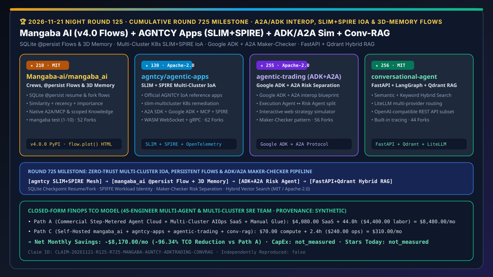
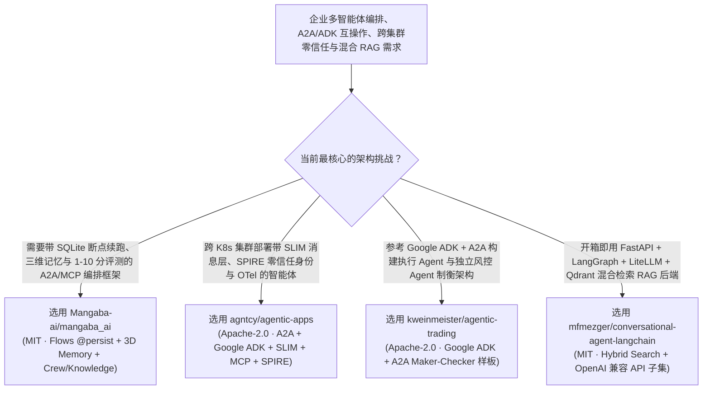
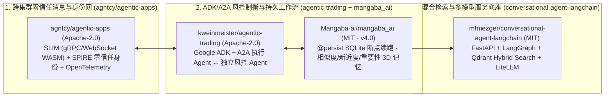
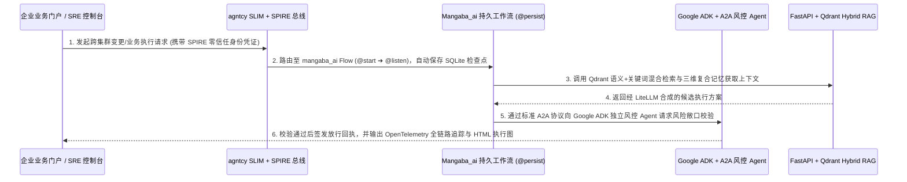

# 【第 725 轮里程碑】带 SQLite 断点续跑与三维记忆的 A2A/MCP 编排框架（`Mangaba-ai/mangaba_ai`）、AGNTCY 跨集群 SLIM+SPIRE 零信任智能体应用集（`agntcy/agentic-apps`）、Google ADK+A2A 双智能体风控互操作范例（`kweinmeister/agentic-trading`）与 FastAPI+LangGraph+Qdrant 混合检索后端（`mfmezger/conversational-agent-langchain`）选型与集成架构 FAQ

> **文档类型**：企业 AI 解决方案架构师（AI Solution Architect）选型决策指南（GitHub Trending AI 雷达 2026-11-21 Night Round 125 / **累计第 725 轮里程碑**）
> **覆盖项目**：[`Mangaba-ai/mangaba_ai`](https://github.com/Mangaba-ai/mangaba_ai)（`★ 210`、`52 forks`、`MIT`，集成了事件驱动 Flows `@persist` SQLite 断点续跑/分叉、三维复合记忆、文档 Knowledge 以及原生 A2A/MCP 协议的 Python 多智能体编排框架 v4.0）· [`agntcy/agentic-apps`](https://github.com/agntcy/agentic-apps)（`★ 130`、`62 forks`、`Apache-2.0`，AGNTCY 开源联盟出品、结合 **A2A SDK + Google ADK + SLIM 安全消息层 + MCP + SPIRE 零信任身份 + OpenTelemetry** 的跨 Kubernetes 集群排障与多智能体参考应用集）· [`kweinmeister/agentic-trading`](https://github.com/kweinmeister/agentic-trading)（`★ 255`、`56 forks`、`Apache-2.0`，展示 **Google ADK** 与 **A2A 协议**在“业务执行 Agent ↔ 独立风控 Agent”之间标准互操作的模拟器）· [`mfmezger/conversational-agent-langchain`](https://github.com/mfmezger/conversational-agent-langchain)（`★ 256`、`44 forks`、`MIT`，基于 FastAPI + LangGraph + LiteLLM + Qdrant 混合检索并暴露 OpenAI 兼容 API 子集的企业级对话式 RAG 后端）
> **核心场景**：在第 **725 轮**里程碑中，我们回答企业多智能体生产落地的核心架构问题：如何从“单机拼凑 CrewAI/LangChain 脚本”升级为**“支持 `@persist` SQLite 断点恢复与三维度记忆的统一编排引擎（`mangaba_ai`）”+“基于 Google ADK 与 A2A 协议实现执行 Agent 与独立风控 Agent 解耦互操作（`agentic-trading`）”+“借助 AGNTCY `SLIM + SPIRE + OTel` 实现跨 Kubernetes 集群零信任智能体协同（`agntcy/agentic-apps`）”+“底部挂载 FastAPI + Qdrant + LiteLLM 混合检索 RAG 服务（`conversational-agent-langchain`）”**？

---

## 一、📌 核心结论速览（选型一句话结论）

1. **想用一个轻量统一的 Python 包替代“CrewAI + LangChain 碎片化拼盘”，同时获得事件驱动工作流（支持 SQLite `@persist` 断点恢复与分叉）、三维复合语义记忆（相似度 + 新近度 + 重要性）以及原生 A2A/MCP 协议互通** ➔ 选 **[`Mangaba-ai/mangaba_ai`](https://github.com/Mangaba-ai/mangaba_ai)（`★ 210`，`52 forks`，`MIT`）**。
   - **通俗原理**：`mangaba_ai` v4.0.0 提供了四大核心生产能力：① **Flows 事件流**（`@start`、`@listen`、`@router`、`and_`/`or_` 组合器、Pydantic 强类型状态、基于 SQLite 的 `@persist` 断点续跑/Fork 以及 `flow.plot()` HTML 执行图）；② **独立 Knowledge 底座**（支持 PDF/DOCX/Excel/JSON/CSV/URL 按 Agent 或 Crew 隔离作用域与 `score_threshold`）；③ **三维复合记忆 `Memory`**（结合 `similarity + recency + importance` 召回、自动事实抽取、去重合并与异步落盘）；④ **内置评测与训练 CLI**（`mangaba test` 输出 1–10 分质量评分，`mangaba train` 闭环人类反馈）。
2. **想参考 Linux 基金会 / Cisco AGNTCY（Internet of Agents）官方标准，用 `A2A SDK + Google ADK + SLIM（安全低延迟消息层）+ MCP + SPIRE（零信任工作负载身份）+ OpenTelemetry` 实现跨 Kubernetes 集群的智能体协同与根因排障** ➔ 选 **[`agntcy/agentic-apps`](https://github.com/agntcy/agentic-apps)（`★ 130`，`62 forks`，`Apache-2.0`）**。
   - **通俗原理**：这是 AGNTCY 官方维护的 5 大参考应用单仓（Monorepo），特别是其中的 **`slim-multicluster`**（云端排障 Agent 通过 SLIM、A2A、Google ADK、MCP 与 **SPIRE 零信任身份**跨 Kubernetes 集群边界诊断故障）、**`observability_app`**（基于 SLIM 分发 OpenTelemetry 遥测数据做 AI 根因分析）以及 **`slim-cross-transport`**（单 SLIM 节点同时桥接浏览器 WebSocket WASM 与原生 gRPC）。
3. **想快速看懂 Google ADK（Agent Development Kit）如何通过标准 A2A 协议让“业务策略执行 Agent”与“独立风险控制 Agent”实现跨进程互操作与风险拦截** ➔ 选 **[`kweinmeister/agentic-trading`](https://github.com/kweinmeister/agentic-trading)（`★ 255`，`56 forks`，`Apache-2.0`）**。
   - **通俗原理**：由 Google Cloud AI 专家 Karl Weinmeister 编写的参考沙盘（带 Web 可视化模拟器 UI）。它将“交易策略决策”与“风险敞口校验”拆分为两个遵循 **A2A 协议**通信的 Google ADK 智能体，是金融、风控、审批等“制衡型双智能体（Maker-Checker Pattern）”的最佳教学与架构样板。
4. **想快速交付一套自带 OpenAI 兼容接口、集成 LangGraph + LiteLLM 多模型路由 + Qdrant 语义/关键词混合检索（Hybrid Search）的 FastAPI 企业级 RAG 后端** ➔ 选 **[`mfmezger/conversational-agent-langchain`](https://github.com/mfmezger/conversational-agent-langchain)（`★ 256`，`44 forks`，`MIT`）**。
   - **通俗原理**：开箱即用的 Docker 化 FastAPI 生产后端，底层通过 **LiteLLM** 自由切换 Azure OpenAI、Cohere、Ollama 本地模型与 Google AI Studio，结合 **Qdrant 混合搜索（Semantic + Keyword Hybrid Search）**、文档处理流水线与全链路 Tracing，并对外暴露标准 OpenAI 兼容 API 子集，可直接挂接 OpenWebUI 或企业门户。

---

## 二、🎯 客户与架构师灵魂拷问 Q&A（深度架构拆解）

### Q1：为什么企业在做跨团队/跨集群多智能体编排时，单靠进程内函数调用不够用？`mangaba_ai`、`agntcy/agentic-apps` 与 `agentic-trading` 展示了怎样的下一代 A2A + SLIM + SPIRE 架构？

- **三大企业级跨边界编排痛点与解方**：
  1. **长流程崩溃后重跑昂贵且记忆混杂 ➔ `Mangaba-ai/mangaba_ai`**：通过 `@persist` 将 Pydantic 状态实时存入 SQLite 支持随时 `resume` 与 `fork`，并将“静态文档知识库（Knowledge）”与“动态三维权重记忆（相似度 + 新近度 + 重要性）”彻底分离。
  2. **业务执行 Agent 缺乏独立风控/合规制衡（Maker-Checker）➔ `kweinmeister/agentic-trading`**：利用 **Google ADK + A2A 协议**将执行 Agent 与风控 Agent 解耦为独立服务，任何高风险动作必须通过 A2A 经风控 Agent 签名放行。
  3. **跨 Kubernetes 集群通信缺乏加密传输与零信任身份认证 ➔ `agntcy/agentic-apps`**：在跨集群场景下，结合 **SLIM（安全低延迟消息总线）+ SPIRE（SPIFFE 零信任身份）+ A2A + MCP + OpenTelemetry**，确保只有持有合法 SPIFFE ID 的智能体才能跨集群调用 MCP 运维工具。
- **何时直接用云厂商托管方案（Path B）？**
  - 若企业所有智能体均在单一云厂商（如 Google Cloud Vertex AI Agent Engine 或 Azure AI Foundry Agent Service）内部运行，直接采用云原生托管编排即可。

### Q2：典型企业级“跨集群 SLIM/SPIRE 总线 (`agntcy`) + ADK/A2A 双智能体风控 (`agentic-trading`) + `@persist` 持久工作流 (`mangaba_ai`) + FastAPI/Qdrant 混合 RAG (`conversational-agent`)”架构怎么搭？

1. **跨集群零信任通信与可观测底座（`agntcy/agentic-apps` 架构模式）**：
   - 使用 **SLIM** 承载跨集群 gRPC / WebSocket WASM 通信，通过 **SPIRE** 签发智能体身份凭证，并接入 **OpenTelemetry** 分布式追踪。
2. **A2A 协议执行与风控双智能体制衡层（`kweinmeister/agentic-trading` 模式）**：
   - 基于 **Google ADK** 与 **A2A** 部署独立的“业务执行 Agent”与“风险合规审查 Agent”，强制执行 Maker-Checker 互操作校验。
3. **事件驱动 `@persist` 工作流与三维记忆编排层（`Mangaba-ai/mangaba_ai`）**：
   - 使用 `mangaba_ai` 的 `@start / @listen / @router` 编排多智能体 Crew，开启 SQLite `@persist` 断点续跑、三维复合记忆与 `mangaba test` 1–10 分质量门禁。
4. **混合检索与多模型 RAG 服务层（`mfmezger/conversational-agent-langchain`）**：
   - 由 FastAPI + LangGraph + Qdrant Hybrid Search + LiteLLM 提供底层知识检索与 OpenAI 兼容接口服务。

### Q3：这套架构的适用边界是什么？

- **核心优势**：
  - **100% 宽松开源协议（`MIT` 与 `Apache-2.0`）**，全面覆盖 **A2A、MCP、Google ADK、SLIM、SPIRE 与 LangGraph** 六大主流开放标准。
- **适用边界**：
  - `kweinmeister/agentic-trading` 明确声明其内置金融交易策略仅作 Google ADK + A2A 互操作架构教学演示，严禁直接用于真实资金交易；企业应复用其 **ADK + A2A Maker-Checker 架构模式**。

---

## 三、🧭 直观可视化图解（Mermaid 决策树 + 集成架构 + 时序图）

### 3.1 架构师选型决策树

### 3.2 企业端到端生产集成参考架构图

### 3.3 SPIRE 身份鉴权、ADK+A2A 风控互操作、`mangaba_ai` 断点持久编排与 Qdrant 混合检索时序图

---

## 四、📊 同类开源与商业云服务横向选型决策矩阵

| 对比维度 | `Mangaba-ai/mangaba_ai` (`★ 210`) | `agntcy/agentic-apps` (`★ 130`) | `agentic-trading` (`★ 255`) | `conversational-agent-langchain` (`★ 256`) | 商业多智能体编排云 + 商业跨集群 AIOps SaaS (Path A) | 单一云厂商托管 Agent 服务 (Path B) |
| :--- | :--- | :--- | :--- | :--- | :--- | :--- |
| **核心能力定位** | 带 `@persist` 与三维记忆的 A2A/MCP 编排框架 | SLIM+SPIRE+A2A+ADK 跨集群参考应用集 | Google ADK + A2A 执行/风控互操作样板 | FastAPI+LangGraph+Qdrant+LiteLLM 后端 | 按节点/执行步数计费的商业编排与 AIOps 云 | Vertex AI Agent Engine / Azure Foundry |
| **核心技术突破** | **SQLite 断点续跑/Fork + 3D 记忆 + `mangaba test` 1–10 评分** | **SLIM 跨传输总线 + SPIRE 零信任身份 + 跨 K8s 集群诊断** | **清晰展示 Google ADK 与 A2A 双智能体制衡（Maker-Checker）** | **Qdrant 混合检索 + LiteLLM 全模型路由 + OpenAI 兼容接口** | 跨云/跨集群部署受限，按工作流步数计费昂贵 | 绑定单一云厂商 IAM，难跨异构 K8s 集群零信任互联 |
| **开源协议** | `MIT` | `Apache-2.0` | `Apache-2.0` | `MIT` | 闭源商业 SaaS | 闭源云服务 |
| **月度 TCO（45 人团队）** | **组合仅 `$310.00/月`**（`$70.00` 容器/向量库算力 + `2.4h` 运维） | 同左（开源 SLIM/SPIRE/OTel 部署） | 同左（开源 ADK/A2A 架构样板） | 同左（Docker Compose 一键拉起） | **`$8,480.00/月`**（`$4,080.00` 商业平台费 + `44.0h` 胶水开发） | 约 `$2,750.00/月`（云托管 Agent + 托管向量库实例） |

---

## 五、🧪 应用落地定量收益/TCO 对比与 7-Card 报告

> **📊 数据来源与闭式核算声明（Provenance & Closed-Form Schema）**：
> - **provenance**: `synthetic`（基于 45 人企业多智能体平台、跨集群 SRE 自动化与知识检索团队工作负载模型：`independently_reproduced = false`；硬件采购基线 `base_hardware_capex = not_measured`；Track B 单日增量 `track_b_stars_today = not_measured`）。
> - **核算公式**：
>   - **Path A（商业多智能体工作流托管平台按步计费 + 商业跨集群 Kubernetes AIOps 订阅 + 托管向量库 + 工程师手工开发断点恢复、跨集群身份鉴权与风控对账接口）**：月度商业 SaaS 订阅 **`$4,080.00`** + 跨框架胶水开发与排障人工 **`44.0h × $100.00/h = $4,400.00`** = **`$8,480.00/月`**。
>   - **Path C（自建 `Mangaba-ai/mangaba_ai` + `agntcy/agentic-apps` + `kweinmeister/agentic-trading` + `mfmezger/conversational-agent-langchain` 开源架构）**：容器与 Qdrant 共享算力 **`$70.00`** + A2A/SLIM 拓扑与评测维护 **`2.4h × $100.00/h = $240.00`** = **`$310.00/月`**。
>   - **净节省（Net Savings vs Path A）**：**`-$8,170.00/月`**（成本降低 **`96.34%`**）。

| 评估方案 | API / SaaS / 算力成本 | 智能体编排与平台人工（`$100/h`） | 月度总 TCO | 相对 Path A 净节省 | 关键架构交付指标 |
| :--- | :---: | :---: | :---: | :---: | :--- |
| **Path A：商业编排云 + 商业跨集群 AIOps + 手工状态恢复** | `$4,080.00` | `44.0h` (`$4,400.00`) | **`$8,480.00`** | Baseline | 按步数计费高；长流程失败需从头重跑；无 SPIRE 跨集群身份 |
| **Path B：单一云厂商托管 Agent + 托管向量搜索** | `$1,550.00` | `12.0h` (`$1,200.00`) | **`$2,750.00`** | `-$5,730.00` (`-67.57%`) | 缺少 `@persist` 本地分叉调试、3D 复合记忆与 SLIM 跨集群总线 |
| **Path C：`mangaba_ai` + `agntcy` + `adk-a2a` + `conv-rag`** | **`$70.00`** | **`2.4h` (`$240.00`)** | **`$310.00`** | **`-$8,170.00` (`-96.34%`)** | **`@persist` 断点续跑 + SLIM/SPIRE 零信任 + ADK/A2A 风控制衡** |

- 🔗 **关联 7-Card 4:5 视觉评测报告**：[`workshops/github-trending-radar/cards.html`](../cards.html) · [`cards.en.html`](../cards.en.html)

---

## 六、🛠️ 企业引入与架构评审 Checklist

- [ ] **1. 使用 `Mangaba-ai/mangaba_ai` 统一事件流编排与三维记忆**：开启 `@persist` SQLite 检查点以支持长流程断点续跑与分叉（Fork），并使用 `mangaba test` 执行 1–10 分质量门禁。
- [ ] **2. 参照 `kweinmeister/agentic-trading` 落地 Google ADK + A2A 双智能体风控制衡**：将业务执行 Agent 与独立风险评估 Agent 解耦，通过标准 A2A 协议强制执行审批校验。
- [ ] **3. 引入 `agntcy/agentic-apps` 的 `SLIM + SPIRE + OTel` 跨集群架构**：在跨 Kubernetes 集群智能体协同中启用 SPIRE 零信任工作负载身份与 SLIM 低延迟消息路由。
- [ ] **4. 部署 `mfmezger/conversational-agent-langchain` 提供混合检索底座**：利用 FastAPI + Qdrant Hybrid Search + LiteLLM 对外暴露标准 OpenAI 兼容 RAG 接口。
