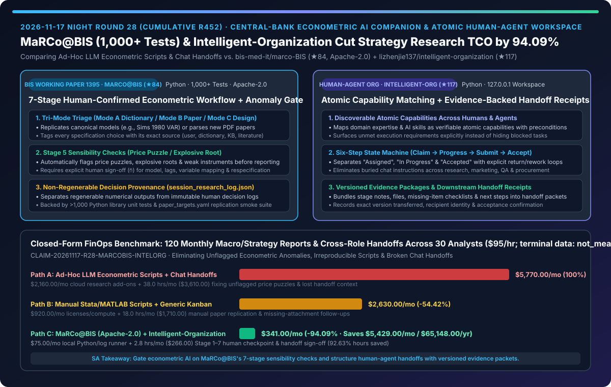
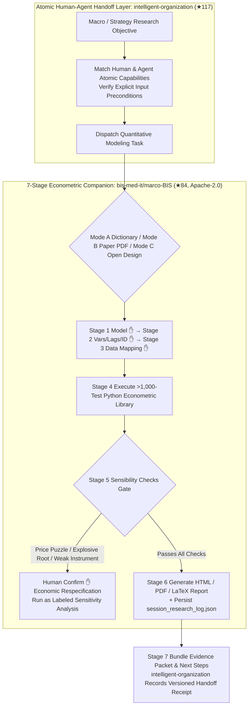

# Central-Bank 7-Stage Macroeconometric AI Companion (`bis-med-it/marco-BIS`) & Atomic Human-Agent Handoff Workspace (`lizhenjie137/intelligent-organization`) Selection FAQ

> **Document Type**: Enterprise AI Solution Architect Practical Selection Guide (Standard 6-Section FAQ)  
> **Shift & Round**: 2026-11-17 Night Round 28 (Cumulative Round 452)  
> **Tracked Repositories**:
> - **`bis-med-it/marco-BIS`** (`★ 84`, Python 3.10+ / 1,000+ Unit Tests / `Apache-2.0`, Official Bank for International Settlements Working Paper No. 1395 Companion): Agentic-AI skill framework, 1,000+-test Python library, and canonical replication dictionary that guides Claude Code through a **7-stage human-confirmed (`✋`) macroeconometric workflow** with built-in Stage 5 sensibility checks (catching price puzzles, explosive roots, and weak instruments)
> - **`lizhenjie137/intelligent-organization`** (`★ 117`, Python / Local `127.0.0.1` Multi-Account Collaborative Workspace): Human–agent organizational workspace modeling human domain expertise and AI skills as discoverable atomic capabilities across a 6-step lifecycle (`Shared Goal → Capability Assignment → Visible Progress → Evidence-Backed Handoff Packet → Independent Acceptance → Experience Archive`)  
> **Audit Claim ID**: `CLAIM-20261117-R28-MARCOBIS-INTELORG` (underlying Bloomberg/Refinitiv market terminal subscriptions marked `not_measured`)

---

## 📌 1. Executive Summary

1. **Why Enterprise Financial Research, Corporate Strategy, and Policy Teams Distrust Unconstrained LLM Quantitative Scripts and Ad-Hoc Chat Handoffs**:
   - **The Silent Econometric Hallucination Risk**: Asking an unconstrained coding agent to run a VAR, local projection, or panel regression in Python/R leads to silent specification choices (arbitrary lag lengths, unverified variable mappings, or dropped observations). Worse, when the estimation exhibits textbook econometric pathologies—such as a **price puzzle** (monetary tightening appearing to raise inflation), an **explosive root**, or a **weak instrument**—a generic agent blindly formats the flawed output into executive charts.
   - **The Cross-Role Chat Handoff Breakdown**: Quantitative research spans data engineers, econometricians, AI agents, domain reviewers, and executive editors. When handoffs happen via scattered chat messages (*"done, files are in the folder"*), downstream reviewers lack the specification provenance, unresolved caveats, and versioned evidence needed to verify the conclusions.
   - **The Solution Architect Stack (`marco-BIS` Apache-2.0 + `intelligent-organization`)**: Deploy the Bank for International Settlements' **`bis-med-it/marco-BIS`** (`Apache-2.0`, >1,000 tests) to enforce a **7-stage human-confirmed (`✋`) workflow** across Mode A (Dictionary Execution), Mode B (Paper PDF Replication), and Mode C (Open Research Design), backed by Stage 5 sensibility gates and immutable `session_research_log.json` provenance; pair it with **`lizhenjie137/intelligent-organization`** to route tasks by atomic human/agent capability and mandate versioned evidence handoff packets.
2. **Closed-Form FinOps Impact (120 Monthly Macro/Strategy Research Reports & Cross-Role Deliverable Handoffs Across 30 Analysts at `$95.00/hr`)**:
   - Transitioning from **Path A (Unconstrained LLM Econometric Scripts + Unstructured Chat/Folder Handoffs at `$5,770.00/mo`)** to **Path C (`MaRCo@BIS` Apache-2.0 + `intelligent-organization` Workspace at `$341.00/mo`)** saves **`$5,429.00/mo` (`-94.09%`, or `$65,148.00/yr`)** while cutting flawed-model reruns, paper replication debugging, and handoff rework from `38.0 hrs/mo` to `2.8 hrs/mo` (**`92.63%` reduction**).

---

## 💬 2. Core Architectural Q&A (Q1–Q3)

### Q1: How does the Bank for International Settlements' `bis-med-it/marco-BIS` (BIS Working Paper No. 1395) enforce central-bank rigor on AI coding agents?
- **Plain-Language Definition**: `MaRCo@BIS` (`Apache-2.0`) is a **three-part econometric governance framework** consisting of Markdown domain skills (`skills/`), a reference Python econometric library covered by **more than 1,000 unit tests** (`scripts/lib/`), and a canonical replication dictionary (`skills/model-dictionary/entries/`) validated against `paper_targets.yaml`.
- **Three Non-Negotiable Research Guardrails**:
  1. **Tri-Mode Triage with Explicit Source Attribution**:
     - **Mode A (Dictionary Execution)**: Replicates canonical models (e.g., *"Replicate the Sims (1980) six-variable VAR using FRED data"*) against verified targets;
     - **Mode B (Paper Submission)**: Parses a new paper PDF/URL into a draft dictionary entry for human verification before execution;
     - **Mode C (Research Design)**: Designs specifications from economic theory for open questions, flagging the exact source (**user**, **dictionary entry**, **knowledge base**, or **literature**) of every choice.
  2. **7-Stage Human-in-the-Loop Checkpoints (`✋`) & Stage 5 Sensibility Gate**:
     - Requires explicit human confirmation at **Stage 1 (Model Selection `✋`)**, **Stage 2 (Variables, Lags, Priors & Identification `✋`)**, and **Stage 3 (Data Variable Mapping `✋`)** before running **Stage 4 (Estimation)**;
     - **Stage 5 (Sensibility Checks)** automatically inspects results for **price puzzles, explosive roots, and weak instruments**. Technical code fixes auto-retry up to 5 times, but any **economic respecification requires human `✋` confirmation** and is explicitly labeled as a sensitivity run.
  3. **Separation of Regenerable Outputs vs. Immutable Decision Logs**: Numerical outputs (`report.html`, `numerical_results.json`) can be regenerated from `config.yaml` and fixed seeds at any time, whereas conversational decisions and gate approvals are preserved in **`session_research_log.json` and `research_log.md`**. Mid-analysis changes (*"add commodity prices"*) re-run only downstream affected stages.

### Q2: How does `lizhenjie137/intelligent-organization` eliminate dropped context between human specialists and AI agents?
- **From Chat Pings to Structured Atomic-Capability Handoffs**:
  1. **Atomic Capability Registry with Explicit Preconditions**: Models both human specialists and AI agents by their verifiable atomic capabilities and required input preconditions—surfacing missing prerequisites upfront rather than letting tasks stall silently.
  2. **Distinct Lifecycle States**: Separates `Assigned`, `In Progress`, `Submitted`, `Accepted`, and `Returned for Rework` across a 6-step collaborative loop.
  3. **Versioned Evidence Handoff Packets**: Instead of passing a bare *"done"* message, upstream contributors hand off a structured packet containing stage notes, data/chart artifacts, pending-item checklists, and next-step recommendations—recording the exact version transferred and recipient sign-off.

### Q3: How should an AI Solution Architect combine `MaRCo@BIS` and `intelligent-organization`?
- **Workflow & Handoff Orchestration (`intelligent-organization`)**: Decompose quarterly macro/strategy initiatives into atomic tasks across data curation, econometric estimation, domain review, and executive brief authoring.
- **Rigorous Estimation & Replication Engine (`MaRCo@BIS`)**: Execute all quantitative modeling inside `MaRCo@BIS`'s 7-stage loop and attach `report.html`, `numerical_results.json`, and the immutable `session_research_log.md` directly into the `intelligent-organization` handoff packet for downstream review.

---

## 🧭 3. End-to-End Reference Architecture & Decision Tree (Mermaid)

---

## 📊 4. Peer Solution Comparison Matrix (Decision Matrix)

| Evaluation Dimension | Option A: Unconstrained LLM Econometric Scripts + Chat Handoffs | Option B: Manual Stata/MATLAB Scripts + Generic Kanban | **Option C (Recommended): `MaRCo@BIS` (Apache-2.0) + `intelligent-organization`** |
| :--- | :--- | :--- | :--- |
| **Specification Provenance & Human Gate Control** | ❌ Silent LLM lag/variable choices with zero source attribution | ✅ Full manual control, but slow multi-day paper replication | ✅ **7-stage `✋` human checkpoints with every choice tagged to user/dictionary/literature** |
| **Automated Econometric Anomaly Detection** | ❌ Blindly reports models with price puzzles or explosive roots | ⚠️ Relies on manual inspection across dozens of diagnostic tables | ✅ **Stage 5 auto-flags price puzzles, explosive roots & weak instruments before reporting** |
| **Statistical Library Testing & Replication Truth** | ❌ Ad-hoc generated scripts frequently miscalculate standard errors | ✅ Reliable proprietary packages, but high per-seat licensing costs | ✅ **Apache-2.0 Python library with `>1,000` unit tests + `paper_targets.yaml` smoke suite** |
| **Cross-Role Deliverable & Evidence Handoff** | ❌ Scattered chat links and missing decision logs | ⚠️ Kanban tracks status labels only, not evidence completeness | ✅ **Atomic capability matching + versioned handoff packets with `session_research_log.json`** |
| **Monthly TCO (120 Research Reports/Mo)** | **`$5,770.00 / mo`** (`$2,160` add-ons/compute + `38.0 hrs` rework) | **`$2,630.00 / mo`** (`$920` licenses + `18.0 hrs` manual coding/chasing) | **`$341.00 / mo`** (**`-94.09%` savings**; `$75` local runner + `2.8 hrs` checkpoint sign-off) |

---

## 🧮 5. 7-Card Quantitative Insights & Closed-Form FinOps (`CLAIM-20261117-R28-MARCOBIS-INTELORG`)

> **Scope & Boundary Declaration**: Evaluated for a 30-analyst macroeconomic, financial strategy, and policy research division producing **120 monthly quantitative research reports and cross-functional handoffs** at a blended rate of `$95.00/hr` (underlying Bloomberg/Refinitiv terminal subscriptions marked `not_measured`):

$$\text{Total Monthly TCO} = \text{Econometric Tooling Spend} + (\text{Model Rework, Replication \& Handoff Hours} \times \$95.00)$$

| Cost Component | Path A: Unconstrained LLM Scripts + Chat Handoffs | Path B: Manual Stata/MATLAB + Generic Kanban | **Path C: `MaRCo@BIS` (Apache-2.0) + `intelligent-organization`** |
| :--- | :---: | :---: | :---: |
| **Monthly Econometric Add-Ons / Local Runner Spend** | `$2,160.00` | `$920.00` | **`$75.00`** |
| **Monthly Anomaly Rework, Replication & Handoff Hours** | `38.0 hrs` | `18.0 hrs` | **`2.8 hrs`** (**`92.63%` reduction**) |
| **Monthly Analyst & Architect Labor (`@ $95.00/hr`)** | `$3,610.00` | `$1,710.00` | **`$266.00`** |
| **Total Monthly TCO** | **`$5,770.00`** | **`$2,630.00`** (`-54.42%`) | **`$341.00`** (**`-94.09%`**) |
| **Net Savings vs. Path A (Monthly / Annual)** | Baseline (`$0.00`) | `$3,140.00 / mo` (`$37,680/yr`) | **`$5,429.00 / mo` (`$65,148.00 / yr`)** |

---

## ✅ 6. Solution Architect Action Checklist

- [ ] **Step 1 — Deploy `bis-med-it/marco-BIS` & Run the 1,000+-Test Suite**: Install `pip install -r requirements-reproduction.txt && pip install pytest`, run `python -m pytest tests -q` to verify the econometric library, and stage FRED-MD / FRED-QD panels via `UPDATE.md`.
- [ ] **Step 2 — Enforce All 7 `✋` Checkpoints & Archive `session_research_log.json`**: Require analysts using Mode A/B/C in Claude Code to confirm Stages 1, 2, 3, and 5 explicitly and archive the non-regenerable `session_research_log.json` and `research_log.md` alongside every report.
- [ ] **Step 3 — Register Human & Agent Atomic Capabilities in `intelligent-organization`**: Map team economists, data engineers, domain reviewers, and `MaRCo@BIS` agents with explicit input preconditions in the workspace.
- [ ] **Step 4 — Mandate Evidence-Backed Handoff Packets**: Require every modeling handoff to bundle `report.html`, `numerical_results.json`, Stage 5 sensibility verdicts, and `session_research_log.md` before downstream acceptance.
