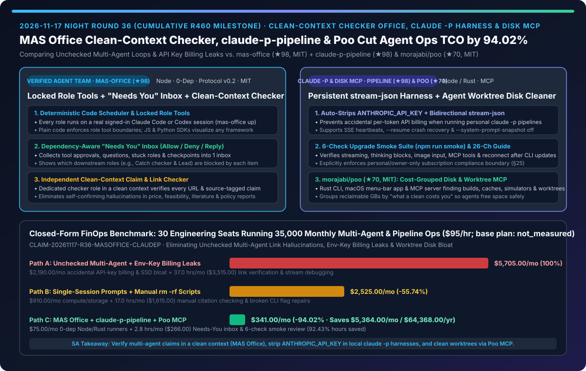
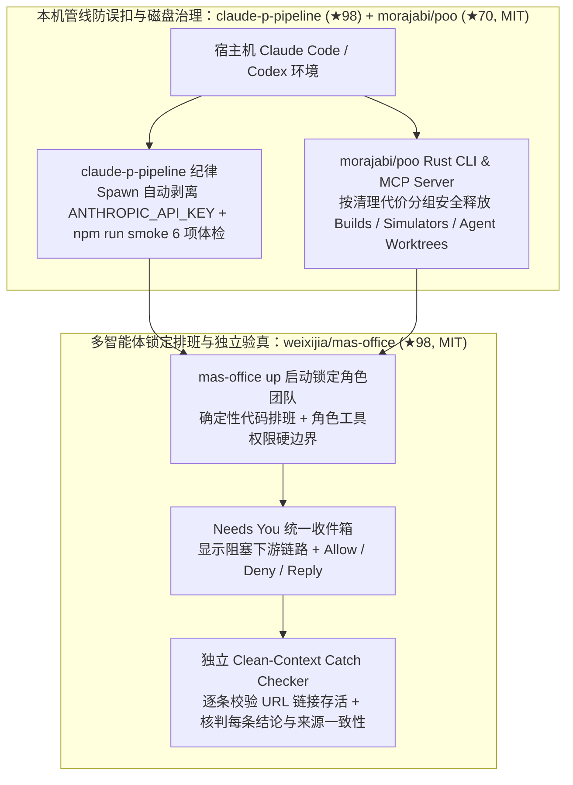

# 独立纯净上下文核查多智能体办公室（`weixijia/mas-office`）与 `claude -p` 常驻流式管线及磁盘清理 MCP（`claude-p-pipeline` & `morajabi/poo`）架构选型 FAQ

> **文档类型**：AI Solution Architect（AI 解决方案架构师）实战选型指南（六段式标准 FAQ）  
> **所属轮次**：2026-11-17 Night Round 36（Cumulative Round 460 Milestone）  
> **追踪目标**：
> - **`weixijia/mas-office`**（`★ 98`，JavaScript / 零依赖 Protocol `v0.2` 与 `v0.3.0` 引擎，`MIT`）：运行在本机真实 Claude Code 与 Codex 会话上的可视化等距多智能体办公室，通过纯代码硬性锁定每个角色的工具权限、在单一 **`"Needs you"` 阻塞收件箱**集中处理工具授权与提问，并强制由拥有**全新干净上下文（Clean Context）的独立 Checker 角色**逐条核验每条结论的来源链接与事实依据
> - **`Saekisui/claude-p-pipeline`**（`★ 98`，JavaScript / 26 章实战指南 + 零依赖 `mini-chat` 骨架 + 6 项 `npm run smoke` 冒烟测试，`AGPL-3.0`）& **`morajabi/poo`**（`★ 70`，Rust / macOS 菜单栏 + CLI + MCP Server，`MIT`）：将个人 `claude -p` 封装为带自动剥离 `ANTHROPIC_API_KEY` 防误扣费、双向 `stream-json`、`--resume` 断线续接的本地常驻管线，配合按“清理代价”分级安全释放构建缓存、模拟器与残留 Agent Worktree 磁盘空间的 `poo` MCP  
> **计量审计 ID**：`CLAIM-20261117-R36-MASOFFICE-CLAUDEP`（开发者个人 Claude Pro/Max 基础订阅费标记为 `not_measured`）

---

## 📌 一、核心结论速览（Executive Summary）

1. **为什么工程团队在本地编排多智能体调研团队（Multi-Agent Research）与长驻 `claude -p` 自动化管线时，常踩中“负责找资料的 Agent 自己编造死链还自己宣布核验通过”、“环境变量里残留 `ANTHROPIC_API_KEY` 导致本想走包月订阅却偷偷烧掉几百美金按量账单”以及“编译缓存与残留 Agent Worktree 悄悄吃光 Mac 磁盘”三大深坑？**
   - **多智能体“同窗自证”幻觉痛点**：在可行性论证、比价调研或政策法规检索中，如果让搜索 Agent 在同一个被冗长网页污染的上下文里自己检查自己的结论，它会顺着先前的幻觉把 `404` 链接或断章取义的数字一路放行给主控 Lead Agent。
   - **`claude -p` 隐形按量计费与版本升级断流痛点**：很多工程师不知道——只要终端环境变量里存在 `ANTHROPIC_API_KEY`，`claude -p` 就会**静默绕过你已付费的 Pro/Max 包月订阅，直接走昂贵的按 Token API 计费**！此外，Claude Code 频繁更新命令行参数（如 `--system-prompt-snapshot off` 或思考链格式），没有自动化冒烟测试很容易在升级后断流。
   - **架构师黄金组合（`mas-office` MIT + `claude-p-pipeline` + `morajabi/poo` MIT）**：在多角色调研与决策协同层部署零依赖的 **`weixijia/mas-office`**（锁定各角色工具白名单，将阻塞下游的审批汇总至 `"Needs you"` 收件箱，并强制由**独立 Clean-Context Checker 角色**逐条校验链接存活与来源一致性）；在个人本地常驻管线层参考 **`Saekisui/claude-p-pipeline`**（Spawn 子进程时自动剔除 `ANTHROPIC_API_KEY` 防止误扣按量费，每次升级 Claude Code 先跑 `npm run smoke` 6 项冒烟测试）；在宿主机存储治理层挂载 **`morajabi/poo`**（Rust 编写的 macOS 菜单栏/CLI/MCP，按“清理代价”分组安全回收构建产物、模拟器与废弃 Agent Worktree）。
2. **闭式 FinOps 量化收益（30 个研发与技术调研席位、每月执行 35,000 次多智能体可行性调研、本地常驻管线交互与开发机磁盘空间治理，综合时薪 `$95.00/hr`）**：
   - 从 **Path A（无独立 Checker 的多 Agent 调研 + 环境变量 `ANTHROPIC_API_KEY` 误触发按量计费与磁盘爆满排障，`$5,705.00/月`）** 切换至 **Path C（`mas-office` 干净上下文核查 + `claude-p-pipeline` 防误扣费冒烟管线 + `poo` 磁盘清理 MCP，`$341.00/月`）**，每月净省 **`$5,364.00/月`（降幅 `-94.02%`，年化节省 `$64,368.00/年`）**，死链人工复核、CLI 升级断流抢修与手工清盘工时从 `37.0 小时/月` 降至 `2.8 小时/月`（节省 **`92.43%`**）。

---

## 💬 二、灵魂拷问 Q1–Q3（大白话拆解应用场景与架构本质）

### Q1：`weixijia/mas-office` 是如何把多智能体从“黑盒群聊”变成“权限锁死、阻塞可视、且由独立干净上下文 Checker 逐条验真”的透明办公室的？
- **大白话本质定义**：`MAS Office`（`MIT`，零依赖，Protocol `v0.2` / Engine `v0.3.0`）是一座**“每个工位坐着一个真实的本机 Claude Code 或 Codex 会话、由确定性代码排班并强制配备独立质检员的可视化多智能体办公室”**。
- **三大核心架构突破**：
  1. **角色工具锁定 + 纯代码确定性排班（`mas-office up`）**：你先设计团队角色（如 `Retail finder`、`Market finder`、`Catch checker`、`Lead`）并锁定设计（Lock Design）；由确定性的普通代码负责调度流程并强制执行每个角色的工具边界（而非让大模型自由决定调什么工具），且提供 JS 与 Python SDK 可将任意外部多智能体框架接入同一等距办公室视图。
  2. **带阻塞链路提示的 `"Needs you"` 统一收件箱**：所有工位产生的工具调用审批、澄清提问、卡死告警与阶段检查点全部汇总进右侧 `"Needs you"` 收件箱——每条审批请求都会明确标注**“当前正阻塞着哪些下游角色（如 `holds up the Catch checker and the Lead`）”**，支持一键 `Allow once`、`Deny` 或直接打字回复。
  3. **独立干净上下文质检官（Clean-Context Checker）**：报告交付前，所有的事实声明（Claims）必须打上来源标签，先过一轮确定性 URL 链接有效性检查，再交由**拥有全新干净上下文（未被前面几万字搜索过程污染）的独立 Checker 角色**逐条核判真伪。

### Q2：`Saekisui/claude-p-pipeline` 揭示了哪些 `claude -p` 生产级隐藏细节？`morajabi/poo` 又是如何帮 Agent 安全清理百 GB 磁盘垃圾的？
- **`Saekisui/claude-p-pipeline`（26 章生产级 `claude -p` 管线解剖 + 6 项升级冒烟测试）**：
  1. **第一铁律：Spawn 时强制剥离 `ANTHROPIC_API_KEY`**：教程与 `mini-chat` 骨架在拉起子进程时自动删除环境变量中的 `ANTHROPIC_API_KEY`（终端测试用 `env -u ANTHROPIC_API_KEY claude ...`），彻底杜绝“以为在用包月订阅、实则暗中走按量 API 扣费”的财务惨剧；
  2. **一窗一常驻进程 + 双向 `stream-json` + `--resume` 断线对账**：支持关掉浏览器网页后后台继续生成、人格档热更新（配合 `--system-prompt-snapshot off`）、按窗口 ID 挂载 MCP 以及断流后通过 `--resume` 无缝续接；
  3. **`npm run smoke` 六项版本升级门禁**：每次升级 Claude Code CLI 后，自动用低成本 `haiku` 在独立端口跑一遍 6 项冒烟测试（流式、思考链、发图、MCP、断线续接、自动清理），确认隐藏 Flag 未失效再投入使用（⚠️ **合规红线**：仅限个人/本机自有订阅自用，严禁包装成对外部多用户开放的商业服务）。
- **`morajabi/poo`（按“清理代价”分级的开发机与 Agent Worktree 磁盘清理 MCP，`MIT`）**：
  - 提供 Apple 公证签名的 macOS 菜单栏 App、跨平台 Rust CLI（macOS/Linux）以及配套 **MCP Server 与 Agent Skill**；
  - 扫描构建目录（`target/`、`node_modules/`、Xcode DerivedData/Simulators、包管理器缓存与残留 **Agent Worktrees**），并独创性地按**“清理后会付出什么代价（What a clean costs you：零代价废弃缓存 vs 需重新编译的构建产物）”**分组展示，让工程师或 Agent 安全释放数十至上百 GB 空间而不会误删未提交代码。

### Q3：企业 AI 架构师如何将这三者整合进研发与技术调研工作站？
- **本机底座健康与防误扣费层（`claude-p-pipeline` + `poo` MCP）**：用 `env -u ANTHROPIC_API_KEY` 与 `npm run smoke` 守护本机 `claude -p` 通道，挂载 `poo` MCP 让 Agent 在磁盘告警时自动清理零代价缓存与过期 Worktree；
- **多角色高可信调研与决策层（`mas-office`）**：通过 `mas-office up` 拉起带独立 Clean-Context Checker 的多角色 Claude Code / Codex 团队执行技术选型、供应商比价与文献可行性核查。

---

## 🧭 三、端到端集成参考架构与选型决策树（Mermaid）

---

## 📊 四、同赛道方案横向选型对比矩阵（Decision Matrix）

| 评估维度 | 方案 A：无独立 Checker 的自由多 Agent 群聊 + 裸调 `claude -p` | 方案 B：单会话长 Prompt 调研 + 手工跑 `rm -rf` 删缓存 | **方案 C（推荐）：`mas-office` (MIT) + `claude-p-pipeline` + `poo` (MIT)** |
| :--- | :--- | :--- | :--- |
| **多智能体事实与链接幻觉拦截** | ❌ 同一上下文既搜又审，经常把死链与编造数字放行进最终报告 | ⚠️ 长上下文注意力衰减，模型常漏看前后矛盾 | ✅ **强制每条声明绑定来源 + 确定性链接检查 + 独立 Clean-Context Checker 逐条终审** |
| **多角色权限边界与审批优先级感知** | ❌ 多个终端同时弹窗，不知道哪个审批正在阻塞主线关键路径 | ✅ 单线程无并发，但速度极慢 | ✅ **代码锁定各角色可用工具，`"Needs you"` 收件箱明确标注被阻塞的下游角色** |
| **防 `ANTHROPIC_API_KEY` 误扣费与升级防崩** | ❌ 环境变量残留 API Key 时静默按量扣费，CLI 升级后参数失效断流 | ⚠️ 靠人工踩坑后排查 | ✅ **自动剥离 `ANTHROPIC_API_KEY` 锁死包月通道 + `npm run smoke` 6 项升级冒烟测试** |
| **开发机与 Agent Worktree 磁盘清理安全性** | ❌ 几十个构建目录与 Worktree 塞满磁盘导致任务崩溃 | ❌ 手写 `rm -rf` 极易误删含未提交代码的活跃 Worktree | ✅ **`poo` Rust CLI/MCP 按“清理代价”分级，一键安全回收零代价缓存与过期 Worktree** |
| **月度总拥有成本（TCO，30 席位 / 3.5 万次作业）** | **`$5,705.00 / 月`**（含 `$2,190` 误扣 API/扩容 + `37.0h` 查死链与修管线） | **`$2,525.00 / 月`**（含 `$910` 算力 + `17.0h` 手工核对与清盘） | **`$341.00 / 月`**（**净省 `-94.02%`**，仅 `$75` 本地运行开销 + `2.8h` 收件箱审批） |

---

## 🧮 五、7-Card 定量洞察与闭式 FinOps 核算（`CLAIM-20261117-R36-MASOFFICE-CLAUDEP`）

> **核算范围与边界声明**：面向 30 名研发与技术调研工程师，每月运行 **35,000 次多智能体可行性调研、本地 `claude -p` 管线交互与开发机磁盘清理任务**（综合时薪 `$95.00/hr`；开发者个人既有 Claude Pro/Max 基础订阅费标记为 `not_measured`）：

$$\text{Total Monthly TCO} = \text{Accidental API Leak \& SSD Spend} + (\text{Citation Verification, Stream Fix \& Disk Cleanup Hours} \times \$95.00)$$

| 成本构成项 | Path A：无独立核查多 Agent + 环境变量误扣费 | Path B：单会话调研 + 手工 `rm -rf` | **Path C：`mas-office` + `claude-p-pipeline` + `poo` MCP** |
| :--- | :---: | :---: | :---: |
| **月度环境变量误触发按量 API 账单与磁盘扩容费** | `$2,190.00` | `$910.00` | **`$75.00`** |
| **月度人工核查幻觉链接、修复 CLI 断流与清理磁盘工时** | `37.0 hrs` | `17.0 hrs` | **`2.8 hrs`**（直降 **`92.43%`**） |
| **月度研发与调研工程师人工成本（`@ $95.00/hr`）** | `$3,515.00` | `$1,615.00` | **`$266.00`** |
| **月度总拥有成本（Monthly TCO）** | **`$5,705.00`** | **`$2,525.00`**（`-55.74%`） | **`$341.00`**（**`-94.02%`**） |
| **相对 Path A 净节省（月度 / 年化）** | 基线（`$0.00`） | `$3,180.00 / 月`（`$38,160/年`） | **`$5,364.00 / 月`（`$64,368.00 / 年`）** |

---

## ✅ 六、AI 解决方案架构师实战上手 Checklist（SA Action Checklist）

- [ ] **Step 1 — 部署 `weixijia/mas-office` 并配置独立 Clean-Context Checker 角色**：运行 `mas-office up` 将多角色调研团队跑在本机 Claude Code 与 Codex 会话上，锁定各角色工具白名单，并强制所有结论必须经独立干净上下文的 `Catch checker` 核验 URL 与来源后方可汇总。
- [ ] **Step 2 — 在所有本地个人 `claude -p` 脚本中强制执行 `env -u ANTHROPIC_API_KEY`**：参照 `Saekisui/claude-p-pipeline` 规范，在本地自动化脚本与守护进程中显式剔除 `ANTHROPIC_API_KEY`（严守个人本机自用合规边界），并在每次升级 Claude Code 后运行 `npm run smoke`。
- [ ] **Step 3 — 安装 `morajabi/poo` 并将其 MCP Server 挂载至编码 Agent**：执行 `curl -fsSL poo.morajabi.com/install | sh` 安装 SHA-256 校验过的 Rust CLI 与 macOS 菜单栏应用，启用 `poo` MCP Server 与 Skill。
- [ ] **Step 4 — 建立每周“零代价缓存自动清理 + `"Needs you"` 阻塞复盘”机制**：让 Agent 通过 `poo` 自动回收零代价编译缓存与废弃 Worktree，并通过 `mas-office` 的 `"Needs you"` 收件箱优化团队工具授权白名单。
