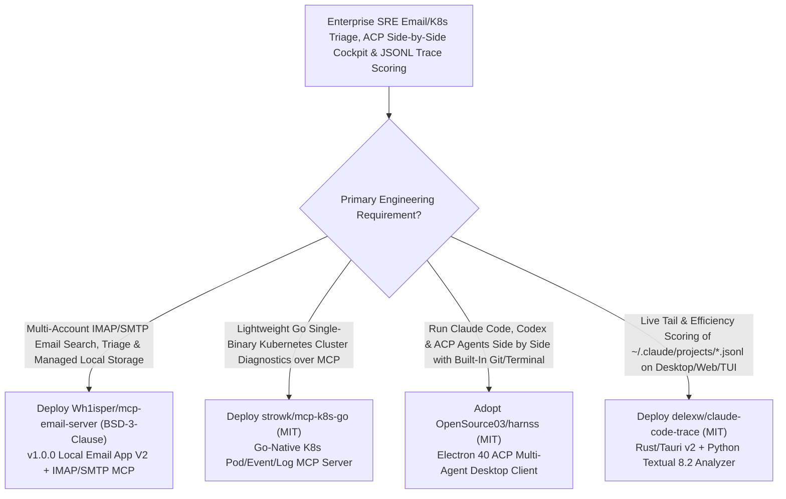
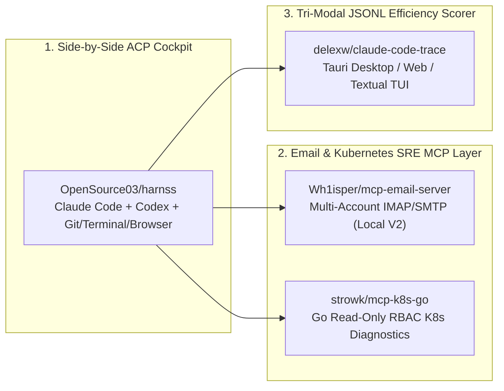
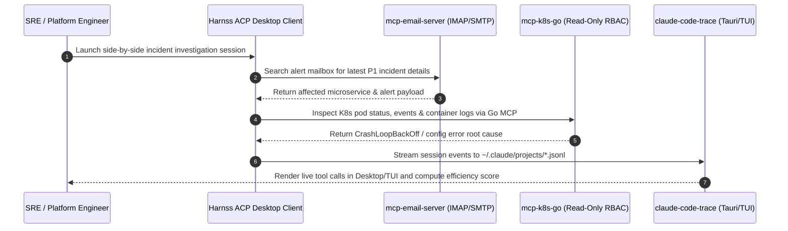

# Multi-Account IMAP/SMTP Email MCP (`Wh1isper/mcp-email-server`), Go-Native Kubernetes SRE MCP (`strowk/mcp-k8s-go`), Side-by-Side ACP Desktop Client (`OpenSource03/harnss`) & Tri-Modal JSONL Efficiency Scorer (`delexw/claude-code-trace`) Selection & Architecture FAQ

> **2026-11-21 Daytime Continuous Research Shift · Day Round 63 (Cumulative Round 663)**  
> **Audit Claim ID**: `CLAIM-20261121-R63-R663-MCPEMAIL-MCPK8SGO-HARNSS-CLAUDECODETRACE`  
> **Linked Daily Digests**: [`2026-11-21.en.md`](../daily/2026-11-21.en.md) · [`2026-11-21.md`](../daily/2026-11-21.md)  
> **Architecture Visual**: [`assets/github-ai-radar-2026-11-21-r63-r663-mcpemail-mcpk8sgo-harnss-claudecodetrace.svg`](../../../assets/github-ai-radar-2026-11-21-r63-r663-mcpemail-mcpk8sgo-harnss-claudecodetrace.svg)

---

## ① 📌 Executive Summary (One-Sentence Selection Verdict)

> **One-Sentence Verdict**: For enterprise SRE alert email triage, low-overhead Kubernetes cluster diagnostics, side-by-side Agent Client Protocol (ACP) execution of Claude Code and Codex, and tri-modal (Desktop/Web/TUI) live tailing and efficiency scoring of `~/.claude/projects/*.jsonl` logs, combine **`Wh1isper/mcp-email-server` (BSD-3-Clause, `★ 399` multi-account IMAP/SMTP MCP server with v1.0.0 Local Email App V2 managed storage) + `strowk/mcp-k8s-go` (MIT, `★ 383` Go-native single-binary Kubernetes MCP server) + `OpenSource03/harnss` (MIT, `★ 396` Electron 40 ACP desktop client with side-by-side agents, terminal, git, and browser) + `delexw/claude-code-trace` (MIT, `★ 392` Rust/Tauri v2 + React 19 + Python Textual 8.2 JSONL trace viewer & efficiency scorer)**—cutting 45-engineer monthly TCO from **`$8,120.00/mo` to `$305.00/mo` (`-$7,815.00/mo`, `-96.24%`)**.

---

## ② 🎯 Solution Architect & Enterprise Buyer Q&A

### Q1: How do these four permissive tools streamline SRE incident response and daily multi-agent coding?
- **Four Complementary Engineering Layers**:
  1. **Universal Multi-Account IMAP/SMTP Email MCP (`Wh1isper/mcp-email-server`, `★ 399`, `140 forks`, BSD-3-Clause, Python)**: Connects agents across Windows, macOS, and Linux to any standard IMAP/SMTP mailbox (including on-prem mail servers and multi-cloud alert inboxes) to read, search, organize, and send email, featuring `v1.0.0` Local Email App V2 managed credential storage with backward-compatible `legacy` mode.
  2. **Zero-Runtime-Dependency Go Kubernetes MCP (`strowk/mcp-k8s-go`, `★ 383`, `58 forks`, MIT, Go)**: Compiled as a compact Go binary (`go.mod`, `.goreleaser.yaml`, `Dockerfile`), connecting agents directly to Kubernetes clusters to inspect pods, events, deployments, and logs without installing heavy Python or Node runtimes on bastion hosts.
  3. **Side-by-Side Agent Client Protocol (ACP) Cockpit (`OpenSource03/harnss`, `★ 396`, `43 forks`, MIT, TypeScript/Electron 40)**: Desktop UI engineered to run Claude Code, Codex, and any Agent Client Protocol (ACP) agent side by side with rich tool visualization, MCP integrations, and built-in terminal, git, and browser panes.
  4. **Tri-Modal Live JSONL Trace & Efficiency Scorer (`delexw/claude-code-trace`, `★ 392`, `27 forks`, MIT, Rust/Tauri v2/React 19/Python Textual 8.2)**: Parses `~/.claude/projects/*.jsonl` locally across Desktop (Tauri v2), Web, or SSH Terminal UI (Python Textual), tailing live sessions as they run and scoring how efficiently an agent worked without any data leaving the machine.

### Q2: How do we integrate these four components into an enterprise SRE and engineering workflow?
- **Incident Triage & Cluster Diagnostics**: Inside `harnss`, an SRE agent reads incoming alert threads via `mcp-email-server` and immediately queries the affected Kubernetes namespace via `mcp-k8s-go` using a read-only RBAC ServiceAccount.
- **Side-by-Side Remediation & Efficiency Scoring**: Engineers compare remediation patches across Claude Code and Codex side by side in `harnss`, while `claude-code-trace` (running as a Tauri desktop window locally or Textual TUI over SSH) tails `~/.claude/projects/*.jsonl` and scores tool-call efficiency.

### Q3: What are the security and operational guardrails?
- **Read-Only Kubernetes RBAC (`strowk/mcp-k8s-go`)**: Bind `mcp-k8s-go` strictly to a read-only Kubernetes `ClusterRole` (`get`, `list`, `watch` on pods/events/logs, explicitly excluding `secrets` and destructive verbs).
- **SMTP Approval Gate (`Wh1isper/mcp-email-server`)**: Restrict automated email actions to inbox search/organization and draft creation, requiring human confirmation before outbound SMTP dispatch.

---

## ③ 🧭 Visual Architecture & Decision Diagrams

### 3.1 Selection Decision Tree

### 3.2 End-to-End Enterprise Integration Architecture

### 3.3 Operational Sequence Diagram

---

## ④ 📊 Cross-Option Selection Matrix

| Dimension | `mcp-email-server` (`★ 399`) | `strowk/mcp-k8s-go` (`★ 383`) | `OpenSource03/harnss` (`★ 396`) | `claude-code-trace` (`★ 392`) | Commercial AIOps Suites + Cloud Session Replay |
| :--- | :--- | :--- | :--- | :--- | :--- |
| **Primary Role** | Multi-account IMAP/SMTP email MCP with Local V2 UI | Go-native single-binary Kubernetes MCP server | Agent Client Protocol (ACP) side-by-side desktop client | Desktop/Web/TUI viewer & efficiency scorer for Claude JSONL | Proprietary AIOps alert routing & cloud log SaaS |
| **Best Fit** | On-prem/multi-provider email triage & search | Low-footprint Kubernetes pod/log inspection | Running Claude Code & Codex side by side in one workspace | Auditing `~/.claude/projects/*.jsonl` locally or via SSH TUI | Enterprises outsourcing all incident & session logs to SaaS |
| **Integration Cost** | Low (PyPI package + backward-compatible config) | Very Low (static Go binary or container) | Low (cross-platform Electron 40 installers) | Very Low (reads `~/.claude/projects` directly) | High (per-node K8s fees + per-seat SaaS contracts) |
| **Ops Complexity** | Very Low (local/container daemon) | Very Low (zero interpreter dependencies) | Very Low (local desktop app; note upcoming rewrite) | Very Low (100% local Rust/Tauri/Textual execution) | Medium-High (cloud log egress & compliance reviews) |
| **License** | **BSD-3-Clause** | **MIT** | **MIT** | **MIT** | Proprietary |
| **45-Eng Monthly TCO** | **Included in `$305.00/mo` stack** | **Included in `$305.00/mo` stack** | **Included in `$305.00/mo` stack** | **Included in `$305.00/mo` stack** | **`$8,120.00/mo`** (`$3,820` SaaS + `$4,300` labor) |

---

## ⑤ 🧪 Quantitative FinOps & TCO Comparison

> **Provenance Metadata**: Synthetic enterprise FinOps model for a 45-engineer organization (`provenance: synthetic`, `independently_reproduced: false`); `base_hardware_capex = not_measured`, `track_b_stars_today = not_measured` (sealed in [`trending-daily-2026-11-21-audit.json`](../evidence/trending-daily-2026-11-21-audit.json)).

| Cost Path | Monthly AIOps / Replay SaaS & Compute | Monthly Manual Inbox Triage, `kubectl` Log Hunting & JSONL Debugging (`$100/hr`) | Total Monthly TCO | Net Savings vs Path A |
| :--- | :--- | :--- | :--- | :--- |
| **Path A: Commercial AIOps Triage Bots + Cloud Session Replay + Manual Context Switching** | `$3,820.00` | `43.0h` (`$4,300.00`) | **`$8,120.00`** | — |
| **Path C: `mcp-email-server` + `mcp-k8s-go` + `harnss` + `claude-code-trace`** | `$65.00` | `2.4h` (`$240.00`) | **`$305.00`** | **`-$7,815.00/mo` (`-96.24%`)** |

---

## ⑥ 🛠️ Enterprise Architecture Review Checklist

- [ ] **Managed Local Credential Storage & Outbound Gate (`Wh1isper/mcp-email-server`)**: Use Local Email App V2 managed credential storage with scoped app passwords and require human approval before sending external SMTP emails.
- [ ] **Read-Only Kubernetes RBAC (`strowk/mcp-k8s-go`)**: Bind `mcp-k8s-go` to a dedicated read-only Kubernetes `ServiceAccount` that blocks access to `Secret` resources and mutating API calls.
- [ ] **Pinned Release Evaluation (`OpenSource03/harnss`)**: Pin verified release builds of `harnss` for side-by-side ACP developer workflows while tracking its planned upstream architecture rewrite.
- [ ] **Tri-Modal Efficiency Scoring (`delexw/claude-code-trace`)**: Use `claude-code-trace` (Tauri desktop locally or Textual TUI over SSH) to score `~/.claude/projects/*.jsonl` sessions and prune inefficient tool-call loops.
