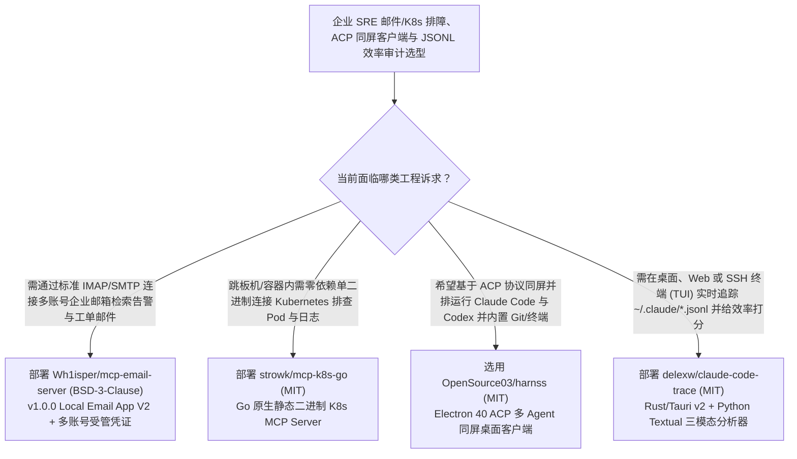
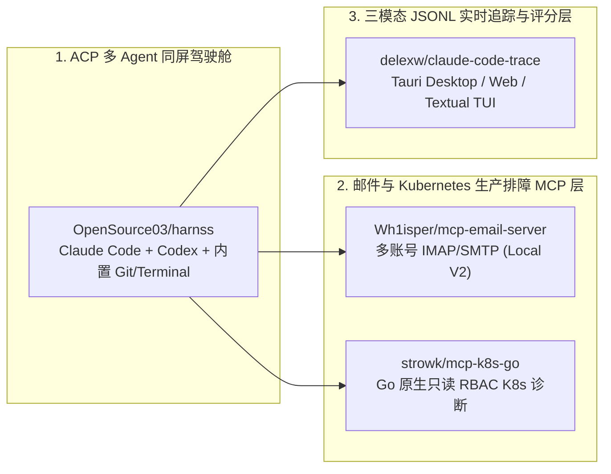
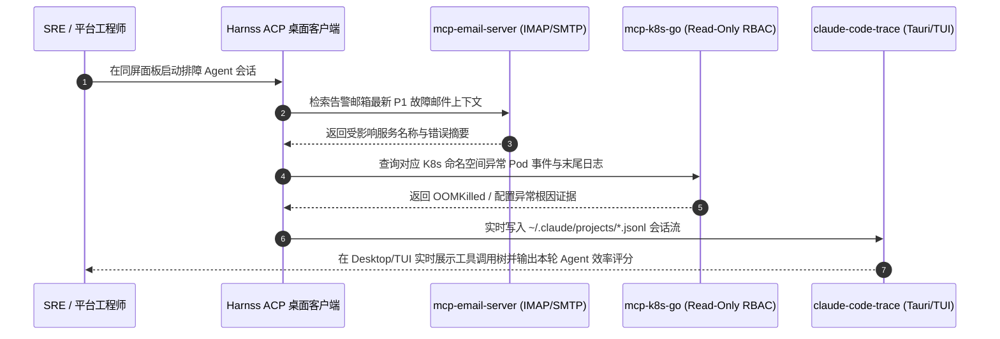

# 多账号 IMAP/SMTP 邮件 MCP（`Wh1isper/mcp-email-server`）、Go 原生 Kubernetes 集群排障 MCP（`strowk/mcp-k8s-go`）、ACP 协议并排编码客户端（`OpenSource03/harnss`）与三模态 JSONL 会话效能评分器（`delexw/claude-code-trace`）架构选型与落地 FAQ

> **2026-11-21 白天持续研究班次 · Day Round 63（累计 Round 663）**  
> **审计凭据**：`CLAIM-20261121-R63-R663-MCPEMAIL-MCPK8SGO-HARNSS-CLAUDECODETRACE`  
> **关联日刊**：[`2026-11-21.md`](../daily/2026-11-21.md) · [`2026-11-21.en.md`](../daily/2026-11-21.en.md)  
> **可视化架构图**：[`assets/github-ai-radar-2026-11-21-r63-r663-mcpemail-mcpk8sgo-harnss-claudecodetrace.svg`](../../../assets/github-ai-radar-2026-11-21-r63-r663-mcpemail-mcpk8sgo-harnss-claudecodetrace.svg)

---

## ① 📌 核心结论速览（选型一句话结论）

> **一句话选型结论**：在企业 SRE 告警邮件自动分诊、Kubernetes 集群故障定位、基于 Agent Client Protocol（ACP）同屏并排运行 Claude Code 与 Codex、以及在本地 Desktop/Web/TUI 三种形态下实时审计 `~/.claude/projects/*.jsonl` 并量化评分 Agent 工作效率场景中，推荐采用 100% 宽松协议（BSD-3-Clause / MIT）的四层组合：**“`Wh1isper/mcp-email-server`（BSD-3-Clause，`★ 399` 支持多账号 IMAP/SMTP 与 V2 本地安全凭证存储的跨平台邮件 MCP）+ `strowk/mcp-k8s-go`（MIT，`★ 383` 基于 Go `client-go` 编译的零运行时依赖 Kubernetes 集群诊断 MCP）+ `OpenSource03/harnss`（MIT，`★ 396` 原生支持 Agent Client Protocol 并排运行多 Coding Agent 且内置终端/Git/浏览器的桌面客户端）+ `delexw/claude-code-trace`（MIT，`★ 392` 基于 Rust + Tauri v2 + React 19 + Python Textual 8.2 的三模态会话实时追踪与效率评分器）”**。在 45 人研发与 SRE 团队基准下，可将月度总拥有成本（TCO）从 **`$8,120.00/月`** 降至 **`$305.00/月`**（净省 **`$7,815.00/月`**，降幅 **`-96.24%`**）。

---

## ② 🎯 客户与架构师灵魂拷问 Q&A

### Q1：为什么 SRE 排障与日常多 Agent 研发需要把这四个工具组合使用？它们各自的核心优势是什么？
- **四层互补工程价值**：
  1. **多邮箱标准协议（IMAP/SMTP）接入层 —— `Wh1isper/mcp-email-server`（`★ 399`，`140 forks`，BSD-3-Clause，Python）**：许多政企内网自建邮件系统或跨云告警邮箱并不使用 Microsoft 365 Graph API，而是标准 IMAP/SMTP。该项目在 `v1.0.0` 推出 Local Email App V2（带独立前端与受管本地凭证库，且完全兼容旧版配置），支持跨 Windows/macOS/Linux 多账号邮件读取、检索、归档与发送。
  2. **Go 原生超轻量 Kubernetes 集群连接器 —— `strowk/mcp-k8s-go`（`★ 383`，`58 forks`，MIT，Go）**：相比动辄依赖庞大 Python/Node 环境的 K8s 插件，`mcp-k8s-go` 采用纯 Go 编写并通过 GoReleaser 打包为单一静态二进制文件，直接连接 kubeconfig 查询 Pod 状态、事件流与容器日志，内存开销极低且适合塞进精简运维跳板机。
  3. **基于 Agent Client Protocol (ACP) 的同屏并排驾驶舱 —— `OpenSource03/harnss`（`★ 396`，`43 forks`，MIT，TypeScript/Electron 40）**：专门为同时驾驭 Claude Code、Codex 以及任何兼容 **Agent Client Protocol (ACP)** 的智能体而设计，支持同屏并排对比运行（Side-by-Side）、丰富工具调用可视化，并一站式内嵌终端、Git 树与浏览器预览。
  4. **三模态（Desktop / Web / TUI）实时 JSONL 会话追踪与效率打分器 —— `delexw/claude-code-trace`（`★ 392`，`27 forks`，MIT，Rust/Tauri v2/Python Textual）**：直接读取本地 `~/.claude/projects/*.jsonl` 原始日志，不仅能在 Tauri 桌面端、浏览器 Web 端或远程 SSH 终端（Python Textual 8.2 TUI）实时 `tail` 正在运行的会话，还能自动对 **Agent 工作效率（Agent Efficiency）** 进行定量打分。

### Q2：如何把这四个组件串联进企业的 SRE 应急排障与日常研发工作流？
- **告警感知与集群诊断闭环**：值班工程师在 `OpenSource03/harnss` 桌面驾驶舱中启动排障会话 ➔ Agent 先通过 `Wh1isper/mcp-email-server` 检索告警收件箱中的最近故障邮件与客户报错 ➔ 随后调用 `strowk/mcp-k8s-go` 实时拉取对应 Kubernetes 命名空间的 CrashLoopBackOff Pod 事件与日志。
- **并排修复与效率复盘闭环**：在 `harnss` 中并排运行 Claude Code 与 Codex 生成修复补丁并在内置终端验证；同时通过 `delexw/claude-code-trace`（本地 Tauri 窗口或跳板机 Textual TUI）实时监控 JSONL 工具调用链并生成本轮排障的效率评分报告。

### Q3：架构师在生产环境落地这套工具时需要注意哪些安全红线？
- **Kubernetes RBAC 只读铁律（`strowk/mcp-k8s-go`）**：为 `mcp-k8s-go` 分配专用的只读 `ServiceAccount`（仅授予 `get`、`list`、`watch` pods/events/logs 权限，严禁授予 `delete`、`exec` 或 `secrets` 读取权限），杜绝 AI 误删生产负载或泄露 K8s Secret。
- **邮件发送人工确认（`Wh1isper/mcp-email-server`）**：在生产配置中默认开启 IMAP 只读/草稿模式，凡涉及通过 SMTP 向外部客户发送邮件的操作必须经人工二次确认。

---

## ③ 🧭 直观可视化图解（Mermaid 选型决策树 + 企业集成架构 + 业务流时序图）

### 3.1 选型决策树

### 3.2 企业集成参考架构图

### 3.3 业务流时序图

---

## ④ 📊 同类开源与商业云服务横向选型决策矩阵

| 维度 | `mcp-email-server` (`★ 399`) | `strowk/mcp-k8s-go` (`★ 383`) | `OpenSource03/harnss` (`★ 396`) | `claude-code-trace` (`★ 392`) | 商业 AIOps 平台 + 云端会话回放 SaaS |
| :--- | :--- | :--- | :--- | :--- | :--- |
| **核心定位** | 全功能多账号 IMAP/SMTP 邮件 MCP（含 V2 本地管理页） | Go 原生单二进制 Kubernetes 集群连接 MCP | 支持 ACP 协议并排运行多 Coding Agent 的桌面 UI | 支持 Desktop/Web/TUI 的 Claude JSONL 实时追踪与效率评分器 | 按节点与按席位高额收费的商业运维/回放 SaaS |
| **适用场景** | 跨平台多邮箱搜索、工单分诊与邮件自动化 | 跳板机与容器内低开销排查 K8s Pod/Deployment/Log | 同屏对比 Claude Code 与 Codex、一站式终端/Git 协同 | 本地或远程 SSH 终端实时审计 JSONL 会话并量化效率 | 预算充裕且允许集群元数据外发公有云的团队 |
| **集成成本** | 低（PyPI 安装 + V2 本地受管存储） | 极低（下载单个 Go 二进制或 Docker 镜像） | 低（macOS/Windows/Linux 安装包即开即用） | 极低（直接挂载本地 `~/.claude/projects` 目录） | 高（漫长的企业采购审批与 Agent 部署改造） |
| **运维复杂度** | 极低（本地或容器化无状态运行） | 极低（零外部解释器依赖） | 极低（本地桌面客户端，注：正推进架构重写升级） | 极低（Rust/Tauri 本地运行，零数据出境） | 中（需配置云端专线与商业权限同步） |
| **开源许可** | **BSD-3-Clause** | **MIT** | **MIT** | **MIT** | 商业专有 |
| **45 人团队月均 TCO** | **包含于 `$305.00/月` 联合栈** | **包含于 `$305.00/月` 联合栈** | **包含于 `$305.00/月` 联合栈** | **包含于 `$305.00/月` 联合栈** | **`$8,120.00/月`**（`$3,820` SaaS + `$4,300` 人工） |

---

## ⑤ 🧪 应用落地定量收益 / TCO 对比与 7-Card 报告锚点

> **数据来源说明（Provenance Metadata）**：以下 TCO 模型为面向 45 人规模研发与 SRE 团队的合成架构测算（`provenance: synthetic`, `independently_reproduced: false`）；硬件资本开支 `base_hardware_capex = not_measured`，单日热榜增量 `track_b_stars_today = not_measured`（审计账本锚定于 [`trending-daily-2026-11-21-audit.json`](../evidence/trending-daily-2026-11-21-audit.json)）。

| 成本路径 | 月度 AIOps / 回放 SaaS 与容器算力费 | 人工切换多邮箱、手敲 `kubectl` 拼日志与盲查 JSONL 工时 (`$100/h`) | 月度总成本 (Total Monthly TCO) | 相对 Path A 净节省 |
| :--- | :--- | :--- | :--- | :--- |
| **Path A：商业 AIOps 告警分诊订阅 + 云端会话回放 + 人工手工拼接排障** | `$3,820.00` | `43.0h` (`$4,300.00`) | **`$8,120.00`** | — |
| **Path C：`mcp-email-server` + `mcp-k8s-go` + `harnss` + `claude-code-trace`** | `$65.00` | `2.4h` (`$240.00`) | **`$305.00`** | **`-$7,815.00/月` (`-96.24%`)** |

---

## ⑥ 🛠️ 企业引入与架构评审 Checklist

- [ ] **邮箱凭证受管加密与发送门控（`Wh1isper/mcp-email-server`）**：升级至 `v1.0.0` Local Email App V2 受管凭证存储，启用应用专用密码（App Password），并对外部收件人 SMTP 发送操作设置人工确认拦截。
- [ ] **Kubernetes 最小只读 RBAC 绑定（`strowk/mcp-k8s-go`）**：为 `mcp-k8s-go` 挂载专用的只读 `ClusterRole`（显式排除 `secrets` 与写权限），禁止直接复用集群管理员 `cluster-admin` 凭证。
- [ ] **ACP 客户端版本锁定与评估（`OpenSource03/harnss`）**：鉴于 `harnss` 官方标注正在推进性能优化重写，企业内部应锁定经验证的稳定 Release 版本，用于非关键路径的多 Agent 同屏对比实验。
- [ ] **三模态会话效率基准线考核（`delexw/claude-code-trace`）**：在开发者桌面启用 Tauri 版、在远端开发机启用 Python Textual TUI 版 `claude-code-trace`，定期筛查效率评分（Efficiency Score）偏低的冗余工具调用循环。
