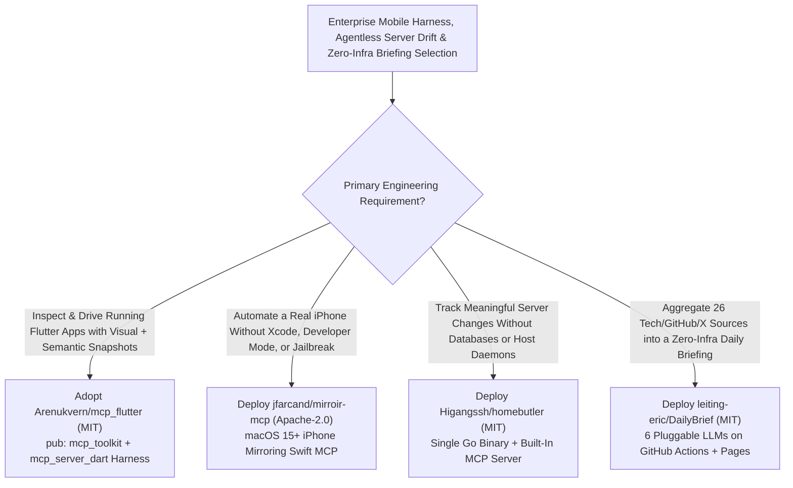
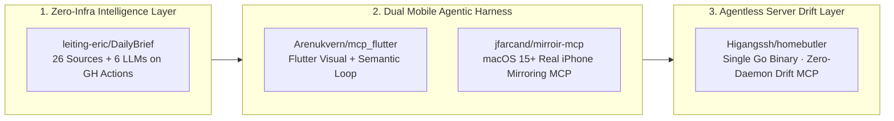
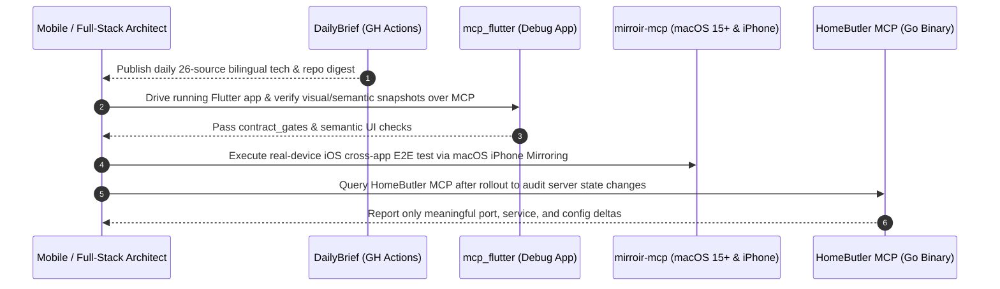

# Flutter Visual/Semantic Harness (`Arenukvern/mcp_flutter`), Zero-Xcode iPhone Mirroring MCP (`jfarcand/mirroir-mcp`), Agentless Server Drift MCP (`Higangssh/homebutler`) & 26-Source Zero-Infra DailyBrief (`leiting-eric/DailyBrief`) Selection & Architecture FAQ

> **2026-11-21 Daytime Continuous Research Shift · Day Round 67 (Cumulative Round 667)**  
> **Audit Claim ID**: `CLAIM-20261121-R67-R667-MCPFLUTTER-MIRROIRMCP-HOMEBUTLER-DAILYBRIEF`  
> **Linked Daily Digests**: [`2026-11-21.en.md`](../daily/2026-11-21.en.md) · [`2026-11-21.md`](../daily/2026-11-21.md)  
> **Architecture Visual**: [`assets/github-ai-radar-2026-11-21-r67-r667-mcpflutter-mirroirmcp-homebutler-dailybrief.svg`](../../../assets/github-ai-radar-2026-11-21-r67-r667-mcpflutter-mirroirmcp-homebutler-dailybrief.svg)

---

## ① 📌 Executive Summary (One-Sentence Selection Verdict)

> **One-Sentence Verdict**: To give coding agents a closed visual/semantic feedback loop inside running Flutter apps, automate real non-jailbroken iPhones via macOS 15+ iPhone Mirroring without Xcode or Developer Mode, detect meaningful server state changes with a single Go binary and zero host daemons, and publish 26-source bilingual intelligence briefings via GitHub Actions, combine **`Arenukvern/mcp_flutter` (MIT, `★ 399` `flutter-mcp-toolkit` with visual & semantic snapshots and custom client-side tools) + `jfarcand/mirroir-mcp` (Apache-2.0, `★ 395` Swift MCP server driving real iPhones via macOS iPhone Mirroring) + `Higangssh/homebutler` (MIT, `★ 387` single Go binary agentless server-change tracker with built-in MCP) + `leiting-eric/DailyBrief` (MIT, `★ 393`, `224 forks` 26-source AI daily briefing engine with 6 pluggable LLM backends)**—cutting 45-engineer monthly TCO from **`$8,110.00/mo` to `$305.00/mo` (`-$7,805.00/mo`, `-96.24%`)**.

---

## ② 🎯 Solution Architect & Enterprise Buyer Q&A

### Q1: How do these four lightweight open-source projects replace expensive mobile device clouds, heavy monitoring agents, and manual tech digests?
- **Four Zero-Bloat Architectural Primitives**:
  1. **Closed-Loop Flutter Visual & Semantic Harness (`Arenukvern/mcp_flutter`, `★ 399`, `50 forks`, MIT, Dart)**: Published on pub.dev as `mcp_toolkit` alongside `mcp_server_dart`. Gives AI coding agents a closed feedback loop combining visual screenshots, semantic widget snapshots, and custom client-side tools inside any running Flutter app, backed by `contract_gates.yml` and `intentcall_eval.yml`.
  2. **Zero-Xcode Real iPhone Automation (`jfarcand/mirroir-mcp`, `★ 395`, `49 forks`, Apache-2.0, Swift)**: Drives a real physical iPhone from any MCP client through **macOS 15+ iPhone Mirroring**—requiring **no Developer Mode, no Xcode provisioning profiles, and no jailbreak**, making it possible to test production App Store builds and cross-app workflows.
  3. **Agentless Single-Binary Server Change Detector (`Higangssh/homebutler`, `★ 387`, `24 forks`, MIT, Go 1.25+)**: A single Go binary with no database and nothing installed on the machines it watches. It remembers what your servers looked like last time and exposes a built-in MCP server that reports only meaningful state changes rather than noisy metric spam.
  4. **Zero-Infrastructure 26-Source Daily Briefing (`leiting-eric/DailyBrief`, `★ 393`, `224 forks`, MIT, TypeScript)**: Aggregates 26 tech, GitHub, X/Twitter, and market sources into bilingual summaries using 6 pluggable LLM backends, deployable in 5 minutes on **GitHub Actions + GitHub Pages** or a local Node 20+ server.

### Q2: How do we integrate these four tools into an enterprise mobile and full-stack engineering workflow?
- **Morning Intelligence Alignment**: Teams run a forked `leiting-eric/DailyBrief` on GitHub Actions to deliver daily technical and repository signals before standup.
- **Mobile Closed-Loop Development & Real-Device QA**: During Flutter development, agents inspect and drive debug builds via `Arenukvern/mcp_flutter`; for iOS system integrations and real-device flows, agents drive a mirrored test iPhone via `jfarcand/mirroir-mcp`.
- **Post-Deploy Server Drift Verification**: After backend deployments, SRE agents query `Higangssh/homebutler` over MCP to confirm that only expected ports, containers, and files changed on target hosts.

### Q3: What are the security and release guardrails?
- **Strip `mcp_toolkit` from Production Mobile Builds (`Arenukvern/mcp_flutter`)**: Guard `mcp_toolkit` initialization behind `kDebugMode` / staging build flavors so production App Store / Play Store binaries never expose debug MCP hooks.
- **Dedicated Test iPhones (`jfarcand/mirroir-mcp`)**: Pair `mirroir-mcp` exclusively with dedicated QA iPhones signed into isolated test Apple IDs.

---

## ③ 🧭 Visual Architecture & Decision Diagrams

### 3.1 Selection Decision Tree

### 3.2 End-to-End Enterprise Integration Architecture

### 3.3 Operational Sequence Diagram

---

## ④ 📊 Cross-Option Selection Matrix

| Dimension | `Arenukvern/mcp_flutter` (`★ 399`) | `jfarcand/mirroir-mcp` (`★ 395`) | `Higangssh/homebutler` (`★ 387`) | `leiting-eric/DailyBrief` (`★ 393`) | Cloud Device Farms + Heavy Host Agents + Paid Newsletters |
| :--- | :--- | :--- | :--- | :--- | :--- |
| **Primary Role** | Closed-loop visual & semantic MCP toolkit for Flutter | Real iPhone MCP automation via macOS 15+ iPhone Mirroring | Single-binary, DB-free, agentless server-change MCP | 26-source AI daily briefing on GitHub Actions / local Node | Per-minute cloud device farms + per-host APM agents |
| **Best Fit** | Agent-driven Flutter UI development & semantic E2E testing | Real-iPhone testing of production iOS apps without Xcode/jailbreak | Detecting meaningful configuration & service drift on servers | Customized team tech radar with 6 pluggable LLM backends | Massive 1,000-device compatibility matrices |
| **Integration Cost** | Low (`mcp_toolkit` pub package + Dart MCP server) | Very Low (`npm i mirroir-mcp` on macOS 15+) | Very Low (single Go 1.25+ binary + YAML config) | Very Low (5-minute fork to GitHub Actions + Pages) | High (device-minute charges & per-node monitoring contracts) |
| **Ops Complexity** | Very Low (runs alongside Flutter debug session) | Very Low (zero provisioning profile or WDA maintenance) | Zero DB / zero remote host daemon | Zero server ops on GitHub Actions | High (expired iOS signing certificates & alert fatigue) |
| **License** | **MIT** | **Apache-2.0** | **MIT** | **MIT** | Proprietary |
| **45-Eng Monthly TCO** | **Included in `$305.00/mo` stack** | **Included in `$305.00/mo` stack** | **Included in `$305.00/mo` stack** | **Included in `$305.00/mo` stack** | **`$8,110.00/mo`** (`$3,810` SaaS + `$4,300` labor) |

---

## ⑤ 🧪 Quantitative FinOps & TCO Comparison

> **Provenance Metadata**: Synthetic enterprise FinOps model for a 45-engineer organization (`provenance: synthetic`, `independently_reproduced: false`); `base_hardware_capex = not_measured` (excludes baseline Mac/iPhone test hardware), `track_b_stars_today = not_measured` (sealed in [`trending-daily-2026-11-21-audit.json`](../evidence/trending-daily-2026-11-21-audit.json)).

| Cost Path | Monthly Device-Cloud / Monitoring SaaS & Tokens | Monthly Manual iOS Provisioning, Flutter QA & Alert Triage (`$100/hr`) | Total Monthly TCO | Net Savings vs Path A |
| :--- | :--- | :--- | :--- | :--- |
| **Path A: Commercial Mobile Device Cloud + Per-Host Drift SaaS + Manual QA & Digest Curation** | `$3,810.00` | `43.0h` (`$4,300.00`) | **`$8,110.00`** | — |
| **Path C: `mcp_flutter` + `mirroir-mcp` + `homebutler` + `DailyBrief`** | `$65.00` | `2.4h` (`$240.00`) | **`$305.00`** | **`-$7,805.00/mo` (`-96.24%`)** |

---

## ⑥ 🛠️ Enterprise Architecture Review Checklist

- [ ] **Debug-Only `mcp_toolkit` Compilation Gate (`Arenukvern/mcp_flutter`)**: Ensure `mcp_toolkit` client hooks are compiled only into debug/staging Flutter flavors and stripped from production store releases.
- [ ] **Dedicated QA iPhone & Apple ID Isolation (`jfarcand/mirroir-mcp`)**: Run `mirroir-mcp` only against dedicated test iPhones paired to isolated macOS 15+ QA runners.
- [ ] **Agentless Pre/Post-Deploy Drift Checks (`Higangssh/homebutler`)**: Trigger `homebutler` MCP snapshots before and after maintenance windows to verify that only authorized server changes occurred.
- [ ] **Custom Source & LLM Backend Governance (`leiting-eric/DailyBrief`)**: Configure `sources.config.json` for domain-relevant repositories and route summarization calls through approved enterprise LLM endpoints.
