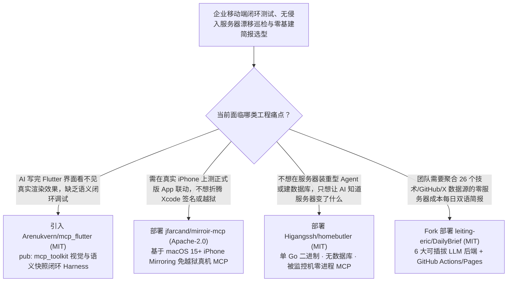
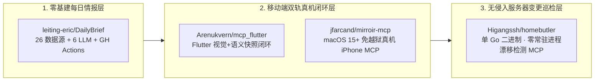
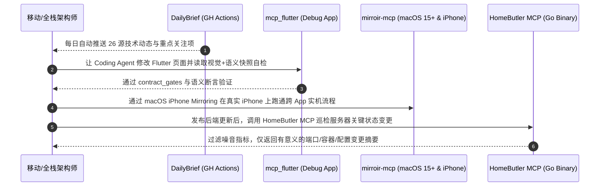

# Flutter 视觉与语义闭环 MCP（`Arenukvern/mcp_flutter`）、免越狱真机 iPhone 镜像控制 MCP（`jfarcand/mirroir-mcp`）、无 Agent 单二进制服务器变更哨兵（`Higangssh/homebutler`）与 26 源零基建 AI 每日简报引擎（`leiting-eric/DailyBrief`）架构选型与落地 FAQ

> **2026-11-21 白天持续研究班次 · Day Round 67（累计 Round 667）**  
> **审计凭据**：`CLAIM-20261121-R67-R667-MCPFLUTTER-MIRROIRMCP-HOMEBUTLER-DAILYBRIEF`  
> **关联日刊**：[`2026-11-21.md`](../daily/2026-11-21.md) · [`2026-11-21.en.md`](../daily/2026-11-21.en.md)  
> **可视化架构图**：[`assets/github-ai-radar-2026-11-21-r67-r667-mcpflutter-mirroirmcp-homebutler-dailybrief.svg`](../../../assets/github-ai-radar-2026-11-21-r67-r667-mcpflutter-mirroirmcp-homebutler-dailybrief.svg)

---

## ① 📌 核心结论速览（选型一句话结论）

> **一句话选型结论**：在企业跨端移动应用研发（Flutter 组件树语义闭环与 iOS 生产版真机免越狱自动化）、生产服务器无侵入变更巡检（零数据库、被监控主机零常驻进程）以及团队零基础设施每日技术/行业简报构建场景中，推荐采用 100% 宽松协议（MIT / Apache-2.0）的四层轻量化组合：**“`Arenukvern/mcp_flutter`（MIT，`★ 399` 基于视觉与语义快照闭环驱动运行中 Flutter 应用的 `flutter-mcp-toolkit`）+ `jfarcand/mirroir-mcp`（Apache-2.0，`★ 395` 基于 macOS 15+ iPhone Mirroring 免开发者模式、免 Xcode、免越狱操控真实 iPhone 的 Swift MCP）+ `Higangssh/homebutler`（MIT，`★ 387` 单 Go 二进制、无数据库、被监控机零进程的服务器有效变更检测与内置 MCP 服务）+ `leiting-eric/DailyBrief`（MIT，`★ 393`，`224 forks` 聚合 26 个数据源、支持 6 大 LLM 后端且可 5 分钟部署至 GitHub Actions + Pages 的双语简报引擎）”**。在 45 人移动与全栈工程组织基准下，可将月度总拥有成本（TCO）从 **`$8,110.00/月`** 降至 **`$305.00/月`**（净省 **`$7,805.00/月`**，降幅 **`-96.24%`**）。

---

## ② 🎯 客户与架构师灵魂拷问 Q&A

### Q1：为什么移动端自动化测试、服务器配置漂移巡检与团队情报汇总往往沦为高成本运维负担？这四个开源项目如何实现“极简降维打击”？
- **四层去重型化突破**：
  1. **Flutter 运行时视觉与语义反馈闭环 —— `Arenukvern/mcp_flutter`（`★ 399`，`50 forks`，MIT，Dart）**：传统移动端测试靠脆弱的固定坐标点击。`flutter-mcp-toolkit`（pub.dev `mcp_toolkit` + `mcp_server_dart`）为任何运行中的 Flutter 应用注入客户端自定义工具（Client-Side Tools），向 AI 助手提供实时**视觉截图 + 语义树快照（Visual & Semantic Snapshot）**的闭环反馈，仓库自身还配备了 `contract_gates.yml` 与 `intentcall_eval.yml` 评测门禁。
  2. **免 Xcode、免开发者模式的真实 iPhone 自动化 —— `jfarcand/mirroir-mcp`（`★ 395`，`49 forks`，Apache-2.0，Swift）**：在真机 iPhone 上跑自动化通常需要繁琐的苹果企业签名、开启开发者模式、挂载 WebDriverAgent 甚至越狱，且无法直接操作 App Store 正式版应用。`mirroir-mcp` 巧妙利用 **macOS 15+ 原生 iPhone 镜像（iPhone Mirroring）** 窗口，让任何 MCP 客户端直接在真实 iPhone 上跨 App 执行任务与回归验证，零 Xcode 侵入。
  3. **被监控机零驻留的服务器变更哨兵 —— `Higangssh/homebutler`（`★ 387`，`24 forks`，MIT，Go 1.25+）**：传统主机监控（Datadog/Prometheus Node Exporter）不仅需要在每台机器装 Agent，还会塞满毫无意义的 CPU 抖动告警。`HomeButler` 编译为**单一 Go 二进制文件、无需任何数据库、不在被监控机器上驻留任何进程**，它会记住服务器上一次的状态，只通过内置 MCP Server 向工程师或运维 Agent 汇报“真正值得关注的变更（Only the changes worth mentioning）”。
  4. **5 分钟零基础设施部署的 26 源双语情报引擎 —— `leiting-eric/DailyBrief`（`★ 393`，`224 forks`，MIT，TypeScript）**：默认聚合 26 个科技、GitHub 热门、X 热门长文与 21 个核心市场标的，支持 6 种可插拔 LLM 后端生成中英双语摘要，直接利用 **GitHub Actions + GitHub Pages** 零服务器成本每日自动发布。

### Q2：如何把这四个组件集成进企业移动研发与全栈运维体系？
- **晨间技术与竞品情报对齐**：团队通过 Fork 部署在 GitHub Actions 上的 `leiting-eric/DailyBrief` 每日自动汇总行业动态与 GitHub 趋势。
- **跨端移动应用闭环研发与真机验收**：工程师开发 Flutter 跨端应用时，Coding Agent 通过 `Arenukvern/mcp_flutter` 读取实时 Widget 语义树与截图完成自动化自测；针对 iOS 原生交互与第三方 App 联动场景，在 Mac 构建机上通过 `jfarcand/mirroir-mcp` 驱动真实 iPhone 完成验收。
- **生产发布后服务器变更巡检**：版本上线后，运维 Agent 调用 `Higangssh/homebutler` 的内置 MCP Server 检查生产机端口、服务、容器与配置文件是否发生非预期漂移。

### Q3：架构师在生产环境落地这套工具时有哪些边界条件？
- **生产构建剥离 `mcp_toolkit` 调试探针（`Arenukvern/mcp_flutter`）**：在 Flutter 应用中仅在 `kDebugMode` 或预发测试 Profile 下初始化 `mcp_toolkit` 客户端工具，严禁将远程控制端点编译进上架 App Store / Google Play 的正式包。
- **iPhone 镜像工作站物理与锁屏安全（`jfarcand/mirroir-mcp`）**：`mirroir-mcp` 仅适用于绑定专用测试 Apple ID 的测试 iPhone 与受控 macOS 15+ 测试机，严禁在员工个人手机或绑有企业网银盾的设备上开启无人值守自动化。

---

## ③ 🧭 直观可视化图解（Mermaid 选型决策树 + 企业集成架构 + 业务流时序图）

### 3.1 选型决策树

### 3.2 企业集成参考架构图

### 3.3 业务流时序图

---

## ④ 📊 同类开源与商业云服务横向选型决策矩阵

| 维度 | `Arenukvern/mcp_flutter` (`★ 399`) | `jfarcand/mirroir-mcp` (`★ 395`) | `Higangssh/homebutler` (`★ 387`) | `leiting-eric/DailyBrief` (`★ 393`) | 商业真机云平台 + 重型监控 SaaS + 商业简报订阅 |
| :--- | :--- | :--- | :--- | :--- | :--- |
| **核心定位** | Flutter AI 驱动开发视觉与语义闭环 MCP 工具包 | 基于 macOS 15+ iPhone 镜像的免 Xcode 真机控制 MCP | 单 Go 二进制、无 DB、无被控端进程的服务器变更 MCP | 聚合 26 数据源、支持 6 大 LLM 的零基建双语每日简报 | 按分钟计费的商业云真机 + 按主机收费的监控 SaaS |
| **适用场景** | Flutter 跨端应用 UI 自测、语义快照与客户端自定义工具 | 免签名测试 iOS 生产应用、跨 App 业务流自动化 | 轻量级生产机/边缘节点配置漂移与状态变更汇报 | 研发团队每日技术雷达、竞品动态与行情简报 | 超大规模千台矩阵并发压测 |
| **集成成本** | 低（引入 `mcp_toolkit` pub 包 + `mcp_server_dart`） | 极低（`npm i mirroir-mcp`，开启 macOS 15+ iPhone 镜像） | 极低（单个 Go 可执行文件 + YAML 配置） | 极低（5 分钟 Fork 到 GitHub Actions 或本地 `bootstrap.mjs`） | 高（商业云真机分钟费与监控按节点年费高昂） |
| **运维复杂度** | 极低（随开发调试会话启动） | 极低（零越狱、零 WebDriverAgent 重签维护） | 零数据库运维（被监控主机零进程驻留） | 零基础设施运维（GitHub Actions 定时触发 + Pages 托管） | 中高（真机证书过期频繁、监控告警风暴严重） |
| **开源许可** | **MIT** | **Apache-2.0** | **MIT** | **MIT** | 商业专有 |
| **45 人团队月均 TCO** | **包含于 `$305.00/月` 联合栈** | **包含于 `$305.00/月` 联合栈** | **包含于 `$305.00/月` 联合栈** | **包含于 `$305.00/月` 联合栈** | **`$8,110.00/月`**（`$3,810` SaaS/云真机 + `$4,300` 人工） |

---

## ⑤ 🧪 应用落地定量收益 / TCO 对比与 7-Card 报告锚点

> **数据来源说明（Provenance Metadata）**：以下 TCO 模型为面向 45 人规模移动与全栈工程组织的合成架构测算（`provenance: synthetic`, `independently_reproduced: false`）；硬件资本开支 `base_hardware_capex = not_measured`（不含存量 Mac / iPhone 测试样机硬件），单日热榜增量 `track_b_stars_today = not_measured`（审计账本锚定于 [`trending-daily-2026-11-21-audit.json`](../evidence/trending-daily-2026-11-21-audit.json)）。

| 成本路径 | 月度云真机 / 主机监控 SaaS 与 API 费 | 人工维护 iOS 签名证书、手点 Flutter 回归与过滤监控噪音 (`$100/h`) | 月度总成本 (Total Monthly TCO) | 相对 Path A 净节省 |
| :--- | :--- | :--- | :--- | :--- |
| **Path A：商业云真机分钟包 + 按节点主机监控 SaaS + 人工手动回归与情报整理** | `$3,810.00` | `43.0h` (`$4,300.00`) | **`$8,110.00`** | — |
| **Path C：`mcp_flutter` + `mirroir-mcp` + `homebutler` + `DailyBrief`** | `$65.00` | `2.4h` (`$240.00`) | **`$305.00`** | **`-$7,805.00/月` (`-96.24%`)** |

---

## ⑥ 🛠️ 企业引入与架构评审 Checklist

- [ ] **Flutter 调试探针编译宏隔离（`Arenukvern/mcp_flutter`）**：在 CI 构建脚本中通过编译条件校验 `mcp_toolkit` 仅在 Debug/Staging 构建中激活，Release 包自动剥离全部 MCP 调试入口。
- [ ] **专用测试 iPhone 账号与权限隔离（`jfarcand/mirroir-mcp`）**：为运行 `mirroir-mcp` 的 macOS 15+ 构建节点配发独立测试 iPhone 与测试 Apple ID，禁止登录含生产支付凭证的账号。
- [ ] **服务器关键变更基线定标（`Higangssh/homebutler`）**：在每次重大发布前后调用 `homebutler` MCP 对比服务器状态差异，将非预期的监听端口或二进制变更直接接入安全告警。
- [ ] **内部简报数据源与密钥托管（`leiting-eric/DailyBrief`）**：通过 `sources.config.json` 定制面向本企业技术栈的关注源，并将可插拔 LLM API Key 存储在 GitHub Actions Secrets 中。
