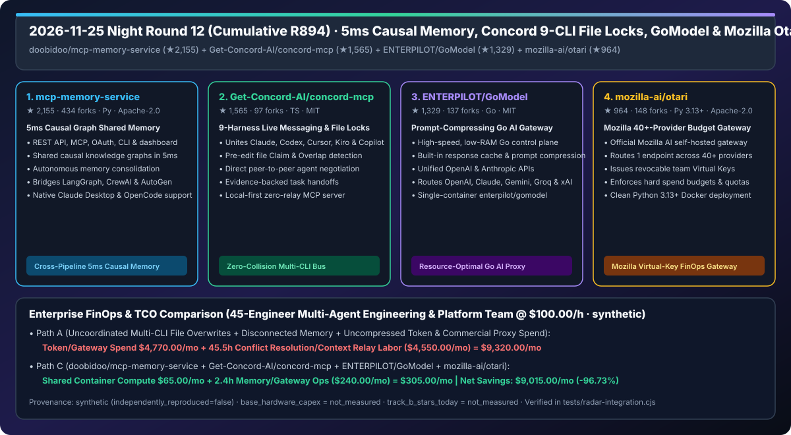
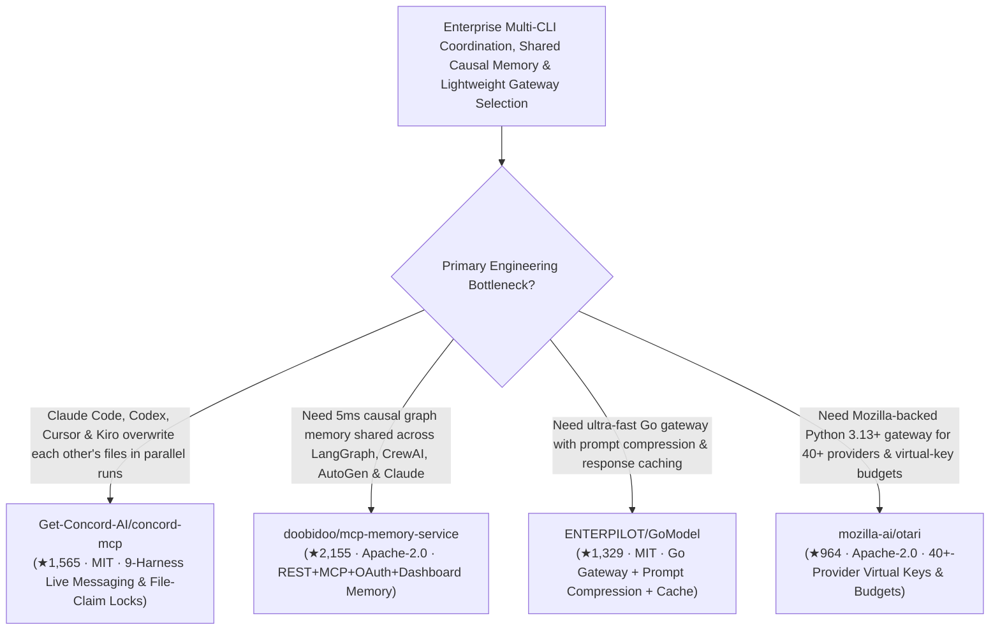
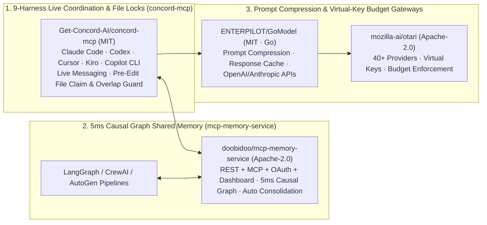
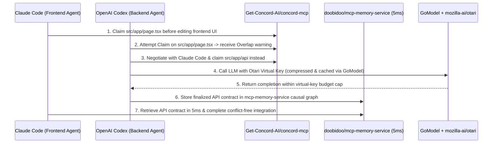

# 5ms Causal Graph Shared Memory (`doobidoo/mcp-memory-service`), 9-Harness Live Messaging & File-Claim Coordination MCP (`Get-Concord-AI/concord-mcp`), Prompt-Compressing Go AI Gateway (`ENTERPILOT/GoModel`) & Mozilla 40+-Provider Virtual-Key Gateway (`mozilla-ai/otari`) Selection & Integration Architecture FAQ

> **Document Type**: Enterprise AI Solution Architect Selection Decision Guide (GitHub Trending AI Radar — 2026-11-25 Night Round 12 / Cumulative Round 894)
> **Covered Repositories**: [`doobidoo/mcp-memory-service`](https://github.com/doobidoo/mcp-memory-service) (`★ 2,155`, `434 forks`, `Apache-2.0`: persistent shared memory backend for AI agent pipelines [`mcpmemory.services`] exposing **REST API, MCP, OAuth, CLI, and web dashboard** so LangGraph, CrewAI, AutoGen, Claude Desktop, and OpenCode share causal knowledge graphs with **`5ms`** retrieval latency) · [`Get-Concord-AI/concord-mcp`](https://github.com/Get-Concord-AI/concord-mcp) (`★ 1,565`, `97 forks`, `MIT`: local-first live communication and coordination MCP server across 9 coding harnesses [Claude Code, Codex, Cursor, Gemini CLI, Grok Build, Goose, Kiro, GitHub Copilot CLI, OpenCode] with **pre-edit File Claiming & Overlap Detection**) · [`ENTERPILOT/GoModel`](https://github.com/ENTERPILOT/GoModel) (`★ 1,329`, `137 forks`, `MIT`: high-efficiency Go AI gateway and control plane [`enterpilot/gomodel`] unifying OpenAI and Anthropic APIs with response caching, prompt compression, intelligent routing, and spend tracking) · [`mozilla-ai/otari`](https://github.com/mozilla-ai/otari) (`★ 964`, `148 forks`, `Apache-2.0`: official Mozilla AI self-hosted Python 3.13+ AI gateway routing one endpoint to **40+ providers** with virtual keys, budget enforcement, and usage tracking)
> **Core Enterprise Scenario**: Preventing **concurrent multi-agent file-edit collisions across heterogeneous coding CLIs (`concord-mcp`), unifying causal graph memory across LangGraph/CrewAI and desktop agents (`mcp-memory-service`), and deploying lightweight self-hosted gateways with prompt compression and virtual-key budgets (`GoModel` + `mozilla-ai/otari`)**.

---

## 1. 📌 Executive Summary (One-Line Selection Verdict)

1. **Need Claude Code, Codex, Cursor, Gemini CLI, GitHub Copilot CLI, and Kiro to talk directly to each other and claim file locks before editing so they never overwrite each other's code** ➔ Choose **[`Get-Concord-AI/concord-mcp`](https://github.com/Get-Concord-AI/concord-mcp) (`★ 1,565`, `97 forks`, `MIT`)**.
   - **Plain-English Mechanism**: Connects 9 coding agent harnesses through a single local MCP server. Before editing `src/app/page.tsx`, Claude Code claims the file; if Codex attempts to claim the same file, Concord immediately flags `Overlap: Claude Code already owns this file`, allowing the agents to negotiate work division autonomously.
2. **Need a self-hosted shared memory service with REST API, MCP, OAuth, CLI, and dashboard that lets LangGraph, CrewAI, AutoGen, and Claude share causal knowledge graphs in `5ms`** ➔ Choose **[`doobidoo/mcp-memory-service`](https://github.com/doobidoo/mcp-memory-service) (`★ 2,155`, `434 forks`, `Apache-2.0`)**.
   - **Plain-English Mechanism**: Provides one self-hosted memory backend (`mcpmemory.services`) across every transport, storing architectural decisions and causal knowledge graphs with autonomous consolidation and `5ms` retrieval latency.
3. **Need a minimal-footprint `MIT`-licensed Go AI gateway with built-in response caching, prompt compression, and dual OpenAI/Anthropic API compatibility** ➔ Choose **[`ENTERPILOT/GoModel`](https://github.com/ENTERPILOT/GoModel) (`★ 1,329`, `137 forks`, `MIT`)**.
   - **Plain-English Mechanism**: Runs as a single lightweight container (`enterpilot/gomodel`) that compresses verbose prompts, caches deterministic responses, and routes across OpenAI, Anthropic, Gemini, Groq, and xAI.
4. **Need a Mozilla AI–backed (`Apache-2.0`), Python 3.13+ self-hosted gateway to route across `40+` providers with per-team virtual keys and hard budget enforcement** ➔ Choose **[`mozilla-ai/otari`](https://github.com/mozilla-ai/otari) (`★ 964`, `148 forks`, `Apache-2.0`)**.
   - **Plain-English Mechanism**: Gives engineering teams clean virtual-key issuance, provider routing across 40+ backends, and strict spend caps in a concise, auditable Python 3.13+ codebase.

---

## 2. 🎯 Architect & Customer Deep-Dive Q&A

### Q1: How does this four-project stack solve multi-agent coordination compared to isolated single-vendor tools?

- **Four-Layer Coordination & Governance Stack (Path C)**:
  1. **Real-Time Inter-Harness Messaging & File Locks ➔ `Get-Concord-AI/concord-mcp`**: Prevents overlapping edits across 9 coding CLIs.
  2. **5ms Cross-Framework Causal Memory ➔ `doobidoo/mcp-memory-service`**: Bridges desktop coding CLIs with backend LangGraph/CrewAI/AutoGen pipelines over MCP and REST.
  3. **Prompt Compression & Response Caching ➔ `ENTERPILOT/GoModel`**: Cuts redundant token spend in a fast Go proxy.
  4. **40+-Provider Virtual Keys & Budgets ➔ `mozilla-ai/otari`**: Governs developer and agent API access with Mozilla AI's `Apache-2.0` gateway.
- **When to deploy Path C?**
  - Whenever developers run **two or more coding agents concurrently on the same repository** or need backend workflow agents (`LangGraph`/`CrewAI`) to immediately inherit architectural decisions made inside IDE coding sessions.

### Q2: How do these four components wire together in production?

1. **Pre-Edit File Claim & Handoff (`Get-Concord-AI/concord-mcp`)**:
   - Every coding CLI claims target file paths via `concord-mcp` before editing and exchanges API contract messages directly with peer agents.
2. **Causal Decision Persistence (`doobidoo/mcp-memory-service`)**:
   - Confirmed architectural decisions and schema changes are persisted via MCP/REST into `mcp-memory-service` (`5ms` recall with OAuth protection).
3. **Compressed & Budget-Gated Model Routing (`ENTERPILOT/GoModel` + `mozilla-ai/otari`)**:
   - Agent model calls pass through `GoModel` (for caching and prompt compression) and `mozilla-ai/otari` (for virtual-key budget enforcement across 40+ providers).

### Q3: What are the key operational guardrails?

- **Architect Redlines**:
  1. **Expire stale file claims automatically**: Configure claim TTLs in `concord-mcp` workflows so crashed CLI sessions automatically release file locks.
  2. **Require OAuth on shared `mcp-memory-service` instances**: Always enable built-in OAuth authentication when exposing `mcp-memory-service` over team networks.

---

## 3. 🧭 Visual Architecture Diagrams (Mermaid Decision Tree + Architecture + Sequence)

### 3.1 Architect Selection Decision Tree

### 3.2 End-to-End Enterprise Integration Architecture

### 3.3 End-to-End Execution Sequence

---

## 4. 📊 Horizontal Selection Matrix

| Dimension | `doobidoo/mcp-memory-service` (`★ 2,155`) | `Get-Concord-AI/concord-mcp` (`★ 1,565`) | `ENTERPILOT/GoModel` (`★ 1,329`) | `mozilla-ai/otari` (`★ 964`) | Uncoordinated Parallel CLIs + Commercial Proxy SaaS (Path A) | Manual Directory Splitting + Local Markdown Notes (Path B) |
| :--- | :--- | :--- | :--- | :--- | :--- | :--- |
| **Primary Role** | `5ms` causal graph shared memory service | 9-harness live messaging & file-claim MCP | Prompt-compressing Go AI gateway | Mozilla 40+-provider virtual-key gateway | Human copy-paste relay + metered gateway SaaS | Unlocked parallel edits & flat note files |
| **Key Differentiator** | **REST+MCP+OAuth + `5ms` causal graph across LangGraph/CrewAI/Claude** | **Detects overlapping file claims before agents edit** | **Go efficiency + built-in prompt compression & cache** | **Official Mozilla `Apache-2.0` + virtual keys & budgets** | Hosted proxy, but zero protection against local multi-CLI file collisions | Frequent shared-file merge conflicts & stale markdown notes |
| **License** | `Apache-2.0` | `MIT` | `MIT` | `Apache-2.0` | Proprietary SaaS | Unmanaged |
| **Monthly TCO (45-Eng Team)** | **`$305.00/mo` combined** (`$65.00` compute + `2.4h` ops) | Included in `$305.00/mo` stack | Included in `$305.00/mo` stack | Included in `$305.00/mo` stack | **`$9,320.00/mo`** (`$4,770.00` uncompressed token/proxy bills + `45.5h` conflict rework) | `~$3,180.00/mo` (manual merge-conflict resolution & context relay) |

---

## 5. 🧪 Quantitative FinOps & TCO Comparison (45-Person Enterprise Team)

> **📊 Provenance & Closed-Form Schema**:
> - **provenance**: `synthetic` (`independently_reproduced = false`; `base_hardware_capex = not_measured`; `track_b_stars_today = not_measured`).
> - **Closed-Form Formula**:
>   - **Path A (Uncoordinated Multi-CLI File Overwrites + Disconnected Framework Memory + Uncompressed Token Spend & Commercial Gateway Fees)**: **`$4,770.00`** monthly token/gateway bills + **`45.5h × $100.00/h = $4,550.00`** merge-conflict resolution and manual context relay labor = **`$9,320.00/mo`**.
>   - **Path C (`doobidoo/mcp-memory-service` + `Get-Concord-AI/concord-mcp` + `ENTERPILOT/GoModel` + `mozilla-ai/otari` Stack)**: **`$65.00`** shared container compute + **`2.4h × $100.00/h = $240.00`** gateway/memory maintenance = **`$305.00/mo`**.
>   - **Net Savings vs. Path A**: **`-$9,015.00/mo`** (**`96.73%`** TCO reduction).

| Evaluation Path | Gateway / Token & Compute Cost | Conflict Rework & Context Relay Labor (`$100/h`) | Monthly Total TCO | Net Savings vs. Path A | Key Architectural Outcome |
| :--- | :---: | :---: | :---: | :---: | :--- |
| **Path A: Uncoordinated Parallel CLIs + Commercial Proxy SaaS** | `$4,770.00` | `45.5h` (`$4,550.00`) | **`$9,320.00`** | Baseline | Frequent file overwrites between Claude Code & Codex; manual context relay |
| **Path B: Manual Folder Splits + Flat Local Notes** | `$1,380.00` | `18.0h` (`$1,800.00`) | **`$3,180.00`** | `-$6,140.00` (`-65.88%`) | Shared schema files still collide; no `5ms` causal graph or virtual-key budgets |
| **Path C: `mcp-memory` + `concord-mcp` + `GoModel` + `otari`** | **`$65.00`** | **`2.4h` (`$240.00`)** | **`$305.00`** | **`-$9,015.00` (`-96.73%`)** | **Zero-overlap file claims + `5ms` causal memory + Go compression + Mozilla Otari** |

- 🔗 **7-Card 4:5 Visual Benchmark Deck**: [`workshops/github-trending-radar/cards.en.html`](../cards.en.html) · [`cards.html`](../cards.html)

---

## 6. 🛠️ Enterprise Adoption & Architecture Review Checklist

- [ ] **Mandate Pre-Edit File Claims in `concord-mcp`**: Require all concurrent coding CLIs to claim target files via `concord-mcp` before writing changes.
- [ ] **Bridge IDE & Pipeline Memory via `mcp-memory-service`**: Connect both desktop coding agents (MCP) and backend LangGraph/CrewAI services (REST + OAuth) to `doobidoo/mcp-memory-service`.
- [ ] **Enable Prompt Compression & Caching in `ENTERPILOT/GoModel`**: Deploy `GoModel` ahead of upstream LLM APIs to cut repetitive token spend.
- [ ] **Issue Per-Agent Virtual Keys in `mozilla-ai/otari`**: Assign scoped virtual keys and hard budget ceilings for every engineer and automated agent workflow.
