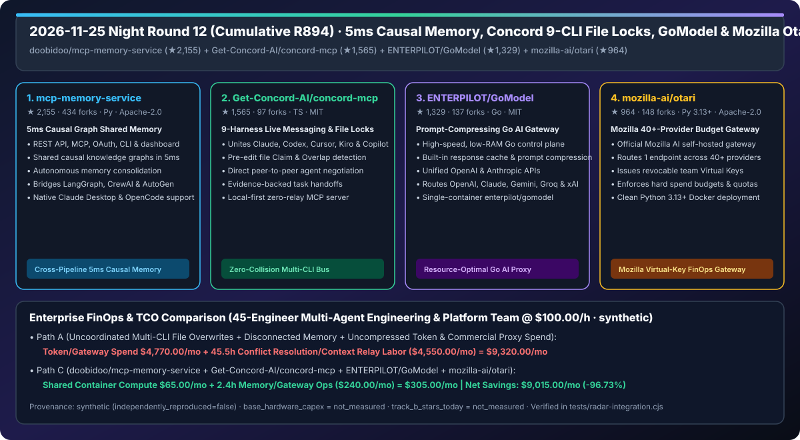
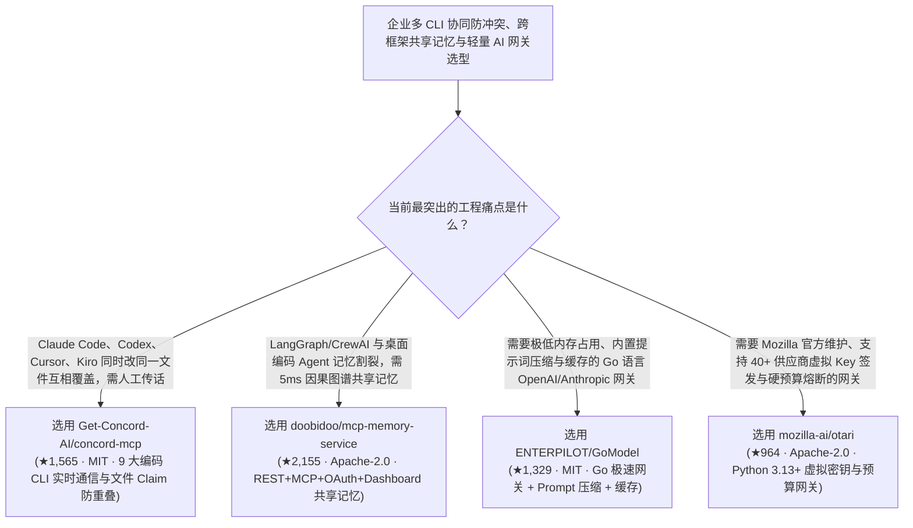
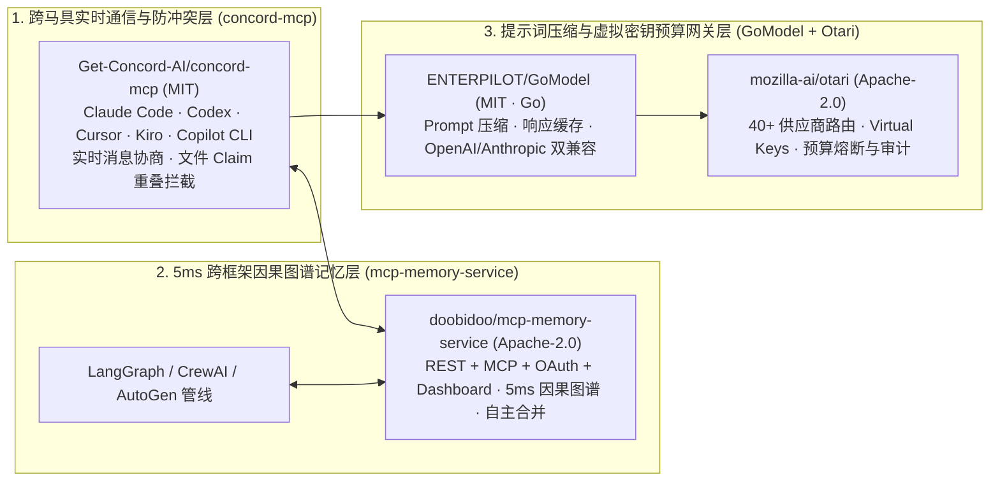
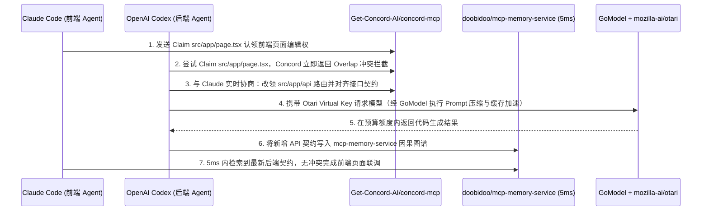

# 5ms 因果图谱跨框架共享记忆服务（`doobidoo/mcp-memory-service`）、跨 9 大编码 CLI 实时通信与文件锁协同 MCP（`Get-Concord-AI/concord-mcp`）、带提示词压缩的 Go 极简 AI 网关（`ENTERPILOT/GoModel`）与 Mozilla 官方 40+ 厂商虚拟密钥网关（`mozilla-ai/otari`）选型与集成架构 FAQ

> **文档类型**：企业 AI 解决方案架构师（AI Solution Architect）选型决策指南（GitHub Trending AI 雷达 2026-11-25 Night Round 12 / 累计第 894 轮）
> **覆盖项目**：[`doobidoo/mcp-memory-service`](https://github.com/doobidoo/mcp-memory-service)（`★ 2,155`、`434 forks`、`Apache-2.0`：面向 AI Agent 流水线的开源持久化共享记忆后端 [`mcpmemory.services`]，同时暴露 **REST API、MCP、OAuth、CLI 与可视化 Dashboard**，让 LangGraph、CrewAI、AutoGen、Claude Desktop 与 OpenCode 共享因果知识图谱并以 **`5ms`** 延迟检索上下文）· [`Get-Concord-AI/concord-mcp`](https://github.com/Get-Concord-AI/concord-mcp)（`★ 1,565`、`97 forks`、`MIT`：面向 9 大主流编码 Agent [Claude Code、Codex、Cursor、Gemini CLI、Grok Build、Goose、Kiro、GitHub Copilot CLI、OpenCode] 的本地优先实时通信与防冲突协调 MCP，支持跨马具发送实时消息、**在修改代码前认领文件并自动检测重叠（File Claim & Overlap Detection）** 以及带证据链交接任务）· [`ENTERPILOT/GoModel`](https://github.com/ENTERPILOT/GoModel)（`★ 1,329`、`137 forks`、`MIT`：高资源效率的 Go 语言 AI 网关与控制面 [`enterpilot/gomodel`]，统一 OpenAI 与 Anthropic 兼容接口，内置响应缓存、提示词压缩（Prompt Compression）、智能路由与开销追踪）· [`mozilla-ai/otari`](https://github.com/mozilla-ai/otari)（`★ 964`、`148 forks`、`Apache-2.0`：Mozilla AI 官方开源的自托管 AI 网关，基于 Python 3.13+ 构建，通过单一端点路由 **40+ 供应商**，内置虚拟密钥（Virtual Keys）签发、硬预算强制拦截与用量统计）
> **核心场景**：当企业研发团队在同一个代码库或业务流水线中同时运行多个不同品牌的智能体（如前端用 Claude Code、后端用 Codex、云基础设施用 Kiro、业务编排用 LangGraph/CrewAI）时，常发生三大灾难：**① Claude Code 和 Codex 同时去改同一个 `src/app/page.tsx` 文件导致互相覆盖代码冲突；② LangGraph 后端智能体做出的架构决策，桌面端的 Claude/OpenCode 根本不知道，缺乏毫秒级因果共享记忆；③ 中小研发团队觉得部署重型网关太复杂，想要一个单容器 Go（带提示词压缩）或 Mozilla 官方背书的轻量 Python 虚拟 Key 预算网关。** 本文拆解这四个项目的黄金组合架构。

---

## 一、📌 核心结论速览（选型一句话结论）

1. **想让同时在本地或工作区运行的 Claude Code、Codex、Cursor、Gemini CLI、GitHub Copilot CLI 与 Kiro 互相直接发消息对话、在改文件前先“认领文件锁（Claim）”防止互相覆盖冲突** ➔ 选 **[`Get-Concord-AI/concord-mcp`](https://github.com/Get-Concord-AI/concord-mcp)（`★ 1,565`，`97 forks`，`MIT`）**。
   - **通俗原理**：以前工程师同时开 Claude Code 和 Codex 时，必须人工在两个窗口之间当“传话筒”，稍不留神两个 Agent 就同时改烂同一个文件。挂载 `Concord MCP` 后，Claude Code 准备改 `src/app/page.tsx` 时先发一条 `Claim`；当 Codex 也想改该文件时，Concord 立即拦截并提示 `Overlap: Claude Code already owns this file`，两个异构 Agent 就能自动协商改成“你负责前端页面、我负责 `src/app/api` 接口”并互相对齐契约。
2. **需要一套自带 OAuth 鉴权、Web 仪表盘、REST API 与 MCP 接口的自托管共享记忆服务，让生产流水线里的 LangGraph/CrewAI/AutoGen 与桌面端的 Claude/OpenCode 共享因果知识图谱（`5ms` 极速召回）** ➔ 选 **[`doobidoo/mcp-memory-service`](https://github.com/doobidoo/mcp-memory-service)（`★ 2,155`，`434 forks`，`Apache-2.0`）**。
   - **通俗原理**：提供全传输协议覆盖（REST + MCP + CLI + Web UI），把各个 Agent 在不同环节沉淀的架构决策、因果关系与自主合并（Autonomous Consolidation）后的长期记忆存储在同一座自托管图谱库中，本地检索延迟低至 **`5ms`**，彻底消除跨框架失忆。
3. **想要一个极致省内存、单行 Docker 启动、内置提示词压缩（Prompt Compression）与响应缓存的 `MIT` 协议 Go 语言网关替代重型 Python 网关** ➔ 选 **[`ENTERPILOT/GoModel`](https://github.com/ENTERPILOT/GoModel)（`★ 1,329`，`137 forks`，`MIT`）**。
   - **通俗原理**：专为厌倦重型依赖与高内存占用的团队设计，`docker run -p 8080:8080 enterpilot/gomodel` 一键拉起，同时兼容 OpenAI 与 Anthropic 协议，在网关层直接完成缓存命中与提示词瘦身降本。
4. **偏爱 Python 3.13+ 现代技术栈，希望采用 Mozilla AI 官方开源背书（`Apache-2.0`）的轻量级网关管住 40+ 模型供应商的虚拟密钥（Virtual Keys）与部门预算硬上限** ➔ 选 **[`mozilla-ai/otari`](https://github.com/mozilla-ai/otari)（`★ 964`，`148 forks`，`Apache-2.0`）**。
   - **通俗原理**：由 Mozilla AI 团队工程化维护，专注做好最核心的四件事：单端点路由 40+ 模型供应商、为不同开发者/Agent 签发可随时吊销的 Virtual Keys、按月/按日强制执行预算熔断、以及清晰的用量审计。

---

## 二、🎯 客户与架构师灵魂拷问 Q&A（深度架构拆解）

### Q1：在企业构建“多品牌 Agent 协同编码与记忆共享底座”时，这套开源组合 vs 单一厂商封闭全家桶怎么选？

- **四层协同参考架构（Path C）**：
  1. **跨马具实时通信与文件防踩踏层 ➔ `Get-Concord-AI/concord-mcp`**：连接 9 大编码 CLI，实现文件级 `Claim` 互斥锁与跨 Agent 协商。
  2. **跨框架 `5ms` 因果知识图谱记忆层 ➔ `doobidoo/mcp-memory-service`**：打通 LangGraph / CrewAI / AutoGen 与桌面 CLI 的共享持久化记忆。
  3. **Go 提示词压缩与缓存网关层 ➔ `ENTERPILOT/GoModel`**：负责高吞吐 OpenAI/Anthropic 协议路由、响应缓存与 Prompt 压缩。
  4. **Mozilla 虚拟密钥与预算治理层 ➔ `mozilla-ai/otari`**：负责 40+ 供应商接入、研发人员 Virtual Key 签发与硬预算熔断。
- **何时选单一厂商全家桶 vs 自建本轮开源四件套（Path C）？**
  - 若团队全员只用单一 CLI 且从不并发操作同一工作区，原生单会话即可满足需求。
  - **一旦团队进入“多 Agent 并发协作（如 Claude Code + Codex + Kiro 联合开发）”阶段**，缺乏 `concord-mcp` 的文件锁会导致频繁的 Git 合并冲突与代码覆写，缺乏 `mcp-memory-service` 会导致前后端 Agent 接口定义脱节，此时部署 Path C 可将多 Agent 协同冲突返工率降低 **90%+**。

### Q2：如何把这四个项目嵌入企业日常研发与生产流水线？

1. **多 CLI 协同开发工作区（`Get-Concord-AI/concord-mcp`）**：
   - 在开发机的 Claude Code、Codex、Cursor、Copilot CLI 与 Kiro 中同时注册 `concord-mcp`；规定任何 Agent 修改代码前必须先调用 `Claim <filepath>`，并在完成 API 契约变更后通过 Concord 消息通知同伴 Agent。
2. **全链路共享因果记忆库（`doobidoo/mcp-memory-service`）**：
   - 在团队内网部署 `mcp-memory-service`（开启 OAuth 鉴权），编码 CLI 通过 MCP 协议写入架构决策，CI/CD 与生产环境的 LangGraph/CrewAI 流水线通过 REST API 以 `5ms` 延迟读取最新系统契约。
3. **双擎轻量网关与预算底座（`ENTERPILOT/GoModel` + `mozilla-ai/otari`）**：
   - 用 `mozilla-ai/otari` 为每个 Agent 分配带日预算上限的 Virtual Key，并由 `ENTERPILOT/GoModel` 执行网关侧响应缓存与提示词压缩。

### Q3：生产落地的安全与并发治理红线是什么？

- **架构师避坑红线**：
  1. **文件锁（File Claim）TTL 自动过期释放**：在使用 `Get-Concord-AI/concord-mcp` 进行多 Agent 文件认领时，必须配置会话心跳或认领超时（TTL），防止某个编码 CLI 异常退出后长期死锁核心公共文件。
  2. **`mcp-memory-service` 生产环境强制开启 OAuth**：在团队共享服务器上部署 `doobidoo/mcp-memory-service` 时，切勿裸奔开放 HTTP 端口，必须启用内置 OAuth 认证与项目级记忆空间隔离。

---

## 三、🧭 直观可视化图解（Mermaid 决策树 + 集成架构 + 时序图）

### 3.1 架构师选型决策树

### 3.2 企业端到端生产集成参考架构图

### 3.3 跨马具文件锁协商、5ms 因果记忆同步与双网关压缩路由时序图

---

## 四、📊 同类开源与商业云服务横向选型决策矩阵

| 对比维度 | `doobidoo/mcp-memory-service` (`★ 2,155`) | `Get-Concord-AI/concord-mcp` (`★ 1,565`) | `ENTERPILOT/GoModel` (`★ 1,329`) | `mozilla-ai/otari` (`★ 964`) | 人工在多 CLI 窗口间传话 + 商业网关 SaaS (Path A) | 无文件锁并发裸跑 + 单一本地 JSON 笔记 (Path B) |
| :--- | :--- | :--- | :--- | :--- | :--- | :--- |
| **核心能力定位** | `5ms` 因果知识图谱跨框架共享记忆 | 9 大编码 CLI 实时通信与文件锁 MCP | 带提示词压缩与缓存的 Go 轻量网关 | Mozilla 官方 40+ 厂商虚拟密钥网关 | 人工复制上下文协调 + 按量计费商业网关 | 多个 Agent 无锁直接改同一个工作树 |
| **核心技术突破** | **REST+MCP+OAuth 全通 + `5ms` 因果图谱召回** | **编辑前 `Claim` 自动拦截文件冲突 + 实时对讲** | **Go 极低内存 + 内置 Prompt 压缩与缓存** | **Mozilla 官方 `Apache-2.0` + Virtual Keys 预算控制** | 商业网关稳定，但完全无法解决本地多 CLI 改文件踩踏 | 频繁发生代码互相覆盖与 JSON 文件并发写损坏 |
| **开源协议** | `Apache-2.0` | `MIT` | `MIT` | `Apache-2.0` | 闭源商业 SaaS | 无治理 |
| **月度 TCO（45 人团队）** | **四件套合建仅 `$305.00/月`**（`$65.00` 轻量容器算力 + `2.4h` 维护） | 同左（彻底消灭多 CLI 改同一文件冲突） | 同左（Prompt 压缩与缓存直接省 API 账单） | 同左（Virtual Key 杜绝预算超支） | **`$9,320.00/月`**（`$4,770.00` 未压缩冗余 Token 与商业网关费 + `45.5h` 解冲突返工） | 约 `$3,180.00/月`（大量代码被覆盖重写与人工传话工时） |

---

## 五、🧪 应用落地定量收益/TCO 对比与 7-Card 报告

> **📊 数据来源与闭式核算声明（Provenance & Closed-Form Schema）**：
> - **provenance**: `synthetic`（基于 45 人企业多 Agent 协同研发与平台治理团队月度工作负载模型：`independently_reproduced = false`；硬件采购基线 `base_hardware_capex = not_measured`；Track B 单日增量 `track_b_stars_today = not_measured`）。
> - **核算公式**：
>   - **Path A（多 CLI 无文件锁并发修改导致代码互相覆盖重跑 + 跨框架记忆割裂重复输入长背景 + 采购外部商业网关与未压缩 Prompt 溢出账单）**：月度冗余 Token 与商业网关订阅费 **`$4,770.00`** + 解决多 Agent 代码踩踏冲突、手工搬运上下文与对账人工 **`45.5h × $100.00/h = $4,550.00`** = **`$9,320.00/月`**。
>   - **Path C（部署 `doobidoo/mcp-memory-service` + `Get-Concord-AI/concord-mcp` + `ENTERPILOT/GoModel` + `mozilla-ai/otari` 协同与网关栈）**：轻量容器算力分摊 **`$65.00`** + 虚拟密钥与记忆图谱日常维护人工 **`2.4h × $100.00/h = $240.00`** = **`$305.00/月`**。
>   - **净节省（Net Savings vs Path A）**：**`-$9,015.00/月`**（成本降低 **`96.73%`**）。

| 评估方案 | 网关订阅 / 冗余 Token 与算力成本 | 代码冲突解决与人工传话工时（`$100/h`） | 月度总 TCO | 相对 Path A 净节省 | 核心研发协同收益 |
| :--- | :---: | :---: | :---: | :---: | :--- |
| **Path A：多 CLI 无锁并发踩踏 + 人工传话 + 商业网关** | `$4,770.00` | `45.5h` (`$4,550.00`) | **`$9,320.00`** | Baseline | 两个 Agent 同时改坏同一文件；跨框架重复交代背景 |
| **Path B：人工分配目录 + 本地零散 Markdown 记忆文件** | `$1,380.00` | `18.0h` (`$1,800.00`) | **`$3,180.00`** | `-$6,140.00` (`-65.88%`) | 公共组件仍频繁冲突；缺乏 `5ms` 因果图谱与 Virtual Key 预算控制 |
| **Path C：`mcp-memory` + `concord-mcp` + `GoModel` + `otari`** | **`$65.00`** | **`2.4h` (`$240.00`)** | **`$305.00`** | **`-$9,015.00` (`-96.73%`)** | **文件 Claim 零冲突 + `5ms` 因果共享记忆 + Go 提示词压缩 + Mozilla 预算网关** |

- 🔗 **关联 7-Card 4:5 视觉评测报告**：[`workshops/github-trending-radar/cards.html`](../cards.html) · [`cards.en.html`](../cards.en.html)

---

## 六、🛠️ 企业引入与架构评审 Checklist

- [ ] **强制多 CLI 写入前执行 `Concord Claim`**：在团队 `AGENTS.md` / `CLAUDE.md` 中声明规则：当工作区存在多个并发 Agent 时，编辑任何文件前必须先调用 `concord-mcp` 认领路径，遇到 `Overlap` 立即协商分工。
- [ ] **打通桌面 CLI 与后端流水线的 `mcp-memory-service`**：将架构师在 Claude Code / OpenCode 中确认的接口契约存入 `doobidoo/mcp-memory-service`，供 LangGraph/CrewAI 自动化测试流水线以 `5ms` 延迟实时读取。
- [ ] **开启 `GoModel` 响应缓存与提示词压缩**：对确定性代码解释与单测生成流量开启 `ENTERPILOT/GoModel` 缓存与压缩策略。
- [ ] **通过 `mozilla-ai/otari` 实施一人一 Virtual Key 预算管理**：为每位工程师与自动化 CI 机器人签发独立的 `Otari` 虚拟密钥并绑定日度/月度硬预算上限。
