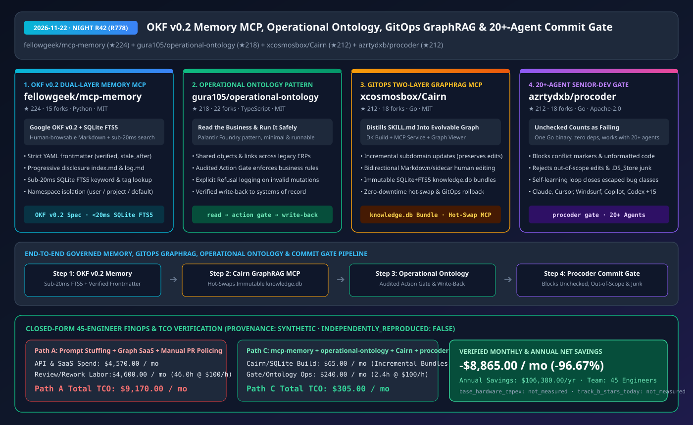
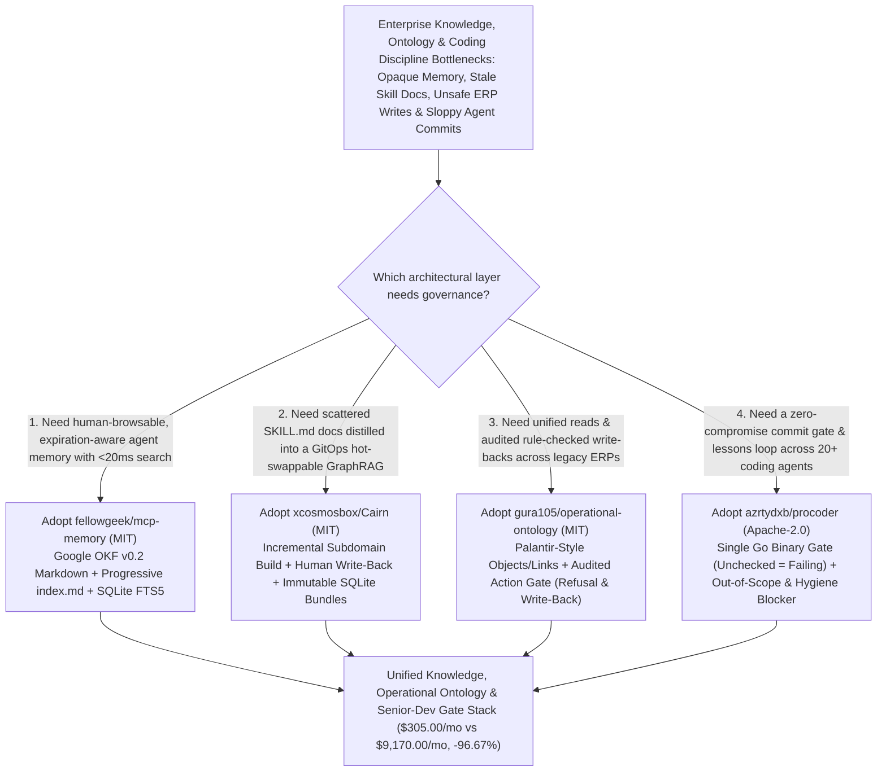
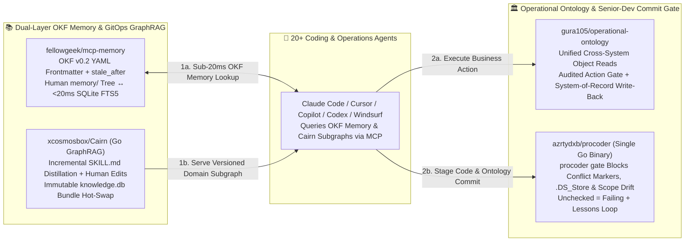

# OKF v0.2 Dual-Layer Memory MCP (`fellowgeek/mcp-memory`), Palantir-Style Operational Ontology (`gura105/operational-ontology`), GitOps Hot-Swappable GraphRAG MCP (`xcosmosbox/Cairn`) & 20+-Agent Senior-Dev Commit Gate (`azrtydxb/procoder`) — Enterprise Selection & Architecture FAQ

> **Document Type**: Enterprise AI Solution Architect Application Landing & Comparative Selection Guide (2026-11-22 Night Round 42 / Cumulative Round `R778`)  
> **Evaluated Repositories**: `fellowgeek/mcp-memory` (`★ 224`, `15 forks`, Python, MIT) · `gura105/operational-ontology` (`★ 218`, `22 forks`, TypeScript, MIT) · `xcosmosbox/Cairn` (`★ 212`, `18 forks`, Go, MIT) · `azrtydxb/procoder` (`★ 212`, `18 forks`, Go, Apache-2.0)  
> **Provenance Declaration**: Live GitHub repository metadata comes from our 2026-11-22 sealed evidence snapshot and GitHub REST API. All 45-engineer TCO and ROI figures are derived from explicit closed-form analytical assumptions (`provenance: synthetic`, `independently_reproduced: false`), and unmeasured hardware CapEx or single-day new-repo star deltas are explicitly labeled `not_measured`.



---

## ① 📌 Executive Summary (One-Sentence Selection Verdict)

> **One-Sentence Verdict**: For a 45-engineer enterprise knowledge architecture, legacy system integration, and AI coding governance team, **stop storing agent memories in opaque blobs without expiration metadata, mistaking a read-only BI semantic layer for an audited operational write-back gate across legacy ERPs, rebuilding entire GraphRAG indexes from scratch whenever a `SKILL.md` changes, or letting coding agents declare "done" while staging merge-conflict markers and `.DS_Store` junk**; instead, deploy the open-source stack of **`fellowgeek/mcp-memory` (Google OKF v0.2 Markdown + sub-20ms SQLite FTS5 dual-layer memory MCP) + `gura105/operational-ontology` (Palantir Foundry-inspired domain model with audited Action Gate and write-back to systems of record) + `xcosmosbox/Cairn` (human-editable, incrementally distilled two-layer GraphRAG served over MCP via GitOps hot-swappable SQLite bundles) + `azrtydxb/procoder` (single Go binary commit gate and lessons loop across 20+ coding agents)**, reducing monthly TCO from **`$9,170.00/mo`** to **`$305.00/mo`** (net savings of **`$8,865.00/mo`**, or **`96.67%`**).

| Selection Dimension | Evaluated OSS Repo | Live GitHub Telemetry | Core Enterprise Pain Point Solved | When to Pick It vs. Managed Cloud PaaS |
| :--- | :--- | :--- | :--- | :--- |
| **OKF v0.2 Dual-Layer Memory MCP** | **`fellowgeek/mcp-memory`** | `★ 224` · `15 forks` · Python · MIT | Opaque vector/JSON memories lack `stale_after` expiration, provenance verification, and human-browsable Git diffs | Pick **`mcp-memory`** when you need **strict Google Open Knowledge Format (OKF v0.2) compliance combining a human-browsable `memory/` Markdown directory (`index.md` progressive disclosure) with sub-20ms SQLite FTS5 search** |
| **Operational Ontology Reference Pattern** | **`gura105/operational-ontology`** | `★ 218` · `22 forks` · TypeScript · MIT | Post-M&A enterprises inherit multiple legacy order/ERP schemas; read-only semantic layers cannot safely govern AI write-backs | Pick **`operational-ontology`** when you want **a clear, runnable TypeScript blueprint of the Palantir Foundry pattern—unified objects/links for reading plus an audited Action Gate (`read → write → refusal → write-back`)**; pick Microsoft Fabric IQ / Palantir for turnkey enterprise SaaS |
| **GitOps Two-Layer GraphRAG MCP** | **`xcosmosbox/Cairn`** | `★ 212` · `18 forks` · Go · MIT | Stuffing all `SKILL.md` files into prompts wastes tokens, while standard GraphRAG overwrites human edits and lacks release rollback | Pick **`Cairn`** when you want **LLMs to incrementally distill skill docs into a human-editable two-layer graph (`knowledge.db` SQLite+FTS5) distributed as immutable GitHub Release bundles with zero-downtime MCP hot-swap** |
| **20+-Agent Senior-Dev Commit Gate** | **`azrtydxb/procoder`** | `★ 212` · `18 forks` · Go · Apache-2.0 | Coding agents claim tasks are "done" while leaving unformatted files, merge-conflict markers, out-of-scope edits, or `.DS_Store` files staged | Pick **`procoder`** when you need **one zero-dependency Go binary working across 20+ agents (Claude, Cursor, Windsurf, Copilot, Codex) where unchecked counts as failing and escaped bugs feed a permanent lessons loop** |

---

## ② 🎯 Solution Architect & Customer Deep-Dive Q&A

### Q1: Why do enterprise AI initiatives stall between "reading scattered docs/databases" and "trusted production execution"—and how do these four projects bridge that gap?

**Plain-Language Breakdown for Chief Architects & Engineering Leaders**:
1. **"A Semantic Layer Lets You Read Your Business; An Operational Ontology Lets You Run It" (`gura105/operational-ontology`)**: When a company acquires a competitor and inherits two legacy order systems with incompatible schemas and status codes, a standard semantic layer only helps answer read-only BI queries. `operational-ontology` distills the core architectural pattern behind **Palantir Foundry's Ontology** into a clean, runnable TypeScript reference implementation (`pnpm demo && pnpm test`): reads travel from a unified object/link model to agents and apps, while writes must pass through an **audited Action Gate** that enforces cross-system business rules, records explicit **refusals** on invalid transitions, and writes valid changes back to the underlying systems of record.
2. **Standardized, Human-Auditable Agent Memory Under Google OKF v0.2 (`fellowgeek/mcp-memory`)**: Instead of trapping agent memories inside proprietary vector blobs, `mcp-memory` formats every record as an **Open Knowledge Format (`OKF v0.2`)** Markdown document with strict YAML frontmatter (`type`, `key`, `namespace`, `tags`, `generated`, `sources`, `verified`, `status`, `stale_after`). Its dual-layer architecture syncs a human-browsable `memory/` folder (with hierarchical `index.md` progressive disclosure and `log.md` history) to a local **SQLite FTS5 index delivering sub-20ms lookups**.
3. **Turning Scattered `SKILL.md` Docs Into a GitOps-Versioned Knowledge Graph (`xcosmosbox/Cairn`)**: `Cairn` solves the three hardest operational problems of GraphRAG over engineering documentation: (a) **incremental updates** (`cairn-incremental`) recompute only affected subdomains while preserving human edits; (b) **bidirectional structured write-back** lets humans edit Markdown blocks/sidecars directly in Git; and (c) **immutable SQLite+FTS5 bundles (`knowledge.db`)** published via GitHub Releases (`stable.json`) allow MCP servers to hot-swap or roll back domain knowledge with zero downtime.
4. **Enforcing Senior-Developer Discipline Across 20+ Coding Agents (`azrtydxb/procoder`)**: Without a hard gate, "done" is whatever the LLM last claimed. `procoder` ships a single Go binary with native adapters for **Claude Code, Cursor, Windsurf, Cline, Kilo Code, Roo, Kiro, Codex CLI, Copilot CLI, Gemini, and OpenCode**. Running `procoder check` / `procoder gate` enforces a strict rule—**unchecked counts as failing**—blocking unformatted files, leftover merge conflict markers (`<<<<<<<`), staged junk files (`.DS_Store`), and out-of-scope edits, while its **lessons loop** turns every escaped bug into a permanently closed class.

### Q2: How do these four components integrate into a governed enterprise AI engineering & operations architecture?

**End-to-End Integration Architecture**:
1. **Stateful OKF Memory Plane (`fellowgeek/mcp-memory`)**: Manages per-user and per-project stateful memories with namespace isolation (`user/preferences`, `project/architecture`), `stale_after` expiration, and `<20ms` SQLite FTS5 search.
2. **GitOps Domain Knowledge Graph Plane (`xcosmosbox/Cairn`)**: Continuously distills repository `SKILL.md` and reference docs into versioned, hot-swappable `knowledge.db` GraphRAG bundles served over MCP.
3. **Operational Ontology Action Plane (`gura105/operational-ontology`)**: Mediates all business-state reads and writes across heterogeneous legacy databases through an audited Action Gate.
4. **Pre-Commit Quality & Scope Gate Plane (`azrtydxb/procoder`)**: Enforces deterministic formatting, scope, hygiene, and lessons-loop checks across all 20+ coding agents before any code or ontology change lands in Git.

### Q3: Where are the architectural boundaries?

**Boundaries & Trade-offs**:
- **Reference Implementation vs. Turnkey Enterprise Platform**: `gura105/operational-ontology` is intentionally a minimal, readable TypeScript reference implementation for learning and custom service scaffolding; organizations seeking a managed petabyte-scale ontology platform with enterprise RBAC should evaluate **Microsoft Fabric (OneLake + Fabric IQ)** or Palantir Foundry.

---

## ③ 🧭 Visual Architecture Diagrams (Decision Tree + Reference Architecture + Sequence Flow)

### 3.1 Selection Decision Tree (Mermaid Flowchart)



### 3.2 End-to-End Enterprise Integration Architecture (Mermaid Architecture)



### 3.3 Post-M&A Order Integration, GraphRAG Hot-Swap & Commit Gate Sequence (Mermaid Sequence)

```mermaid
sequenceDiagram
    autonumber
    actor Arch as Enterprise Solution Architect
    participant Cairn as xcosmosbox/Cairn (GitOps GraphRAG MCP)
    participant Mem as fellowgeek/mcp-memory (OKF v0.2 MCP)
    participant Onto as operational-ontology (Action Gate)
    participant Proc as azrtydxb/procoder (Commit Gate)

    Arch->>Cairn: Update post-merger order-cancellation SKILL.md & sidecar graph notes
    Cairn->>Cairn: cairn-incremental rebuilds affected subdomain (preserving human edits) & hot-swaps knowledge.db bundle
    Arch->>Mem: Agent queries project/architecture namespace via sub-20ms SQLite FTS5 (OKF v0.2 verified)
    Mem-->>Onto: Agent implements unified cancelOrder action across both legacy order databases
    Onto->>Onto: Run pnpm test: verify Action Gate refuses invalid status & writes back valid cancellations
    Onto->>Proc: Agent attempts commit; procoder gate inspects staged files
    Proc-->>Onto: BLOCKING: detect merge conflict marker in notes.md & staged .DS_Store junk
    Onto->>Proc: Agent cleans hygiene violations & passes procoder gate; lessons loop records rule
```

---

## ④ 📊 Comparative Selection Matrix (OSS vs. Commercial Cloud PaaS)

| Comparison Dimension | `fellowgeek/mcp-memory` | `gura105/operational-ontology` | `xcosmosbox/Cairn` | `azrtydxb/procoder` | Unstructured Vector RAG + Read-Only BI + Manual PR Review |
| :--- | :--- | :--- | :--- | :--- | :--- |
| **Primary Role** | OKF v0.2 Markdown + SQLite FTS5 persistent memory MCP | Palantir-style operational ontology with audited write-back | GitOps-versioned, human-editable two-layer GraphRAG MCP | Senior-developer commit gate & lessons loop for 20+ agents | Opaque vector store + read-only semantic layer + ad-hoc CI linters |
| **Governance & Auditability** | **Strict OKF v0.2 YAML frontmatter** (`verified`, `stale_after`, `log.md`) | **Audited Action Gate** enforces business rules & logs refusals | **Preserves human edits** on incremental build; instant bundle rollback | **Unchecked counts as failing**; blocks out-of-scope & junk files | Stale memories pollute prompts; agents commit conflict markers & `.DS_Store` |
| **Runtime Footprint** | Python + local SQLite FTS5 triggers (**`<20ms` lookup**) | Minimal, zero-lock-in TypeScript reference implementation | Go build daemon + immutable SQLite+FTS5 `knowledge.db` bundle | **Single Go binary, zero runtime dependencies** | Heavy graph DB clusters + expensive LLM review passes |
| **License** | **MIT** | **MIT** | **MIT** | **Apache-2.0** | Proprietary SaaS |

---

## ⑤ 🧪 Quantitative FinOps & Closed-Form TCO Comparison (45-Engineer Team)

### 5.1 Explicit Closed-Form Assumptions (`provenance: synthetic`, `independently_reproduced: false`)
- **Team & Labor Baseline**: `team_size_engineers = 45` engineers; blended architecture/engineering hourly rate `hourly_rate_usd = $100.00/hr`; `base_hardware_capex = not_measured`; `track_b_stars_today = not_measured`.
- **Path A (Baseline: Full-Doc Context Stuffing + Commercial Graph/Code-Hygiene SaaS + Manual PR Hygiene & Legacy Write-Back Rework)**:
  - **API & Commercial SaaS Spend (`path_a_api_saas_usd`)**: Stuffing unindexed skill docs into context windows, managed graph DB hosting, and commercial code-review SaaS seats = **`$4,570.00/mo`**;
  - **Manual Review & Rework Labor (`path_a_labor_hours`)**: **`46.0 hours/mo`** spent rejecting sloppy agent commits (conflict markers, out-of-scope edits, `.DS_Store`), manually re-indexing knowledge bases, and fixing unvalidated legacy DB writes = `46.0 × $100.00 =` **`$4,600.00/mo`** (`path_a_labor_usd`);
  - **Path A Total Monthly TCO (`path_a_total_usd`)**: `$4,570.00 + $4,600.00 =` **`$9,170.00/mo`**.
- **Path C (Hybrid Open-Source Stack: `mcp-memory` + `operational-ontology` + `Cairn` + `procoder`)**:
  - **Incremental Graph Distillation & CI Compute (`path_c_compute_usd`)**: Incremental `Cairn` subdomain distillation plus local SQLite FTS5 and single-binary `procoder` execution = **`$65.00/mo`**;
  - **Ontology & Lessons-Loop Governance Labor (`path_c_labor_hours`)**: **`2.4 hours/mo`** curating `Cairn` release bundles and `procoder` lessons-loop rules = `2.4 × $100.00 =` **`$240.00/mo`** (`path_c_labor_usd`);
  - **Path C Total Monthly TCO (`path_c_total_usd`)**: `$65.00 + $240.00 =` **`$305.00/mo`**.
- **Closed-Form Net Savings & Percentage Reduction**:
  - **Monthly Net Savings (`net_savings_usd`)**: `$9,170.00 - $305.00 =` **`$8,865.00/mo`** (`$106,380.00/yr`);
  - **Percentage TCO Reduction (`pct_savings`)**: `$8,865.00 / $9,170.00 × 100% =` **`96.67%`**.

| Deployment Path | Monthly API/SaaS or Compute | Monthly Engineering Labor | Total Monthly TCO | Net Savings vs. Path A | Architectural Outcome |
| :--- | :--- | :--- | :--- | :--- | :--- |
| **Path A: Full-Doc Prompt Stuffing + Commercial Graph SaaS + Manual PR Policing** | `$4,570.00` | `$4,600.00` (`46.0h`) | **`$9,170.00/mo`** | Baseline (`0.00%`) | Opaque stale memory; full-graph rebuilds overwrite human edits; sloppy commits |
| **Path B: Standard OSS GraphRAG + Basic Pre-Commit Linters** | `$2,260.00` | `$1,200.00` (`12.0h`) | **`$3,460.00/mo`** | `-$5,710.00/mo` (`-62.27%`) | No human write-back preservation or GitOps bundle hot-swap; no scope gate |
| **Path C: `mcp-memory` + `operational-ontology` + `Cairn` + `procoder` (Recommended)** | **`$65.00`** | **`$240.00`** (`2.4h`) | **`$305.00/mo`** | **`-$8,865.00/mo` (`-96.67%`)** | **OKF <20ms memory + GitOps GraphRAG + audited Action Gate + 20+-agent commit gate** |

---

## ⑥ 🛠️ Enterprise Onboarding & Architecture Review Checklist

- [ ] **OKF v0.2 Frontmatter & Sub-20ms FTS5 Setup (`fellowgeek/mcp-memory`)**: Configure `mcp-memory` across developer MCP clients, verify `okf_version: "0.2"` progressive `index.md` generation under `memory/`, and enforce `stale_after` expiration policies.
- [ ] **Audited Action Gate & Write-Back Verification (`gura105/operational-ontology`)**: Model cross-system enterprise mutations after `operational-ontology`'s `read → write → refusal → write-back` pipeline so agents never write directly to legacy tables without rule verification and audit logging.
- [ ] **Incremental Skill-Graph Build & GitOps Bundle Hot-Swap (`xcosmosbox/Cairn`)**: Deploy `cairnd` and `cairn-incremental` on internal `SKILL.md` repositories, confirm human Markdown edits survive incremental re-indexing, and serve immutable `knowledge.db` Release bundles over MCP.
- [ ] **20+-Agent Commit Gate & Lessons Loop Rollout (`azrtydxb/procoder`)**: Initialize `/procoder:init` across repositories so Claude Code, Cursor, Windsurf, Copilot CLI, and Codex CLI cannot mark tasks done with unformatted files, merge conflict markers, `.DS_Store` junk, or out-of-scope changes.
