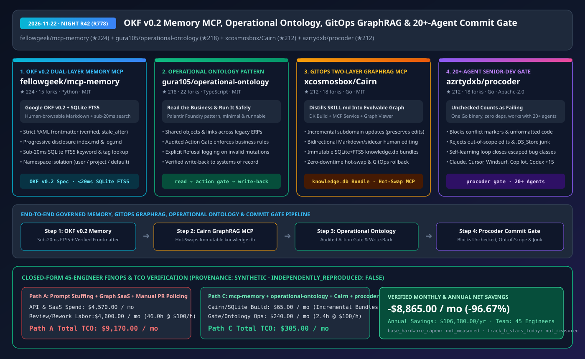
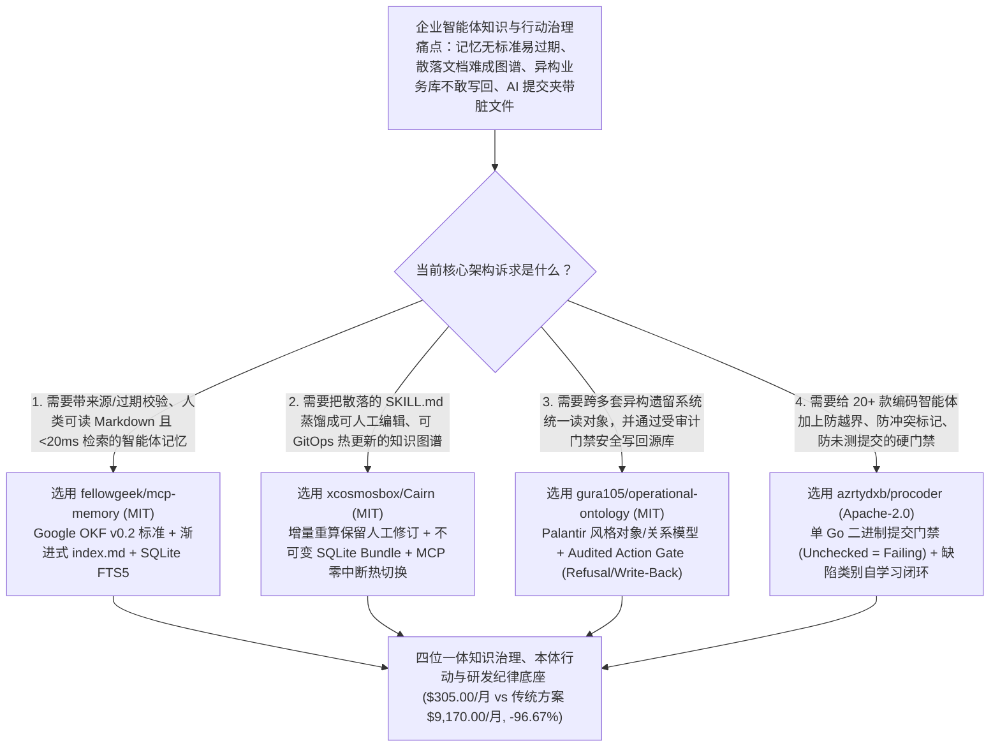
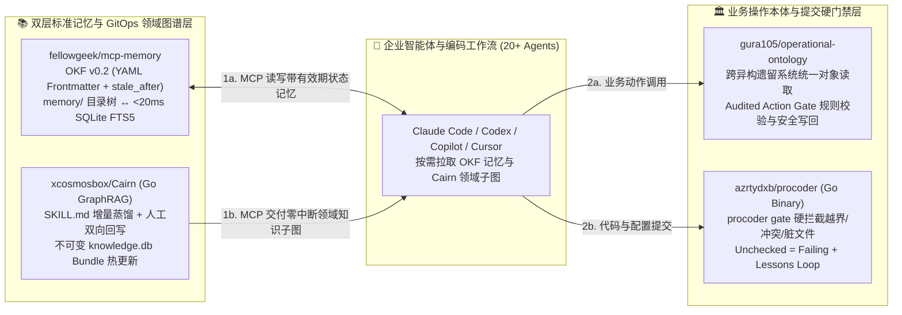
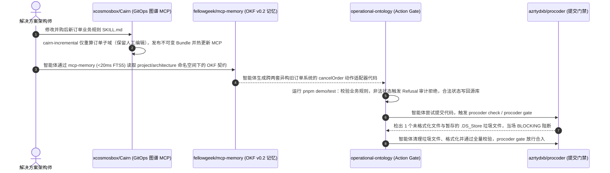

# OKF v0.2 标准双层长程记忆 MCP（`fellowgeek/mcp-memory`）、Palantir 风格可写回业务操作本体参考实现（`gura105/operational-ontology`）、GitOps 热更新双层知识图谱 MCP（`xcosmosbox/Cairn`）与 20+ 编码智能体零妥协提交门禁（`azrtydxb/procoder`）企业选型与集成架构 FAQ

> **文档类型**：AI 解决方案架构师（AI Solution Architect）企业应用落地与横向选型指南（2026-11-22 Night Round 42 / 累计第 778 轮 `R778`）  
> **评测锚点**：`fellowgeek/mcp-memory` (`★ 224`, `15 forks`, Python, MIT) · `gura105/operational-ontology` (`★ 218`, `22 forks`, TypeScript, MIT) · `xcosmosbox/Cairn` (`★ 212`, `18 forks`, Go, MIT) · `azrtydxb/procoder` (`★ 212`, `18 forks`, Go, Apache-2.0)  
> **Provenance 声明**：本文实时 GitHub 元数据采自 2026-11-22 封存快照与 GitHub REST API；45 人企业架构与智能体工程团队的 TCO 与 ROI 测算均为显式闭式假设推导（`provenance: synthetic`, `independently_reproduced: false`），所有未实测硬件资本开支与新仓单日增量统一标注为 `not_measured`。

---

## ① 📌 核心结论速览（选型一句话结论）

> **一句话选型结论**：在 45 人规模的企业知识治理、业务系统融合与 AI 编码规范团队中，**切勿让智能体记忆沦为人类无法审阅的黑盒数据库、把只能“只读看报表”的语义层当成能安全改写核心 ERP/订单库的操作底座、每次改一行文档就全量重算整张 GraphRAG 图谱，或任由 AI 把未验证、越界修改乃至 `.DS_Store` 垃圾文件塞进 Git 提交**；应当采用 **“MCP-Memory（遵循 Google OKF v0.2 标准的 Markdown + `<20ms` SQLite FTS5 双层记忆）+ Operational Ontology（对标 Palantir Foundry 的统一业务对象读取与受审计 Action Gate 写回底座）+ Cairn（支持人工双向编辑与 GitHub Release 不可变 Bundle 零中断热更新的二层 GraphRAG MCP）+ Procoder（兼容 20+ 智能体、视未检查为失败的单 Go 二进制提交门禁）”**，将月度综合 TCO 从 **`$9,170.00/月`** 压降至 **`$305.00/月`**（净省 **`$8,865.00/月`**，降幅 **`96.67%`**）。

| 选型维度 | 评测开源方案 | GitHub 实测指标 | 核心解决的企业业务痛点 | 一句话何时选它 vs 云端商业 PaaS |
| :--- | :--- | :--- | :--- | :--- |
| **OKF v0.2 双层智能体记忆 MCP** | **`fellowgeek/mcp-memory`** | `★ 224` · `15 forks` · Python · MIT | 传统智能体记忆库无过期时间（`stale_after`）与来源校验字段，且存进二进制库后人类无法直接用 Git/编辑器审阅 | 需要 **严格遵循 Open Knowledge Format (OKF v0.2) 规范、兼顾人类可浏览 `memory/` 层级目录（`index.md` 渐进披露）与 `<20ms` SQLite FTS5 全文检索** 时选 `mcp-memory` |
| **可写回业务操作本体参考实现** | **`gura105/operational-ontology`** | `★ 218` · `22 forks` · TypeScript · MIT | 企业并购或遗留系统并存时，多套订单/ERP 表结构与状态码各异；传统语义层只能只读查询，AI 写回极易破坏业务规则 | 需要 **理解并落地 Palantir Foundry 核心模式——用统一对象/关系读取异构系统，并通过强制业务规则与审计的 Action Gate 安全写回源系统（Systems of Record）** 时首选它；全托管重型平台选 Microsoft Fabric IQ / Palantir |
| **GitOps 热更新二层知识图谱 MCP** | **`xcosmosbox/Cairn`** | `★ 212` · `18 forks` · Go · MIT | 散落在各处的 `SKILL.md` 文档全量塞进上下文太贵，而普通 GraphRAG 无法保留人工对图谱的手工修订且无法像发版一样回滚 | 需要 **增量重算受影响子域、支持人类改 Markdown 即改图谱（双向结构化回写），并将 `knowledge.db` 打包为不可变 Release Bundle 供 MCP 零中断热更新** 时选 `Cairn` |
| **20+ 智能体资深研发纪律门禁** | **`azrtydxb/procoder`** | `★ 212` · `18 forks` · Go · Apache-2.0 | AI 智能体常把没跑测试、残留合并冲突标记、超出任务范围的改动或 `.DS_Store` 当作“已完成（Done）”直接提交 | 需要 **单一 Go 二进制、适配 Claude/Cursor/Copilot/Codex 等 20+ 智能体、把“未检查（Unchecked）”一律判为失败并带缺陷类别自学习闭环的硬门禁** 时选 `procoder` |

---

## ② 🎯 客户与架构师灵魂拷问 Q&A（直击业务落地痛点）

### Q1：很多企业都在谈“知识库 RAG”和“企业本体（Ontology）”，为什么上了生产后要么知识过期没人管，要么 AI 一执行写操作就闯祸？

**通俗解答（给首席架构师与数据/AI 负责人）**：
1. **“语义层只能读业务，操作本体才能跑业务”（`gura105/operational-ontology` 破局）**：
   假设公司刚完成并购，手里有两套表结构与状态编码完全不同的旧订单系统。如果只做数据仓库语义层，AI 最多帮你查报表；一旦让 AI 执行“取消高风险订单（`cancelOrder`）”，它不知道该改哪张表、更不知道哪些状态严禁取消。`operational-ontology` 用极简可读的 TypeScript 代码把 **Palantir Foundry 最核心的 Operational Ontology 模式** 彻底拆解透彻：**读取走统一领域对象与关联边（Objects & Links），而所有写操作必须经过受审计的动作门禁（Audited Action Gate）校验业务规则（不合规直接 Refusal 拒绝），通过后再按映射安全写回底层源系统（Write-back to Systems of Record）**。
2. **如何防止智能体的记忆变成“过期垃圾场”（`fellowgeek/mcp-memory` 破局）**？
   普通记忆插件随便塞一段 JSON 就完事，三个月后全成了过期的错误提示。`mcp-memory` 强制采用 Google 倡导的 **Open Knowledge Format (`OKF v0.2`)** 标准：每条记忆都是带严格 YAML Frontmatter（`type`, `key`, `namespace`, `tags`, `sources`, `verified`, `status`, `stale_after`）的 Markdown 文件，既在磁盘上生成带渐进式披露目录（`index.md` + `log.md`）的人类可读文件树，又通过自动触发器同步至本地 **SQLite FTS5 索引（`<20ms` 极速查找）**。
3. **团队成百上千份 `SKILL.md` 和架构规范怎么变成可随版本热回滚的图谱（`xcosmosbox/Cairn` 破局）**？
   `Cairn` 用 Go 构建了一套 **“构建端（`cairnd` / `cairn-incremental`）+ 查询端（MCP Service）+ 可视化（Viewer）”** 三件套：当某篇文档修改时，只增量重算受影响的子域，**并且识别保留人类的手工编辑（双向结构化回写）**；构建出的 `knowledge.db`（SQLite + FTS5）被打包成不可变 Bundle 发布到 GitHub Release，由 `stable.json` 指针控制全体智能体客户端 **零中断热切换或一键回滚**。
4. **如何治住 AI 编码智能体“嘴上说改好了，结果留着冲突标记和 `.DS_Store` 就提交”（`azrtydxb/procoder` 破局）**？
   `procoder` 是一个零运行时依赖的 Go 单二进制工具，内置对 Claude Code、Cursor、Windsurf、Cline、Copilot CLI、Codex CLI、Gemini、OpenCode 等 **20+ 款智能体** 的原生适配器。它奉行一条铁律：**“未检查即失败（Unchecked counts as failing）”**——只要存在未格式化文件、残留 `<<<<<<<` 合并冲突标记、暂存了 `.DS_Store` 垃圾文件、或者修改了超出当前任务范围（Out of Scope）的文件，`procoder gate` 当场阻断提交，并通过自学习循环（Lessons Loop）把逃逸过一次的 Bug 类别永久封死。

### Q2：如何把这四个组件组合成一套“标准记忆 + GitOps 领域图谱 + 受控业务本体写回 + 资深研发纪律门禁”的企业智能体架构？

**端到端集成架构设计**：
1. **个体与项目长程状态记忆层（`fellowgeek/mcp-memory`）**：按 `user/preferences`、`project/architecture` 等命名空间隔离存储符合 OKF v0.2 标准的记忆，自动过滤超过 `stale_after` 的过期条目，提供 `<20ms` SQLite FTS5 检索。
2. **团队级领域技能图谱分发层（`xcosmosbox/Cairn`）**：将团队沉淀的 `SKILL.md` 与 `references/*.md` 持续蒸馏为“领域 → 子域 → 实体/关系”二层知识图谱，通过 GitOps 打包为不可变 `knowledge.db` Bundle 下发至所有智能体 MCP 客户端。
3. **跨异构业务系统读写控制层（`gura105/operational-ontology`）**：当智能体需要操作企业核心业务数据时，通过 Operational Ontology 统一读取多套遗留系统状态，并经由 Audited Action Gate 校验业务不变量后安全写回源库。
4. **代码变更与知识入库质量门禁层（`azrtydxb/procoder`）**：无论是业务代码提交还是本体/Skill 仓库变更，统一由 `procoder check` 与 `procoder gate` 执行格式、冲突标记、越界修改与垃圾文件硬拦截。

### Q3：这套组合在企业落地时的边界是什么？

**适用边界与选型建议**：
- **`operational-ontology` 的定位边界**：该仓库是面向架构师与研发团队的高可读性 TypeScript 参考实现（Reference Implementation），用于快速在企业内部孵化定制化的轻量级 Ontology 动作网关；若企业需要开箱即用的 PB 级跨云数据湖治理与图形化权限编排，应直接选用 **Microsoft Fabric（OneLake + Fabric IQ）** 或商业 Palantir Foundry。

---

## ③ 🧭 直观可视化图解（选型决策树 + 集成参考架构 + 业务流时序图）

### 3.1 选型决策树（Mermaid Flowchart）

### 3.2 企业生产集成参考架构图（Mermaid Architecture）

### 3.3 跨遗留系统订单变更、领域图谱热更新与 `procoder` 提交门禁时序图（Mermaid Sequence Diagram）

---

## ④ 📊 同类开源与商业云服务横向选型决策矩阵

| 对比维度 | `fellowgeek/mcp-memory` | `gura105/operational-ontology` | `xcosmosbox/Cairn` | `azrtydxb/procoder` | 黑盒向量记忆 + 只读语义层 + 无门禁 AI 提交 |
| :--- | :--- | :--- | :--- | :--- | :--- |
| **核心功能定位** | 遵循 Google OKF v0.2 的双层长程记忆与 SQLite FTS5 MCP | 对标 Palantir Foundry 的跨异构系统操作本体与写回门禁 | 支持双向编辑与 GitOps 热更新的二层 GraphRAG MCP | 适配 20+ 智能体的单 Go 二进制提交门禁与缺陷自学习 | 无模式 JSON 记忆 + 昂贵商业图数据库 + 靠人工 Review 抓脏提交 |
| **可维护性与审计性** | **人类可直接浏览 `memory/` Markdown 树**，带 `verified` 与 `stale_after` | **读写分离**：统一模型读 + Audited Action Gate 校验写回 | **人改文档即改图谱**，GitHub Release 不可变 Bundle 秒级回滚 | **Unchecked = Failing**，精准拦截越界修改、冲突标记与缓存垃圾 | 向量库内容无法人工批量订正；AI 常把未完成工作谎报为 Done |
| **性能与运行时依赖** | Python + 本地 SQLite FTS5 触发器（**`<20ms` 查询**） | 纯 TypeScript 零框架锁定，清晰演示异构系统融合 | Go 守护进程 + SQLite FTS5 单文件 Bundle 分发 | **单一 Go 二进制、零运行时依赖**，不暗中篡改代码 | 需维护重型 Neo4j/向量集群与复杂 CI 脚本 |
| **开源协议** | **MIT** | **MIT** | **MIT** | **Apache-2.0** | 专有商业许可 |

---

## ⑤ 🧪 应用落地定量收益 / 闭式 TCO 对比（45 人企业架构与智能体团队）

### 5.1 闭式参数假设（`provenance: synthetic`, `independently_reproduced: false`）
- **团队规模与人力单价**：`team_size_engineers = 45` 人，架构师与研发工程师折算时薪 `hourly_rate_usd = $100.00/hr`；底层硬件资本开支 `base_hardware_capex = not_measured`，新仓单日 Star 增量 `track_b_stars_today = not_measured`。
- **Path A（基准方案：全量文档塞入长窗口消耗 Token + 采购商业知识图谱/代码质量 SaaS + 人工清理 AI 脏提交与手工核对跨系统写回错误）**：
  - **API 与商业 SaaS 订阅费（`path_a_api_saas_usd`）**：未蒸馏 `SKILL.md` 全量塞入上下文的 Token 消耗、商业图数据库托管费与代码卫生扫描 SaaS 席位，合计 **`$4,570.00/月`**；
  - **人工返工与数据修复工时（`path_a_labor_hours`）**：每月用于打回含冲突标记/越界改动的 AI PR、手工重建全量知识图谱及修复跨遗留系统写回脏数据耗费 **`46.0 小时`**，折合人工成本 `46.0 × $100.00 =` **`$4,600.00/月`**（`path_a_labor_usd`）；
  - **Path A 月度总成本（`path_a_total_usd`）**：`$4,570.00 + $4,600.00 =` **`$9,170.00/月`**。
- **Path C（开源混合自建方案：`mcp-memory` + `operational-ontology` + `Cairn` + `procoder`）**：
  - **自托管与构建资源费（`path_c_compute_usd`）**：`Cairn` 增量蒸馏构建与 SQLite Bundle 分发、`mcp-memory` 与 `procoder` 均本地零成本运行，月均算力与增量蒸馏 API 仅 **`$65.00/月`**；
  - **规则与图谱治理工时（`path_c_labor_hours`）**：每月仅需 **`2.4 小时`** 审阅 `Cairn` 增量 Bundle 与 `procoder` 经验闭环（Lessons Loop），折合人工成本 `2.4 × $100.00 =` **`$240.00/月`**（`path_c_labor_usd`）；
  - **Path C 月度总成本（`path_c_total_usd`）**：`$65.00 + $240.00 =` **`$305.00/月`**。
- **净节省与 ROI 闭式校验**：
  - **月度净节省（`net_savings_usd`）**：`$9,170.00 - $305.00 =` **`$8,865.00/月`**（年化节省 **`$106,380.00/年`**）；
  - **成本降幅百分比（`pct_savings`）**：`$8,865.00 / $9,170.00 × 100% =` **`96.67%`**。

| 方案路径 | 月度 API/SaaS 或算力费 | 月度架构与审查人工 | 月度综合 TCO 总额 | 相对 Path A 净节省 | 关键架构收益 |
| :--- | :--- | :--- | :--- | :--- | :--- |
| **Path A：全量文档塞 Prompt + 商业图库 + 人工拦截 AI 脏提交** | `$4,570.00` | `$4,600.00` (`46.0h`) | **`$9,170.00/月`** | 基准 (`0.00%`) | 记忆过期难清理，图谱无法保留人工修改，脏提交频发 |
| **Path B：普通开源 GraphRAG + 手写 Git pre-commit 脚本** | `$2,260.00` | `$1,200.00` (`12.0h`) | **`$3,460.00/月`** | `-$5,710.00/月` (`-62.27%`) | 每次改文档需全量重算图谱，缺乏跨 20+ 智能体的统一范围门禁 |
| **Path C：`mcp-memory` + `operational-ontology` + `Cairn` + `procoder`（推荐）** | **`$65.00`** | **`$240.00`** (`2.4h`) | **`$305.00/月`** | **`-$8,865.00/月` (`-96.67%`)** | **OKF 标准双层记忆 + GitOps 热更新图谱 + 受审计本体写回 + 20+ 智能体硬门禁** |

---

## ⑥ 🛠️ 企业引入与架构评审 Checklist

- [ ] **OKF v0.2 记忆规范与过期治理接入（`fellowgeek/mcp-memory`）**：在 Claude / Cursor / Codex / Windsurf 中运行 `python3 setup.py` 注册 `mcp-memory`，验证生成的 `memory/` 目录严格包含 `okf_version: "0.2"`、`verified` 与 `stale_after` 元数据，且 SQLite FTS5 查询延迟低于 `20ms`。
- [ ] **跨异构遗留系统 Action Gate 建模演练（`gura105/operational-ontology`）**：参考 `operational-ontology` 的 `pnpm demo` 与 `pnpm test` 架构，为企业内部跨 ERP/CRM 的高危写操作设计统一的 Audited Action Gate，确保所有不满足业务前置条件的调用均被确定性 `Refusal` 拒绝并留存审计日志。
- [ ] **SKILL 文档增量蒸馏与不可变 Bundle 热分发（`xcosmosbox/Cairn`）**：配置 `cairnd` 与 `cairn-incremental` 监听企业 `SKILL.md` 仓库，验证人工编辑 Markdown 图谱块不被增量构建覆盖，并通过 `stable.json` 与 GitHub Release 验证消费端 MCP 零中断热更新与回滚。
- [ ] **20+ 编码智能体统一提交硬门禁部署（`azrtydxb/procoder`）**：在各核心代码仓执行 `/procoder:init` 与 `procoder check`，确认未格式化代码、合并冲突标记、`.DS_Store` 垃圾文件及越界文件修改一律触发 `BLOCKING`，并将线上逃逸缺陷录入 `procoder` 自学习规则库。
