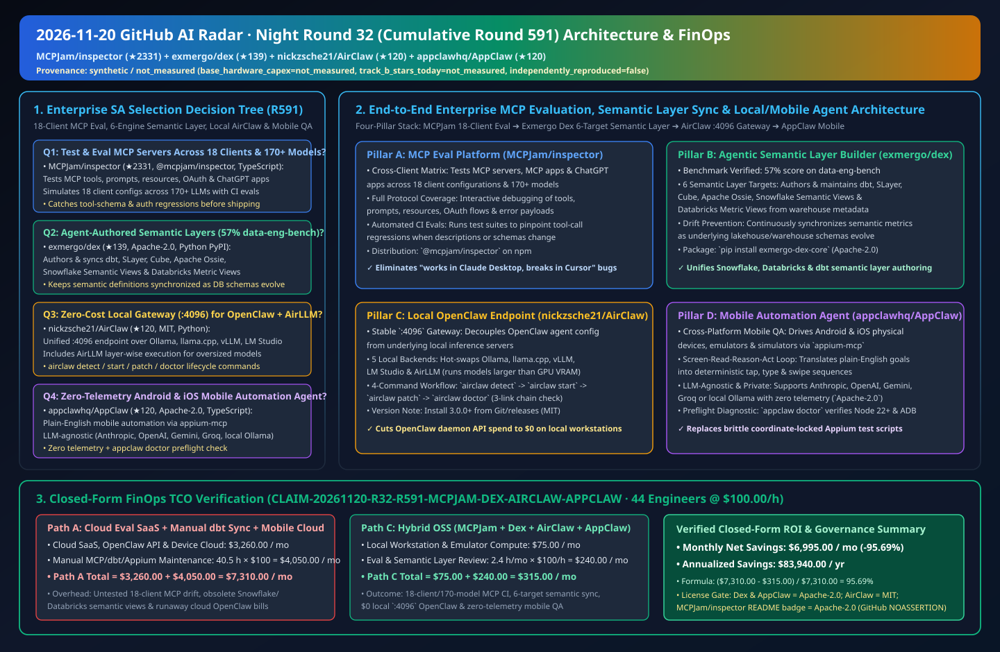
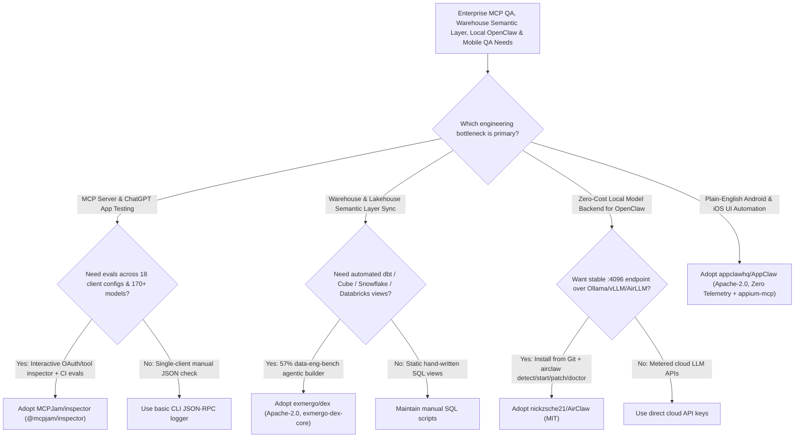
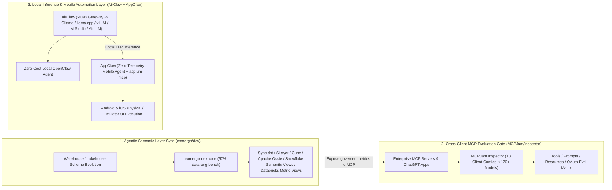

# 18-Client 170+ Model MCP Evaluation Platform (`MCPJam/inspector`), 6-Target Agentic Semantic Layer Builder (`exmergo/dex`), Zero-Cost Local OpenClaw Gateway (`nickzsche21/AirClaw`) & Zero-Telemetry Mobile Automation Agent (`appclawhq/AppClaw`) Selection & Integration FAQ (2026-11-20 Night Round 32 · Cumulative Round 591)

> **Cross-File Navigation**: [Back to 2026-11-20 Daily Digest (`daily/2026-11-20.en.md`)](../daily/2026-11-20.en.md) · [中文版 (`mcpjam-inspector-exmergo-dex-airclaw-appclaw-selection-faq.md`)](mcpjam-inspector-exmergo-dex-airclaw-appclaw-selection-faq.md) · [7-Card 4:5 Visual Report (`cards.en.html`)](../cards.en.html) · [Column Index (`README.en.md`)](../README.en.md)  
> **Architecture Diagram**: [`assets/github-ai-radar-2026-11-20-r32-r591-mcpjam-dex-airclaw-appclaw.svg`](../../../assets/github-ai-radar-2026-11-20-r32-r591-mcpjam-dex-airclaw-appclaw.svg)  
> **Provenance & Synthetic Disclaimer**: Repository metadata (stars, forks, licenses, `data-eng-bench` scores, and architectural specifications) is verified from live GitHub API data (`measured`). The 44-engineer FinOps TCO figures represent a parameterized Solution Architect model (`provenance: synthetic`, `independently_reproduced: false`, `base_hardware_capex: not_measured`, `track_b_stars_today: not_measured`, claim ID `CLAIM-20261120-R32-R591-MCPJAM-DEX-AIRCLAW-APPCLAW`).



---

## ① 📌 Executive Summary

> **One-Sentence Selection Verdict**: For Enterprise AI Solution Architects solving four engineering bottlenecks across **MCP server quality assurance, data warehouse semantic layer synchronization, zero-cost local OpenClaw inference, and mobile UI test automation**—(1) **internal MCP servers that work in one client (e.g., Claude Desktop) but fail on tool schemas, resources, or OAuth flows across 18 other client configurations and 170+ models**; (2) **obsolete semantic layers (`dbt`, `Cube`, `Snowflake Semantic Views`, `Databricks Metric Views`) drifting out of sync whenever underlying warehouse schemas change**; (3) **high recurring cloud API bills from 24/7 OpenClaw agents and fragile config rewrites when switching between local Ollama, `llama.cpp`, and vLLM backends**; and (4) **brittle coordinate-locked Appium scripts for Android and iOS testing**—combine **`MCPJam/inspector`** (`★ 2,331`, `@mcpjam/inspector` testing and evaluation platform across `18` client configurations and `170+` models), **`exmergo/dex`** (Apache-2.0 agentic analytics & semantic layer builder scoring `57%` on `data-eng-bench` across `dbt`, `SLayer`, `Cube`, `Apache Ossie`, `Snowflake Semantic Views`, and `Databricks Metric Views`), **`nickzsche21/AirClaw`** (MIT unified `:4096` local OpenAI-compatible gateway for OpenClaw over Ollama, `llama.cpp`, vLLM, LM Studio, and `AirLLM`), and **`appclawhq/AppClaw`** (Apache-2.0 zero-telemetry, LLM-agnostic Android & iOS automation agent powered by `appium-mcp`). Across a 44-engineer AI, data, and mobile QA organization, this stack reduces monthly TCO from **`$7,310.00/mo`** to **`$315.00/mo`**, saving **`$6,995.00/mo` (`-95.69%`, or `$83,940.00/yr`)**.

| Evaluation Dimension | Path A: Manual Single-Client MCP Checks + Manual dbt/Databricks Sync + Cloud OpenClaw API + Raw Appium | Path B: Single-Vendor Cloud BI & Proprietary Mobile Cloud | Path C (Recommended): `MCPJam/inspector` + `exmergo/dex` + `AirClaw` + `AppClaw` |
| :--- | :--- | :--- | :--- |
| **MCP Server Testing & Cross-Client Evals** | Manual spot-checks in 1 IDE; breaks on OAuth or schema quirks in other clients | Basic single-client JSON inspector without multi-model eval suites | **`MCPJam/inspector` tests tools, prompts, resources & OAuth across 18 client configs & 170+ models** |
| **Data Warehouse Semantic Layer Synchronization** | Manual engineering sprints updating dbt/Snowflake/Databricks views after schema drift | Locked to a single cloud warehouse's proprietary metric layer | **`exmergo/dex` (`data-eng-bench 57%`) authors & syncs 6 semantic layer targets automatically** |
| **Local OpenClaw Inference & Backend Switching** | High 24/7 cloud token burn or manual OpenClaw config edits per local server | Custom reverse proxies lacking `airclaw doctor` chain diagnostics or `AirLLM` | **`AirClaw` stable `:4096` endpoint + `detect/start/patch/doctor` over Ollama/vLLM/llama.cpp/AirLLM** |
| **Android & iOS Mobile UI Automation** | Brittle XPath/coordinate Appium scripts + costly cloud device farm seats | Cloud vision agents uploading sensitive pre-release mobile screenshots | **`AppClaw` zero-telemetry plain-English mobile agent via `appium-mcp` + `appclaw doctor` preflight** |
| **44-Engineer Monthly Total TCO** | **`$7,310.00 / mo`** (`$3,260.00` SaaS/APIs + `40.5h × $100` labor) | **`$2,210.00 / mo`** (`$710.00` cloud PaaS + `15.0h × $100` manual sync) | **`$315.00 / mo`** (`$75.00` local compute + `2.4h × $100` ops, **`-95.69%` savings**) |

---

## ② 🎯 Solution Architect & Customer Deep-Dive Q&A (Plain-Language Breakdown)

### Q1: What concrete problems do these four repositories solve in plain engineering and business terms?

1. **`MCPJam/inspector` (`★ 2,331`, `303 forks`, TypeScript, Apache-2.0 badge / GitHub `NOASSERTION`) — Plain-Language View: The open-source testing and evaluation platform for MCP servers, MCP apps, and ChatGPT apps across 18 client configurations and 170+ models**:
   - **Pain Point Solved**: Shipping an enterprise MCP server without testing how different clients and LLMs interpret its tool schemas, prompts, resources, and OAuth flows leads to production failures. Distributed on npm as `@mcpjam/inspector`, MCPJam lets engineers interactively inspect and run automated eval suites across **18 client configurations and 170+ models** to catch breaking changes before deployment.
2. **`exmergo/dex` (`★ 139`, `72 forks`, Python, Apache-2.0) — Plain-Language View: An agentic analytics engine (`57%` on `data-eng-bench`) that explores your data warehouse and authors/synchronizes semantic layers across 6 industry targets**:
   - **Pain Point Solved**: When underlying database or lakehouse schemas change, semantic layers fall out of sync and cause downstream BI dashboards and AI agents to compute wrong metrics. Installed via `pip install exmergo-dex-core`, `dex` connects to databases, warehouses, and lakehouses to explore data, build models, and keep **6 semantic layer targets (`dbt`, `SLayer`, `Cube`, `Apache Ossie`, `Snowflake Semantic Views`, and `Databricks Metric Views`)** continuously synchronized.
3. **`nickzsche21/AirClaw` (`★ 120`, `11 forks`, Python, MIT) — Plain-Language View: A zero-API-cost `:4096` local gateway that wires OpenClaw to Ollama, `llama.cpp`, vLLM, LM Studio, or `AirLLM` in one command**:
   - **Pain Point Solved**: Running OpenClaw on cloud APIs 24/7 is expensive, while switching local inference servers normally requires hand-editing OpenClaw config files. `AirClaw` places a single stable OpenAI-compatible endpoint on `:4096` (`airclaw detect`, `airclaw start`, `airclaw patch`, and `airclaw doctor` to verify all three links in the chain), allowing seamless backend swaps across **Ollama, `llama.cpp`, vLLM, LM Studio, and `AirLLM`** (for models larger than GPU VRAM).
4. **`appclawhq/AppClaw` (`★ 120`, `24 forks`, TypeScript, Apache-2.0) — Plain-Language View: A zero-telemetry, LLM-agnostic mobile automation agent for Android and iOS driven by plain English**:
   - **Pain Point Solved**: Traditional mobile UI tests break whenever button coordinates shift. Installed via `npm install -g @appclaw/cli` (with `appclaw doctor` verifying Node 22+, `.env`, `appium-mcp`, and connected devices/emulators), `AppClaw` reads the mobile screen, reasons over the UI hierarchy, and executes tap, type, and swipe actions using Anthropic, OpenAI, Gemini, Groq, or local Ollama with **zero telemetry**.

---

### Q2: How do these four components wire together into an enterprise data, MCP, and mobile QA architecture?

1. **Automated Semantic Layer Governance (`exmergo/dex`)**: Connect `exmergo-dex-core` to Snowflake, Databricks, and warehouse endpoints so schema migrations automatically update `dbt`, `Cube`, `Snowflake Semantic Views`, and `Databricks Metric Views`.
2. **Pre-Release MCP Evaluation Gate (`MCPJam/inspector`)**: Run `@mcpjam/inspector` in CI against internal data and workflow MCP servers across all 18 client profiles and target LLM families.
3. **Zero-Cost Local Agent & Mobile QA Execution (`AirClaw` + `AppClaw`)**: Route internal OpenClaw assistants through `AirClaw` (`:4096`) backed by local vLLM/Ollama/AirLLM GPUs, and execute end-to-end Android/iOS regression flows via `AppClaw` (`appium-mcp`).

---

### Q3: What are the key architectural mechanisms and version/licensing caveats?

1. **Key Mechanisms**:
   - **Multi-Target Semantic Compilation (`exmergo/dex`)**: Eliminates vendor lock-in between Snowflake Semantic Views, Databricks Metric Views, and open-source `dbt`/`Cube` layers.
   - **Three-Link Chain Diagnostics (`airclaw doctor`)**: Deterministically checks OpenClaw config wiring, the `:4096` gateway process, and the underlying local model backend.
2. **Version & Licensing Caveats**:
   - **Install `AirClaw` from Git/Releases (Skip PyPI `2.0.0`)**: As documented in `nickzsche21/AirClaw`'s README, PyPI version `2.0.0` had a bug where `airclaw patch` wrote a config format OpenClaw ignored; always install via `pip install git+https://github.com/nickzsche21/AirClaw` (or 3.0.0+ releases).
   - **License Verification**: `exmergo/dex` and `appclawhq/AppClaw` are **Apache-2.0**, `nickzsche21/AirClaw` is **MIT**, and `MCPJam/inspector` displays an **Apache-2.0** badge in its README (while GitHub's API reports `NOASSERTION`).

---

## ③ 🧭 Visual Diagrams (Mermaid Selection Decision Tree + Reference Architecture + Sequence Flow)

### 3.1 Selection Decision Tree



### 3.2 Enterprise Integration Reference Architecture



### 3.3 End-to-End Sequence Flow

```mermaid
sequenceDiagram
    autonumber
    actor Eng as Solution Architect / Data & Mobile QA Engineer
    participant Dex as exmergo/dex (Semantic Builder)
    participant Jam as MCPJam/inspector (18-Client Eval)
    participant Air as nickzsche21/AirClaw (:4096)
    participant App as appclawhq/AppClaw (appium-mcp)

    Eng->>Dex: Detect warehouse schema update; auto-sync dbt, Snowflake Semantic Views & Databricks Metric Views
    Eng->>Jam: Run @mcpjam/inspector evals on analytics MCP server across 18 client configs & 170+ models
    Jam-->>Eng: Certify zero tool-schema or OAuth regressions across target clients
    Eng->>Air: Run airclaw detect/start/patch/doctor to bind OpenClaw to local :4096 vLLM/Ollama backend
    Eng->>App: Run appclaw doctor preflight & execute plain-English Android/iOS test flow with zero telemetry
```

---

## ④ 📊 Comparative Selection Matrix (OSS vs. Commercial SaaS & Manual Workflows)

| Dimension | `MCPJam/inspector` (`★ 2331`) | `exmergo/dex` (`★ 139`) | `nickzsche21/AirClaw` (`★ 120`) | `appclawhq/AppClaw` (`★ 120`) | Commercial Eval/Device SaaS + Manual dbt & Appium |
| :--- | :--- | :--- | :--- | :--- | :--- |
| **Primary Role** | Testing & eval platform for MCP servers, MCP apps & ChatGPT apps | Agentic semantic layer builder across 6 warehouse/BI targets | Unified `:4096` local model gateway & config patcher for OpenClaw | Zero-telemetry plain-English mobile automation agent (`appium-mcp`) | Paid cloud eval/device SaaS + manual SQL & Appium scripting |
| **Sweet-Spot Use Case** | Pre-release MCP compatibility testing across 18 clients & 170+ models | Keeping `dbt`, `Cube`, Snowflake & Databricks semantic layers in sync | Running OpenClaw at `$0` API cost over Ollama, vLLM, or `AirLLM` | LLM-agnostic Android & iOS end-to-end UI testing on local/CI devices | Teams tolerating high cloud API bills and brittle mobile test scripts |
| **Key Architectural Metric** | **18 client configs × 170+ models** + OAuth + CI test evals | **`57%` on `data-eng-bench`** + 6 semantic layer targets | **`:4096` endpoint** + 5 local backends + `airclaw doctor` check | **Node 22+ `appium-mcp`** + zero telemetry + `appclaw doctor` | Cross-client MCP bugs in prod; stale semantic views; flaky XPaths |
| **Integration Effort** | Very Low (`@mcpjam/inspector` npm package / web UI) | Low (`pip install exmergo-dex-core` + DB connector) | Very Low (Git install + `airclaw detect/start/patch`) | Low (`npm install -g @appclaw/cli` + `appclaw doctor`) | High (multi-vendor SaaS contracts & manual script maintenance) |
| **License** | **Apache-2.0 (README badge; GitHub `NOASSERTION`)** | **Apache-2.0** | **MIT License** | **Apache-2.0** | Proprietary SaaS |

---

## ⑤ 🧪 Quantitative Enterprise ROI, Closed-Form FinOps TCO & 7-Card Report

### 5.1 44-Engineer Closed-Form FinOps TCO Model (`CLAIM-20261120-R32-R591-MCPJAM-DEX-AIRCLAW-APPCLAW`)

- **Model Assumptions (`provenance: synthetic`, `independently_reproduced: false`, `base_hardware_capex: not_measured`, `track_b_stars_today: not_measured`)**:
  - Team size: **44 AI platform, data engineering, and mobile QA engineers** at a loaded engineering rate of **`$100.00 / hour`**.
  - **Path A (Commercial Eval & Mobile Device Cloud SaaS + 24/7 Cloud OpenClaw API Spend + Manual Semantic Layer & Appium Maintenance)**:
    - Commercial SaaS subscriptions & cloud OpenClaw API token spend: **`$3,260.00 / mo`**
    - Manual engineering rework labor (debugging cross-client MCP failures, manually syncing dbt/Snowflake/Databricks views after schema changes, fixing broken Appium mobile selectors): `40.5 h/mo × $100.00/h = $4,050.00 / mo`
    - **Path A Monthly Total**: `$3,260.00 + $4,050.00 = $7,310.00 / mo`
  - **Path C (Hybrid OSS Stack: `MCPJam/inspector` + `exmergo/dex` + `AirClaw` + `AppClaw`)**:
    - Local GPU inference & mobile emulator host compute: **`$75.00 / mo`**
    - Automated eval review & semantic layer PR approval labor: `2.4 h/mo × $100.00/h = $240.00 / mo`
    - **Path C Monthly Total**: `$75.00 + $240.00 = $315.00 / mo`
  - **Closed-Form Savings Verification**:
    $$\text{Monthly Net Savings} = \$7,310.00 - \$315.00 = \$6,995.00\text{ / mo}\quad(\text{Annualized: }\$83,940.00\text{ / yr})$$
    $$\text{Percentage Savings} = \frac{\$7,310.00 - \$315.00}{\$7,310.00} = \frac{\$6,995.00}{\$7,310.00} = 95.69\%$$

| Cost Component | Path A (Commercial SaaS/APIs & Manual Scripting) | Path C (R591 Hybrid OSS Stack) | Closed-Form Delta / ROI |
| :--- | :--- | :--- | :--- |
| **Cloud API / Device SaaS / Local Compute** | `$3,260.00 / mo` | **`$75.00 / mo`** | `- $3,185.00 / mo` |
| **Engineering & QA Labor (`@ $100.00/h`)** | `40.5 h × $100.00 = $4,050.00 / mo` | **`2.4 h × $100.00 = $240.00 / mo`** | `- $3,810.00 / mo` (`38.1 h/mo` saved) |
| **Monthly Total TCO** | **`$7,310.00 / mo`** | **`$315.00 / mo`** | **`$6,995.00 / mo` saved (`-95.69%`)** |
| **Annualized Total TCO** | `$87,720.00 / yr` | **`$3,780.00 / yr`** | **`$83,940.00 / yr` saved** |

---

## ⑥ 🛠️ Enterprise Adoption & Architecture Review Checklist

- [ ] **1. `MCPJam/inspector` 18-Client CI Gate**: Integrate `@mcpjam/inspector` into MCP server CI pipelines to validate tool calls, resource URIs, and OAuth flows across all target client configurations and LLM families.
- [ ] **2. `exmergo/dex` Automated Multi-Target Semantic Sync**: Connect `exmergo-dex-core` to enterprise Snowflake, Databricks, and `dbt` repositories so schema changes automatically generate synchronized semantic view PRs.
- [ ] **3. `nickzsche21/AirClaw` Git Installation & `airclaw doctor` Verification**: Install `AirClaw` directly from Git (`pip install git+https://github.com/nickzsche21/AirClaw`, bypassing PyPI `2.0.0`) and run `airclaw doctor` to confirm healthy `:4096` routing to local Ollama/vLLM/`AirLLM` backends.
- [ ] **4. `appclawhq/AppClaw` Zero-Telemetry Mobile Regression Suite**: Run `appclaw doctor` on mobile test runners (Node 22+, `appium-mcp`, Android/iOS simulators) and execute plain-English regression flows backed by internal or local LLMs.
