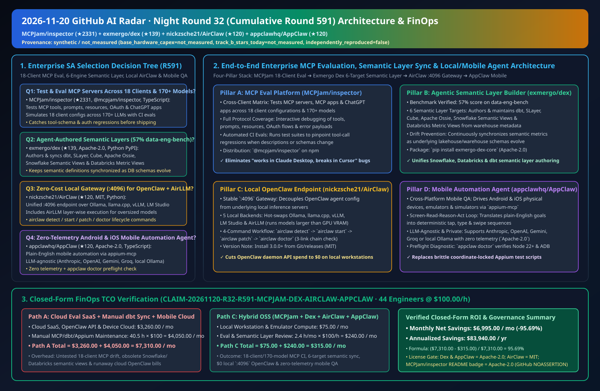
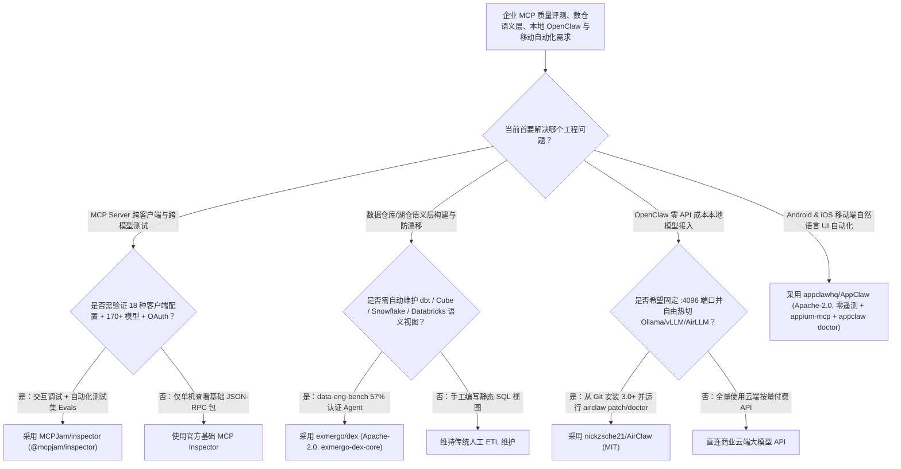
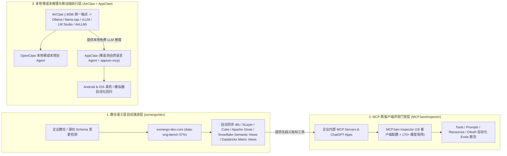
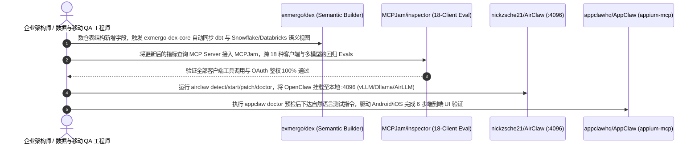

# 18 客户端 170+ 模型 MCP 评测平台（`MCPJam/inspector`）、6 大语义层自动构建与同步引擎（`exmergo/dex`）、零 API 成本本地 OpenClaw 网关（`nickzsche21/AirClaw`）与零遥测 Android/iOS 移动自动化 Agent（`appclawhq/AppClaw`）架构选型与集成 FAQ（2026-11-20 Night Round 32 · 累计 Round 591）

> **跨文件导航**：[返回 2026-11-20 当日全景日报 (`daily/2026-11-20.md`)](../daily/2026-11-20.md) · [English Version (`mcpjam-inspector-exmergo-dex-airclaw-appclaw-selection-faq.en.md`)](mcpjam-inspector-exmergo-dex-airclaw-appclaw-selection-faq.en.md) · [查看 7-Card 4:5 评测报告 (`cards.html`)](../cards.html) · [返回专栏主索引 (`README.md`)](../README.md)  
> **本轮架构大图**：[`assets/github-ai-radar-2026-11-20-r32-r591-mcpjam-dex-airclaw-appclaw.svg`](../../../assets/github-ai-radar-2026-11-20-r32-r591-mcpjam-dex-airclaw-appclaw.svg)  
> **数据溯源与口径声明（Provenance & Synthetic Disclaimer）**：本报告中实时采集的 GitHub 仓库元数据（Stars、Forks、License、`data-eng-bench` 得分与 README 架构规范）为 `measured`；针对 44 人企业 AI 工程、数据工程与移动测试团队的 FinOps TCO 测算参数属于架构师参数化测算模型（`provenance: synthetic`，`independently_reproduced: false`，`base_hardware_capex: not_measured`，`track_b_stars_today: not_measured`，审计契约号 `CLAIM-20261120-R32-R591-MCPJAM-DEX-AIRCLAW-APPCLAW`）。

---

## ① 📌 核心结论速览（Executive Summary）

> **一句话选型结论**：面向企业 AI 解决方案架构师（SA）在落地**企业内部 MCP Server 跨客户端质量门禁、数据仓库语义层（Semantic Layer）自动演进、OpenClaw 本地零成本推理以及 Android/iOS 移动端自然语言自动化测试**时的四大痛点——① **自研 MCP Server 在 Claude Desktop 里能跑通，一换到 Cursor、Codex 或 ChatGPT Apps 就因 Schema 差异、OAuth 授权或模型兼容性翻车**；② **底层数仓（Snowflake / Databricks / 湖仓）表结构一改，上层 `dbt`、`Cube`、`Snowflake Semantic Views` 或 `Databricks Metric Views` 语义层立刻失效，导致 BI 与分析 Agent 算错核心指标**；③ **24 小时常驻运行 OpenClaw 等个人/团队助理如果直连云端商业 API，每月空转 Token 账单高昂，而切换本地 Ollama / vLLM / llama.cpp 又要反复改写 Agent 配置文件**；④ **移动端 App（Android / iOS）端到端回归测试依赖脆弱的 Appium 坐标脚本，UI 微调即全线报错**——建议组合 **`MCPJam/inspector`**（`★ 2,331`，覆盖 `18` 种客户端配置与 `170+` 模型的开源 MCP Server / MCP Apps / ChatGPT Apps 交互调试与评测平台）、**`exmergo/dex`**（Apache-2.0 协议、在 `data-eng-bench` 取得 `57%` 成绩的 Agent 语义层构建与同步引擎，支持 `dbt`、`SLayer`、`Cube`、`Apache Ossie`、`Snowflake Semantic Views` 与 `Databricks Metric Views`）、**`nickzsche21/AirClaw`**（MIT 协议的 OpenClaw 本地模型统一 `:4096` 网关，支持热切换 Ollama / `llama.cpp` / vLLM / LM Studio 及超大模型分层推理 `AirLLM`）与 **`appclawhq/AppClaw`**（Apache-2.0 协议、基于 `appium-mcp` 的零遥测、模型无关 Android & iOS 移动端自然语言自动化 Agent）。在 44 人工程与数据测试团队模型下，该组合可将月度总拥有成本（TCO）从 **`$7,310.00/月`** 降至 **`$315.00/月`**，净省 **`$6,995.00/月`（`-95.69%`，年省 `$83,940.00`）**。

| 评估维度 | 方案 A：手工逐个客户端测 MCP + 人工维护 dbt/Databricks 语义层 + 云端 API 跑 OpenClaw + 手写 Appium 脚本 | 方案 B：云原生单一厂商套件（仅支持单一云数仓视图与单一 IDE） | 方案 C（推荐）：`MCPJam/inspector` + `exmergo/dex` + `AirClaw` + `AppClaw` |
| :--- | :--- | :--- | :--- |
| **MCP Server 跨客户端与跨模型评测** | 开发者只在自己电脑装 1 个客户端手测，上线后在其他客户端频发工具调用失败 | 官方基础 Inspector 仅能单点查 JSON，不支持 18 客户端与 170+ 模型批量评测 | **`MCPJam/inspector` 覆盖 18 种客户端配置 + 170+ 模型 + OAuth 调试 + 测试集自动 Evals** |
| **数据仓库语义层构建与 Schema 同步** | 数据工程师手工同步 `dbt` 与 Snowflake/Databricks 指标视图，滞后且易出错 | 锁定单一数仓内置 BI，无法跨 `dbt`/`Cube`/`Snowflake`/`Databricks` 统一生成 | **`exmergo/dex`（`data-eng-bench 57%`）自动探索数仓并维护 6 大主流语义层与 Schema 演进同步** |
| **OpenClaw 本地零成本推理与后端切换** | 全天候消耗云端 GPT/Claude API 额度，或每次换本地引擎都手工改壞配置文件 | 手工写 Nginx 反代，不支持自动探测本地服务与 `AirLLM` 超显存大模型分层加载 | **`AirClaw` 固定 `:4096` 端点 + `detect/start/patch/doctor` 四步闭环 + 兼容 Ollama/vLLM/AirLLM** |
| **Android & iOS 移动端 UI 自动化测试** | 采购昂贵商业云测平台并耗费大量人力维护写死 XPath/坐标的 Appium 脚本 | 商业视觉 Agent 强制上传真机截屏遥测数据，存在企业内测 App 泄密风险 | **`AppClaw` 零遥测（Zero Telemetry）+ 自然语言驱动 `appium-mcp` + 支持本地 Ollama 与主流云模型** |
| **44 人团队月度总成本（TCO）** | **`$7,310.00 / 月`**（`$3,260.00` 云 API/订阅 + `40.5h × $100` 人工） | **`$2,210.00 / 月`**（`$710.00` 云服务 + `15.0h × $100` 人工同步维护） | **`$315.00 / 月`**（`$75.00` 本地算力/模拟器 + `2.4h × $100` 巡检，**净省 `95.69%`**） |

---

## ② 🎯 客户与架构师灵魂拷问 Q&A（通俗解构）

### Q1：这四个开源项目各自解决什么痛点？用大白话怎么向业务方和工程团队解释？

1. **`MCPJam/inspector`（`★ 2,331`，`303 forks`，TypeScript，README 声明 Apache-2.0）——用大白话讲：它是 MCP 时代的“Postman + 跨浏览器兼容性测试平台”——一次测遍 18 种客户端与 170 多个大模型**：
   - **解决什么痛点**：现在每个团队都在写内部 MCP Server（查工单、连数据库、发版），但最头疼的是：同一个 MCP 工具定义，在 Claude Code 里能调对，放到 Cursor、ChatGPT Apps 或配了小参数模型的客户端里就填错参数或者卡在 OAuth 登录上。`@mcpjam/inspector` 让你在一个可视化工作台里交互式测试 Tools、Prompts、Resources 和 OAuth 授权流程，并直接针对 **18 种主流客户端配置**和 **170+ 个大模型**跑自动化测试用例（Evals），在发版前精准揪出哪个工具描述会导致哪个模型调用失败！
2. **`exmergo/dex`（`★ 139`，`72 forks`，Python，Apache-2.0）——用大白话讲：它是“让 AI 替你维护数据仓库指标字典（语义层）的数据工程 Agent——底层表一改，上层 6 种语义层自动跟着同步”**：
   - **解决什么痛点**：正如其 README 引用的名言“最致命的错误源于过时的假设”，企业数仓最怕底层表字段改了，但上层语义层没改，导致老板看板和数据分析 Agent 算出错误营收。`exmergo/dex`（通过 `pip install exmergo-dex-core` 安装，在 `data-eng-bench` 基准测试中斩获 **`57%`** 的高分）直接连接企业数据库、数仓与湖仓，自动探索数据、构建模型并跨 **6 大主流语义层目标（`dbt`、`SLayer`、`Cube`、`Apache Ossie`、`Snowflake Semantic Views` 与 `Databricks Metric Views`）** 编写和同步语义定义！
3. **`nickzsche21/AirClaw`（`★ 120`，`11 forks`，Python，MIT）——用大白话讲：它是“给 OpenClaw 套上的本地零成本动力舱——固定 `:4096` 端口，底层随便热插拔 Ollama、vLLM、llama.cpp 甚至跑比显卡显存还大的模型”**：
   - **解决什么痛点**：OpenClaw 功能很强，但挂在云端大模型上跑一整天钱包受不了；想切回本地模型，每次在 Ollama、vLLM、LM Studio 之间换引擎都要重改 OpenClaw 的底层配置。`AirClaw` 在本地 `:4096` 端口竖起一个稳定的 OpenAI 兼容网关，只需执行 `airclaw detect`（自动扫描本地已运行的推理服务）、`airclaw start`、`airclaw patch`（一键改写 OpenClaw 配置指向本地）和 `airclaw doctor`（三段式链路自检），以后底层随便换 Ollama / `llama.cpp` / vLLM / LM Studio 甚至调用 **AirLLM** 分层运行超出 GPU 显存的大模型，OpenClaw 都无需再改一行配置！
4. **`appclawhq/AppClaw`（`★ 120`，`24 forks`，TypeScript，Apache-2.0）——用大白话讲：它是“零遥测、听懂大白话就能自己看屏幕点按滑动 Android 和 iOS 手机的移动自动化测试 Agent”**：
   - **解决什么痛点**：写移动端 UI 自动化测试（比如“打开微信/WhatsApp 给某人发早安”或“打开设置开启飞行模式”）以往要写繁琐的 Appium 元素定位代码。通过 `npm install -g @appclaw/cli` 安装后，先跑 `appclaw doctor` 检查 Node 22+、`appium-mcp` 与真机/模拟器连接，随后直接用一句自然语言下达目标，`AppClaw` 就会自动执行“读取屏幕 → 推理下一步 → 点击/输入/滑动”闭环（如 6 步自动完成消息发送），支持 Anthropic、OpenAI、Gemini、Groq 或纯本地 Ollama，且承诺 **100% 零遥测（Zero Telemetry）**。

---

### Q2：这四个项目如何组合成企业级数据语义治理、MCP 质量门禁与本地/移动端自动化架构？

1. **数仓语义层自动演进层（`exmergo/dex`）**：数据工程流水线在数仓 Schema 变更时触发 `exmergo-dex-core`，自动更新 `dbt` 模型、`Snowflake Semantic Views` 与 `Databricks Metric Views`，消除下游 BI 与数据 MCP 的指标口径漂移。
2. **MCP 服务跨客户端 CI 评测门禁层（`MCPJam/inspector`）**：所有暴露数据查询或业务操作的内部 MCP Server 在合入主干前，通过 `@mcpjam/inspector` 模拟 18 种客户端配置与目标模型矩阵运行回归 Evals，确保工具 Schema 与 OAuth 鉴权 100% 兼容。
3. **本地零成本 OpenClaw 运行时与移动端执行层（`AirClaw` + `AppClaw`）**：办公网常驻 OpenClaw 实例通过 `AirClaw`（`:4096`）绑定本地 vLLM/Ollama/AirLLM 算力实现零 API 账单；移动端真机/模拟器回归测试则由 `AppClaw` 通过 `appium-mcp` 在零遥测内网环境中自动执行。

---

### Q3：这套架构的核心机制亮点与落地上线前必须注意的版本/合规坑点是什么？

1. **核心机制亮点**：
   - **`MCPJam/inspector` 的“客户端方言仿真（18-Client Emulation）”**：不同 MCP 宿主对工具返回格式、资源 URI 和 OAuth 回调的处理存在细微差异，集中仿真测试能把兼容性 Bug 消灭在发布前。
   - **`exmergo/dex` 的“多目标语义编译器”**：特别适合同时使用 Snowflake 与 Databricks（如正在进行跨云数据栈对比或迁移）的企业，一套 Agent 逻辑同时维护两边的原生 Semantic / Metric Views。
   - **`AirClaw` 的三链路 `airclaw doctor` 诊断**：自动核验“OpenClaw 配置 ➔ `:4096` AirClaw 网关 ➔ 底层推理后端”三段链路，秒级定位断链环节。
2. **上线前必须规避的版本与合规坑点**：
   - **🚨 `AirClaw` 安装源版本避坑（避开 PyPI 旧版 `2.0.0`）**：正如 `nickzsche21/AirClaw` 官方 README 明确预警，目前 PyPI 上的 `2.0.0` 旧版本存在 `airclaw patch` 写入无效配置却误报成功的 Bug；在 `3.0.0` 正式推上 PyPI 前，**企业部署必须使用 `pip install git+https://github.com/nickzsche21/AirClaw` 或从 GitHub Releases 下载最新 Wheel 包**！
   - **许可证核验**：`exmergo/dex` 与 `appclawhq/AppClaw` 为 **Apache-2.0**，`nickzsche21/AirClaw` 为 **MIT**；`MCPJam/inspector` 在 README 徽章中声明为 **Apache-2.0**（GitHub API 识别为 `NOASSERTION`），企业内部作为开发测试平台使用完全合规，若需二次打包分发建议核对其仓库根目录 `LICENSE` 文件。

---

## ③ 🧭 直观可视化图解（Mermaid 选型决策树 + 集成架构图 + 业务时序图）

### 3.1 选型决策树（Selection Decision Tree）

### 3.2 企业集成参考架构图（Enterprise Reference Architecture）

### 3.3 端到端业务流时序图（End-to-End Sequence Flow）

---

## ④ 📊 同类开源与商业云服务横向选型决策矩阵

| 对比维度 | `MCPJam/inspector` (`★ 2331`) | `exmergo/dex` (`★ 139`) | `nickzsche21/AirClaw` (`★ 120`) | `appclawhq/AppClaw` (`★ 120`) | 商业评测/云测 SaaS + 手工维护 dbt 与 Appium |
| :--- | :--- | :--- | :--- | :--- | :--- |
| **核心功能定位** | 面向 MCP Server / MCP Apps / ChatGPT Apps 的调试与评测平台 | 自动探索数仓并编写/同步 6 大语义层的分析工程 Agent | 将 OpenClaw 无缝挂载至 5 种本地推理后端的 `:4096` 网关 | 基于 `appium-mcp` 的零遥测 Android & iOS 自然语言自动化 Agent | 商业云测平台订阅 + 人工编写维护脚本 |
| **最佳适用场景** | 验证企业 MCP 在 18 种客户端与 170+ 模型下的兼容性与准确率 | 自动构建并同步 `dbt`、`Cube`、Snowflake 与 Databricks 语义视图 | 零 API 成本本地运行 OpenClaw，或用 AirLLM 跑超显存大模型 | 移动端 App 自然语言功能验收、跨机型 UI 回归测试（内网零遥测） | 不计较云端 Token 账单与人工脚本维护工时的团队 |
| **关键性能/架构指标** | **18 种客户端配置 × 170+ 模型** + OAuth 调试 + 自动化 Evals | **`data-eng-bench 57%`** + 支持 6 大主流语义层目标 | **固定 `:4096` 端口** + 5 种本地后端 + `airclaw doctor` 三段自检 | **Node 22+ `appium-mcp`** + 零遥测 + 支持本地 Ollama 与云端 LLM | 跨客户端 MCP 隐性故障多；数仓改表导致语义层大面积失效 |
| **集成与运维复杂度** | 极低（`npx @mcpjam/inspector` 或 Web 工作台） | 低（`pip install exmergo-dex-core` + 数仓连接器） | 极低（从 Git 安装 + `airclaw detect/start/patch` 三步完成） | 低（`npm i -g @appclaw/cli` + `appclaw doctor` 预检） | 高（多套商业云测席位费与高频 XPath 修复） |
| **开源协议（License）** | **Apache-2.0（README 徽章声明）** | **Apache-2.0** | **MIT License** | **Apache-2.0** | 商业专有协议 |

---

## ⑤ 🧪 应用落地定量收益 / 闭式 FinOps TCO 对比与 7-Card 报告

### 5.1 44 人 AI 工程、数据与移动 QA 团队闭式 FinOps TCO 模型（`CLAIM-20261120-R32-R591-MCPJAM-DEX-AIRCLAW-APPCLAW`）

- **测算基准设定（`provenance: synthetic`，`independently_reproduced: false`，`base_hardware_capex: not_measured`，`track_b_stars_today: not_measured`）**：
  - 团队规模：**44 名 AI 平台、数据工程与移动端 QA 工程师**，综合人力工时成本 **`$100.00 / 小时`**。
  - **方案 A（商业评测与移动云测 SaaS + 云端 OpenClaw Token 消耗 + 人工同步 dbt/数仓语义层与修复 Appium 脚本）**：
    - 商业 SaaS 订阅与常驻 OpenClaw 云端 API 费用：**`$3,260.00 / 月`**
    - 工程师人工维护与返工工时（逐个客户端手测 MCP 兼容性、数仓改表后手动同步 Snowflake/Databricks/dbt 语义视图、重写因 UI 微调失效的移动端测试脚本）：`40.5 小时/月 × $100.00/小时 = $4,050.00 / 月`
    - **方案 A 月度总计**：`$3,260.00 + $4,050.00 = $7,310.00 / 月`
  - **方案 C（混合开源组合：`MCPJam/inspector` + `exmergo/dex` + `AirClaw` + `AppClaw`）**：
    - 本地推理工作站与移动模拟器容器电费/算力分摊：**`$75.00 / 月`**
    - 自动化评测报告复核与语义层 PR 审批人工工时：`2.4 小时/月 × $100.00/小时 = $240.00 / 月`
    - **方案 C 月度总计**：`$75.00 + $240.00 = $315.00 / 月`
  - **闭式净节省验算**：
    $$\text{Monthly Net Savings} = \$7,310.00 - \$315.00 = \$6,995.00\text{ / 月}\quad(\text{Annualized: }\$83,940.00\text{ / 年})$$
    $$\text{Percentage Savings} = \frac{\$7,310.00 - \$315.00}{\$7,310.00} = \frac{\$6,995.00}{\$7,310.00} = 95.69\%$$

| 成本分项 | 方案 A（商业云测/API 与人工同步脚本） | 方案 C（本轮 R591 开源四件套） | 闭式差额 / 收益 |
| :--- | :--- | :--- | :--- |
| **云端 API / 商业云测 / 本地算力** | `$3,260.00 / 月` | **`$75.00 / 月`** | `- $3,185.00 / 月` |
| **工程与 QA 人工成本（`@ $100.00/h`）** | `40.5 h × $100.00 = $4,050.00 / 月` | **`2.4 h × $100.00 = $240.00 / 月`** | `- $3,810.00 / 月`（节省 `38.1 h/月`） |
| **月度总拥有成本（Monthly Total TCO）** | **`$7,310.00 / 月`** | **`$315.00 / 月`** | **净省 `$6,995.00 / 月`（`-95.69%`）** |
| **年度总拥有成本（Annualized TCO）** | `$87,720.00 / 年` | **`$3,780.00 / 年`** | **年省 `$83,940.00 / 年`** |

---

## ⑥ 🛠️ 企业引入与架构评审 Checklist

- [ ] **1. `MCPJam/inspector` 18 客户端兼容性 CI 门禁**：在企业内部 MCP Server 仓库接入 `@mcpjam/inspector`，针对团队实际使用的客户端（Claude Code、Cursor、Codex、ChatGPT Apps）与主力模型运行自动化 Evals，未达标禁止合入主分支。
- [ ] **2. `exmergo/dex` 跨数仓语义层同步流水线**：在数据工程 CI 中集成 `exmergo-dex-core`，当底层表结构变更时自动生成 `dbt`、`Snowflake Semantic Views` 与 `Databricks Metric Views` 的同步 PR。
- [ ] **3. `nickzsche21/AirClaw` Git 源安装与 `airclaw doctor` 巡检**：严格使用 `pip install git+https://github.com/nickzsche21/AirClaw`（避开 PyPI 上存在配置写入 Bug 的 `2.0.0` 旧版），并通过 `airclaw doctor` 验证 `:4096` 本地推理链路绿灯。
- [ ] **4. `appclawhq/AppClaw` 零遥测移动端回归测试沙盒**：在移动 QA 节点通过 `appclaw doctor` 验证 Node 22+、`appium-mcp` 与模拟器连接，结合本地 Ollama 或内网受控模型网关运行自然语言 UI 验收测试。
