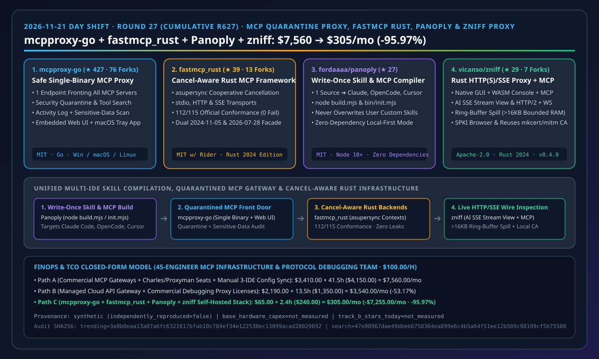
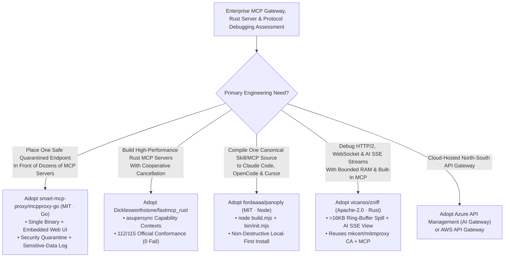
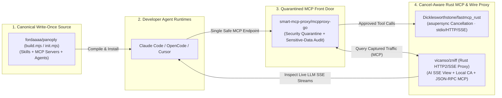
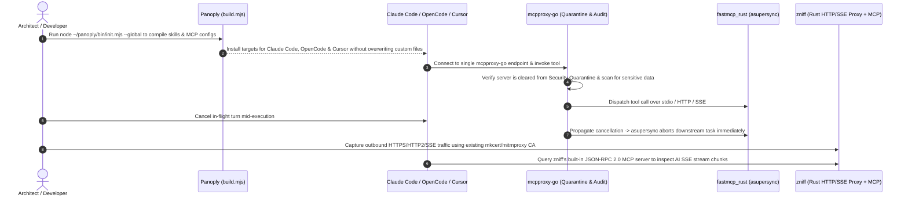

# Safe Single-Binary MCP Proxy (`smart-mcp-proxy/mcpproxy-go`), Cancel-Aware Rust FastMCP (`Dicklesworthstone/fastmcp_rust`), Write-Once Multi-IDE Agent Compiler (`fordaaaa/panoply`) & Pure-Rust AI HTTP(S)/SSE Debugging Proxy (`vicanso/zniff`) Selection FAQ

> **Document Metadata (2026-11-21 Day Shift Round 27 · Cumulative Round 627 Deep-Dive)**  
> - **Target Audience**: Enterprise AI Solution Architects, MCP Infrastructure & Tooling Leads, and Network / Protocol Debugging Engineers  
> - **Evaluated Repositories**:  
>   1. [`smart-mcp-proxy/mcpproxy-go`](https://github.com/smart-mcp-proxy/mcpproxy-go) (`★ 427` · `76 forks` · Go · MIT · Single-binary cross-platform MCP proxy with embedded Web UI and macOS menu-bar tray app providing one safe endpoint in front of every MCP server, tool discovery, sensitive-data detection, and **security quarantine**)  
>   2. [`Dicklesworthstone/fastmcp_rust`](https://github.com/Dicklesworthstone/fastmcp_rust) (`★ 39` · `13 forks` · Rust 2024 Edition · MIT with rider · Cancel-aware Rust port of Python `jlowin/fastmcp` with `asupersync` capability contexts over `stdio`, `HTTP`, and `SSE`, achieving **112 / 115 SUCCESS (`0 FAILURE`)** on `@modelcontextprotocol/conformance@0.2.0-alpha.10`)  
>   3. [`fordaaaa/panoply`](https://github.com/fordaaaa/panoply) (`★ 27` · `0 forks` · JavaScript · MIT · Write-once agent toolkit [`node build.mjs` & `bin/init.mjs`] compiling skills, MCP servers, and agents from one canonical source to **Claude Code, OpenCode, and Cursor** with zero dependencies)  
>   4. [`vicanso/zniff`](https://github.com/vicanso/zniff) (`★ 29` · `7 forks` · Rust 2024 Edition · Apache-2.0 · `v0.4.0`: Single-process HTTP(S)/HTTP2/WebSocket/SSE debugging proxy in pure Rust with native GUI, WASM console, `>16 KB` ring-buffer spill, **AI SSE Stream View**, local CA reuse, and a built-in **JSON-RPC 2.0 MCP server**)  
> - **Sealed Evidence Chain**: `workshops/github-trending-radar/evidence/search-new-repos-2026-11-21-raw.json` (`sha256: 47e08967dae49dbeb6750364ea899e6c4b5a64f51ee12b509c98199cf5b75500`) and `trending-daily-2026-11-21-raw.html` (`sha256: 3e8b0eaa13a07a6fc6321617bfab10c784ef34e122538ec13099acad28029692`)  
> - **Architecture Visual**: [`assets/github-ai-radar-2026-11-21-r27-r627-mcpproxygo-fastmcprust-panoply-zniff.svg`](../../../assets/github-ai-radar-2026-11-21-r27-r627-mcpproxygo-fastmcprust-panoply-zniff.svg) · [中文版 (`mcpproxy-go-fastmcp-rust-panoply-zniff-selection-faq.md`)](mcpproxy-go-fastmcp-rust-panoply-zniff-selection-faq.md)

---

## ① 📌 Executive Summary (One-Sentence Selection Verdict)

> **Solution Architect's Verdict**:  
> As enterprise teams scale from a couple of local MCP plugins to **dozens of upstream MCP servers across Claude Code, OpenCode, and Cursor**, four operational bottlenecks emerge: **(1) connecting 20+ raw MCP servers bloats agent context and exposes developers to tool-poisoning updates, (2) canceled agent turns leave Python MCP tool tasks running as orphan zombies, (3) teams waste hours maintaining duplicate skill/MCP configs across three different IDEs, and (4) legacy HTTP proxies choke on long-lived AI SSE streams and cannot expose captured traffic back to coding agents over MCP**.  
> - **To place one single-binary safe endpoint in front of every MCP server with embedded Web UI, sensitive-data activity logging, and security quarantine** ➔ Choose **`smart-mcp-proxy/mcpproxy-go`** (MIT, `★ 427`);  
> - **To build high-throughput Rust MCP servers and clients with `asupersync` cooperative cancellation and 112/115 official conformance (`0 FAILURE`)** ➔ Choose **`Dicklesworthstone/fastmcp_rust`**;  
> - **To author skills, MCP servers, and agents once and compile them cleanly to Claude Code, OpenCode, and Cursor via `node build.mjs`** ➔ Choose **`fordaaaa/panoply`** (MIT);  
> - **To inspect HTTP/2, WebSocket, and AI SSE streams in a bounded-memory pure-Rust proxy that reuses existing local CAs (`mkcert`/`mitmproxy`) and exposes traffic via a built-in JSON-RPC 2.0 MCP server** ➔ Choose **`vicanso/zniff`** (Apache-2.0).  
> Combined, this stack reduces monthly commercial gateway/proxy licenses and multi-IDE maintenance TCO for a 45-engineer team from **$7,560.00/mo** to **$305.00/mo (-$7,255.00/mo, -95.97%)**.

---

## ② 🎯 Solution Architect & Customer Deep-Dive Q&A

### Q1: Why does wiring 20+ MCP servers directly into every developer's IDE create security and context-window chaos, and how do `mcpproxy-go` and `panoply` standardize the front door?
- **Two Scaling Bottlenecks in Multi-IDE MCP Deployments**:
  1. **Untrusted Server Updates & Context Bloat**: Exposing hundreds of raw tools across 20 MCP servers floods context windows and leaves agents vulnerable if an upstream server silently mutates a tool description.
  2. **Three-Way Configuration Drift**: Maintaining separate skill, agent, and MCP definitions for Claude Code, OpenCode, and Cursor leads to constant drift.
- **How `mcpproxy-go` + `panoply` Fix Both**:
  - **`smart-mcp-proxy/mcpproxy-go` (Single-Binary Safe Front Door + Quarantine)**:
    - Ships as a single binary for macOS, Linux, and Windows with an embedded Web UI (plus an optional macOS menu-bar tray app).
    - Acts as **one safe endpoint in front of every MCP server**, providing dynamic tool discovery, an activity log with **sensitive-data detection**, and a **security quarantine** that holds untrusted or modified servers until approved.
  - **`fordaaaa/panoply` (Write-Once Compiler for Claude Code, OpenCode & Cursor)**:
    - Keeps skills, MCP servers, and agents in one canonical source; `node build.mjs` and `node ~/panoply/bin/init.mjs` compile skills for Claude Code, agents for OpenCode, and MCP servers for all three (plus plain-text prompt fallbacks), never overwriting user-authored files and configuring nothing external by default.

### Q2: How does `fastmcp_rust` eliminate zombie tool tasks on cancellation, and how does `zniff` let AI agents debug their own HTTP/2 and SSE streams?
- **`Dicklesworthstone/fastmcp_rust` (`asupersync` Cooperative Cancellation & Measured Conformance)**:
  - Extends the ergonomics of Python's `jlowin/fastmcp` into Rust 2024 Edition with **`asupersync` capability contexts and cooperative-cancellation primitives** over `stdio`, `HTTP`, and `SSE` transports so canceled agent turns cleanly abort downstream work.
  - Verifies protocol behavior via `scripts/run_official_conformance.sh` against `@modelcontextprotocol/conformance@0.2.0-alpha.10` (`--spec-version 2026-07-28 --suite all`), recording **112 SUCCESS, 0 FAILURE, 2 WARNING, 1 INFO** across 40 scenarios / 115 checks.
- **`vicanso/zniff` (Bounded-Memory Pure-Rust HTTP(S)/SSE Proxy with Built-In MCP)**:
  - Compiles its proxy engine and `nsh 0.6.1` native GUI into a single pure-Rust binary with bounded RAM (ring-buffer spill to disk for bodies `> 16 KB`), true ALPN protocol following (HTTP/2 multiplexing, RFC 6455 WebSockets, and SSE without HTTP/1.1 downgrade), and `socks5://`/`socks5h://` upstream chaining.
  - Features a dedicated **AI SSE Stream View**, one-click SPKI-trusted Chromium or Android `adb` reverse proxy, automatic reuse of trusted local root CAs (`Whistle`, `mitmproxy`, `mkcert`, `Proxyman`), and a built-in **JSON-RPC 2.0 MCP server** so coding agents can inspect captured traffic directly.

### Q3: What protocol-version and licensing boundaries should Solution Architects review?
- **Key Technical & Licensing Notes**:
  - **`fastmcp_rust` Dual Protocol Facade**: The root compatibility `PROTOCOL_VERSION` is `2024-11-05` while `modern::PROTOCOL_VERSION` targets `2026-07-28` (under active implementation alongside the 112/115 conformance harness).
  - **Licensing**: `mcpproxy-go` and `panoply` are **MIT-licensed**, `zniff` is **Apache-2.0**, and `fastmcp_rust` is **MIT with rider**.

---

## ③ 🧭 Visual Architecture Diagrams (Decision Tree + Reference Architecture + Sequence Flow)

### 3.1 Solution Architect Selection Decision Tree (Mermaid Flowchart)

### 3.2 Unified Multi-IDE Skill Compilation, Quarantined MCP Gateway & Rust Proxy Architecture (Mermaid Architecture)

### 3.3 Write-Once Deployment, Quarantine Approval, Cooperative Cancellation & SSE Debugging Sequence (Mermaid Sequence Diagram)

---

## ④ 📊 Horizontal Selection Matrix (Open-Source Quartet vs. Commercial Gateways & Proxies)

| Dimension | `mcpproxy-go` (`★ 427`) | `fastmcp_rust` (`★ 39`) | `fordaaaa/panoply` (`★ 27`) | `vicanso/zniff` (`★ 29`) | Commercial MCP Gateways & Proxyman/Charles Seats |
| :--- | :--- | :--- | :--- | :--- | :--- |
| **Primary Role** | Single-binary safe MCP proxy with quarantine & Web UI | Cancel-aware Rust MCP server/client framework | Write-once compiler for Claude Code, OpenCode & Cursor | Pure-Rust HTTP(S)/SSE debugging proxy with built-in MCP | Metered cloud gateways & per-seat desktop proxy licenses |
| **Best-Fit Scenario** | Fronting 10–50 MCP servers with one safe endpoint & quarantine | Building high-concurrency Rust MCP servers with clean cancellation | Sharing one canonical repo of skills, agents & MCP servers across IDEs | Debugging AI SSE streams & HTTP/2 traffic with bounded memory | Teams purchasing standalone proprietary debugging tools |
| **Key Differentiator** | Embedded Web UI, macOS tray, **security quarantine**, sensitive-data scan | `asupersync` cooperative cancellation, 112/115 official conformance | Zero dependencies, never overwrites custom user skills, local by default | `>16 KB` ring-buffer spill, AI SSE view, reuses local CAs, built-in MCP | Polished commercial UI, high per-seat annual renewal cost |
| **Integration & Ops Effort** | Very Low (single binary for macOS/Linux/Windows) | Low (Rust Cargo workspace + conformance script) | Very Low (Node 18+ `init.mjs` or Claude `/plugin install`) | Very Low (single pure-Rust binary + 1-click SPKI browser/adb) | Low (high recurring seat & gateway fees) |
| **License** | MIT | MIT with rider | MIT | Apache-2.0 | Proprietary |
| **45-Eng Monthly TCO** | **Combined `$305.00/mo`** (`$65` shared proxy host + `2.4h` ops) | Included (eliminates zombie task resource leaks) | Included (zero-cost cross-IDE compilation) | Included (replaces paid per-seat proxy licenses) | **`$3,540.00 – $7,560.00/mo`** |

---

## ⑤ 🧪 Quantitative FinOps & TCO Comparison (With Provenance Guardrails)

> **Provenance & Guardrails Declaration**:  
> - `provenance`: `"synthetic"` (`independently_reproduced: false`, closed-form FinOps model for a 45-engineer MCP infrastructure and protocol debugging team at `$100.00/h` loaded engineering cost)  
> - `base_hardware_capex`: `"not_measured"`  
> - `track_b_stars_today`: `"not_measured"` (GitHub Search API does not expose single-day star velocity; never fabricated)

| Cost Component (45-Engineer Team / Month) | Path A: Commercial MCP Gateways + Charles/Proxyman Seats + Manual 3-IDE Config Sync | Path B: Managed Cloud API Gateway + Commercial Debugging Proxy Licenses | Path C: `mcpproxy-go` + `fastmcp_rust` + `Panoply` + `zniff` Self-Hosted Stack |
| :--- | :--- | :--- | :--- |
| **Gateway & Proxy Seat Licenses / Zombie Task Compute** | `$3,410.00 / mo` | `$2,190.00 / mo` | **`$65.00 / mo`** (shared self-hosted MCP proxy instance) |
| **Manual 3-IDE Skill Sync, Quarantine Audits & SSE Debugging** | `41.5 hours / mo` | `13.5 hours / mo` | **`2.4 hours / mo`** (`build.mjs` compiler + quarantine UI + `zniff` MCP) |
| **Engineering Labor Cost (`$100.00/h`)** | `$4,150.00 / mo` | `$1,350.00 / mo` | **`$240.00 / mo`** |
| **Total Monthly TCO** | **`$7,560.00 / mo`** | **`$3,540.00 / mo`** | **`$305.00 / mo`** |
| **Net Monthly Savings vs. Path A** | Baseline (`0.00%`) | `-$4,020.00 / mo` (`-53.17%`) | **`-$7,255.00 / mo` (`-95.97%`)** |

---

## ⑥ 🛠️ Enterprise Adoption & Architecture Review Checklist

- [ ] **Front All Upstream MCP Servers with `mcpproxy-go`**: Deploy the single-binary `mcpproxy-go` across developer workstations and enable **Security Quarantine** and sensitive-data activity logging before exposing third-party MCP servers to agents.
- [ ] **Enforce Cooperative Cancellation & Conformance (`fastmcp_rust`)**: Build internal high-throughput MCP servers with `fastmcp_rust` `asupersync` capability contexts and gate CI releases with `scripts/run_official_conformance.sh`.
- [ ] **Unify Multi-IDE Skills & MCP Definitions (`panoply`)**: Store team skills, agents, and MCP configs in a single `panoply` repository and compile them to Claude Code, OpenCode, and Cursor via `node build.mjs` / `bin/init.mjs`.
- [ ] **Debug AI SSE Streams Over MCP (`zniff`)**: Use `vicanso/zniff` (reusing existing local `mkcert` or `mitmproxy` root CAs) to capture HTTP/2 and AI SSE streams with bounded ring-buffer memory and connect coding agents to its built-in JSON-RPC 2.0 MCP server.
