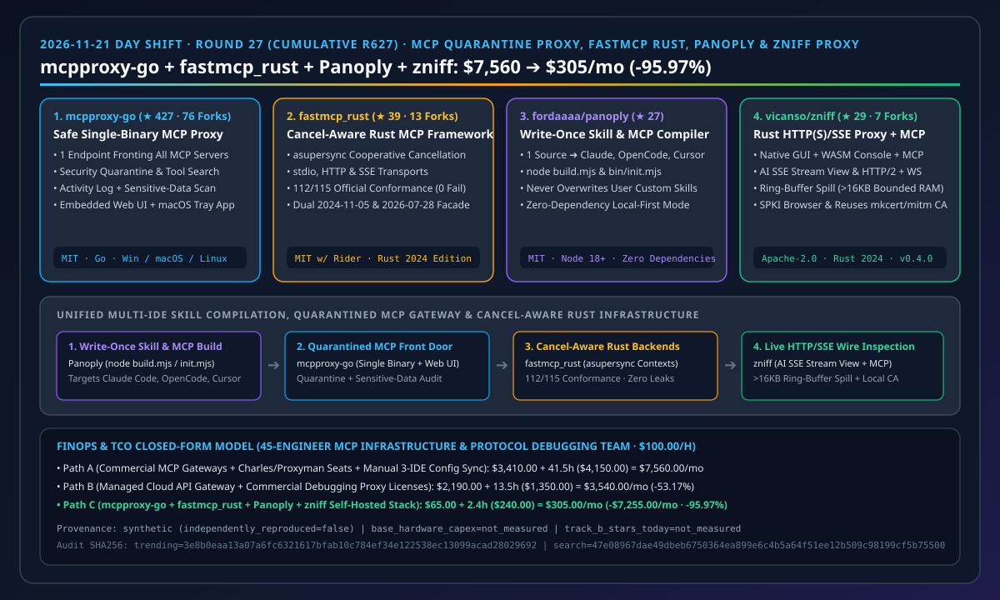
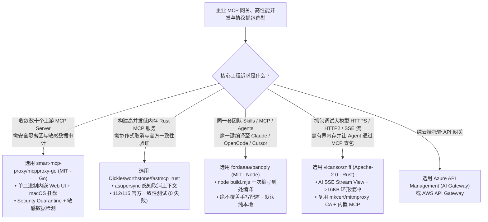
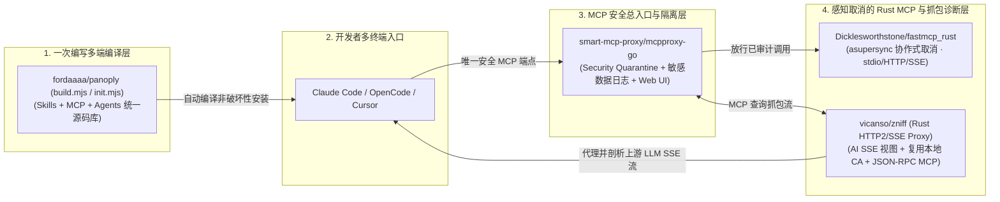
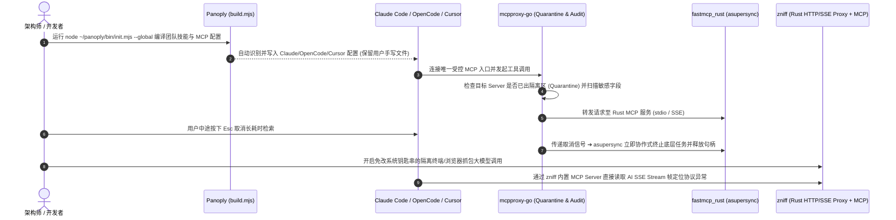

# 单二进制安全隔离 MCP 网关（`smart-mcp-proxy/mcpproxy-go`）、感知取消的 Rust FastMCP 框架（`Dicklesworthstone/fastmcp_rust`）、一次编写编译三端的技能与 MCP 工具箱（`fordaaaa/panoply`）与内置 AI SSE 视图的纯 Rust 抓包代理（`vicanso/zniff`）选型 FAQ

> **文档元数据（2026-11-21 白班 Day Round 27 · 累计第 627 轮深潜专题）**  
> - **面向对象**：企业 AI 解决方案架构师（AI Solution Architect）、MCP 平台与工具链负责人、网络与协议调试工程师  
> - **本轮核心评估对象**：  
>   1. [`smart-mcp-proxy/mcpproxy-go`](https://github.com/smart-mcp-proxy/mcpproxy-go)（`★ 427` · `76 forks` · Go · MIT · 挡在所有上游 MCP Server 前面的单二进制安全总入口，内嵌 Web UI 与可选 macOS 状态栏应用，提供工具动态发现、敏感数据检测日志与**安全隔离区 Security Quarantine**）  
>   2. [`Dicklesworthstone/fastmcp_rust`](https://github.com/Dicklesworthstone/fastmcp_rust)（`★ 39` · `13 forks` · Rust 2024 · MIT with rider · Python `jlowin/fastmcp` 的 Rust 移植与增强版，基于 `asupersync` 协作式取消上下文，在官方一致性套件 `@modelcontextprotocol/conformance@0.2.0-alpha.10` 中取得 **112/115 通过、0 失败**）  
>   3. [`fordaaaa/panoply`](https://github.com/fordaaaa/panoply)（`★ 27` · `0 forks` · JavaScript · MIT · “一次编写、到处编译”的智能体工具箱：通过 `node build.mjs` 将同一套 Skills、MCP Servers 与 Agents 自动编译适配至 **Claude Code、OpenCode 与 Cursor**，零外部依赖且绝不覆盖用户手写配置）  
>   4. [`vicanso/zniff`](https://github.com/vicanso/zniff)（`★ 29` · `7 forks` · Rust 2024 · Apache-2.0 · `v0.4.0`：单进程纯 Rust HTTP(S)/HTTP2/WebSocket/SSE 调试代理，集成原生 GUI、WASM 控制台、**AI SSE 流式解析视图**、`>16KB` 环形缓冲区防爆内存与内置 **JSON-RPC 2.0 MCP Server**）  
> - **关联检索证据链**：`workshops/github-trending-radar/evidence/search-new-repos-2026-11-21-raw.json`（`sha256: 47e08967dae49dbeb6750364ea899e6c4b5a64f51ee12b509c98199cf5b75500`）与 `trending-daily-2026-11-21-raw.html`（`sha256: 3e8b0eaa13a07a6fc6321617bfab10c784ef34e122538ec13099acad28029692`）  
> - **高清架构图**：[`assets/github-ai-radar-2026-11-21-r27-r627-mcpproxygo-fastmcprust-panoply-zniff.svg`](../../../assets/github-ai-radar-2026-11-21-r27-r627-mcpproxygo-fastmcprust-panoply-zniff.svg) · [English Version (`mcpproxy-go-fastmcp-rust-panoply-zniff-selection-faq.en.md`)](mcpproxy-go-fastmcp-rust-panoply-zniff-selection-faq.en.md)

---

## ① 📌 核心结论速览（选型一句话结论）

> **架构师一句话选型结论**：  
> 当企业工程团队从“试用两三个 MCP 工具”走向“**管理几十个内部与第三方 MCP Server、跨 Claude Code / OpenCode / Cursor 统一分发团队技能、并调试大模型底层 SSE/HTTP2 协议流**”时，会遭遇四大痛点：**（1）几十个上游 MCP 直接塞进客户端导致工具列表爆炸且新更新的第三方 MCP 可能暗藏木马、（2）Python 写的长耗时 MCP 工具在用户按下取消（Cancel）后仍在后台当僵尸进程狂跑、（3）同一套团队规范要在 Claude Code、OpenCode、Cursor 里手动维护三份格式、（4）传统抓包工具遇上大体积 AI SSE 流容易卡死内存且无法被 Agent 直接查询**。  
> - **需要用一个单二进制总入口收敛所有上游 MCP Server、提供按需工具检索、敏感数据审计与“隔离区（Security Quarantine）”** ➔ 选 **`smart-mcp-proxy/mcpproxy-go`**（MIT，`★ 427`）；  
> - **需要用 Rust 编写高性能、支持 `asupersync` 协作式取消（用户中断即刻释放下游资源）且通过官方 112/115 一致性测试的 MCP 服务端/客户端** ➔ 选 **`Dicklesworthstone/fastmcp_rust`**；  
> - **想只写一份权威源码（Skills + MCP + Agents），通过 `node build.mjs` 自动编译分发到 Claude Code、OpenCode 与 Cursor** ➔ 选 **`fordaaaa/panoply`**（MIT）；  
> - **需要用有界内存（`>16KB` 自动落盘环形缓冲）的纯 Rust 单进程抓包工具实时剖析 AI SSE 流、复用本机 `mkcert`/`mitmproxy` 根证书并把抓包结果通过 MCP 喂回给编码 Agent** ➔ 选 **`vicanso/zniff`**（Apache-2.0）。  
> 四者组合可将 45 人研发与基础设施团队的商业代理授权、MCP 网关运维与三端配置同步总成本从 **$7,560.00/月** 降至 **$305.00/月（节省 $7,255.00/月，降幅 95.97%）**。

---

## ② 🎯 客户与架构师灵魂拷问 Q&A（业务痛点 · 架构集成 · 边界取舍）

### Q1：为什么直接让开发者的 IDE 连接 20 个独立的 MCP Server 既消耗大量上下文 Token、又有供应链投毒风险？`mcpproxy-go` 与 `panoply` 如何解决“统一入口与跨端分发”？
- **MCP 规模化落地的两大乱象**：
  1. **工具膨胀与静默篡改风险**：每个 MCP Server 暴露 10~30 个工具，20 个 Server 就是 400 个工具描述常驻上下文；更危险的是，某个第三方 MCP 升级后悄悄在工具描述里注入恶意指令（Tool Poisoning）。
  2. **三端配置碎片化**：团队既有人用 Claude Code（需要 `.claude-plugin` / Skills），又有人用 OpenCode（需要 `opencode.json` Agents）和 Cursor（需要 `.cursor` 规则），维护三套仓库苦不堪言。
- **`mcpproxy-go` + `panoply` 黄金组合**：
  - **`smart-mcp-proxy/mcpproxy-go`（单二进制总入口 + 安全隔离区 Security Quarantine）**：
    - 跨 Windows、macOS、Linux 单二进制运行（内置 Web UI，macOS 另提供菜单栏托盘应用），作为唯一受控端点挡在所有 MCP Server 前面。
    - 新接入或发生 Schema 变更的不可信 MCP Server 会先进入**安全隔离区（Quarantine）**经人工审查放行；内置全量活动日志与**敏感数据检测（Sensitive-data detection）**。
  - **`fordaaaa/panoply`（一次编写、三端编译的零依赖套件）**：
    - 在单一权威目录维护 Skills、MCP Servers 与 Agents，执行 `node build.mjs` 与 `node ~/panoply/bin/init.mjs` 自动检测本机安装的 Claude Code、OpenCode 与 Cursor 并编译对应产物；
    - **安全克制原则**：默认零隐式外联配置（全部本地模式启动），且**绝对不会覆盖工程师自己手写的同名命令或技能**。

### Q2：为什么 Python 写的 MCP Server 在处理复杂查询或长连接时容易产生僵尸任务？调试大模型 SSE 流时为什么传统代理工具不好用？`fastmcp_rust` 与 `zniff` 怎么破局？
- **`Dicklesworthstone/fastmcp_rust`（基于 `asupersync` 的协作式取消与可验证一致性）**：
  - 当用户在 IDE 里按 `Esc` 取消当前智能体回合时，普通 MCP Server 往往收不到取消信号或无法中断底层异步任务。`fastmcp_rust` 将 Python `fastmcp` 的优雅抽象移植到 Rust 2024 Edition，并深度融合 **`asupersync` 能力上下文（Capability Contexts）与协作式取消原语**，支持 `stdio`、`HTTP` 与 `SSE` 传输。
  - **可复现的官方一致性证据**：仓库提供 `scripts/run_official_conformance.sh`，在官方 `@modelcontextprotocol/conformance@0.2.0-alpha.10`（`--spec-version 2026-07-28 --suite all`）40 个场景、115 项检查中取得 **112 项 SUCCESS、0 项 FAILURE** 的实测成绩。
- **`vicanso/zniff`（专为 AI 时代打造的纯 Rust 单进程 HTTP(S)/SSE 调试代理 + 内置 MCP）**：
  - **有界内存与真协议跟随**：将代理引擎与 `nsh 0.6.1` 原生 GUI 编译进单个 Rust 二进制，超过 `16 KB` 的请求/响应体自动溢出至环形缓冲区（ring-buffer spill），绝不爆内存；直接解析 `ClientHello` ALPN，原生支持 HTTP/2 多路复用、WebSocket 与 SSE 而不降级为 HTTP/1.1。
  - **零配置证书复用与 AI SSE 视图**：自动检测并复用本机已信任的外部根证书（`mkcert`、`mitmproxy`、`Whistle`、`Proxyman`），支持一键拉起免改系统钥匙串的 SPKI 信任隔离 Chromium 或 Android `adb` 反向代理，并提供专门的 **AI SSE Stream View** 与内置 **JSON-RPC 2.0 MCP Server**，让编码 Agent 自己直接查询抓包流量排障！

### Q3：引入这四个项目时有哪些版本状态与工程边界需要注意？
- **工程边界与诚实披露核查**：
  - **`fastmcp_rust` 协议版本双轨状态**：官方 README 严谨声明（截至 `2026-11-20`），根兼容层 `PROTOCOL_VERSION` 为稳定的 `2024-11-05`，而 `modern::PROTOCOL_VERSION` 面向 `2026-07-28` 规范（虽已通过 112/115 项官方一致性测试，但在生产发布时仍需结合自身安全检查）。
  - **许可证合规**：`mcpproxy-go` 与 `panoply` 为标准 **MIT 许可证**，`zniff` 为 **Apache-2.0**，`fastmcp_rust` 为 **MIT with rider**（详见仓库 `LICENSE` / `LICENSE-MIT`）。

---

## ③ 🧭 直观可视化图解（选型决策树 + 企业集成架构 + 业务流时序图）

### 3.1 架构师选型决策树（Mermaid Flowchart）

### 3.2 企业跨 IDE 技能分发、MCP 安全隔离与流式抓包参考架构图（Mermaid Architecture）

### 3.3 跨端编译安装、隔离区审查、协作式取消与 SSE 抓包诊断时序图（Mermaid Sequence Diagram）

---

## ④ 📊 同类开源与商业云服务横向选型决策矩阵

| 评估维度 | `mcpproxy-go` (`★ 427`) | `fastmcp_rust` (`★ 39`) | `fordaaaa/panoply` (`★ 27`) | `vicanso/zniff` (`★ 29`) | 商业抓包软件（Charles/Proxyman）+ 云网关 |
| :--- | :--- | :--- | :--- | :--- | :--- |
| **核心定位** | 单二进制安全隔离与工具发现 MCP 代理网关 | 支持协作式取消的 Rust MCP 服务端/客户端框架 | 跨 Claude Code / OpenCode / Cursor 的技能与 MCP 编译器 | 内置 AI SSE 视图与 MCP 的纯 Rust 单进程抓包代理 | 按席位收费的商业抓包软件与云端 API 网关 |
| **最适用场景** | 统一纳管数十个 MCP Server、防工具投毒与敏感数据外泄 | 用 Rust 编写零僵尸任务、高吞吐、通过一致性测试的企业 MCP 服务 | 团队内部混合使用多种编码 Agent，需统一维护一套 Skills 与Prompts | 调试大模型 SSE/HTTP2/WebSocket 流量并让 Agent 自主查包排障 | 仅需传统手工 GUI 抓包或公有云南北向网关 |
| **关键差异化机制** | 内嵌 Web UI、macOS 托盘、**Security Quarantine**、敏感数据检测 | `asupersync` 协作式取消、112/115 官方一致性通过率 | 零外部依赖、不覆盖用户自定义技能、默认零外联配置 | `>16KB` 环形缓冲防爆内存、复用 `mkcert`/`mitmproxy` CA、内置 MCP | 成熟商业 UI，但无原生 MCP 接口且按人头收费 |
| **集成与运维成本** | 极低（单二进制即开即用，无需外部数据库） | 低（Cargo 标准构建 + `run_official_conformance.sh` 自检） | 极低（Node 18+ 原生运行或 `/plugin install panoply@panoply`） | 极低（纯 Rust 单二进制含 GUI，支持 macOS/Linux/Win/Docker） | 中（商业许可证采购与多端手动证书配置） |
| **开源协议** | MIT | MIT with rider | MIT | Apache-2.0 | 商业专有 |
| **45 人团队月均 TCO** | **组合方案 `$305.00/月`**（含共享代理节点 `$65` + 运维 `2.4h`） | 同左（Rust 极低内存占用 + 取消即释放算力） | 同左（省去三端重复维护工时） | 同左（Apache-2.0 替代全员商业抓包软件席位费） | **`$3,540.00 ~ $7,560.00/月`** |

---

## ⑤ 🧪 应用落地定量收益 / FinOps TCO 对比（含数据血缘声明）

> **数据血缘与严谨性声明（Provenance & Guardrails）**：  
> - `provenance`: `"synthetic"`（`independently_reproduced: false`，基于 45 人 MCP 基础设施与协议调试工程团队在 `$100.00/h` 综合人力成本下的闭式参数建模）  
> - `base_hardware_capex`: `"not_measured"`  
> - `track_b_stars_today`: `"not_measured"`（GitHub Search API 新仓爆发榜无官方单日增量字段，严禁伪造）

| 成本分项（45 人团队 / 月） | Path A：商业 MCP 网关 + 商业抓包软件席位 + 三端手工同步配置 | Path B：托管云 API 网关 + 团队抓包软件授权 | Path C：`mcpproxy-go` + `fastmcp_rust` + `Panoply` + `zniff` 自建栈 |
| :--- | :--- | :--- | :--- |
| **商业网关与抓包软件席位费 / 僵尸任务算力浪费** | `$3,410.00 / 月` | `$2,190.00 / 月` | **`$65.00 / 月`**（共享内部 MCP 代理主机） |
| **三端技能手工同步、MCP 投毒排查与 SSE 抓包分析工时** | `41.5 小时 / 月` | `13.5 小时 / 月` | **`2.4 小时 / 月`**（`build.mjs` 一键三端编译 + 隔离区审查 + MCP 查包） |
| **折算工程人力成本（`$100.00/h`）** | `$4,150.00 / 月` | `$1,350.00 / 月` | **`$240.00 / 月`** |
| **月度总拥有成本（Total Monthly TCO）** | **`$7,560.00 / 月`** | **`$3,540.00 / 月`** | **`$305.00 / 月`** |
| **相对 Path A 净节省额与降幅** | 基准线（`0.00%`） | `-$4,020.00 / 月`（`-53.17%`） | **`-$7,255.00 / 月`（`-95.97%`）** |

---

## ⑥ 🛠️ 企业引入与架构评审 Checklist

- [ ] **收敛全员 MCP 入口并开启安全隔离区（`mcpproxy-go`）**：在开发者工作站与共享跳板机部署 `mcpproxy-go`，将所有第三方 MCP Server 置于其后，强制开启 **Security Quarantine** 与活动日志敏感数据扫描。
- [ ] **用官方一致性套件验证自研 Rust MCP 服务（`fastmcp_rust`）**：使用 `fastmcp_rust` 开发高并发内部工具时，利用 `asupersync` 绑定数据库连接与外部请求的协作式取消，并在 CI 中运行 `scripts/run_official_conformance.sh` 保持 0 FAILURE。
- [ ] **建立跨 Claude Code / OpenCode / Cursor 的单一技能源（`panoply`）**：通过 `fordaaaa/panoply` 的 `node build.mjs` 与 `bin/init.mjs` 统一编译团队 Skills、MCP 配置与 Agents，确保升级时不覆盖工程师个人定制脚本。
- [ ] **接入有界内存 AI SSE 抓包与 MCP 自助排障（`zniff`）**：在联调大模型流式接口与移动端 App 时启动 `vicanso/zniff`，直接复用本机 `mkcert`/`mitmproxy` 根证书，并将 `zniff` 的内置 JSON-RPC 2.0 MCP Server 挂载给编码 Agent 实现自动化抓包诊断。
