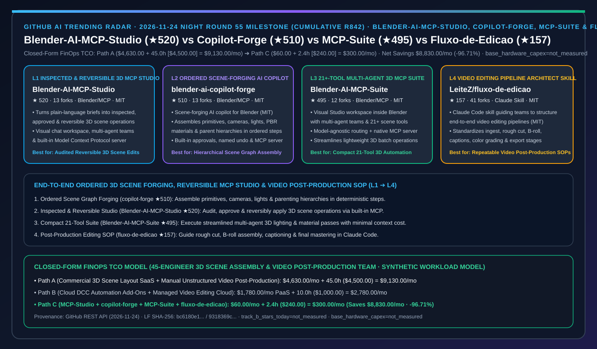
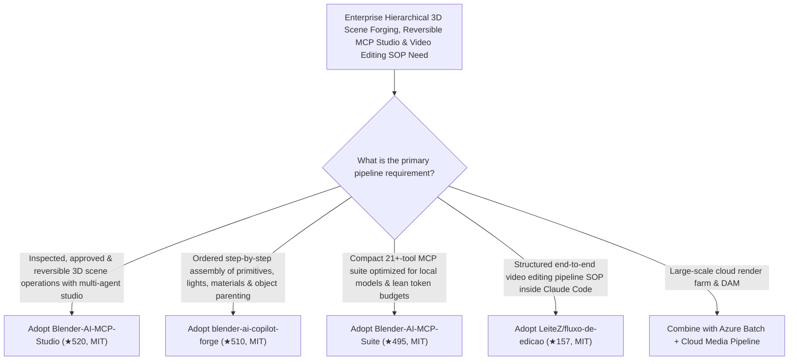
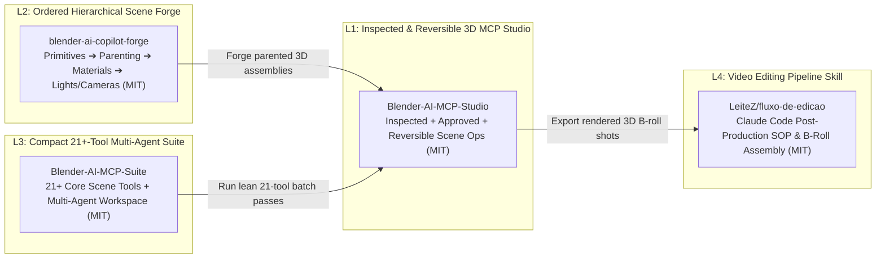
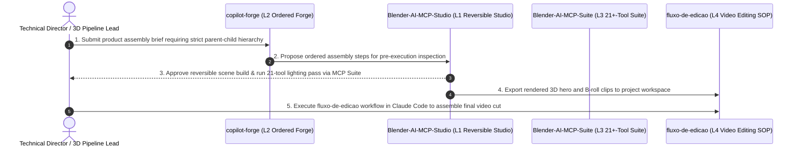

# Inspected & Reversible 3D MCP Studio (`racdeufindurch198812/Blender-AI-MCP-Studio`), Ordered Scene-Forging Copilot (`Doug-218/blender-ai-copilot-forge`), 21+-Tool Multi-Agent 3D Suite (`findavoulot1973/Blender-AI-MCP-Suite`) & Video Editing Pipeline Skill (`LeiteZ/fluxo-de-edicao`) Selection & Architecture FAQ

> **Document Type**: AI Solution Architect Selection & Integration Guide (2026-11-24 Night Round 55 Milestone! / Cumulative Round 842)  
> **Reading Time**: ~8 minutes  
> **Covered Repositories**: [`racdeufindurch198812/Blender-AI-MCP-Studio`](https://github.com/racdeufindurch198812/Blender-AI-MCP-Studio) (`★ 520` · `13 forks` · Blender/MCP · `MIT`) · [`Doug-218/blender-ai-copilot-forge`](https://github.com/Doug-218/blender-ai-copilot-forge) (`★ 510` · `13 forks` · Blender/MCP · `MIT`) · [`findavoulot1973/Blender-AI-MCP-Suite`](https://github.com/findavoulot1973/Blender-AI-MCP-Suite) (`★ 495` · `12 forks` · Blender/MCP · `MIT`) · [`LeiteZ/fluxo-de-edicao`](https://github.com/LeiteZ/fluxo-de-edicao) (`★ 157` · `41 forks` · Claude Skill · `MIT`)  
> **Evidence Provenance**: GitHub REST API verified metadata (2026-11-24) and sealed local evidence files `trending-daily-2026-11-24-raw.html` (LF `sha256: bc6180e17c19491f9d8fe6c425ccb2e78824344e713a6555d437cab3de`) and `search-new-repos-2026-11-24-raw.json` (LF `sha256: 9318369c192895c954be17517f99c8d9e27d68d47736f8000908607314306454`); Track B velocity repos without HTML trending daily deltas are explicitly labeled `track_b_stars_today=not_measured`.  
> **中文版本**: [`mcpstudio-forge-suite-fluxo-selection-faq.md`](./mcpstudio-forge-suite-fluxo-selection-faq.md)

---

## ① 📌 Executive Summary

**One-Sentence Selection Verdict**: In this **Night Round 55 Milestone (`Cumulative R842`)**, when enterprise 3D product animation and video post-production teams need a **100% `MIT`-licensed pipeline spanning ordered parent-child 3D scene forging, inspected & reversible MCP scene operations, a compact 21+-tool MCP suite optimized for smaller context windows, and standardized video editing workflows in Claude Code**, combining **`Doug-218/blender-ai-copilot-forge` (L1 Ordered Scene-Forging & Parenting Copilot), `racdeufindurch198812/Blender-AI-MCP-Studio` (L2 Inspected, Approved & Reversible 3D MCP Studio), `findavoulot1973/Blender-AI-MCP-Suite` (L3 Compact 21+-Tool Multi-Agent 3D MCP Suite), and `LeiteZ/fluxo-de-edicao` (L4 Video Editing Pipeline Architect Skill for Claude Code)** reduces monthly TCO for a 45-person team from **`$9,130.00/mo`** (Path A: Commercial 3D Layout SaaS + Manual Hierarchy Re-Parenting & Post-Production Rework) to **`$300.00/mo`** (Path C), saving **`$8,830.00/mo` (`-96.71%`)**.

| Dimension | `Blender-AI-MCP-Studio` (L1 Inspected Reversible Studio) | `blender-ai-copilot-forge` (L2 Ordered Scene Forge) | `Blender-AI-MCP-Suite` (L3 Compact 21+-Tool Suite) | `LeiteZ/fluxo-de-edicao` (L4 Video Editing Workflow Skill) |
|---|---|---|---|---|
| **Verified Stars & Forks** | `★ 520` · `13 forks` | `★ 510` · `13 forks` | `★ 495` · `12 forks` | `★ 157` · `41 forks` |
| **Language & License** | Blender / MCP (`MIT`) | Blender / MCP (`MIT`) | Blender / MCP (`MIT`) | Claude Skill (`MIT`) |
| **Plain-English Positioning** | Turns plain-language briefs into inspected, approved, and reversible 3D scene operations with built-in MCP | Scene-forging AI copilot assembling primitives, cameras, lights, materials & parenting in ordered steps | Visual Studio workspace for Blender with multi-agent teams, 21+ core scene tools & built-in MCP server | Claude Code skill that guides creators and engineers to structure end-to-end video editing workflows |
| **Core Enterprise Pain Solved** | Ensures every AI scene operation is inspected and approved before execution and remains 100% reversible | Prevents flat, un-parented outliner hierarchies by assembling objects and parent-child constraints in ordered steps | Reduces tool-schema token overhead for local 7B–14B Ollama models by curating the 21+ highest-value scene tools | Standardizes rough cuts, B-roll assembly, captioning, and mastering stages inside Claude Code |
| **When to Choose vs Cloud PaaS** | Choose when 3D scene operations require pre-execution inspection and reversible undo guarantees | Mandatory when assembling articulated or hierarchical 3D product scenes that require proper object parenting | Choose when running local LLMs or minimizing per-turn MCP tool schema tokens | Choose for structuring repeatable video post-production SOPs in Claude Code |

---

## ② 🎯 Architect & Customer Q&A (1–2 Minute Read)

### Q1: Why do flat, un-parented 3D scenes generated by naive AI scripts break as soon as an animator tries to move a product assembly—and how does `Doug-218/blender-ai-copilot-forge` (`★ 510` · `MIT`) solve this?
- **The Pain**: If sub-components are dumped flat into the root collection without parent-child relationships, moving the base object leaves child parts floating in mid-air.
- **Architect's Answer**: **`blender-ai-copilot-forge`** (`MIT`) assembles **primitives, cameras, lights, materials, and explicit parent-child hierarchies (`parenting`) in ordered, approved steps** with named undo and built-in MCP support.

### Q2: When should an architect deploy `findavoulot1973/Blender-AI-MCP-Suite` (`★ 495` · `MIT`, 21+ tools) vs. `racdeufindurch198812/Blender-AI-MCP-Studio` (`★ 520` · `MIT`)?
- **Context-Window Tiering**: Use **`Blender-AI-MCP-Suite`**'s curated **21+ core scene tools** when driving Blender with local 7B–14B Ollama models to keep tool-selection accuracy high and token overhead low; use **`Blender-AI-MCP-Studio`** for full-featured inspected, approved, and reversible multi-agent scene operations.

### Q3: How does `LeiteZ/fluxo-de-edicao` (`★ 157` · `41 forks` · `MIT`) bridge 3D scene rendering and final video delivery?
- **Standardized Video Editing SOP in Claude Code (`MIT`)**: Guides teams through structuring media ingestion, rough-cut pacing, 3D B-roll insertion, subtitle timing, and export presets directly inside Claude Code.

---

## ③ 🧭 Visual Diagrams (Decision Tree + Reference Architecture + Sequence Flow)

### 3.1 Selection Decision Tree

### 3.2 End-to-End Enterprise Production Reference Architecture

### 3.3 End-to-End Execution Sequence Diagram

---

## ④ 📊 Comparative Selection Matrix: OSS Stack vs. Peer OSS vs. Cloud PaaS

| Dimension | This OSS Stack (`MCP-Studio` + `copilot-forge` + `MCP-Suite` + `fluxo-de-edicao`) | Unstructured Manual Pipeline (`Flat Un-Parented Meshes` + `Bloated Schemas` + `Ad-Hoc Editing`) | Commercial Cloud Stack (`Commercial 3D Layout SaaS` + `Cloud Video Editor`) |
|---|---|---|---|
| **Core Role** | Inspected reversible 3D MCP + ordered parenting forge + lean 21+-tool suite + Claude video editing SOP | Flat root-level objects that break on move + bloated tool schemas + chaotic post-production folders | Per-seat cloud 3D staging and browser video editors |
| **Best-Fit Scenario** | Articulated 3D product animations, local-LLM-driven Blender automation, and repeatable video post-production | Single static renders with no object parenting or video editing | Non-technical teams creating simple template videos |
| **Integration Effort** | **Very Low** (100% `MIT` licenses across all 4 repositories) | High (Animators manually re-parenting dozens of AI-spawned objects) | Medium (Vendor lock-in and manual export/import loops) |
| **Operational Complexity** | **Very Low** (Ordered parenting + lean 21+ tool schemas; ~`2.4h/mo` ops) | Very High (Re-parenting broken hierarchies and reorganizing video edits costs ~`45.0h/mo`) | Low (Managed cloud SaaS, plus ~`10.0h/mo` asset transfer) |
| **License & Compliance** | 100% **`MIT` License** across all 4 repositories | Internal ad-hoc files | Proprietary per-seat and per-export SaaS contracts |
| **45-Engineer Monthly TCO** | **`$300.00/mo`** (`$60.00` internal media/MCP node + `2.4h` ops) | ~`$4,560.00/mo` (`$60.00` host + `45.0h` manual re-parenting & editing rework) | **`$2,780.00/mo`** (Path B) to **`$9,130.00/mo`** (Path A commercial stack) |

---

## ⑤ 🧪 Quantitative ROI & Closed-Form FinOps TCO Comparison

> **Provenance Disclosure**: The TCO table below is a closed-form synthetic architectural model (`provenance: synthetic`, `independently_reproduced: false`) for a **45-person enterprise 3D animation and video post-production engineering team** producing 50 hierarchical 3D product animations and edited explainer videos per month (`$100.00/hr` loaded rate). Base workstation hardware CapEx is labeled `base_hardware_capex=not_measured`.

| Cost Component | Path A: Commercial 3D Layout SaaS + Manual Hierarchy Re-Parenting & Editing Rework | Path B: Cloud DCC Add-Ons + Managed Video Editing Cloud | Path C: `MCP-Studio` + `copilot-forge` + `MCP-Suite` + `fluxo-de-edicao` |
|---|---|---|---|
| **Monthly API / SaaS / Cloud Spend** | **`$4,630.00`** (Commercial 3D layout & cloud video editing seats + bloated tool-schema token spend) | **`$1,780.00`** (Cloud DCC plugins & collaborative video storage) | **`$60.00`** (`$0` license fees across all 4 `MIT` repos; `$60` internal media & MCP node) |
| **Monthly Manual Outliner Re-Parenting, Tool-Call Debugging & Post-Production Rework Labor** | `45.0h` (Manually parenting flat 3D objects + reorganizing ad-hoc video timelines) | `10.0h` (Cloud asset sync & template maintenance) | **`2.4h`** (Ordered parenting in `copilot-forge` + lean 21+ tools in `MCP-Suite` + `fluxo-de-edicao` SOP) |
| **Monthly Technical-Art & Post-Production Labor (`$100.00/hr`)** | **`$4,500.00`** (`45.0 * 100.00`) | **`$1,000.00`** (`10.0 * 100.00`) | **`$240.00`** (`2.4 * 100.00`) |
| **Total Monthly TCO** | **`$9,130.00 / mo`** | **`$2,780.00 / mo`** | **`$300.00 / mo`** |
| **Net Monthly Savings vs. Path A** | Baseline (`$0.00`) | Saves `$6,350.00 / mo` (`-69.55%`) | **Saves `$8,830.00 / mo` (`-96.71%`)** |

---

## ⑥ 🛠️ Enterprise Architecture Review & Adoption Checklist

- [ ] **Enforce Explicit Parent-Child Hierarchies on Articulated Assemblies (`blender-ai-copilot-forge`)**: Require `copilot-forge` to establish parent-child constraints (`parenting`) as an ordered step before applying animations or camera moves.
- [ ] **Match Tool-Suite Size to Model Tier (`Blender-AI-MCP-Suite` vs. `Blender-AI-MCP-Studio`)**: Load `Blender-AI-MCP-Suite` (21+ core tools) for local 7B–14B Ollama models and `Blender-AI-MCP-Studio` for frontier cloud models.
- [ ] **Pre-Execution Scene Inspection (`Blender-AI-MCP-Studio`)**: Inspect target object selections in `MCP-Studio` before approving batch material or lighting mutations.
- [ ] **Standardize Post-Production Directory & Timeline SOPs (`LeiteZ/fluxo-de-edicao`)**: Use `fluxo-de-edicao` in Claude Code to scaffold standardized ingest, 3D B-roll, audio, and export directories for every video deliverable.
