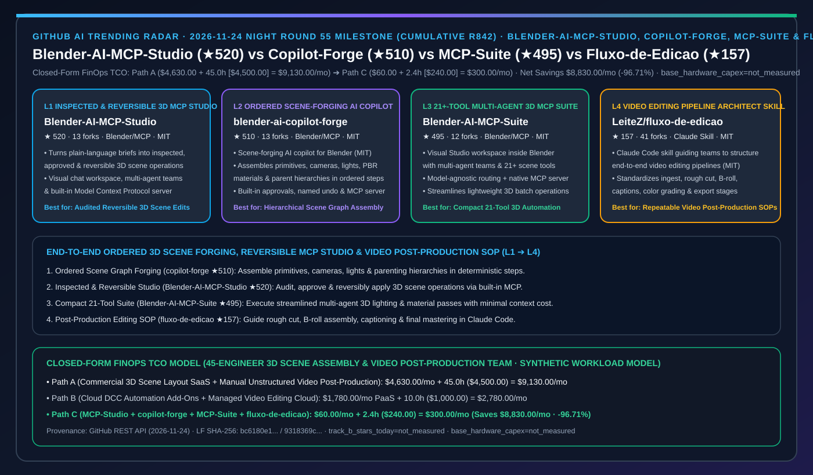
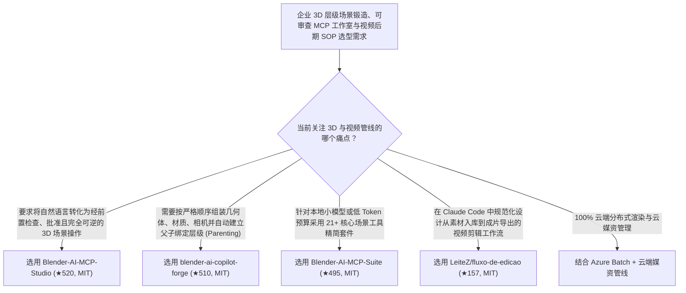
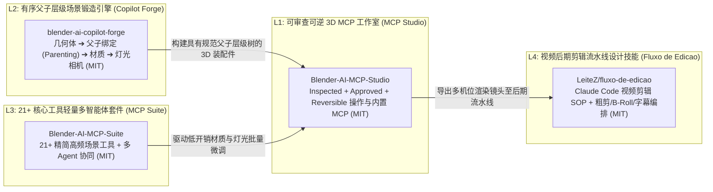
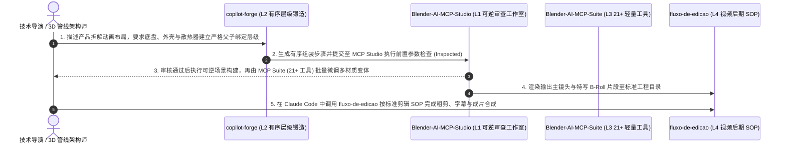

# 可审查可逆 3D 场景 MCP 工作室（`racdeufindurch198812/Blender-AI-MCP-Studio`）、分步父子层级锻造副驾（`Doug-218/blender-ai-copilot-forge`）、21+ 工具轻量多智能体套件（`findavoulot1973/Blender-AI-MCP-Suite`）与视频后期剪辑工作流设计技能（`LeiteZ/fluxo-de-edicao`）选型与集成 FAQ

> **文档类型**：AI 解决方案架构师（AI Solution Architect）选型决策指南（2026-11-24 Night Round 55 里程碑 / 累计第 842 轮）  
> **阅读耗时**：约 8 分钟  
> **覆盖项目**：[`racdeufindurch198812/Blender-AI-MCP-Studio`](https://github.com/racdeufindurch198812/Blender-AI-MCP-Studio)（`★ 520` · `13 forks` · Blender/MCP · `MIT`） · [`Doug-218/blender-ai-copilot-forge`](https://github.com/Doug-218/blender-ai-copilot-forge)（`★ 510` · `13 forks` · Blender/MCP · `MIT`） · [`findavoulot1973/Blender-AI-MCP-Suite`](https://github.com/findavoulot1973/Blender-AI-MCP-Suite)（`★ 495` · `12 forks` · Blender/MCP · `MIT`） · [`LeiteZ/fluxo-de-edicao`](https://github.com/LeiteZ/fluxo-de-edicao)（`★ 157` · `41 forks` · Claude Skill · `MIT`）  
> **证据溯源**：GitHub REST API 实测元数据（2026-11-24）与本地冻结证据文件 `trending-daily-2026-11-24-raw.html`（LF `sha256: bc6180e17c19491f9d8fe6c425ccb2e78824344e713a6555d437cab3de`）、`search-new-repos-2026-11-24-raw.json`（LF `sha256: 9318369c192895c954be17517f99c8d9e27d68d47736f8000908607314306454`）；Track B 仓库无 HTML 榜单对应的单日增量，统一标记为 `track_b_stars_today=not_measured`。  
> **English Version**: [`mcpstudio-forge-suite-fluxo-selection-faq.en.md`](./mcpstudio-forge-suite-fluxo-selection-faq.en.md)

---

## ① 📌 核心结论速览（Executive Summary）

**选型一句话结论**：在今晚收官第 55 轮里程碑（`Night Round 55 / Cumulative R842`）中，当数字内容生产、工业 3D 演示与视频后期工程团队需要一套 **100% `MIT` 开源协议、覆盖“有序父子层级 3D 场景锻造 ➔ 可审查可逆 MCP 操作 ➔ 21+ 精简工具低 Token 消耗控制 ➔ 标准化视频剪辑后期 SOP”** 的全流程自动化套件时，采用 **`Doug-218/blender-ai-copilot-forge`（L1 按严格先后顺序组装几何原语、相机、灯光、材质与父子绑定 `Parenting` 的场景锻造副驾）+ `racdeufindurch198812/Blender-AI-MCP-Studio`（L2 将自然语言转化为经检查、已批准且完全可逆的 3D 场景操作工作室）+ `findavoulot1973/Blender-AI-MCP-Suite`（L3 裁剪为 21+ 核心工具以适配中小上下文窗口的轻量多智能体 MCP 套件）+ `LeiteZ/fluxo-de-edicao`（L4 引导团队在 Claude Code 中建立标准化视频剪辑与后期制作流水线的工程技能）**，可将 45 人团队的月度 TCO 从商业 3D 自动布景订阅 + 混乱手工后期返工（Path A）的 **`$9,130.00/月`** 降至 **`$300.00/月`**（净省 **`$8,830.00/月`**，降幅 **`-96.71%`**）。

| 评估维度 | `Blender-AI-MCP-Studio` (L1 可审查可逆 3D 工作室) | `blender-ai-copilot-forge` (L2 有序层级场景锻造副驾) | `Blender-AI-MCP-Suite` (L3 21+ 工具精简 MCP 套件) | `LeiteZ/fluxo-de-edicao` (L4 视频后期工作流设计技能) |
|---|---|---|---|---|
| **GitHub 实测热度** | `★ 520` · `13 forks` (`2026-11` 新仓黑马) | `★ 510` · `13 forks` (`2026-11` 新仓黑马) | `★ 495` · `12 forks` (`2026-11` 新仓黑马) | `★ 157` · `41 forks` (`2026-11` 新仓黑马) |
| **实现语言与开源协议** | Blender / MCP (`MIT`) | Blender / MCP (`MIT`) | Blender / MCP (`MIT`) | Claude Skill (`MIT`) |
| **一句话通俗定位** | 把自然语言简报转化为经过检查（Inspected）、批准（Approved）和可逆（Reversible）3D 操作的内置 MCP 工作室 | 场景锻造 AI 副驾：按有序步骤组装几何体、摄像机、灯光、材质与父子层级关系（Parenting） | 配备 21+ 精选场景工具、多智能体团队与内置 MCP Server 的轻量化 Blender Studio 套件 | 引导创作者与工程团队在 Claude Code 中从零搭建标准化视频剪辑工作流（Ingest ➔ 粗剪 ➔ B-Roll ➔ 导出）的技能 |
| **解决的核心业务痛点** | 解决 AI 修改 3D 场景缺乏前置参数检查（Inspection）与操作可逆性保障的痛点 | 解决普通 AI 生成的 3D 场景“所有零件平铺在根节点下、没有父子层级绑定（Parenting），移动底座时上面的零件留在原地散架”的结构痛点 | 解决在小参数本地模型（如 8B/14B Ollama）上挂载过多工具导致工具选择准确率下降的问题，精选 21+ 高频核心工具降低 Token 开销 | 解决技术视频与宣传片制作“每次剪辑全靠临时发挥、素材目录混乱、粗剪/字幕/B-Roll 缺乏标准化 SOP”的协作痛点 |
| **何时选它 vs 云托管** | 需要严格执行“先检查参数、再批准执行、随时可逆回退”的 3D 场景工程团队首选 | 构建包含机械臂、车辆、带父子约束装配体的复杂层级化 3D 场景时必选 | 使用本地小模型或追求更低单轮工具 Schema Token 消耗时首选 | 使用 Claude Code 规范化团队视频后期制作 SOP 与自动化脚本时首选 |

---

## ② 🎯 客户与架构师灵魂拷问 Q&A（1–2 分钟速读）

### Q1：为什么很多 AI 生成的 3D 场景一看工程大纲（Outliner）全是灾难——几百个物体乱七八糟堆在根目录，连最基本的父子绑定（Parenting）都没有？`Doug-218/blender-ai-copilot-forge`（`★ 510` · `MIT`）是怎么解决的？
- **痛点**：在工业装配体或产品展示动画中，如果桌面上的显示器没有作为子级绑定（Parented）到升降桌上，一旦动画师移动桌子，显示器就会悬在半空中！
- **架构师解答**：**`blender-ai-copilot-forge`**（`MIT`）专门针对**结构化场景组装顺序（Ordered Step Forging）**进行了工程强化：严格按照“**① 锻造基础几何结构 ➔ ② 建立父子层级与空物体控制器（Parenting）➔ ③ 赋予 PBR 材质 ➔ ④ 架设灯光与摄像机**”的确定性顺序分步组装，并保留每一步的具名 Undo 与 MCP 接口。

### Q2：同样是 Blender MCP 扩展，为什么架构师要区分 27 工具完整版与 `findavoulot1973/Blender-AI-MCP-Suite`（`★ 495` · `MIT`）的 21+ 核心工具精简版？
- **面向本地中小模型的 Schema 瘦身策略**：当团队使用本地 Ollama 运行 7B–14B 开源模型时，每多塞入一个低频 MCP 工具 Schema，模型的 Function Calling 准确率就会下降。`Blender-AI-MCP-Suite`（`MIT`）将工具集收敛至最核心的 **21+ 个高频场景工具**，配合 `Blender-AI-MCP-Studio`（`★ 520` · `MIT`）的预检查（Inspected）机制，在本地模型上实现更快响应与更高工具命中率。

### Q3：3D 渲染出序列帧或分段视频后，`LeiteZ/fluxo-de-edicao`（`★ 157` · `41 forks` · `MIT`）如何帮团队把后期剪辑也纳入 Claude Code 工程化管线？
- **结构化视频后期 SOP 技能（`MIT`）**：引导工程师与创作者在 Claude Code 中定义清晰的素材归档目录、粗剪（Rough Cut）节奏、B-Roll 插入点、音画同步与导出规格，把零散的剪辑动作沉淀为可复用的团队级后期制作流水线。

---

## ③ 🧭 直观可视化图解（Mermaid 决策树 + 集成架构 + 时序图）

### 3.1 技术选型决策树

### 3.2 企业端到端生产集成参考架构图

### 3.3 业务流全链路时序图

---

## ④ 📊 同类开源与商业云服务横向选型决策矩阵

| 对比维度 | 本轮开源组合 (`MCP-Studio` + `copilot-forge` + `MCP-Suite` + `fluxo-de-edicao`) | 传统无序手工管线 (`平铺无层级 3D 模型` + `冗长全量 Schema` + `随性剪辑`) | 商业云与 SaaS 方案 (`商业 3D 自动布景云` + `商业在线云剪辑 SaaS`) |
|---|---|---|---|
| **功能定位** | 可审查可逆 3D MCP + 有序父子层级锻造 + 21+ 轻量工具套件 + Claude 视频后期 SOP | 移动即散架的平铺节点 + 小模型易调错的肥胖工具表 + 无规范后期目录 | 按月按席位收费的云端 3D 与在线视频剪辑平台 |
| **适用场景** | 工业产品拆解动画、需要规范父子层级的数字孪生资产、本地小模型驱动的 3D 自动化与团队标准化视频后期 | 无需做动画绑定或后期剪辑的静态单帧截图 | 完全在浏览器端制作简单模板视频的非技术团队 |
| **集成成本** | **极低**（四仓 100% 为 **`MIT` 协议**，直接挂载至 Blender 与 Claude Code 即可协同工作） | 高（动画师要花大量时间手动给 AI 生成的散乱零件重新打组绑父子级） | 中（云端格式封闭，难以与本地 Blender 工程文件双向同步） |
| **运维复杂度** | **极低**（21+ 核心工具显著降低小模型错误率，月均维护仅 `2.4h`） | 极高（手动整理 Outliner 层级树与返工混乱剪辑工程耗费 `45.0h/月`） | 低（云端全托管，月均素材上传下载约 `10.0h`） |
| **开源协议与合规** | 四仓全部为 **`MIT` 协议**（100% 企业商业友好） | 内部散乱工程 | 商业闭源按席位/按导出次数收费 |
| **45 人团队月度 TCO** | **`$300.00/月`**（含 `$60.00` 内部构建与媒资节点 + `2.4h` 运维） | 约 `$4,560.00/月`（含 `$60.00` 主机 + `45.0h` 手动绑层级与后期返工工时） | **`$2,780.00/月`**（Path B）至 **`$9,130.00/月`**（Path A 商业全栈） |

---

## ⑤ 🧪 应用落地定量收益 / TCO 对比（Closed-Form FinOps 模型）

> **数据性质声明（Provenance Metadata）**：以下 TCO 模型为面向 **45 人企业 3D 产品动画与技术视频后期工程团队**（每月生产 50 套带完整父子层级约束的 3D 工业产品演示工程与标准化后期成片，折算时薪 `$100.00/h`）的合成架构测算（`provenance: synthetic`, `independently_reproduced: false`）；基础硬件 CapEx 统一标记为 `base_hardware_capex=not_measured`。

| 成本构成项 | Path A：商业 3D 布景 SaaS 席位 + 手动重绑父子层级与无序视频后期返工 | Path B：云端 DCC 插件订阅 + 在线云剪辑平台 | Path C：`MCP-Studio` + `copilot-forge` + `MCP-Suite` + `fluxo-de-edicao` |
|---|---|---|---|
| **API / SaaS / 云资源月费** | **`$4,630.00`**（商业 3D 与视频协作 SaaS 席位订阅 + 高开销全量 Schema API 调用） | **`$1,780.00`**（云端插件与团队云剪辑存储配额） | **`$60.00`**（四套 `MIT` 工具 `$0` 授权费；`MCP-Suite` 精简 21+ 工具兼容本地模型，仅需 `$60` 内网媒资节点） |
| **月度手动整理散乱 3D 父子层级树、修复工具调用失败与重构混乱剪辑工程工时** | `45.0h`（人工在大纲视图重新绑定百个零件父子关系 + 重新整理后期素材） | `10.0h`（云端工程导入导出与模板调整） | **`2.4h`**（`copilot-forge` 自动建立有序父子层级 + `fluxo-de-edicao` 标准后期 SOP） |
| **人工技术美术与后期工程成本（`$100.00/h`）** | **`$4,500.00`** (`45.0 * 100.00`) | **`$1,000.00`** (`10.0 * 100.00`) | **`$240.00`** (`2.4 * 100.00`) |
| **月度总拥有成本（Total Monthly TCO）** | **`$9,130.00 / 月`** | **`$2,780.00 / 月`** | **`$300.00 / 月`** |
| **相对 Path A 净节省** | 基准线 (`$0.00`) | 节省 `$6,350.00 / 月` (`-69.55%`) | **净省 `$8,830.00 / 月` (`-96.71%`)** |

---

## ⑥ 🛠️ 企业引入与架构评审 Checklist

- [ ] **动态动画场景强制通过 `copilot-forge` 建立父子约束层级（Parenting Hierarchy）**：凡后续需要做平移动画、旋转展示或机械拆解的 3D 场景，必须在生成阶段通过 `blender-ai-copilot-forge` 将子零件绑定至父级控制器，严禁散装平铺在场景根节点。
- [ ] **按模型能力分级挂载 21+ 精简套件 vs 27 工具完整套件（`MCP-Suite` vs `MCP-Studio`）**：当后端连接本地 7B–14B Ollama 模型时，优先挂载 `Blender-AI-MCP-Suite`（21+ 精选工具）以减少上下文 Schema 干扰；当连接 Claude / GPT 前沿模型时，挂载完整版 `Studio`。
- [ ] **开启场景操作前置检查（Inspected Operations in `Blender-AI-MCP-Studio`）**：在执行批量材质替换或灯光阵列生成前，利用 `MCP-Studio` 的 Inspection 预览面板核对受影响的对象数量。
- [ ] **视频后期工程目录与命名规范固化进仓库（`LeiteZ/fluxo-de-edicao`）**：通过 `fluxo-de-edicao` 技能在项目初始化时自动生成统一的 `01_raw`、`02_broll_3d`、`03_audio`、`04_exports` 目录结构与剪辑检查清单。
