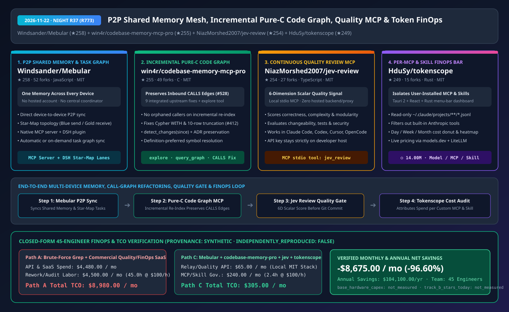
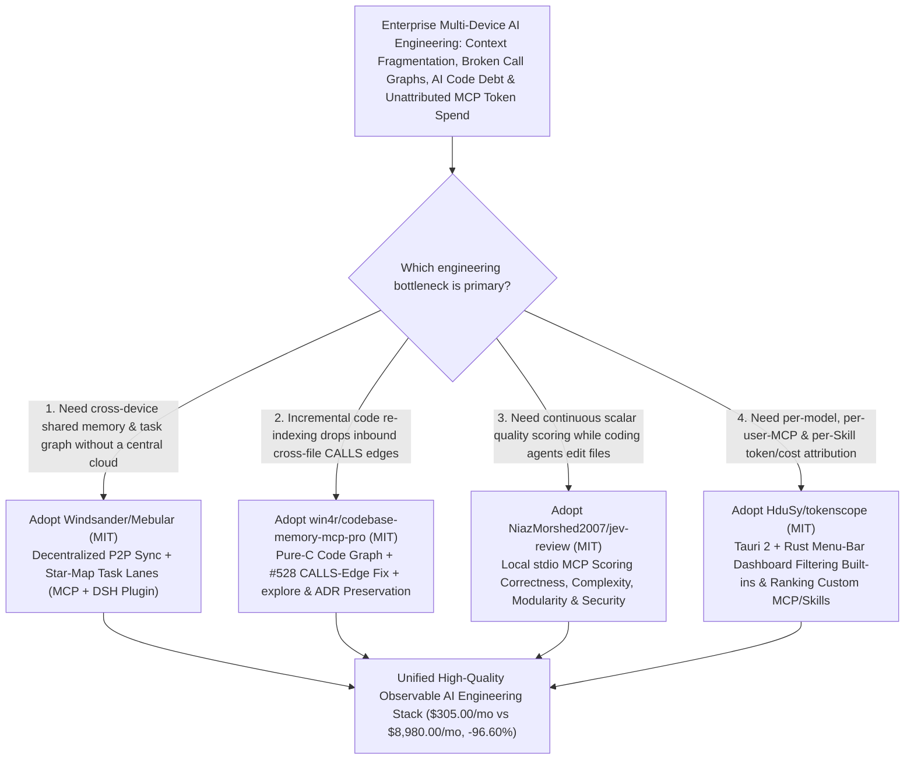
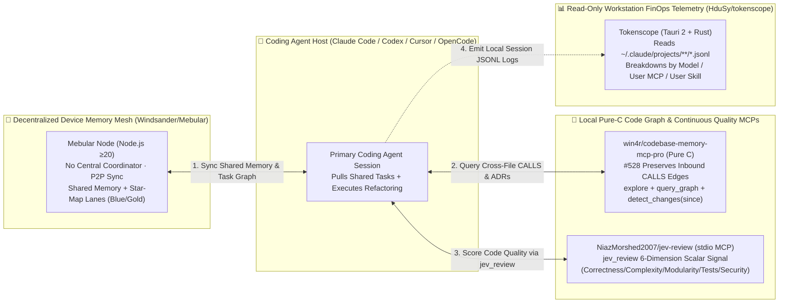

# Decentralized Multi-Device Shared Memory & Task Graph (`Windsander/Mebular`), Incremental-Reindex Pure-C Code Knowledge-Graph MCP (`win4r/codebase-memory-mcp-pro`), Continuous Software-Quality Scoring MCP (`NiazMorshed2007/jev-review`) & Per-MCP/Skill Token FinOps Dashboard (`HduSy/tokenscope`) — Enterprise Selection & Architecture FAQ

> **Document Type**: Enterprise AI Solution Architect Application Landing & Comparative Selection Guide (2026-11-22 Night Round 37 / Cumulative Round `R773`)  
> **Evaluated Repositories**: `Windsander/Mebular` (`★ 258`, `52 forks`, JavaScript, MIT) · `win4r/codebase-memory-mcp-pro` (`★ 255`, `49 forks`, C, MIT) · `NiazMorshed2007/jev-review` (`★ 254`, `27 forks`, TypeScript, MIT) · `HduSy/tokenscope` (`★ 249`, `15 forks`, Rust, MIT)  
> **Provenance Declaration**: Live GitHub repository metadata comes from our 2026-11-22 sealed evidence snapshot and GitHub REST API. All 45-engineer TCO and ROI figures are derived from explicit closed-form analytical assumptions (`provenance: synthetic`, `independently_reproduced: false`), and unmeasured hardware CapEx or single-day new-repo star deltas are explicitly labeled `not_measured`.



---

## ① 📌 Executive Summary (One-Sentence Selection Verdict)

> **One-Sentence Verdict**: For a 45-engineer multi-device AI-assisted software engineering organization, **stop letting coding agents lose task context across workstations, sever cross-file `CALLS` edges during incremental code re-indexing, commit unverified AI-generated code without scalar quality feedback, or burn millions of tokens on bloated third-party MCP servers and Skills without attribution**; instead, deploy the MIT-licensed four-part stack of **`Windsander/Mebular` (decentralized peer-to-peer shared memory and task graph) + `win4r/codebase-memory-mcp-pro` (pure-C code knowledge-graph MCP preserving inbound `CALLS` edges on incremental re-index) + `NiazMorshed2007/jev-review` (local `stdio` MCP for continuous 6-dimension code-quality scoring) + `HduSy/tokenscope` (Tauri 2 + Rust menu-bar FinOps dashboard breaking down token spend by model, user-installed MCP, and Skill)**, cutting monthly TCO from **`$8,980.00/mo`** to **`$305.00/mo`** (net savings of **`$8,675.00/mo`**, or **`96.60%`**).

| Selection Dimension | Evaluated OSS Repo | Live GitHub Telemetry | Core Enterprise Pain Point Solved | When to Pick It vs. Managed Cloud PaaS |
| :--- | :--- | :--- | :--- | :--- |
| **Decentralized Shared Memory & Task Graph** | **`Windsander/Mebular`** | `★ 258` · `52 forks` · JavaScript · MIT | Switching between desktop, laptop, and remote servers fragments agent memory and task graphs—or forces uploading private context to a vendor cloud | Pick **`Mebular`** when you need **zero hosted accounts, no central coordinator, MCP + DeepSeek Harness (`DSH`) plugins, and direct device-to-device sync with a visual Star Map of send/receive task lanes**; pick Azure Cosmos DB for centralized cloud agent state |
| **Incremental-Reindex Pure-C Code Graph MCP** | **`win4r/codebase-memory-mcp-pro`** | `★ 255` · `49 forks` · C · MIT | Editing a single file and triggering incremental re-index in upstream `codebase-memory-mcp` orphans inbound cross-file `CALLS` edges and truncates Cypher queries at 10 rows | Pick **`codebase-memory-mcp-pro`** when you need **pure-C speed with 9 critical fixes (#528 inbound `CALLS`-edge preservation, #465 Cypher `WITH` properties, #412 >10-row traversal, #539 ADR preservation) plus an agent-native `explore` MCP tool** |
| **Continuous Code-Quality Review MCP** | **`NiazMorshed2007/jev-review`** | `★ 254` · `27 forks` · TypeScript · MIT | Coding agents generate high-churn patches without immediate scalar feedback on modularity, complexity, changeability, or security before PR submission | Pick **`jev-review`** when you want **a zero-hosted-backend local `stdio` MCP server (`jev_review`) giving Claude Code, Codex, Cursor, and OpenCode instant scalar scores across 6 quality dimensions**; pick SonarQube for centralized CI gates |
| **Per-Model / MCP / Skill Token FinOps Bar** | **`HduSy/tokenscope`** | `★ 249` · `15 forks` · Rust · MIT | Teams see daily Claude CLI usage hit `14.00M+` tokens but cannot tell which user-installed MCP server or custom `~/.claude/skills/` caused the spike | Pick **`tokenscope`** when you want **a read-only Tauri 2 + Rust macOS/Windows menu-bar app that filters out built-in tools and breaks down token count and USD cost (`models.dev` + LiteLLM) by model, user MCP server, and custom Skill** |

---

## ② 🎯 Solution Architect & Customer Deep-Dive Q&A

### Q1: Why do enterprise AI coding teams need these four specific tools when they already use standard code search and basic API billing dashboards?

**Plain-Language Breakdown for Engineering Directors & Platform Architects**:
Four hidden failure modes silently erode ROI in multi-device AI coding workflows:
1. **Cross-Device Context Amnesia (`Windsander/Mebular`)**: An architect plans a service migration on a workstation in the afternoon and continues on a laptop or build node at night, losing the entire task graph unless they push sensitive notes to a third-party cloud. `Mebular` ("One memory. Every assistant. Every device.") operates with **no hosted account and no central coordinator**: devices sync directly over shared-subscription edges, visualizing task-domain lanes on an interactive Star Map (blue lanes can send tasks, gold lanes can receive).
2. **Broken Call Graphs After Incremental Edits (`win4r/codebase-memory-mcp-pro`)**: While `DeusData/codebase-memory-mcp` provides a fast pure-C code graph, editing a file and running incremental re-index previously dropped inbound cross-file `CALLS` edges into that file's symbols—causing agents to mistakenly believe a function had zero callers! `win4r/codebase-memory-mcp-pro` integrates 9 upstream fixes ahead of merge: preserving inbound `CALLS` edges on incremental re-index (`#528`), populating node properties across Cypher `WITH` aggregations (`#465`), fixing label-filtered traversal truncation at 10 rows (`#412`), honoring `since` in `detect_changes` (`#464`), preserving ADRs across full re-index (`#539`), fixing stack-buffer overflows (`#475`), and adding a unified `explore` MCP tool.
3. **Unchecked AI Code Debt During Authoring (`NiazMorshed2007/jev-review`)**: Waiting until CI to catch tangled AI-generated code wastes review cycles. `jev-review` runs locally over MCP `stdio` with no author-operated backend (API keys stay on the developer machine) and exposes a single `jev_review` tool returning fast scalar scores across correctness, complexity, changeability, modularity, tests, and security—letting the coding agent self-correct before committing.
4. **Unattributed MCP & Skill Token Drain (`HduSy/tokenscope`)**: Developers install dozens of MCP servers and `~/.claude/skills/`, unaware that one verbose MCP tool or skill is consuming 70% of their daily `14.00M` token budget. `tokenscope` (Tauri 2 + React + Rust) reads `~/.claude/projects/**/*.jsonl`, `~/.claude.json`, and `~/.claude/skills/` with zero intrusion, **filtering out Anthropic's built-in tools so only user-installed MCP servers and Skills are ranked by token volume and USD cost**.

### Q2: How do these four MIT-licensed projects integrate into an enterprise AI engineering workflow?

**End-to-End Integration Architecture**:
1. **Peer-to-Peer Memory & Task Graph Plane (`Windsander/Mebular`)**: Connected via MCP server or DeepSeek Harness (`DSH`) plugin across developer desktops, laptops, and remote VMs to keep architectural decisions and task graphs synchronized without a central cloud database.
2. **Incremental Code Knowledge-Graph Plane (`win4r/codebase-memory-mcp-pro`)**: Mounted in Claude Code, Cursor, and Codex to serve exact cross-file `CALLS` edges, Cypher `query_graph` traversals, `detect_changes(since)`, and `explore` queries with sub-second pure-C performance.
3. **In-Loop Software Quality Gate Plane (`NiazMorshed2007/jev-review`)**: Invoked via `jev_review` after each multi-file edit so the agent verifies scalar modularity, complexity, and security scores before creating a commit.
4. **Workstation FinOps Telemetry Plane (`HduSy/tokenscope`)**: Runs in the macOS menu bar or Windows system tray, attributing every session's input/output tokens and dollar cost (`models.dev` primary pricing with LiteLLM fallback) across models, custom MCP servers, and Skills.

### Q3: Where are the boundaries where cloud-managed services should complement this local stack?

**Boundaries & Trade-offs**:
- **Org-Wide Central Billing Rollups**: `tokenscope` inspects local `~/.claude/projects/**/*.jsonl` logs per workstation; for enterprise-wide chargeback across 500+ seats using multiple non-Claude API gateways, combine workstation `tokenscope` insights with centralized Azure API Management / FinOps Hub telemetry.
- **Air-Gapped Quality Scoring**: `jev-review` sends code snippets directly from the local Node.js MCP process to the configured Jev API; strictly air-gapped defense enclaves should pair `codebase-memory-mcp-pro` with offline static analyzers.

---

## ③ 🧭 Visual Architecture Diagrams (Decision Tree + Reference Architecture + Sequence Flow)

### 3.1 Selection Decision Tree (Mermaid Flowchart)



### 3.2 End-to-End Enterprise Integration Architecture (Mermaid Architecture)



### 3.3 Cross-Device Task Handoff, Call-Graph Refactoring & FinOps Attribution Sequence (Mermaid Sequence)

```mermaid
sequenceDiagram
    autonumber
    actor Dev as Enterprise Developer
    participant Meb as Windsander/Mebular (P2P Memory & Task Graph)
    participant Agent as Claude Code / Cursor
    participant Graph as codebase-memory-mcp-pro (Pure-C Graph)
    participant Jev as jev-review (Quality MCP)
    participant Scope as HduSy/tokenscope (Menu-Bar FinOps)

    Dev->>Agent: Resume payment-service refactoring on laptop from workstation session
    Agent->>Meb: Fetch peer-synced task graph & architectural constraints via MCP
    Meb-->>Agent: Return active task lane state, interface contracts & prior context
    Agent->>Graph: Call detect_changes(since) & explore on modified payment symbols
    Graph-->>Agent: Incremental re-index preserves all inbound cross-file CALLS edges & ADRs
    Agent->>Agent: Apply cross-file refactoring across callers & unit tests
    Agent->>Jev: Invoke jev_review over stdio MCP on updated modules
    Jev-->>Agent: Return scalar scores (flagging high complexity in retry handler)
    Agent->>Agent: Simplify retry handler & pass second jev_review check
    Agent->>Meb: Mark task node complete & sync P2P across subscribed devices
    Scope->>Scope: Parse ~/.claude/**/*.jsonl read-only; update menu-bar (⬡ 14.00M) & MCP/Skill cost donut
```

---

## ④ 📊 Comparative Selection Matrix (OSS vs. Commercial Cloud PaaS)

| Comparison Dimension | `Windsander/Mebular` | `win4r/codebase-memory-mcp-pro` | `NiazMorshed2007/jev-review` | `HduSy/tokenscope` | Brute-Force Grep + Commercial DevEx/FinOps SaaS |
| :--- | :--- | :--- | :--- | :--- | :--- |
| **Primary Role** | Decentralized multi-device shared memory & task graph | Pure-C code knowledge-graph MCP with incremental `CALLS`-edge fix | Local `stdio` MCP for continuous 6-dimension software quality scoring | macOS/Windows menu-bar Claude CLI token & cost attribution app | Cloud agent memory + brute-force grep + CI-only static gates + cloud proxy billing |
| **Core Architectural Differentiator** | **No hosted account or central coordinator**; direct P2P Star-Map task lanes | **Preserves inbound cross-file `CALLS` edges on incremental re-index (#528)** + `explore` tool | Instant scalar quality signal during coding; **no author-operated backend** | **Filters out built-in tools** to isolate user-installed MCP servers & Skills | Incremental edits orphan call edges; cloud proxies cannot see local Skill invocations |
| **Runtime Footprint** | Node.js ≥ 20 lightweight daemon; automatic or on-demand sync | **Pure-C native binary**; sub-second Cypher traversal & UTF-8 snippet slicing | Lightweight Node.js `stdio` process exposing single `jev_review` tool | **Tauri 2 + React + Rust** read-only parser over local `~/.claude` files | Repeated full-repo grep burns tens of thousands of tokens per turn |
| **Ecosystem Support** | MCP Server + DeepSeek Harness (`DSH`) plugin + Star Map UI | Any MCP client (`explore`, `query_graph`, `detect_changes`, ADR storage) | Claude Code, Codex, Cursor, OpenCode (`stdio` MCP) | macOS & Windows tray app (`models.dev` + LiteLLM pricing fallback) | Vendor lock-in with per-seat monthly SaaS contracts |
| **License** | **MIT** | **MIT** | **MIT** | **MIT** | Proprietary SaaS |

---

## ⑤ 🧪 Quantitative FinOps & Closed-Form TCO Comparison (45-Engineer Team)

### 5.1 Explicit Closed-Form Assumptions (`provenance: synthetic`, `independently_reproduced: false`)
- **Team & Labor Baseline**: `team_size_engineers = 45` engineers; blended engineering hourly rate `hourly_rate_usd = $100.00/hr`; `base_hardware_capex = not_measured`; `track_b_stars_today = not_measured`.
- **Path A (Baseline: Brute-Force Grep Token Waste + Commercial Multi-Device Memory/Quality/FinOps SaaS + Manual Call-Breakage Debugging)**:
  - **API & Commercial SaaS Spend (`path_a_api_saas_usd`)**: Extra token spend from brute-force repo grepping and unmonitored verbose MCP/Skill calls, plus commercial code-quality and FinOps SaaS seats = **`$4,480.00/mo`**;
  - **Manual Debugging & Attribution Labor (`path_a_labor_hours`)**: **`45.0 hours/mo`** spent reconstructing lost cross-device context, fixing broken cross-file callers missed during refactoring, and manually auditing token spikes = `45.0 × $100.00 =` **`$4,500.00/mo`** (`path_a_labor_usd`);
  - **Path A Total Monthly TCO (`path_a_total_usd`)**: `$4,480.00 + $4,500.00 =` **`$8,980.00/mo`**.
- **Path C (Hybrid Open-Source Stack: `Mebular` + `codebase-memory-mcp-pro` + `jev-review` + `tokenscope`)**:
  - **Self-Hosted Relay & Quality API Spend (`path_c_compute_usd`)**: All four tools run locally on developer machines; lightweight P2P discovery relay and direct `jev_review` API usage cost **`$65.00/mo`**;
  - **Configuration & Governance Labor (`path_c_labor_hours`)**: **`2.4 hours/mo`** maintaining shared MCP configs and pruning high-cost Skills identified by `tokenscope` = `2.4 × $100.00 =` **`$240.00/mo`** (`path_c_labor_usd`);
  - **Path C Total Monthly TCO (`path_c_total_usd`)**: `$65.00 + $240.00 =` **`$305.00/mo`**.
- **Closed-Form Net Savings & Percentage Reduction**:
  - **Monthly Net Savings (`net_savings_usd`)**: `$8,980.00 - $305.00 =` **`$8,675.00/mo`** (`$104,100.00/yr`);
  - **Percentage TCO Reduction (`pct_savings`)**: `$8,675.00 / $8,980.00 × 100% =` **`96.60%`**.

| Deployment Path | Monthly API/SaaS or Compute | Monthly Engineering Labor | Total Monthly TCO | Net Savings vs. Path A | Architectural Outcome |
| :--- | :--- | :--- | :--- | :--- | :--- |
| **Path A: Brute-Force Grep + Commercial Quality/FinOps SaaS + Manual Debugging** | `$4,480.00` | `$4,500.00` (`45.0h`) | **`$8,980.00/mo`** | Baseline (`0.00%`) | High token waste on full-repo grep; zero visibility into per-MCP/Skill token drain |
| **Path B: Upstream Code Graph MCP + Generic Cloud APM** | `$2,190.00` | `$1,100.00` (`11.0h`) | **`$3,290.00/mo`** | `-$5,690.00/mo` (`-63.36%`) | Incremental re-index drops inbound `CALLS` edges; built-in tools obscure custom Skill costs |
| **Path C: `Mebular` + `codebase-memory-mcp-pro` + `jev-review` + `tokenscope` (Recommended)** | **`$65.00`** | **`$240.00`** (`2.4h`) | **`$305.00/mo`** | **`-$8,675.00/mo` (`-96.60%`)** | **P2P multi-device memory + zero orphaned `CALLS` edges + live 6D quality + per-MCP/Skill FinOps** |

---

## ⑥ 🛠️ Enterprise Onboarding & Architecture Review Checklist

- [ ] **Decentralized Star-Map Memory & Task Sync (`Windsander/Mebular`)**: Deploy `Mebular` (Node.js ≥ 20) across developer workstations and laptops via its MCP server or DSH plugin, verifying direct device-to-device synchronization across blue/gold task lanes with zero cloud coordinator dependency.
- [ ] **Incremental Cross-File `CALLS`-Edge Verification (`win4r/codebase-memory-mcp-pro`)**: Register `codebase-memory-mcp-pro` in Claude Code / Cursor, edit a shared module, trigger incremental re-indexing, and verify via `query_graph` and `explore` that inbound cross-file `CALLS` edges (`#528`), >10-row label traversals (`#412`), and ADRs (`#539`) remain intact.
- [ ] **In-Loop 6-Dimension Code Quality Gate (`NiazMorshed2007/jev-review`)**: Configure `jev_review` (`stdio` MCP) with local API keys and require coding agents to validate scalar correctness, complexity, modularity, and security scores before finalizing multi-file commits.
- [ ] **Per-MCP & Per-Skill Token Cost Audit (`HduSy/tokenscope`)**: Install `tokenscope` on macOS and Windows developer machines to inspect read-only `~/.claude/projects/**/*.jsonl` breakdowns, identifying and refactoring any user-installed MCP server (`~/.claude.json`) or custom Skill (`~/.claude/skills/`) responsible for disproportionate token spend.
