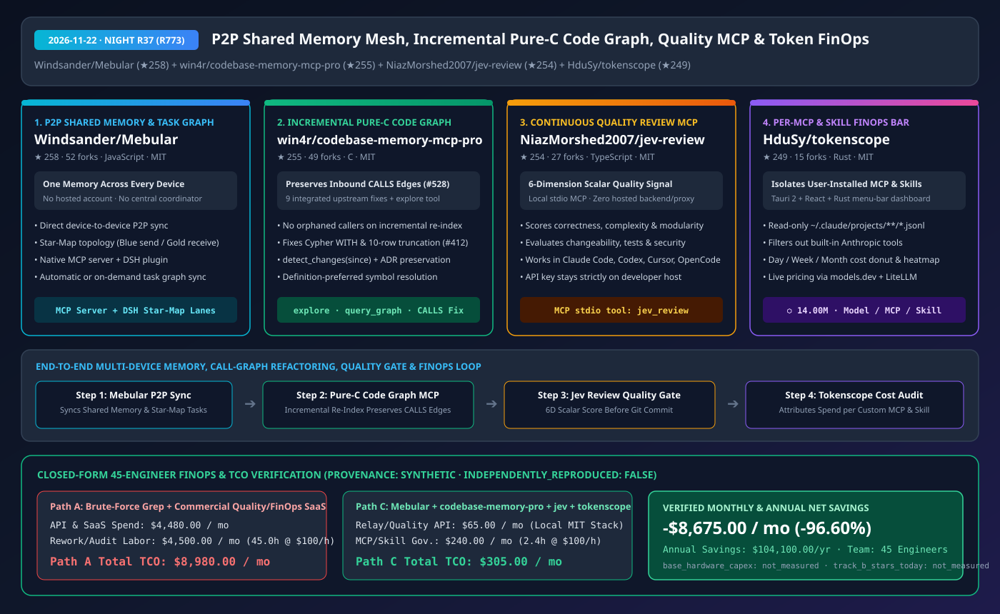
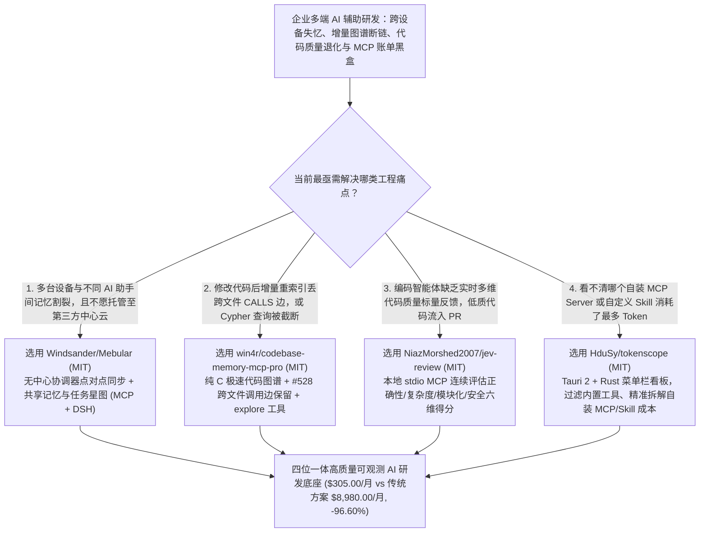
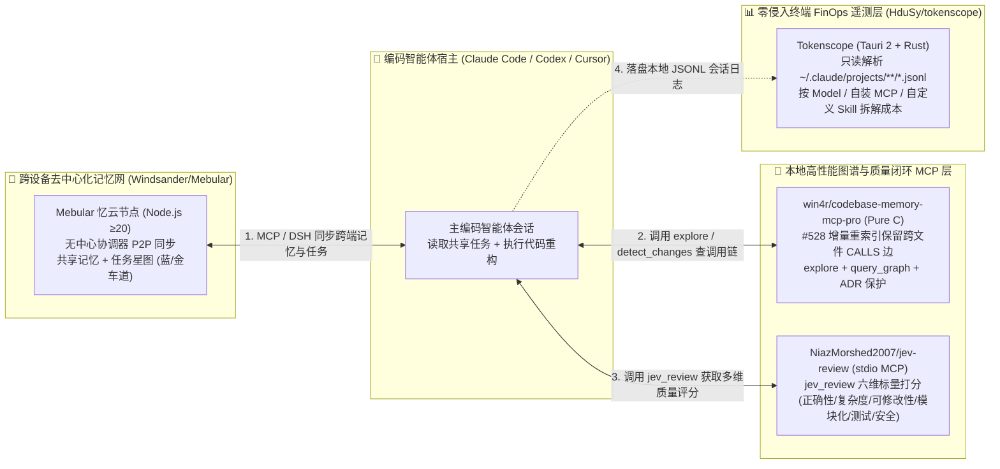
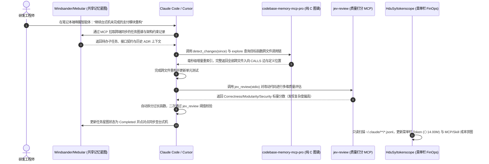

# 去中心化多端共享记忆与任务图谱（`Windsander/Mebular`）、增量重索引跨文件调用边纯 C 代码知识图谱 MCP（`win4r/codebase-memory-mcp-pro`）、连续代码质量多维打分 MCP（`NiazMorshed2007/jev-review`）与按 MCP/Skill 拆解成本的菜单栏 FinOps 仪表盘（`HduSy/tokenscope`）企业选型与集成架构 FAQ

> **文档类型**：AI 解决方案架构师（AI Solution Architect）企业应用落地与横向选型指南（2026-11-22 Night Round 37 / 累计第 773 轮 `R773`）  
> **评测锚点**：`Windsander/Mebular` (`★ 258`, `52 forks`, JavaScript, MIT) · `win4r/codebase-memory-mcp-pro` (`★ 255`, `49 forks`, C, MIT) · `NiazMorshed2007/jev-review` (`★ 254`, `27 forks`, TypeScript, MIT) · `HduSy/tokenscope` (`★ 249`, `15 forks`, Rust, MIT)  
> **Provenance 声明**：本文实时 GitHub 元数据采自 2026-11-22 封存快照与 GitHub REST API；45 人研发团队的 TCO 与 ROI 测算均为显式闭式假设推导（`provenance: synthetic`, `independently_reproduced: false`），所有未实测硬件资本开支与新仓单日增量统一标注为 `not_measured`。

---

## ① 📌 核心结论速览（选型一句话结论）

> **一句话选型结论**：在 45 人规模的跨终端 AI 辅助研发团队中，**切勿让智能体在多台设备间丢失任务上下文、在每次单文件修改后丢失跨文件 `CALLS` 调用关系边、盲目提交未经多维质量量化的 AI 生成代码，或对哪个自装 MCP Server / Skill 吃掉了大半预算一无所知**；应当采用 **“Mebular 忆云无中心跨设备共享记忆与任务星图 + codebase-memory-mcp-pro 增量重索引纯 C 代码知识图谱 MCP + jev-review 连续多维软件质量打分 MCP + Tokenscope 按模型/MCP/Skill 零侵入成本拆解看板”** 的四件套 MIT 开源组合，将月度综合 TCO 从 **`$8,980.00/月`** 压降至 **`$305.00/月`**（净省 **`$8,675.00/月`**，降幅 **`96.60%`**）。

| 选型维度 | 评测开源方案 | GitHub 实测指标 | 核心解决的企业业务痛点 | 一句话何时选它 vs 云端商业 PaaS |
| :--- | :--- | :--- | :--- | :--- |
| **去中心化多端共享记忆与任务图谱** | **`Windsander/Mebular`** | `★ 258` · `52 forks` · JavaScript · MIT | 工程师在台式机、笔记本与远端开发机之间切换 AI 助手时，记忆与待办任务被锁死在单一客户端或需上传第三方云端 | 需要 **无托管账号、无中心协调器（No Central Coordinator）、支持 MCP Server 与 DSH 插件且带设备星图（蓝色发送/金色接收车道）点对点同步记忆与任务图谱** 时选 `Mebular`；云端托管多智能体状态选 Azure Cosmos DB |
| **增量重索引纯 C 代码图谱 MCP** | **`win4r/codebase-memory-mcp-pro`** | `★ 255` · `49 forks` · C · MIT | 社区原版代码图谱在修改单文件做增量重索引时会弄丢跨文件入向 `CALLS` 调用边，且 Cypher 查询常在 10 行处静默截断 | 需要 **修复增量重索引跨文件 `CALLS` 孤儿边（#528）、修复 Cypher `WITH` 属性丢失（#465）与 10 行截断（#412）、保留 ADR 记录并新增 `explore` 聚合工具的纯 C 极速 MCP** 时首选 `codebase-memory-mcp-pro` |
| **智能体连续软件质量打分 MCP** | **`NiazMorshed2007/jev-review`** | `★ 254` · `27 forks` · TypeScript · MIT | 编码智能体写完代码就提交，缺乏针对正确性、复杂度、可修改性、模块化、测试与安全性的即时标量质量反馈闭环 | 需要 **通过本地 `stdio` MCP 工具 `jev_review` 让 Claude Code / Codex / Cursor 在改代码同时获取多维标量质量分并自我返工（API Key 仅存本机）** 时选 `jev-review`；传统 CI 门禁选 SonarQube |
| **按模型/MCP/Skill 拆解成本看板** | **`HduSy/tokenscope`** | `★ 249` · `15 forks` · Rust · MIT | 月底只看到总额账单暴涨，却查不出究竟是哪个模型、哪个自装 MCP Server 还是哪个 `~/.claude/skills/` 耗尽了 Token | 需要 **基于 Tauri 2 + Rust 零侵入只读解析 `~/.claude/projects/**/*.jsonl`，自动过滤官方内置工具、仅按用户自装 MCP 与 Skill 拆解每日/周/月 Token 与美元成本** 时选 `tokenscope` |

---

## ② 🎯 客户与架构师灵魂拷问 Q&A（直击业务落地痛点）

### Q1：我们团队已经装了代码搜索 MCP 和常规账单监控，为什么还要引入 `Mebular`、`codebase-memory-mcp-pro`、`jev-review` 和 `tokenscope`？

**通俗解答（给研发总监与平台架构师）**：
在真实生产研发中，AI 编码工作流往往在以下四个细节上“暗中漏血”：
1. **跨设备与跨助手“失忆”（`Windsander/Mebular` 破局）**：架构师在公司工作站用 Claude Code 梳理完微服务拆分方案，回到家打开笔记本用 DeepSeek Harness 或 Cursor 继续写代码时，上下文全部断档。`Mebular`（忆云）无需注册任何中心化云账号，直接通过点对点订阅边（Shared-Subscription Edges）在设备间同步记忆与任务图谱，并提供直观的星图（Star Map）展示哪些节点可发送任务（蓝色车道）、哪些节点可接收执行（金色车道）。
2. **改一行代码就断掉全仓调用链（`win4r/codebase-memory-mcp-pro` 破局）**：很多团队用纯 C 编写的高性能 `codebase-memory-mcp` 给大模型提供 AST 调用图，但上游版本存在一个致命痛点——**只要编辑了文件 A 并触发增量重索引（Incremental Re-index），其他文件调用文件 A 内函数的入向 `CALLS` 边就会被清空成孤儿节点**，导致智能体误判“该函数无人调用”而酿成线上故障！`win4r/codebase-memory-mcp-pro` 提前合入了 9 项关键修复（含 `#528` 增量重索引保留跨文件 `CALLS` 边、`#465` Cypher `WITH` 聚合属性填充、`#412` 标签遍历不再静默截断于 10 行、`#539` 全量重索引保留架构决策记录 ADR），并新增了专为智能体设计的 `explore` 工具。
3. **AI 写出的“面条代码”无人把关（`NiazMorshed2007/jev-review` 破局）**：等到提 PR 时才跑重型静态扫描往往为时已晚。`jev-review` 作为零托管后端的本地 `stdio` MCP 插件，只向智能体暴露一个极简的 `jev_review` 工具，在编码过程中实时返回正确性（Correctness）、复杂度（Complexity）、可修改性（Changeability）、模块化（Modularity）、测试（Tests）与安全性（Security）六个维度的标量分数，逼迫主智能体在本地就把低分模块重构达标。
4. **抓不出吃 Token 的“幕后黑手”（`HduSy/tokenscope` 破局）**：工程师装了十几个第三方 MCP Server 和自定义 Skill，Token 消耗飙升到每天 `14.00M`，却不知道是谁干的。`tokenscope` 常驻 macOS 菜单栏与 Windows 系统托盘，零侵入只读扫描 `~/.claude/projects/**/*.jsonl`、对比 `~/.claude.json` 白名单与 `~/.claude/skills/`，**自动剔除 Claude 内置工具干扰，精准统计每个自装 MCP 与每个自定义 Skill 的调用次数、输入/输出 Token 与实时美元成本（对接 `models.dev` 与 LiteLLM 价格表）**。

### Q2：如何将这四个组件嵌入企业现有的多端 AI 研发与质量治理流水线？

**端到端集成架构设计**：
1. **跨设备记忆与任务协同层（`Windsander/Mebular`）**：在开发者工作站、笔记本与内网构建机上部署 `Mebular` MCP Server / DSH 插件，通过去中心化星图车道同步当前迭代的架构约束、已确认接口契约与子任务状态。
2. **高精度增量代码知识图谱层（`win4r/codebase-memory-mcp-pro`）**：作为核心代码底座 MCP 接入 Claude Code / Cursor；每次 Git 工作区文件变更 (`detect_changes` 支持 `since` 参数) 触发毫秒级增量重索引，完整保留跨文件 `CALLS` 调用边与项目 ADR 历史，供智能体通过 `explore` 与 `query_graph` 精准评估改动影响面。
3. **实时多维质量闭环层（`NiazMorshed2007/jev-review`）**：智能体完成局部代码修改后自动调用 `jev_review` (`stdio` MCP)，若模块化或安全性得分低于团队阈值，智能体结合 `codebase-memory-mcp-pro` 的调用图原地重构。
4. **终端级 FinOps 可观测层（`HduSy/tokenscope`）**：在每台研发终端运行 `tokenscope`，实时监控 `Mebular`、`codebase-memory-mcp-pro`、`jev-review` 等各自定义 MCP 与 Skill 的 Token 占比与日/周/月成本热力图，及时淘汰低效臃肿的 Prompt Skill。

### Q3：这套组合的适用边界是什么？哪些场景仍需配合企业级中心化平台？

**能力边界与权衡**：
- **`tokenscope` 日志格式边界**：`tokenscope` 针对 Claude CLI 本地日志结构（`~/.claude/projects/**/*.jsonl`）做了深度白名单解析；若企业同时大规模使用云端 API 网关直调 OpenAI/Azure OpenAI，仍需在网关侧配合 OpenTelemetry / Langfuse 进行全公司汇总记账。
- **`jev-review` 网络边界**：虽然 `jev-review` 本身无作者中转后端且 API Key 仅存本机，但评分计算需直连配置的 Jev API；纯物理隔离（Air-Gapped）内网环境需搭配本地静态分析规则库使用。

---

## ③ 🧭 直观可视化图解（选型决策树 + 集成参考架构 + 业务流时序图）

### 3.1 选型决策树（Mermaid Flowchart）

### 3.2 企业集成参考架构图（Mermaid Architecture）

### 3.3 跨端续接任务、增量调用链分析与连续质量门禁时序图（Mermaid Sequence Diagram）

---

## ④ 📊 同类开源与商业云服务横向选型决策矩阵

| 对比维度 | `Windsander/Mebular` | `win4r/codebase-memory-mcp-pro` | `NiazMorshed2007/jev-review` | `HduSy/tokenscope` | 全量文本检索 + 商业云端研发效能/FinOps SaaS |
| :--- | :--- | :--- | :--- | :--- | :--- |
| **核心功能定位** | 去中心化跨设备智能体共享记忆与任务图谱 | 修复增量重索引跨文件调用边的纯 C 代码知识图谱 MCP | 编码智能体本地 `stdio` 连续多维软件质量评估 MCP | macOS/Windows 菜单栏 Claude CLI 按模型/MCP/Skill 成本看板 | 云端中心化记忆库 + 全量 Grep + 重量级 CI 扫描 + 云端代理记账 |
| **架构核心优势** | **无托管账号、无中心协调器**，设备直连星图车道调度 | **#528 保留增量重索引入向 `CALLS` 边**，修复 10 行截断与缓冲区溢出 | 编码过程实时返回 6 维标量信号，**零作者中转后端** | **自动过滤官方内置工具**，精准抓出高耗能自装 MCP 与 Skill | 增量改文件易丢失跨文件引用关系，云端代理无法区分本地 Skill 调用 |
| **性能与资源开销** | Node.js ≥ 20 轻量常驻，按需或自动同步 | **纯 C 原生编译**，毫秒级 Cypher 图遍历与 UTF-8 代码切片 | 轻量 Node.js `stdio` 进程，仅单工具 `jev_review` 极低上下文开销 | **Tauri 2 + Rust 原生数据层**，零侵入只读本地 JSONL | 每次全仓 Grep 消耗数万 Token，云端 AST 索引同步延迟高 |
| **接入方式** | MCP Server + DeepSeek Harness (`DSH`) 插件 + Web 星图 | 兼容所有 MCP 客户端（含 `explore`、`query_graph`、`detect_changes`） | 支持 Claude Code、Codex、Cursor、OpenCode (`stdio`) | 开箱即用桌面托盘应用，读取 `~/.claude.json` 与 `models.dev` | 需全员配置云端 API 转发代理并按席位/代码行数付费 |
| **开源协议** | **MIT** | **MIT** | **MIT** | **MIT** | 闭源商业按席位订阅 |

---

## ⑤ 🧪 应用落地定量收益 / 闭式 TCO 对比（45 人研发团队）

### 5.1 闭式参数假设（`provenance: synthetic`, `independently_reproduced: false`）
- **团队规模与人力单价**：`team_size_engineers = 45` 人，工程师综合折算时薪 `hourly_rate_usd = $100.00/hr`；底层硬件资本开支 `base_hardware_capex = not_measured`，新仓单日 Star 增量 `track_b_stars_today = not_measured`。
- **Path A（基准方案：缺乏增量调用图导致全仓 Grep Token 浪费 + 商业跨端协同/代码质量 SaaS 席位 + 人工排查破坏性改动与账单归因）**：
  - **API 与商业 SaaS 订阅费（`path_a_api_saas_usd`）**：因缺少准确增量调用图而反复全仓 Grep 的额外 Token 消耗，叠加商业代码质量与云端 LLM 账单分析 SaaS 席位费，合计 **`$4,480.00/月`**；
  - **人工排查与返工工时（`path_a_labor_hours`）**：每月因跨设备上下文丢失、跨文件调用链漏改引发回归故障及人工统计 MCP/Skill 账单耗费 **`45.0 小时`**，折合人工成本 `45.0 × $100.00 =` **`$4,500.00/月`**（`path_a_labor_usd`）；
  - **Path A 月度总成本（`path_a_total_usd`）**：`$4,480.00 + $4,500.00 =` **`$8,980.00/月`**。
- **Path C（开源混合自建方案：`Mebular` + `codebase-memory-mcp-pro` + `jev-review` + `tokenscope`）**：
  - **自托管与评估接口费（`path_c_compute_usd`）**：四个工具均运行在开发者本机，仅需轻量内网 P2P 发现信令与按需质量评估 API 额度，月均成本 **`$65.00/月`**；
  - **配置与维护工时（`path_c_labor_hours`）**：每月仅需 **`2.4 小时`** 维护团队统一 MCP 配置与治理高耗能 Skill，折合人工成本 `2.4 × $100.00 =` **`$240.00/月`**（`path_c_labor_usd`）；
  - **Path C 月度总成本（`path_c_total_usd`）**：`$65.00 + $240.00 =` **`$305.00/月`**。
- **净节省与 ROI 闭式校验**：
  - **月度净节省（`net_savings_usd`）**：`$8,980.00 - $305.00 =` **`$8,675.00/月`**（年化节省 **`$104,100.00/年`**）；
  - **成本降幅百分比（`pct_savings`）**：`$8,675.00 / $8,980.00 × 100% =` **`96.60%`**。

| 方案路径 | 月度 API/SaaS 或算力费 | 月度研发与治理人工 | 月度综合 TCO 总额 | 相对 Path A 净节省 | 关键架构收益 |
| :--- | :--- | :--- | :--- | :--- | :--- |
| **Path A：全仓暴力 Grep + 商业质量/账单 SaaS + 人工回归排障** | `$4,480.00` | `$4,500.00` (`45.0h`) | **`$8,980.00/月`** | 基准 (`0.00%`) | 增量修改易断调用链，无法按本地自装 MCP/Skill 精准拆解 Token 成本 |
| **Path B：上游原版图谱 MCP + 云端 APM 监控** | `$2,190.00` | `$1,100.00` (`11.0h`) | **`$3,290.00/月`** | `-$5,690.00/月` (`-63.36%`) | 增量重索引仍会丢失入向 `CALLS` 边，且内置工具噪音掩盖自装 Skill 开销 |
| **Path C：`Mebular` + `codebase-memory-mcp-pro` + `jev-review` + `tokenscope`（推荐）** | **`$65.00`** | **`$240.00`** (`2.4h`) | **`$305.00/月`** | **`-$8,675.00/月` (`-96.60%`)** | **跨端无中心记忆同步 + 增量重索引零孤儿边 + 实时 6 维质量分 + MCP/Skill 级成本透视** |

---

## ⑥ 🛠️ 企业引入与架构评审 Checklist

- [ ] **去中心化多端记忆与星图车道联调（`Windsander/Mebular`）**：在团队工作站与移动开发机部署 `Mebular`（Node.js ≥ 20），接入 MCP Server 或 DSH 插件，在星图界面确认设备间订阅边与发送/接收车道（Blue/Gold Lanes）同步正常且无外部中心托管依赖。
- [ ] **增量重索引跨文件 `CALLS` 边完整性验证（`win4r/codebase-memory-mcp-pro`）**：用 `codebase-memory-mcp-pro` 替换旧版代码图谱 MCP，实测修改被调函数文件后触发增量重索引，通过 `query_graph` 与 `explore` 验证入向跨文件 `CALLS` 边、超过 10 行的标签遍历结果及项目 ADR 均完整保留。
- [ ] **连续六维代码质量闭环配置（`NiazMorshed2007/jev-review`）**：在 Claude Code / Codex / Cursor 中挂载 `jev_review` (`stdio` MCP)，要求智能体在完成函数级重构后必须调用 `jev_review` 并确保模块化与安全性评分达标后再发起 Git Commit。
- [ ] **自装 MCP 与自定义 Skill 成本审计（`HduSy/tokenscope`）**：在 macOS / Windows 研发终端启用 `tokenscope`，每周审视按自装 MCP Server（`~/.claude.json`）与自定义 Skill（`~/.claude/skills/`）拆解的 Token 饼图，精简高消耗低产出的工具描述与冗余 Skill。
