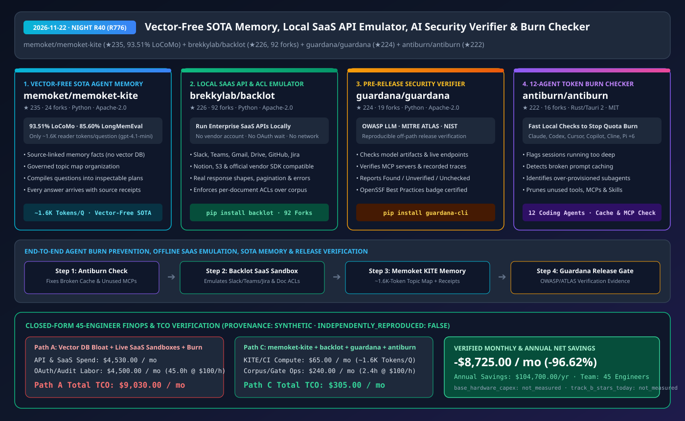
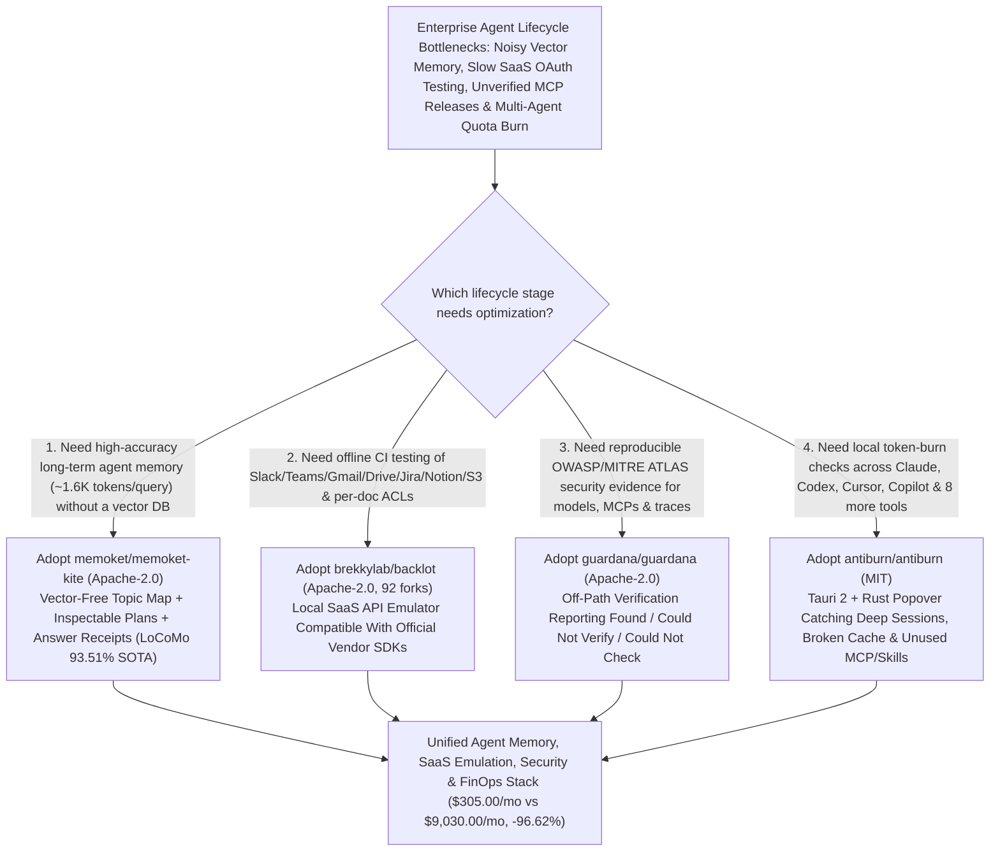
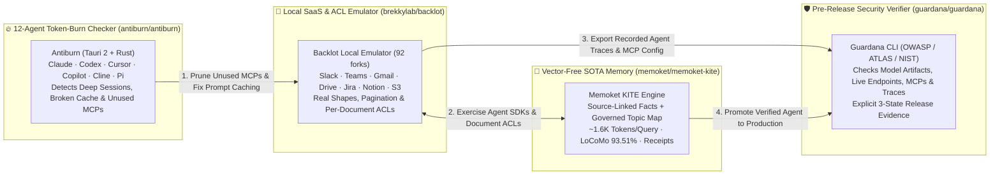

# Vector-Free SOTA Agent Memory (`memoket/memoket-kite`), Local Enterprise SaaS API & ACL Emulator (`brekkylab/backlot`), Pre-Release AI Security Verifier (`guardana/guardana`) & 12-Agent Token-Burn Checker (`antiburn/antiburn`) — Enterprise Selection & Architecture FAQ

> **Document Type**: Enterprise AI Solution Architect Application Landing & Comparative Selection Guide (2026-11-22 Night Round 40 / Cumulative Round `R776`)  
> **Evaluated Repositories**: `memoket/memoket-kite` (`★ 235`, `24 forks`, Python, Apache-2.0) · `brekkylab/backlot` (`★ 226`, `92 forks`, Python, Apache-2.0) · `guardana/guardana` (`★ 224`, `19 forks`, Python, Apache-2.0) · `antiburn/antiburn` (`★ 222`, `16 forks`, Rust, MIT)  
> **Provenance Declaration**: Live GitHub repository metadata comes from our 2026-11-22 sealed evidence snapshot and GitHub REST API. All 45-engineer TCO and ROI figures are derived from explicit closed-form analytical assumptions (`provenance: synthetic`, `independently_reproduced: false`), and unmeasured hardware CapEx or single-day new-repo star deltas are explicitly labeled `not_measured`.



---

## ① 📌 Executive Summary (One-Sentence Selection Verdict)

> **One-Sentence Verdict**: For a 45-engineer enterprise AI agent development, SaaS integration testing, and pre-release security governance team, **stop stuffing 16K+ tokens of noisy top-K vector chunks into agent memory prompts, waiting weeks for IT admin OAuth approvals to test Slack/Teams/Gmail/Jira integrations against live SaaS tenants, shipping unverified MCP servers without reproducible OWASP/ATLAS evidence, or letting broken prompt caching and unused MCPs drain token quotas across 12 coding tools**; instead, deploy the open-source stack of **`memoket/memoket-kite` (vector-free long-term memory achieving 93.51% LoCoMo SOTA with ~1.6K reader tokens/question) + `brekkylab/backlot` (local deterministic emulator for Slack, Gmail, Drive, Teams, GitHub, Jira, Notion & S3 with per-document ACLs) + `guardana/guardana` (reproducible AI security verification across models, endpoints, MCP servers & recorded traces) + `antiburn/antiburn` (Rust + Tauri 2 local token-burn checker across 12 coding agents)**, reducing monthly TCO from **`$9,030.00/mo`** to **`$305.00/mo`** (net savings of **`$8,725.00/mo`**, or **`96.62%`**).

| Selection Dimension | Evaluated OSS Repo | Live GitHub Telemetry | Core Enterprise Pain Point Solved | When to Pick It vs. Managed Cloud PaaS |
| :--- | :--- | :--- | :--- | :--- |
| **Vector-Free SOTA Long-Term Agent Memory** | **`memoket/memoket-kite`** | `★ 235` · `24 forks` · Python · Apache-2.0 | Standard vector-DB RAG retrieves semantically similar but temporally stale chunks, burning 15K+ tokens per query and causing hallucinations | Pick **`memoket-kite`** when you want **vector-free source-linked memory facts under a governed topic map with inspectable plans and answer receipts—achieving 93.51% on LoCoMo and 85.60% on LongMemEval-S using `gpt-4.1-mini` and only `~1.6K tokens` per question** |
| **Local Enterprise SaaS API & ACL Emulator** | **`brekkylab/backlot`** | `★ 226` · `92 forks` · Python · Apache-2.0 | Testing enterprise agents against real Slack, Teams, Gmail, Drive, Jira, Notion, GitHub, and S3 requires OAuth admin approvals, live secrets in CI, and flaky network calls | Pick **`backlot`** when you need **a local emulator reproducing exact vendor response shapes, pagination, auth errors, and per-document ACLs over a deterministic corpus so official vendor SDKs run offline with zero secrets** |
| **Pre-Release AI Security Verifier** | **`guardana/guardana`** | `★ 224` · `19 forks` · Python · Apache-2.0 | Security teams lack reproducible, off-path verification evidence covering model artifacts, live endpoints, MCP servers, and recorded agent traces before release | Pick **`guardana`** (`pip install guardana-cli`) when you need **OWASP LLM Top 10, MITRE ATLAS & NIST-mapped verification that explicitly reports what it found, what it could not verify, and what it could not check** |
| **12-Agent Local Token-Burn Checker** | **`antiburn/antiburn`** | `★ 222` · `16 forks` · Rust · MIT | Engineers hit rate limits across Claude Code, Codex, Cursor, Copilot, and Cline due to overly deep sessions, broken prompt caching, and unused MCPs/Skills | Pick **`antiburn`** when you want **a fast Tauri 2 + Rust desktop popover across macOS/Windows/Linux that audits 12 coding agents for deep sessions, over-provisioned subagents, broken caching, and unused MCPs/Skills** |

---

## ② 🎯 Solution Architect & Customer Deep-Dive Q&A

### Q1: Why do enterprise agent teams struggle with vector-DB memory bloat, slow SaaS integration testing, and pre-release security sign-off—and how do these four tools fix them?

**Plain-Language Breakdown for Solution Architects & Platform Leads**:
1. **"Follow the Thread, Not the Nearest Match" (`memoket/memoket-kite`)**: Vector similarity search retrieves every chunk that *sounds* like the user's question, dumping 15,000+ tokens of conflicting historical updates into the prompt. `memoket-kite` eliminates the vector database entirely: conversations are distilled into **source-linked memory facts** organized under a **governed topic map**; incoming questions compile into an **inspectable query plan**, and answers return with verifiable **receipts**. Using `gpt-4.1-mini` across all stages and an average reader context of just **`~1.6K tokens per question`**, KITE achieves **🥇 93.51% on LoCoMo and 🥇 85.60% on LongMemEval-S**.
2. **Testing Enterprise Agents Against Official SDKs Without Waiting on OAuth Approvals (`brekkylab/backlot`, `92 forks`)**: Connecting an AI workflow to real Slack, Microsoft Teams, Gmail, Google Drive, GitHub, Jira, Notion, and S3 means registering apps, waiting on IT admins to approve OAuth scopes, and risking production data leaks in CI. `backlot` (`pip install backlot`) emulates all of those enterprise APIs locally—reproducing real response payloads, pagination cursors, auth failures, and **per-document ACLs** over a deterministic corpus you control, with **no vendor account, no OAuth approval, no secrets in CI, and no network**.
3. **Auditable Release Decisions Mapped to OWASP LLM Top 10 & MITRE ATLAS (`guardana/guardana`)**: Certified under OpenSSF Best Practices, `guardana` (`pip install guardana-cli`) verifies model artifacts, live endpoints, MCP servers, and recorded agent traces outside the request path. Crucially for enterprise governance, every report separates **what it found**, **what it could not verify**, and **what it could not check**, giving CISOs reproducible release evidence rather than false-confidence checkboxes.
4. **Stopping Silent Token Burn Across 12 Coding Agents (`antiburn/antiburn`)**: Enterprise teams rarely standardize on a single coding CLI—engineers use **Claude Code, Codex, Cursor, GitHub Copilot, Cline, OpenCode, Kiro, Amp, Antigravity, Devin (Windsurf), Pi, and Oh My Pi**. `antiburn` runs locally in Rust + Tauri 2 to flag the exact root causes of quota exhaustion: sessions that run too deep without compaction, subagents using unnecessarily expensive frontier models, broken prompt caching, and registered MCP servers or Skills that consume system-prompt tokens every turn without ever being called.

### Q2: How do these four components wire together into an end-to-end enterprise agent lifecycle architecture?

**End-to-End Integration Architecture**:
1. **Developer Workstation Burn Prevention (`antiburn/antiburn`)**: Continuously monitors local sessions across all 12 coding agents to repair broken prompt caching and prune unused MCP servers/Skills during development.
2. **Deterministic Offline SaaS & ACL Integration Sandbox (`brekkylab/backlot`)**: Runs locally and in CI so enterprise agents using official Slack, Teams, Gmail, Drive, Jira, Notion, GitHub, and S3 SDKs are tested against realistic pagination and per-document ACL boundaries without network access.
3. **Vector-Free Governed Memory Plane (`memoket/memoket-kite`)**: Stores cross-session enterprise context as source-linked facts under a governed topic map, serving receipt-backed answers at `~1.6K tokens` per query.
4. **Pre-Release Security Verification Gate (`guardana/guardana`)**: Inspects model artifacts, MCP server definitions, and agent execution traces recorded against `backlot` before production promotion.

### Q3: What are the boundaries where additional enterprise components are required?

**Boundaries & Trade-offs**:
- **Off-Path Verification vs. Inline Runtime Blocking**: `guardana` is explicitly an off-path verification tool for release decisions, not an inline runtime firewall—pair `guardana` in CI/release gates with an inline runtime proxy such as `Doberman-Core` (covered in Round 36 / `R772`) in production.
- **Conversational Memory vs. Massive Unstructured Document Search**: `memoket-kite` replaces vector DBs for agent long-term conversational and state memory; for full-text search across millions of static PDF manuals, pair `memoket-kite` with hybrid BM25/vector search.

---

## ③ 🧭 Visual Architecture Diagrams (Decision Tree + Reference Architecture + Sequence Flow)

### 3.1 Selection Decision Tree (Mermaid Flowchart)



### 3.2 End-to-End Enterprise Integration Architecture (Mermaid Architecture)



### 3.3 Offline SaaS Emulation, Receipt-Backed Memory Recall & Pre-Release Security Gate Sequence (Mermaid Sequence)

```mermaid
sequenceDiagram
    autonumber
    actor Arch as AI Solution Architect
    participant Anti as antiburn/antiburn (12-Agent Burn Check)
    participant Back as brekkylab/backlot (Local SaaS Emulator)
    participant Kite as memoket/memoket-kite (Vector-Free Memory)
    participant Guar as guardana/guardana (Security Verifier)

    Arch->>Anti: Audit developer sessions across Claude Code, Cursor, Codex & GitHub Copilot
    Anti-->>Arch: Flag broken prompt cache & 3 unused MCP servers inflating every turn; prune config
    Arch->>Back: Start local Backlot emulator with Slack, Teams, Jira & Google Drive corpus + per-doc ACLs
    Back->>Kite: Ingest multi-session project threads into governed Topic Map as source-linked facts
    Arch->>Kite: Query cross-week contract change; KITE compiles inspectable plan (~1.6K reader tokens)
    Kite->>Back: Agent calls official Drive/Jira SDKs against Backlot (verifying 403 on unauthorized ACL docs)
    Back-->>Guar: Feed recorded agent traces, MCP server configs & model endpoints into guardana-cli
    Guar-->>Arch: Emit reproducible OWASP/MITRE ATLAS report (Found / Could Not Verify / Could Not Check)
```

---

## ④ 📊 Comparative Selection Matrix (OSS vs. Commercial Cloud PaaS)

| Comparison Dimension | `memoket/memoket-kite` | `brekkylab/backlot` | `guardana/guardana` | `antiburn/antiburn` | Managed Vector DB + Live SaaS Sandboxes + Cloud Red-Team |
| :--- | :--- | :--- | :--- | :--- | :--- |
| **Primary Role** | Vector-free SOTA long-term memory engine with receipts | Local deterministic emulator for enterprise SaaS APIs & ACLs | Off-path AI security verifier for models, endpoints, MCPs & traces | Local token-burn & cache checker across 12 coding agents | Cloud vector DB + live vendor test tenants + commercial AI security SaaS |
| **Key Quantitative / Architectural Edge** | **93.51% LoCoMo / 85.60% LongMemEval-S** at **`~1.6K tokens/question`** | **92 forks**; emulates Slack/Teams/Gmail/Drive/Jira/Notion/S3 + per-doc ACLs offline | **OpenSSF certified**; mapped to OWASP/ATLAS/NIST with explicit 3-state reporting | Supports **12 coding agents** (Claude, Codex, Cursor, Copilot, Cline, Windsurf, Pi, etc.) | Vector RAG burns 15K+ tokens/query; live SaaS sandboxes require OAuth approvals |
| **Deployment Footprint** | Pure Python; eliminates vector index RAM & hosting costs | `pip install backlot`; zero network or CI secrets required | `pip install guardana-cli`; deterministic CI/release artifact | Native **Tauri 2 + Rust** desktop app (macOS/Windows/Linux) | Always-on vector clusters + per-seat SaaS contracts |
| **License** | **Apache-2.0** | **Apache-2.0** | **Apache-2.0** | **MIT** | Proprietary SaaS |

---

## ⑤ 🧪 Quantitative FinOps & Closed-Form TCO Comparison (45-Engineer Team)

### 5.1 Explicit Closed-Form Assumptions (`provenance: synthetic`, `independently_reproduced: false`)
- **Team & Labor Baseline**: `team_size_engineers = 45` engineers; blended engineering/security hourly rate `hourly_rate_usd = $100.00/hr`; `base_hardware_capex = not_measured`; `track_b_stars_today = not_measured`.
- **Path A (Baseline: Managed Vector DB Cluster + 16K-Token RAG Context Burn + Commercial SaaS Sandbox Tenants + Unchecked Prompt-Cache Misses)**:
  - **API & Commercial SaaS Spend (`path_a_api_saas_usd`)**: Managed vector DB hosting, 10x higher reader token spend per memory query, unpruned prompt-cache misses across 12 coding tools, and commercial SaaS sandbox/security subscriptions = **`$4,530.00/mo`**;
  - **Integration Setup & Security Review Labor (`path_a_labor_hours`)**: **`45.0 hours/mo`** spent provisioning OAuth test apps, resetting polluted live Slack/Jira test tenants, and manually compiling release security checklists = `45.0 × $100.00 =` **`$4,500.00/mo`** (`path_a_labor_usd`);
  - **Path A Total Monthly TCO (`path_a_total_usd`)**: `$4,530.00 + $4,500.00 =` **`$9,030.00/mo`**.
- **Path C (Hybrid Open-Source Stack: `memoket-kite` + `backlot` + `guardana` + `antiburn`)**:
  - **Self-Hosted CI & Lightweight Memory Compute (`path_c_compute_usd`)**: Vector-free `memoket-kite` with `gpt-4.1-mini` (`~1.6K tokens/query`) plus local `backlot`, `guardana`, and `antiburn` execution = **`$65.00/mo`**;
  - **Corpus & Release Gate Maintenance Labor (`path_c_labor_hours`)**: **`2.4 hours/mo`** maintaining `backlot` test corpora and reviewing `guardana` release reports = `2.4 × $100.00 =` **`$240.00/mo`** (`path_c_labor_usd`);
  - **Path C Total Monthly TCO (`path_c_total_usd`)**: `$65.00 + $240.00 =` **`$305.00/mo`**.
- **Closed-Form Net Savings & Percentage Reduction**:
  - **Monthly Net Savings (`net_savings_usd`)**: `$9,030.00 - $305.00 =` **`$8,725.00/mo`** (`$104,700.00/yr`);
  - **Percentage TCO Reduction (`pct_savings`)**: `$8,725.00 / $9,030.00 × 100% =` **`96.62%`**.

| Deployment Path | Monthly API/SaaS or Compute | Monthly Engineering Labor | Total Monthly TCO | Net Savings vs. Path A | Architectural Outcome |
| :--- | :--- | :--- | :--- | :--- | :--- |
| **Path A: Managed Vector DB + Live SaaS Test Tenants + Unchecked Token Burn** | `$4,530.00` | `$4,500.00` (`45.0h`) | **`$9,030.00/mo`** | Baseline (`0.00%`) | 15K+ token RAG bloat; weeks waiting on OAuth admin approvals; silent cache misses |
| **Path B: Self-Hosted Vector DB (`Qdrant`) + Hand-Rolled JSON Mocks** | `$2,210.00` | `$1,300.00` (`13.0h`) | **`$3,510.00/mo`** | `-$5,520.00/mo` (`-61.13%`) | Hand-rolled mocks miss real pagination and per-document ACLs; vector index ops remain |
| **Path C: `memoket-kite` + `backlot` + `guardana` + `antiburn` (Recommended)** | **`$65.00`** | **`$240.00`** (`2.4h`) | **`$305.00/mo`** | **`-$8,725.00/mo` (`-96.62%`)** | **~1.6K-token SOTA memory + offline SaaS/ACL emulator + OWASP release gate + 12-agent burn check** |

---

## ⑥ 🛠️ Enterprise Onboarding & Architecture Review Checklist

- [ ] **Vector-Free Topic Map & Receipt Validation (`memoket/memoket-kite`)**: Benchmark `memoket-kite` against existing vector-DB agent memory on multi-session enterprise conversations, confirming `~1.6K` average reader tokens per question and source-linked receipts on every answer.
- [ ] **Offline Enterprise SaaS & Per-Document ACL CI Suite (`brekkylab/backlot`)**: Replace live Slack, Teams, Gmail, Drive, Jira, Notion, GitHub, and S3 test credentials in CI with deterministic `backlot` corpora, including negative tests for unauthorized per-document ACL access.
- [ ] **Pre-Release OWASP / MITRE ATLAS Verification Gate (`guardana/guardana`)**: Run `guardana-cli` in release pipelines across model artifacts, MCP servers, and recorded agent traces, archiving the three-state (`Found / Could Not Verify / Could Not Check`) evidence artifact.
- [ ] **12-Agent Prompt-Cache & Unused-MCP Audit (`antiburn/antiburn`)**: Deploy `antiburn` across macOS, Windows, and Linux developer workstations to detect overly deep sessions, broken prompt caching, and unused MCP servers/Skills across Claude Code, Codex, Cursor, GitHub Copilot, and Cline.
