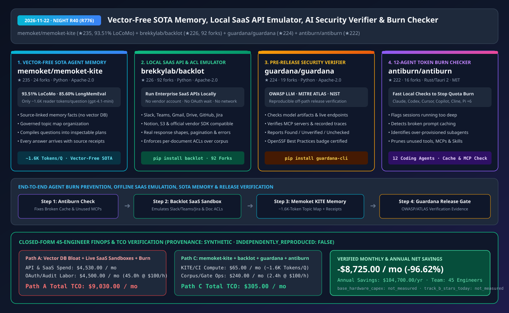
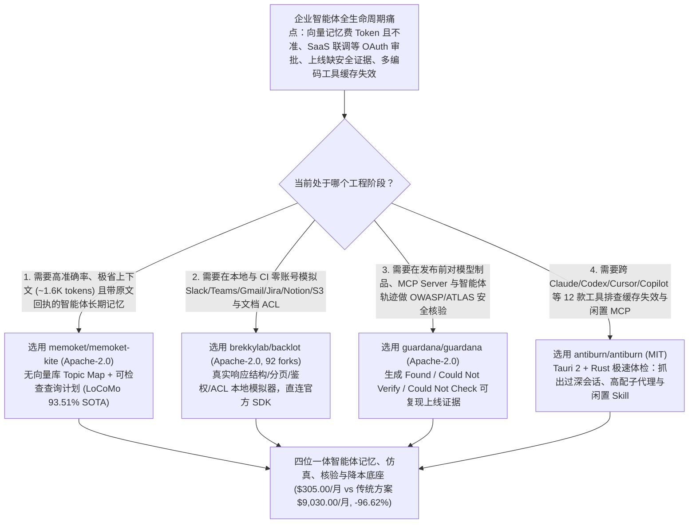
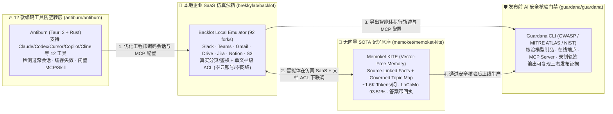
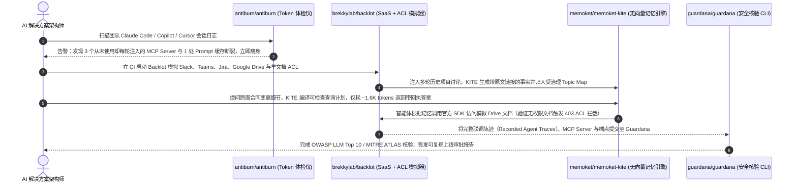

# 无向量库 SOTA 长程智能体记忆引擎（`memoket/memoket-kite`）、企业 SaaS API 本地确定性模拟器（`brekkylab/backlot`）、模型/MCP/轨迹离线安全核验器（`guardana/guardana`）与 12 款编码工具 Token 空转体检仪（`antiburn/antiburn`）企业选型与集成架构 FAQ

> **文档类型**：AI 解决方案架构师（AI Solution Architect）企业应用落地与横向选型指南（2026-11-22 Night Round 40 / 累计第 776 轮 `R776`）  
> **评测锚点**：`memoket/memoket-kite` (`★ 235`, `24 forks`, Python, Apache-2.0) · `brekkylab/backlot` (`★ 226`, `92 forks`, Python, Apache-2.0) · `guardana/guardana` (`★ 224`, `19 forks`, Python, Apache-2.0) · `antiburn/antiburn` (`★ 222`, `16 forks`, Rust, MIT)  
> **Provenance 声明**：本文实时 GitHub 元数据采自 2026-11-22 封存快照与 GitHub REST API；45 人研发与安全评测团队的 TCO 与 ROI 测算均为显式闭式假设推导（`provenance: synthetic`, `independently_reproduced: false`），所有未实测硬件资本开支与新仓单日增量统一标注为 `not_measured`。

---

## ① 📌 核心结论速览（选型一句话结论）

> **一句话选型结论**：在 45 人规模的企业级 AI 智能体研发、集成联调与上线门禁团队中，**切勿盲目堆砌高延迟高噪音的向量数据库来存对话记忆、在 CI 里直连真实的生产 Slack/Jira/Gmail/Teams 等待管理员审批 OAuth、仅靠主观印象放行未核验的 MCP Server 上线，或放任 12 种编码工具因缓存失效与未用 MCP 烧光配额**；应当采用 **“Memoket-KITE（无向量库、仅 ~1.6K Token 上下文即夺得 LoCoMo 93.51% SOTA 的回执式记忆引擎）+ Backlot（含文档级 ACL 的本地企业 SaaS API 确定性模拟器）+ Guardana（对齐 OWASP/MITRE ATLAS 的模型/MCP/轨迹发布安全核验器）+ Antiburn（支持 12 款编码智能体的本地 Token 空转体检仪）”** 的四位一体组合，将团队月度综合 TCO 从 **`$9,030.00/月`** 压降至 **`$305.00/月`**（净省 **`$8,725.00/月`**，降幅 **`96.62%`**）。

| 选型维度 | 评测开源方案 | GitHub 实测指标 | 核心解决的企业业务痛点 | 一句话何时选它 vs 云端商业 PaaS |
| :--- | :--- | :--- | :--- | :--- |
| **无向量库 SOTA 长程智能体记忆** | **`memoket/memoket-kite`** | `★ 235` · `24 forks` · Python · Apache-2.0 | 传统向量检索（Top-K Cosine Similarity）常把语义相似但时间/因果错误的旧对话塞满 16K+ 窗口，既费 Token 又易幻觉 | 需要 **零向量数据库、基于受治理主题图谱（Topic Map）与可检查查询计划，仅用 `gpt-4.1-mini` 与每问平均 `~1.6K tokens` 即达 LoCoMo `93.51%` / LongMemEval-S `85.60%` SOTA** 时首选 `memoket-kite` |
| **企业 SaaS API 本地确定性模拟器** | **`brekkylab/backlot`** | `★ 226` · `92 forks` · Python · Apache-2.0 | 开发对接 Slack/Teams/Gmail/Jira/Notion/GitHub/S3 的企业智能体时，申请测试租户与 OAuth 审批动辄数周且 CI 测试不稳定 | 需要 **在本地零账号、零 OAuth 审批、零网络完整复现 Slack/Teams/Gmail/Drive/Jira/Notion/GitHub/S3 真实响应结构、分页、报错与文档级 ACL** 时选 `backlot` |
| **模型/MCP/轨迹发布安全核验器** | **`guardana/guardana`** | `★ 224` · `19 forks` · Python · Apache-2.0 | 现有安全工具要么只扫传统 CVE，要么缺少针对模型权重、在线端点、MCP Server 与智能体历史轨迹的可复现上线证据 | 需要 **对齐 OWASP LLM Top 10 / MITRE ATLAS / NIST 的离线与准生产核验 CLI（`guardana-cli`），明确输出“已发现、无法核实、未覆盖”三态上线证据** 时选 `guardana` |
| **12 款编码工具 Token 空转体检仪** | **`antiburn/antiburn`** | `★ 222` · `16 forks` · Rust · MIT | 团队混用 Claude Code、Codex、Cursor、GitHub Copilot、Cline 等十余种工具，常因会话过深、Prompt 缓存失效或冗余 MCP 瞬间打满限额 | 需要 **Tauri 2 + Rust 跨平台桌面应用一键扫描 12 款主流编码智能体会话，精准揪出过深会话、高配子智能体、失效缓存与闲置 MCP/Skill** 时选 `antiburn` |

---

## ② 🎯 客户与架构师灵魂拷问 Q&A（直击业务落地痛点）

### Q1：我们正在构建连接企业内部 Slack/Teams/Jira/Google Drive 的办公智能体，为什么传统“向量库记忆 + 连真实 SaaS 联调”的方法又慢又贵？

**通俗解答（给企业架构师与 AI 平台负责人）**：
1. **为什么“沿着线索找（Follow the thread）”比“向量最近邻匹配（Nearest Match）”省 90% 上下文还更准（`memoket/memoket-kite` 破局）**？
   当用户问“上周三推迟的那个客户合同最新金额是多少”时，传统向量库会把过去半年所有提到“合同金额”的片段全部召回塞进 Prompt（动辄 15K–30K Tokens），模型反而被旧数字误导。`memoket-kite` 彻底抛弃向量库（Vector-Free）：它把对话转化为带原文出处的结构化事实（Source-Linked Memory Facts），归档在受治理的主题图谱（Governed Topic Map）下；提问时先编译成可检查的查询计划（Inspectable Plan），最终回答自带原文回执（Receipts）。实测全程仅用轻量级 `gpt-4.1-mini`、**每题平均读取上下文仅 `~1.6K tokens`**，就在权威基准 **LoCoMo 拿下 `93.51%` 第一名、LongMemEval-S 拿下 `85.60%` 第一名**。
2. **为什么企業集成联调与 CI 评测离不开本地 SaaS 模拟器（`brekkylab/backlot` 破局，高达 `92 forks`）**？
   想测试一个能跨 Slack、Microsoft Teams、Gmail、Google Drive、GitHub、Jira、Notion、S3 自动流转工单的智能体，如果直连真实 SaaS，光是找 IT 管理员批 OAuth 权限就要等两周，而且跑自动化回归测试还会污染真实频道、触发 API 限流。`backlot`（`pip install backlot`）在本地一键启动与官方 SDK 完全兼容的模拟端点，不仅 1:1 复现真实 JSON 响应结构、游标分页（Pagination）与鉴权报错，甚至连 **单篇文档级访问控制列表（Per-Document ACLs）** 都完整模拟——让智能体权限越界测试在离线 CI 中毫秒级确定性跑通。
3. **上线前如何向 CISO 交出一份不掺水的 AI 安全核验报告（`guardana/guardana` 破局）**？
   `guardana`（`pip install guardana-cli`，OpenSSF Best Practices 认证）运行在请求路径之外，专门对 **模型制品（Model Artifacts）、在线端点（Live Endpoints）、MCP Servers 与录制好的智能体运行轨迹（Recorded Agent Traces）** 进行对齐 OWASP LLM Top 10、MITRE ATLAS 与 NIST 的安全验证，最诚实的地方在于它会明确区分汇报：**发现了什么漏洞（What it found）、什么条件受限未能核实（What it could not verify）、什么不在检查范围内（What it could not check）**。
4. **如何一次性管住 12 种编码工具的 Token 空转黑洞（`antiburn/antiburn` 破局）**？
   企业里有人用 Claude Code、Codex、Cursor、GitHub Copilot，也有人用 Cline、OpenCode、Kiro、Amp、Antigravity、Devin (Windsurf)、Pi、Oh My Pi。`antiburn` 用 Rust + Tauri 2 提供了一个极速本地体检台，直接诊断四大烧钱元凶：**会话层级过深（Sessions too deep）、简单任务误用顶配模型（Models too powerful）、Prompt Caching 意外失效（Caching broken）、以及挂载却从未使用却每轮白占上下文的 MCP/Skills**。

### Q2：如何把这四个组件整合进企业 AI 智能体的“研发省钱 → 本地 SaaS 仿真 → 长程记忆问答 → 发布安全门禁”全生命周期架构？

**端到端集成架构设计**：
1. **研发期 Token 空转治理层（`antiburn/antiburn`）**：在全体工程师桌面运行 `antiburn`，实时监测 Claude Code / GitHub Copilot / Cursor / Codex 等 12 类工具的缓存命中率与闲置 MCP，确保研发期零配额浪费。
2. **集成联调期企业 SaaS 仿真层（`brekkylab/backlot`）**：在本地与 CI 流水线拉起 `backlot`，加载企业脱敏语料库与文档级 ACL 规则，让智能体直接使用官方 Slack / Teams / Jira / Google Drive / S3 SDK 执行端到端回归评测。
3. **生产运行期无向量长程记忆层（`memoket/memoket-kite`）**：作为智能体的核心长期记忆底座，将跨会话业务事实沉淀至受控 Topic Map，以每次查询仅 `~1.6K tokens` 的极低上下文开销提供带原文回执的高精度记忆召回。
4. **预发布与准生产安全签收层（`guardana/guardana`）**：在 CI/CD 发布门禁运行 `guardana-cli`，对模型文件、MCP Server 配置以及在 `backlot` 仿真环境中录制的智能体轨迹进行 OWASP / MITRE ATLAS 安全核验，生成可复现的上线放行证据包。

### Q3：这套架构有哪些边界与互补场景？

**边界与选型注意**：
- **`memoket-kite` vs 多模态原始块检索**：`memoket-kite` 专为跨会话对话记忆与结构化事实演进设计（Vector-Free）；若业务需要对百万页静态 PDF 扫描件或非结构化图像做模糊语义召回，仍可将 `memoket-kite`（管对话与业务状态记忆）与 Azure AI Search（管静态知识库混合检索）分层组合。
- **`guardana` 的非在线拦截定位**：正如其官方设计声明，`guardana` 是运行在请求路径外的发布核验工具（Release Verification），而非在线实时防火墙；生产运行时拦截应搭配上一轮评测的 `Doberman-Core` 或 Azure AI Content Safety。

---

## ③ 🧭 直观可视化图解（选型决策树 + 集成参考架构 + 业务流时序图）

### 3.1 选型决策树（Mermaid Flowchart）

### 3.2 企业生产集成参考架构图（Mermaid Architecture）

### 3.3 企业跨系统办公智能体仿真联调、记忆召回与上线安全核验时序图（Mermaid Sequence Diagram）

---

## ④ 📊 同类开源与商业云服务横向选型决策矩阵

| 对比维度 | `memoket/memoket-kite` | `brekkylab/backlot` | `guardana/guardana` | `antiburn/antiburn` | 传统向量库 RAG + 真实 SaaS 沙箱 + 商业安全 SaaS |
| :--- | :--- | :--- | :--- | :--- | :--- |
| **核心功能定位** | 无向量库、带原文回执的 SOTA 长程智能体记忆引擎 | 含文档级 ACL 的企业 SaaS API 本地确定性模拟器 | 模型/端点/MCP/智能体轨迹离线安全核验 CLI | 支持 12 款编码智能体的本地 Token 空转与缓存体检仪 | 托管向量数据库 + 申请测试租户 + 商业红队 SaaS |
| **关键量化/架构优势** | **LoCoMo `93.51%` / LongMemEval-S `85.60%` SOTA**，每问仅 **`~1.6K tokens`** | **零厂商账号、零 OAuth 审批、零网络**，兼容官方 SDK 与单文档 ACL | **OpenSSF 认证**，对齐 OWASP/ATLAS/NIST，诚实区分已核实与未覆盖项 | 覆盖 **Claude/Codex/Cursor/Copilot/Cline/Windsurf/Pi 等 12 款工具** | 向量召回平均消耗 12K–24K Tokens，真实 SaaS 联调慢且易限流 |
| **部署与运行开销** | 纯 Python 轻量运行，省去高昂向量库内存与索引费 | `pip install backlot` 本地进程，CI 毫秒级重置确定性语料 | `pip install guardana-cli` 按需在 CI/发布前运行 | **Tauri 2 + Rust** 原生桌面弹窗，零云端依赖 | 向量库常驻集群 + 商业安全与沙箱按年付费 |
| **开源协议** | **Apache-2.0** | **Apache-2.0** (`92 forks`) | **Apache-2.0** | **MIT** | 闭源商业 SaaS |

---

## ⑤ 🧪 应用落地定量收益 / 闭式 TCO 对比（45 人智能体研发与安全评测团队）

### 5.1 闭式参数假设（`provenance: synthetic`, `independently_reproduced: false`）
- **团队规模与人力单价**：`team_size_engineers = 45` 人，研发与安全工程师折算时薪 `hourly_rate_usd = $100.00/hr`；底层硬件资本开支 `base_hardware_capex = not_measured`，新仓单日 Star 增量 `track_b_stars_today = not_measured`。
- **Path A（基准方案：托管向量数据库集群与长上下文 Token 消耗 + 商业 SaaS 测试租户与安全评估订阅 + 人工申请 OAuth/造测试数据/排查缓存失效）**：
  - **API 与商业 SaaS 订阅费（`path_a_api_saas_usd`）**：高冗余向量检索导致的 10 倍读取 Token 消耗、12 款编码工具因缓存失效与闲置 MCP 产生的浪费，外加托管向量库与商业 SaaS 测试席位，合计 **`$4,530.00/月`**；
  - **联调等待与安全核查工时（`path_a_labor_hours`）**：每月用于配置 Slack/Jira/Drive 测试沙箱权限、手工清理被污染测试数据及人工编写上线安全检查表耗费 **`45.0 小时`**，折合人工成本 `45.0 × $100.00 =` **`$4,500.00/月`**（`path_a_labor_usd`）；
  - **Path A 月度总成本（`path_a_total_usd`）**：`$4,530.00 + $4,500.00 =` **`$9,030.00/月`**。
- **Path C（开源混合自建方案：`memoket-kite` + `backlot` + `guardana` + `antiburn`）**：
  - **自托管与轻量模型推理费（`path_c_compute_usd`）**：`memoket-kite` 采用无向量架构配合 `gpt-4.1-mini`（`~1.6K tokens/问`），`backlot`、`guardana` 与 `antiburn` 均在本地/CI 免费运行，月度分摊算力与推理成本仅 **`$65.00/月`**；
  - **维护与门禁巡检工时（`path_c_labor_hours`）**：每月仅需 **`2.4 小时`** 更新 `backlot` 测试语料与审阅 `guardana` 发布报告，折合人工成本 `2.4 × $100.00 =` **`$240.00/月`**（`path_c_labor_usd`）；
  - **Path C 月度总成本（`path_c_total_usd`）**：`$65.00 + $240.00 =` **`$305.00/月`**。
- **净节省与 ROI 闭式校验**：
  - **月度净节省（`net_savings_usd`）**：`$9,030.00 - $305.00 =` **`$8,725.00/月`**（年化节省 **`$104,700.00/年`**）；
  - **成本降幅百分比（`pct_savings`）**：`$8,725.00 / $9,030.00 × 100% =` **`96.62%`**。

| 方案路径 | 月度 API/SaaS 或算力费 | 月度联调与安全核验人工 | 月度综合 TCO 总额 | 相对 Path A 净节省 | 关键架构收益 |
| :--- | :--- | :--- | :--- | :--- | :--- |
| **Path A：重型向量库记忆 + 真实 SaaS 测试租户 + 未治理编码会话** | `$4,530.00` | `$4,500.00` (`45.0h`) | **`$9,030.00/月`** | 基准 (`0.00%`) | 向量召回上下文臃肿且易错，SaaS 联调依赖外网与管理员审批 |
| **Path B：开源向量库 (`Milvus/Qdrant`) + 手写 Mock 接口** | `$2,210.00` | `$1,300.00` (`13.0h`) | **`$3,510.00/月`** | `-$5,520.00/月` (`-61.13%`) | 手写 Mock 缺失真实分页与单文档级 ACL，仍需维护向量索引集群 |
| **Path C：`memoket-kite` + `backlot` + `guardana` + `antiburn`（推荐）** | **`$65.00`** | **`$240.00`** (`2.4h`) | **`$305.00/月`** | **`-$8,725.00/月` (`-96.62%`)** | **~1.6K Token 无向量 SOTA 记忆 + 离线 SaaS/ACL 仿真 + OWASP 发布核验 + 12 工具防烧钱** |

---

## ⑥ 🛠️ 企业引入与架构评审 Checklist

- [ ] **无向量长程记忆基准与回执验证（`memoket/memoket-kite`）**：将对话智能体的长期记忆层切换至 `memoket-kite`，验证跨会话事实沉淀至受控 Topic Map 后，单次提问平均读取上下文稳定在 `~1.6K tokens` 左右且每条回答均附带可溯源的原文回执（Receipts）。
- [ ] **企业 SaaS 与文档级 ACL 离线回归沙箱搭建（`brekkylab/backlot`）**：在 CI 中安装 `backlot`，导入包含多角色权限边界的 Slack / Teams / Gmail / Drive / Jira / Notion / S3 测试语料，验证智能体通过官方 SDK 调用时分页、报错与单文档 ACL 越权拒绝行为 100% 符合预期。
- [ ] **发布前 OWASP / MITRE ATLAS 安全核验门禁（`guardana/guardana`）**：在预发布流水线集成 `guardana-cli`，对模型制品、MCP Server 与录制轨迹执行自动化核验，并将包含 `Found / Could Not Verify / Could Not Check` 的结构化证据包归档至发布审批单。
- [ ] **12 款编码智能体缓存失效与闲置 MCP 清理（`antiburn/antiburn`）**：在全员研发终端运行 `antiburn`，排查 Claude Code、Codex、Cursor、GitHub Copilot、Cline 等工具中的过深会话、Prompt Caching 失效点与长期未调用的冗余 MCP/Skills。
