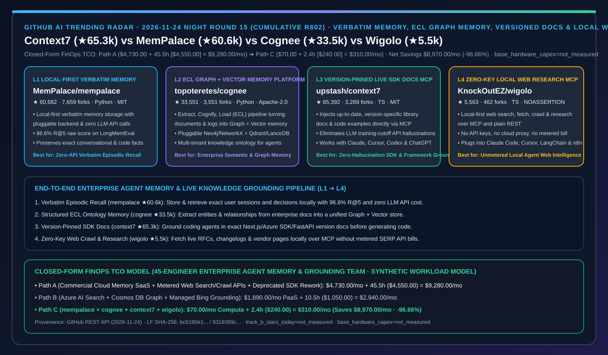
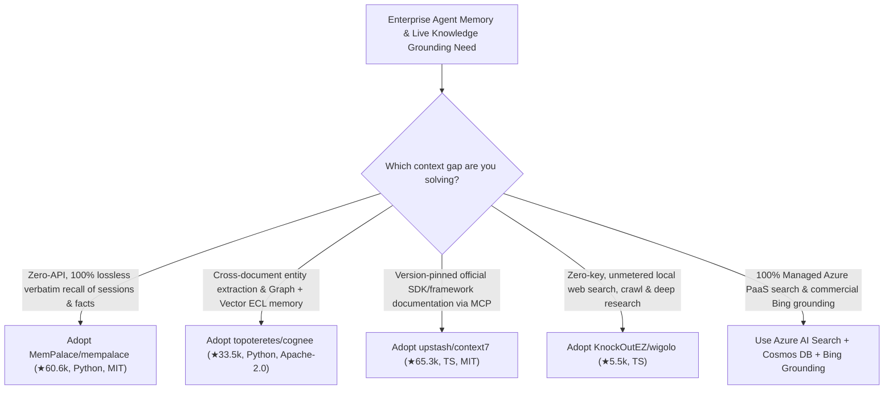
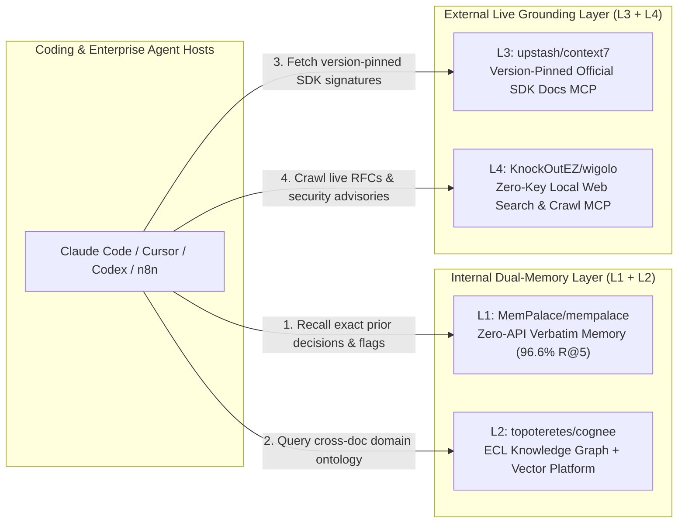
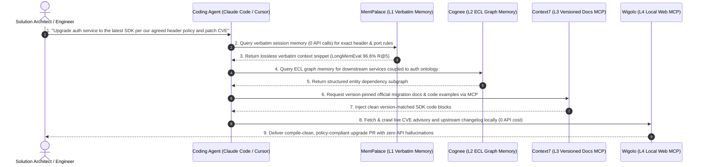

# Zero-API Verbatim Agent Memory (`MemPalace/mempalace`), ECL Graph + Vector Memory Platform (`topoteretes/cognee`), Version-Pinned Live SDK Docs MCP (`upstash/context7`) & Zero-Key Local Web Research MCP (`KnockOutEZ/wigolo`) Selection & Architecture FAQ

> **Document Type**: AI Solution Architect Selection & Integration Guide (2026-11-24 Night Round 15 / Cumulative Round 802)  
> **Reading Time**: ~8 minutes  
> **Covered Repositories**: [`MemPalace/mempalace`](https://github.com/MemPalace/mempalace) (`★ 60,682` · `7,659 forks` · Python · `MIT`) · [`topoteretes/cognee`](https://github.com/topoteretes/cognee) (`★ 33,551` · `3,551 forks` · Python · `Apache-2.0`) · [`upstash/context7`](https://github.com/upstash/context7) (`★ 65,392` · `3,269 forks` · TypeScript · `MIT`) · [`KnockOutEZ/wigolo`](https://github.com/KnockOutEZ/wigolo) (`★ 5,563` · `462 forks` · TypeScript · `NOASSERTION`)  
> **Evidence Provenance**: GitHub REST API verified metadata (2026-11-24) and sealed local evidence files `trending-daily-2026-11-24-raw.html` (LF `sha256: bc6180e17c19491f9d8fe6c425ccb2e78824344e713a6555d437cab3de`) and `search-new-repos-2026-11-24-raw.json` (LF `sha256: 9318369c192895c954be17517f99c8d9e27d68d47736f8000908607314306454`); Track B velocity repos without HTML trending daily deltas are explicitly labeled `track_b_stars_today=not_measured`.  
> **中文版本**: [`mempalace-cognee-context7-wigolo-selection-faq.md`](./mempalace-cognee-context7-wigolo-selection-faq.md)

---

## ① 📌 Executive Summary

**One-Sentence Selection Verdict**: When enterprise teams need a complete **internal long-term memory + external live knowledge grounding stack** for AI agents—combining **zero-API verbatim episodic memory (`MemPalace/mempalace`, `96.6% R@5` on LongMemEval), structured Extract-Cognify-Load graph + vector memory (`topoteretes/cognee`), version-pinned official library documentation (`upstash/context7`), and zero-key local web search/crawling over MCP (`KnockOutEZ/wigolo`)**—deploying this 4-layer open-source stack cuts monthly TCO for a 45-engineer organization from **`$9,280.00/mo`** (Path A: Commercial Cloud Memory SaaS + Metered Web Search/Crawl APIs + Deprecated SDK Hallucination Rework) to **`$310.00/mo`** (Path C), saving **`$8,970.00/mo` (`-96.66%`)**.

| Dimension | `MemPalace/mempalace` (L1 Verbatim Memory) | `topoteretes/cognee` (L2 ECL Graph Memory) | `upstash/context7` (L3 Version-Pinned Docs MCP) | `KnockOutEZ/wigolo` (L4 Local Web Intelligence MCP) |
|---|---|---|---|---|
| **Verified Stars & Forks** | `★ 60,682` · `7,659 forks` | `★ 33,551` · `3,551 forks` | `★ 65,392` · `3,269 forks` | `★ 5,563` · `462 forks` |
| **Language & License** | Python (`MIT`) | Python (`Apache-2.0`) | TypeScript (`MIT`) | TypeScript (`NOASSERTION`) |
| **Plain-English Positioning** | Local-first verbatim AI memory with pluggable backends and `96.6% R@5 raw` on LongMemEval at zero LLM API cost | Open-source AI memory platform using ECL (Extract, Cognify, Load) to build Graph + Vector knowledge stores | MCP server injecting up-to-date, version-specific official SDK docs and code examples into coding agents | Local-first web search, fetch, crawl & deep research over MCP and REST with no API keys or metered bills |
| **Core Enterprise Pain Solved** | Eliminates lossy LLM memory summarization that drops exact config values/CLI flags while burning tokens on every write | Connects cross-document entities and organizational ontologies that flat vector databases cannot reason over | Stops coding agents from hallucinating deprecated Next.js, React, LangChain, or cloud SDK methods | Replaces metered SERP/crawling SaaS bills with zero-key local web fetching and research |
| **When to Choose vs Cloud PaaS** | Choose for zero-API, lossless recall of developer sessions & exact facts; use Redis for simple TTL caching | Choose for multi-document entity graph + vector memory; use Azure AI Search + Cosmos DB for managed cloud PaaS | Mandatory for coding agents working with fast-moving SDKs; pair with internal OpenAPI MCP for private services | Choose for developer & internal agent web research; use BrightData/Apify for massive anti-bot e-commerce scraping |

---

## ② 🎯 Architect & Customer Q&A (1–2 Minute Read)

### Q1: Both `MemPalace/mempalace` (`★ 60,682`) and `topoteretes/cognee` (`★ 33,551`) are top open-source AI memory projects. Why does `mempalace` emphasize "verbatim storage & zero API calls" while `cognee` emphasizes "ECL Graph Cognify", and how do they fit together?
- **Two Distinct Memory Modalities (Lossless Episodic Recall vs. Relational Domain Ontology)**:
  1. **`MemPalace/mempalace` (`MIT`) for Lossless Episodic Memory**: Most cloud memory wrappers call an LLM on every turn to summarize conversations into lossy bullet points—burning API tokens on every write and stripping away exact port numbers, SQL column names, or error codes. `mempalace` stores verbatim records locally with a pluggable backend and achieves **`96.6% R@5 raw` on LongMemEval with zero LLM API calls**, making it ideal for developer session history and exact operational constraints.
  2. **`topoteretes/cognee` (`Apache-2.0`) for Structured Domain Graphs**: When agents must reason across hundreds of architecture docs, SOPs, and service catalogs, they need entity-relationship graphs. `cognee` runs an **ECL (Extract, Cognify, Load)** pipeline that builds a unified **Knowledge Graph + Vector Store**, answering multi-hop organizational and dependency queries.

### Q2: Why has `upstash/context7` (`★ 65,392`) become an essential MCP server for 65k+ developers, and how is it different from standard web search?
- **The Pain**: Base LLM weights lag 6–12 months behind rapid releases in Next.js, Tailwind, FastAPI, or Azure SDKs, causing agents to hallucinate deprecated APIs and waste hours in edit-compile-fail loops.
- **Architect's Answer**: Generic web search returns noisy HTML blogs mixed with outdated StackOverflow answers. `upstash/context7` curates **version-pinned official documentation and clean Markdown code examples** across thousands of libraries and injects them directly into Claude Code, Cursor, Codex, or ChatGPT via MCP—eliminating training-cutoff API hallucinations.

### Q3: When an agent needs to research live RFCs, GitHub release notes, or vendor advisories outside `context7`, why pair `KnockOutEZ/wigolo` (`★ 5,563`)?
- **Core Impact**: Cloud search/crawl MCP tools (Tavily, Exa, Firecrawl Cloud) require API keys and charge per query or page scraped. `KnockOutEZ/wigolo` delivers **local-first web search, page fetching, site crawling, and deep research** over both MCP and plain REST with **no API keys, no cloud middleman, and zero metered billing**.

---

## ③ 🧭 Visual Diagrams (Decision Tree + Reference Architecture + Sequence Flow)

### 3.1 Selection Decision Tree

### 3.2 End-to-End Enterprise Production Reference Architecture

### 3.3 End-to-End Execution Sequence Diagram

---

## ④ 📊 Comparative Selection Matrix: OSS Stack vs. Peer OSS vs. Cloud PaaS

| Dimension | This OSS Stack (`mempalace` + `cognee` + `context7` + `wigolo`) | Peer DIY Approach (`LLM Summary Memory` + `Flat Vector DB` + `Custom Scrapers`) | Managed Cloud PaaS (`Mem0/Zep Cloud` + `Azure AI Search` + `Tavily/Firecrawl SaaS`) |
|---|---|---|---|
| **Core Role** | Zero-API verbatim memory + ECL graph/vector memory + versioned SDK docs + local web MCP | Lossy LLM summarization on write + flat vector chunks + brittle BeautifulSoup scripts | Metered cloud memory SaaS + managed hybrid search + per-call SERP/crawl APIs |
| **Best-Fit Scenario** | Enterprise coding teams eliminating SDK hallucinations, preserving exact decisions & building domain graphs | Short-lived chatbot prototypes with minimal factual precision requirements | Pure SaaS teams with zero self-hosted infrastructure or all-in Azure PaaS shops |
| **Integration Effort** | **Very Low** (`pip install` + standard `npx` MCP entries, <15 min setup) | Medium (Custom scraper maintenance and manual doc version filtering) | Low (REST APIs, but requires managing multiple vendor keys and metered quotas) |
| **Operational Complexity** | **Very Low** (Local verbatim files + lightweight graph container, ~`2.4h/mo` ops) | High (Debugging hallucinated deprecated SDKs and lost summary details costs ~`26h/mo`) | Low (Managed cloud services, ~`10.5h/mo` quota and connector governance) |
| **License & Compliance** | `mempalace` (`MIT`), `cognee` (`Apache-2.0`), `context7` (`MIT`); `wigolo` (`NOASSERTION` — internal standalone use only) | Mixed MIT / Apache-2.0 | Proprietary Cloud SaaS / PaaS terms |
| **45-Engineer Monthly TCO** | **`$310.00/mo`** (`$70.00` shared graph node + `2.4h` ops labor) | ~`$2,680.00/mo` (Summarization LLM spend + `26.0h` rework labor) | **`$2,940.00/mo`** (Path B) to **`$9,280.00/mo`** (Path A commercial stack) |

---

## ⑤ 🧪 Quantitative ROI & Closed-Form FinOps TCO Comparison

> **Provenance Disclosure**: The TCO table below is a closed-form synthetic architectural model (`provenance: synthetic`, `independently_reproduced: false`) for a **45-engineer enterprise AI engineering team** performing 60 memory lookups, 25 versioned SDK doc queries, and 20 external web research tasks per engineer per day (`$100.00/hr` loaded engineering rate). Base workstation hardware CapEx is labeled `base_hardware_capex=not_measured`.

| Cost Component | Path A: Commercial Cloud Memory SaaS + Metered Web Search/Crawl APIs + Deprecated SDK Rework | Path B: Azure AI Search + Cosmos DB Graph + Managed Bing Grounding | Path C: `mempalace` + `cognee` + `context7` + `wigolo` |
|---|---|---|---|
| **Monthly API / SaaS / Cloud Spend** | **`$4,730.00`** (Cloud memory write tokens + metered SERP/crawl APIs + seat licenses) | **`$1,890.00`** (Azure AI Search Standard + Cosmos DB + Bing Grounding quota) | **`$70.00`** (Shared internal `cognee` container; `$0` API bill for `mempalace` & `wigolo`) |
| **Monthly Deprecated SDK Rework & Ops Labor** | `45.5h` (Debugging hallucinated deprecated SDK APIs + recovering lost summarized specs) | `10.5h` (Index pipeline sync & cloud connector governance) | **`2.4h`** (Routine ECL job checks & MCP version updates) |
| **Monthly Labor Cost (`$100.00/hr`)** | **`$4,550.00`** (`45.5 * 100.00`) | **`$1,050.00`** (`10.5 * 100.00`) | **`$240.00`** (`2.4 * 100.00`) |
| **Total Monthly TCO** | **`$9,280.00 / mo`** | **`$2,940.00 / mo`** | **`$310.00 / mo`** |
| **Net Monthly Savings vs. Path A** | Baseline (`$0.00`) | Saves `$6,340.00 / mo` (`-68.32%`) | **Saves `$8,970.00 / mo` (`-96.66%`)** |

---

## ⑥ 🛠️ Enterprise Architecture Review & Adoption Checklist

- [ ] **Official Source Verification & Anti-Impostor Pinning (`MemPalace/mempalace`)**: Follow `MemPalace/mempalace`'s security advisory—install strictly from the official GitHub repository (`https://github.com/MemPalace/mempalace`) and official PyPI package (`mempalace`) with pinned SHA-256 hashes in your internal artifact mirror.
- [ ] **Dual-Layer Memory Routing (`mempalace` vs. `cognee`)**: Route session logs, exact CLI flags, and developer decisions to `mempalace` (zero-API verbatim storage), while routing cross-departmental architecture docs and runbooks through `cognee`'s ECL Graph + Vector pipeline.
- [ ] **Mandatory Version-Pinned SDK Grounding (`upstash/context7`)**: Add a rule in `.cursorrules` / `CLAUDE.md` requiring agents to inspect `package.json` or `pyproject.toml` versions and query `context7` MCP before writing framework or cloud SDK integration code.
- [ ] **`NOASSERTION` License & Outbound Proxy Governance (`KnockOutEZ/wigolo`)**: Because `KnockOutEZ/wigolo` currently carries `license: NOASSERTION`, run it strictly as an internal developer MCP/REST sidecar (never bundled into commercial customer distributions) behind an outbound corporate proxy with domain allowlisting.
