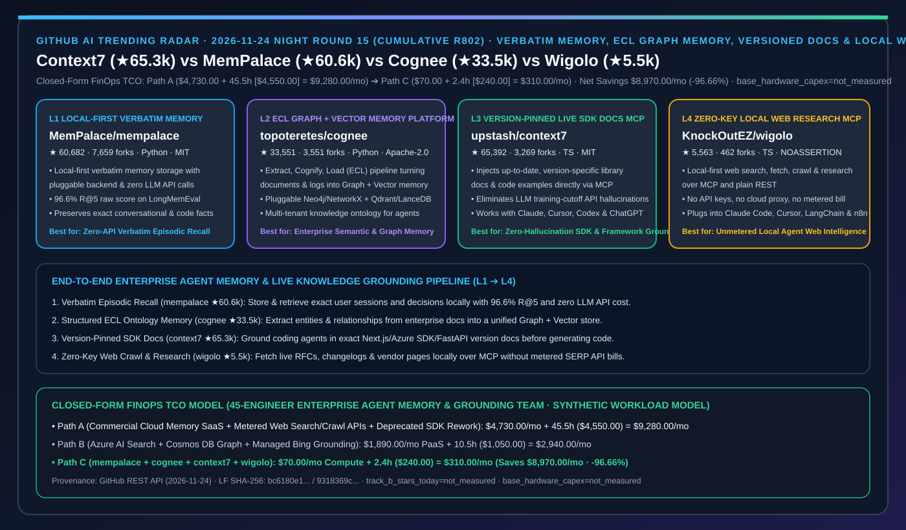
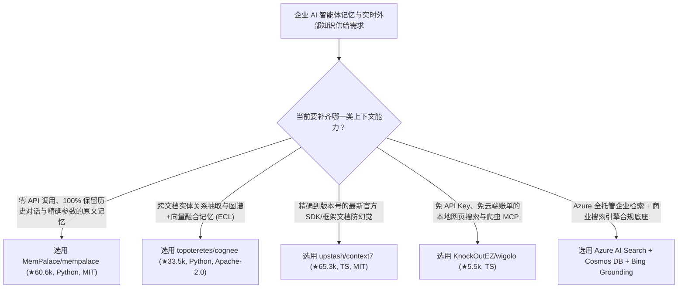
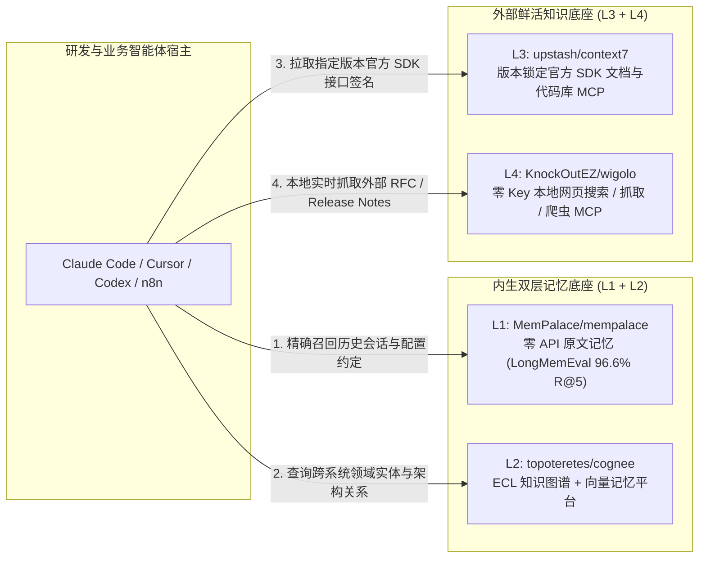
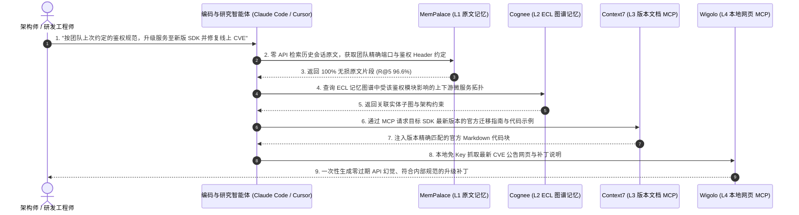

# 零 API 调用原文级智能体记忆宫殿（`MemPalace/mempalace`）、ECL 图谱+向量双擎记忆平台（`topoteretes/cognee`）、版本锁定实时开发文档 MCP（`upstash/context7`）与零 Key 本地网页深潜 MCP（`KnockOutEZ/wigolo`）选型与集成 FAQ

> **文档类型**：AI 解决方案架构师（AI Solution Architect）选型决策指南（2026-11-24 Night Round 15 / 累计第 802 轮）  
> **阅读耗时**：约 8 分钟  
> **覆盖项目**：[`MemPalace/mempalace`](https://github.com/MemPalace/mempalace)（`★ 60,682` · `7,659 forks` · Python · `MIT`） · [`topoteretes/cognee`](https://github.com/topoteretes/cognee)（`★ 33,551` · `3,551 forks` · Python · `Apache-2.0`） · [`upstash/context7`](https://github.com/upstash/context7)（`★ 65,392` · `3,269 forks` · TypeScript · `MIT`） · [`KnockOutEZ/wigolo`](https://github.com/KnockOutEZ/wigolo)（`★ 5,563` · `462 forks` · TypeScript · `NOASSERTION`）  
> **证据溯源**：GitHub REST API 实测元数据（2026-11-24）与本地冻结证据文件 `trending-daily-2026-11-24-raw.html`（LF `sha256: bc6180e17c19491f9d8fe6c425ccb2e78824344e713a6555d437cab3de`）、`search-new-repos-2026-11-24-raw.json`（LF `sha256: 9318369c192895c954be17517f99c8d9e27d68d47736f8000908607314306454`）；Track B 仓库无 HTML 榜单对应的单日增量，统一标记为 `track_b_stars_today=not_measured`。  
> **English Version**: [`mempalace-cognee-context7-wigolo-selection-faq.en.md`](./mempalace-cognee-context7-wigolo-selection-faq.en.md)

---

## ① 📌 核心结论速览（Executive Summary）

**选型一句话结论**：当企业需要为 AI 智能体构建**“内部长效记忆（原文精确召回 + 知识图谱结构化沉淀）+ 外部鲜活知识锚定（精确到版本号的官方 SDK 文档 + 免 Key 本地网页检索与爬取）”**的完整上下文供给体系时，采用 **`MemPalace/mempalace`（L1 零 API 调用原文级记忆，LongMemEval `96.6% R@5`）+ `topoteretes/cognee`（L2 ECL 图谱+向量语义记忆平台）+ `upstash/context7`（L3 版本锁定的官方库文档 MCP）+ `KnockOutEZ/wigolo`（L4 免 API Key 本地网页搜索与抓取 MCP）** 的四层架构，可将 45 人研发团队的月度 TCO 从商业云端记忆 SaaS + 按次计费网页抓取 API + 过期 SDK 幻觉返工（Path A）的 **`$9,280.00/月`** 降至 **`$310.00/月`**（净省 **`$8,970.00/月`**，降幅 **`-96.66%`**）。

| 评估维度 | `MemPalace/mempalace` (L1 原文记忆宫殿) | `topoteretes/cognee` (L2 ECL 图谱记忆) | `upstash/context7` (L3 版本锁定文档 MCP) | `KnockOutEZ/wigolo` (L4 本地网页情报 MCP) |
|---|---|---|---|---|
| **GitHub 实测热度** | `★ 60,682` · `7,659 forks` | `★ 33,551` · `3,551 forks` | `★ 65,392` · `3,269 forks` | `★ 5,563` · `462 forks` |
| **实现语言与开源协议** | Python (`MIT`) | Python (`Apache-2.0`) | TypeScript (`MIT`) | TypeScript (`NOASSERTION`) |
| **一句话通俗定位** | 零 LLM API 调用、保留 100% 原文细节的本地优先 AI 记忆库（LongMemEval `96.6% R@5`） | 基于 ECL（Extract, Cognify, Load）流水线的企业级“知识图谱 + 向量”双擎记忆平台 | 为编码 Agent 实时注入特定版本最新官方 SDK 文档与代码示例的 MCP 服务 | 无需 API Key、无云端账单的本地优先网页搜索、抓取、爬虫与深度调研 MCP |
| **解决的核心业务痛点** | 消除传统“大模型摘要型记忆”丢失精确配置参数、报错码和承诺细节且每次写入都要调 API 烧钱的痛点 | 解决纯向量库无法表达跨文档实体关系、组织层级与时序演化的企业知识孤岛问题 | 彻底终结大模型因训练语料截止而幻觉出已废弃 API（如旧版 Next.js/LangChain 接口）的顽疾 | 免除昂贵的商业 SERP/网页抓取按次计费账单，让内网 Agent 也能自由抓取最新技术变更 |
| **何时选它 vs 云托管** | 需零成本、零摘要失真地记住历史对话与代码约定时选它；仅做简单键值缓存用 Redis 即可 | 需将企业多源文档转化为可推理图谱+向量记忆时选它；纯云端全托管选 Azure AI Search + Cosmos DB | 编写依赖新版开源框架/SDK 的代码时必选；纯内部私有 API 需配合内部 OpenAPI MCP | 研发团队本地日常技术检索与网页正文提取选它；大规模反爬商业舆情监控选 BrightData/Apify |

---

## ② 🎯 客户与架构师灵魂拷问 Q&A（1–2 分钟速读）

### Q1：同样是开源 AI 记忆系统，为什么 `MemPalace/mempalace`（`★ 60,682`）强调“零 API 调用、原文存储（Verbatim Storage）”，而 `topoteretes/cognee`（`★ 33,551`）强调“ECL 图谱化（Cognify）”？企业该如何搭配？
- **两类记忆的本质差异（情景原文记忆 vs 语义本体图谱）**：
  1. **用 `MemPalace/mempalace`（`MIT`）管理“情景原文记忆（Episodic Verbatim Memory）”**：很多记忆框架在写入时会调用 LLM 把对话浓缩成一句话摘要，既慢又贵，还会把关键端口号、SQL 字段名或客户特殊要求“摘要丢了”。`mempalace` 坚持本地优先原文存储与可插拔检索后端，在 **零 LLM API 调用** 下在权威基准 LongMemEval 取得 **`96.6% R@5 raw`** 的召回率，极适合记录工程师与 Agent 的历史决策、排障日志与精确指令。
  2. **用 `topoteretes/cognee`（`Apache-2.0`）管理“企业领域本体与跨文档关系（Semantic Graph Memory）”**：当面对几十份产品手册、架构规范与业务流程文档时，需要抽取“服务 A 依赖数据库 B、由团队 C 负责”的实体关系。`cognee` 通过 **ECL（Extract 抽取 ➔ Cognify 认知成图 ➔ Load 装载至图数据库+向量库）** 流水线，为多 Agent 提供结构化本体推理能力。

### Q2：为什么 `upstash/context7`（`★ 65,392`）会成为全球 6.5 万+ 开发者标配的 MCP Server？它和直接让 Agent 搜网页有什么区别？
- **痛点**：大模型训练数据往往滞后 6–12 个月，写 Next.js 15、Tailwind v4、React 19 或最新 Azure SDK 时，经常把旧版本写法和最新写法混在一起导致编译报错。
- **架构师解答**：普通网页搜索返回的是充满 SEO 垃圾和过时博客的 HTML；而 `upstash/context7` 专门将数千个主流开源库与 SDK 的**官方最新文档按精确版本号解析为干净的 Markdown 代码片段**，通过 MCP 直接注入 Claude Code、Cursor 或 Codex 的提示词中，从根源上消灭“过期 API 幻觉”。

### Q3：对于不在 `context7` 收录范围内的长尾技术文章、GitHub Issue 或竞品发布页，为什么推荐搭配 `KnockOutEZ/wigolo`（`★ 5,563`）？
- **核心收益**：传统商业搜索/爬虫 MCP（如 Tavily、Exa、Firecrawl 云端版）均需注册 API Key 并按调用次数计费。`KnockOutEZ/wigolo` 提供**本地优先的搜索、网页抓取（Fetch）、站点爬取（Crawl）与多步聚合研究能力**，既支持 MCP 协议（适配 Claude Code、Cursor、Codex、Gemini CLI、Windsurf）又支持标准 REST API（适配 LangChain、CrewAI、n8n），**无需任何外部 API Key，无云端按量账单**。

---

## ③ 🧭 直观可视化图解（Mermaid 决策树 + 集成架构 + 时序图）

### 3.1 技术选型决策树

### 3.2 企业端到端生产集成参考架构图

### 3.3 业务流全链路时序图

---

## ④ 📊 同类开源与商业云服务横向选型决策矩阵

| 对比维度 | 本轮开源组合 (`mempalace` + `cognee` + `context7` + `wigolo`) | 同赛道开源方案 (`摘要型 Memory` + `纯向量库` + `手写爬虫脚本`) | 云厂商托管 PaaS (`Mem0 Cloud / Zep` + `Azure AI Search` + `Tavily / Firecrawl API`) |
|---|---|---|---|
| **功能定位** | 零 API 原文记忆 + ECL 图谱/向量双擎 + 版本锁定官方 SDK 文档 + 免 Key 本地网页调研 | 每次写入调 LLM 摘要 + 单一向量检索 + 临时 BeautifulSoup 脚本 | 托管云端记忆 API + 托管混合检索 + 按次计费云端搜索/爬虫 SaaS |
| **适用场景** | 企业研发团队防 SDK 幻觉、长周期项目原文记忆留存、跨文档知识图谱构建與日常技术调研 | 短期轻量级聊天机器人原型 | 无本地运维能力的纯 SaaS 创业团队或全托管 Azure 企业 |
| **集成成本** | **极低**（Python `pip install` + 标准 `npx` MCP 配置，15 分钟内完成接入） | 中（需自行处理网页反爬清洗与文档版本过滤） | 低（REST API / SDK 接入，但需管理多套商业 API Key 与配额） |
| **运维复杂度** | **极低**（本地存储与轻量容器，月均维护仅 `2.4h`） | 高（摘要丢失关键信息需频繁人工纠偏，月均 `26h+`） | 低（全托管云服务，月均账单与权限核对约 `10.5h`） |
| **开源协议与合规** | `mempalace` (`MIT`)、`cognee` (`Apache-2.0`)、`context7` (`MIT`)；`wigolo` 为 `NOASSERTION`（需仅限内部独立工具使用） | MIT / Apache-2.0 不等 | 商业闭源 SaaS 订阅协议 |
| **45 人团队月度 TCO** | **`$310.00/月`**（含 `$70.00` 共享图谱节点 + `2.4h` 运维） | 约 `$2,680.00/月`（含摘要 Token 消耗 + `26.0h` 幻觉返工） | **`$2,940.00/月`**（Path B）至 **`$9,280.00/月`**（Path A 商业全栈） |

---

## ⑤ 🧪 应用落地定量收益 / TCO 对比（Closed-Form FinOps 模型）

> **数据性质声明（Provenance Metadata）**：以下 TCO 模型为面向 **45 人企业 AI 研发与架构团队**（每名工程师日均触发 60 次历史记忆召回、25 次新版 SDK 文档查询与 20 次外部网页技术检索，工程师折算时薪 `$100.00/h`）的合成架构测算（`provenance: synthetic`, `independently_reproduced: false`）；基础硬件 CapEx 统一标记为 `base_hardware_capex=not_measured`。

| 成本构成项 | Path A：商业云端记忆 SaaS + 按量网页搜索/抓取 API + 旧版 SDK 幻觉返工 | Path B：Azure AI Search + Cosmos DB 图谱 + 托管 Bing Grounding | Path C：`mempalace` + `cognee` + `context7` + `wigolo` |
|---|---|---|---|
| **API / SaaS / 云资源月费** | **`$4,730.00`**（云端记忆写入 LLM 账单 + 商业 SERP/Crawl 按次计费 + 席位费） | **`$1,890.00`**（Azure AI Search 标准层 + Cosmos DB + 托管搜索配额） | **`$70.00`**（内网共享 `cognee` 图数据库容器；`mempalace` 与 `wigolo` 0 API 账单） |
| **月度过期 API 幻觉返工与运维工时** | `45.5h`（修复大模型幻觉出的废弃 SDK 接口 + 找回被摘要丢掉的历史参数） | `10.5h`（索引同步与云端连接器维护） | **`2.4h`**（ECL 定时任务巡检与 MCP 升级） |
| **人工运维成本（`$100.00/h`）** | **`$4,550.00`** (`45.5 * 100.00`) | **`$1,050.00`** (`10.5 * 100.00`) | **`$240.00`** (`2.4 * 100.00`) |
| **月度总拥有成本（Total Monthly TCO）** | **`$9,280.00 / 月`** | **`$2,940.00 / 月`** | **`$310.00 / 月`** |
| **相对 Path A 净节省** | 基准线 (`$0.00`) | 节省 `$6,340.00 / 月` (`-68.32%`) | **净省 `$8,970.00 / 月` (`-96.66%`)** |

---

## ⑥ 🛠️ 企业引入与架构评审 Checklist

- [ ] **官方源防钓鱼核验（`MemPalace/mempalace`）**：严格遵循 `MemPalace/mempalace` 官方安全警示，仅从官方 GitHub 仓库（`https://github.com/MemPalace/mempalace`）与官方 PyPI（`pip install mempalace`）拉取镜像与包，在企业内部 PyPI 私有源中锁定 SHA-256 哈希，杜绝仿冒域名供应链投毒。
- [ ] **原文记忆与本体图谱分层路由（`mempalace` + `cognee`）**：将高频、需保留 100% 原始字面值的会话记录与参数配置路由至零 API 消耗的 `mempalace`，将跨部门制度、架构 ADR 与产品知识库定期通过 `cognee` 的 ECL 流水线写入图谱+向量底座。
- [ ] **仓库依赖版本与 `context7` 自动对齐（`upstash/context7`）**：在团队 `.cursorrules` 或 `CLAUDE.md` 中声明强制规则：凡涉及外部框架升级或新增接口调用，必须先携带 `package.json` / `pyproject.toml` 中的真实版本号调用 `context7` MCP 拉取对应版本文档，严禁凭训练记忆盲写。
- [ ] **`NOASSERTION` 协议与出网代理管控（`KnockOutEZ/wigolo`）**：鉴于 `KnockOutEZ/wigolo` 当前未声明标准 SPDX 开源许可证（`license: NOASSERTION`），在企业内部仅将其作为开发机本地独立 MCP 进程使用，不将其代码合并进商业发布产物；同时为其配置企业统一正向代理与域名白名单。
