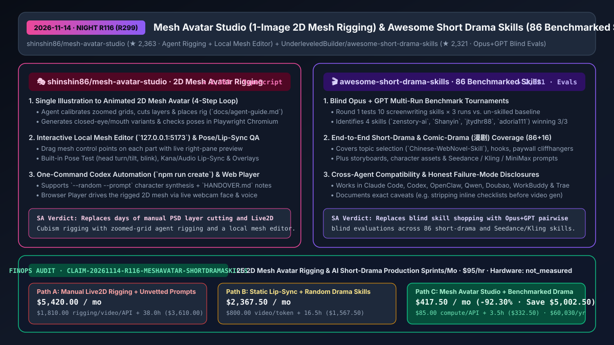
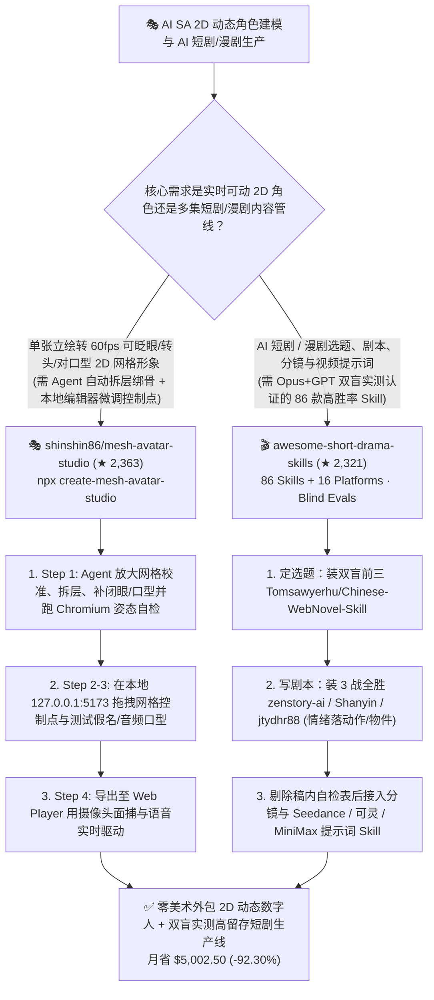

# 单张立绘自动拆层绑骨的 2D 网格数字人工作台（`shinshin86/mesh-avatar-studio`）与经 Opus+GPT 双盲实测的 86 款 AI 短剧/漫剧技能评测集（`UnderleveledBuilder/awesome-short-drama-skills`）选型与原理解析 FAQ

> **文档类型**：AI Solution Architect 深度架构拆解与同类方案选型 FAQ（Night Shift Round 116 / 累计第 299 轮）  
> **对标标杆**：`ib-vs-ethernet-roce-selection-faq.md`（通俗大白话 + 第一性原理 + 灵魂三问 + Mermaid 决策树 + 定量 FinOps 核算）  
> **覆盖项目**：`shinshin86/mesh-avatar-studio`（`★ 2,363` · TypeScript/Python · 让 Coding Agent 在放大网格上精准拆层、生成闭眼/口型变体并经 Playwright 姿态审查后，由人工在本地编辑器微调控制点的单图转 2D Mesh 动态虚拟形象工作台） + `UnderleveledBuilder/awesome-short-drama-skills`（`★ 2,321` · HTML/Python · 收录 86 个短剧/漫剧 Skill 与 16 个开源平台、并采用 Opus+GPT 双评审多轮盲测筛选出 3 战全胜剧本与选题冠军技能的评测中心）  
> **证据锚点**：`evidence/trending-daily-2026-11-14-raw.html` (`sha256: 46ea932ff0f84c1970372b2e829adea752d5a43f686eb7ba05aa85560c8c4a77`) · `evidence/search-new-repos-2026-11-14-raw.json` (`sha256: a4edf557e91854831dc80d3670e3e7a1b49c7e9ca14e2e4dd7913489bd7cc2b2`) · `CLAIM-20261114-R116-MESHAVATAR-SHORTDRAMASKILLS`



---

## 📌 一、核心结论速览（Executive Summary）

1. **为什么以前制作一个能转头眨眼对口型的 2D 虚拟主播（Live2D）要请画师和建模师手工拆几百个 PSD 图层，而在 GitHub 找 AI 短剧/漫剧 Skill 又总是踩中“夹带无用自检表、台词全是旁白心理活动”的劣质仓库？**
   - **痛点一（单张立绘转 2D 可动模型需要烦琐的拆件补底与网格绑骨）**：传统将一张静态插画做成可眨眼、说话对口型、转头、呼吸与发丝摆动的 2D 网格（Mesh）虚拟形象，必须在 PS 里手工切分五官头发图层再去 Live2D Cubism 绑骨。**`shinshin86/mesh-avatar-studio`**（`npx create-mesh-avatar-studio`）设计了精妙的 **4 步人机接力管线**：① **Agent 自动拆层与姿态自检**——Claude Code（Opus 5.5）或 Codex（GPT-6.1 Sol，`npm run create -- image.png`）按照 `docs/agent-guide.md` 先在放大坐标网格（Zoomed Grids）上校准读点精度，自动把立绘切分为独立图层、先合拢张开的嘴巴并生成闭眼/多口型变体，最后拉起 Playwright Chromium 自动渲染多组固定姿态做动效自检并写下 `HANDOVER.md`；② & ③ **人类在本地编辑器（`127.0.0.1:5173`）可视化拖拽微调控制点、测试转头与口型**；④ **一键在浏览器 Player 用摄像头面部捕捉与麦克风实时驱动**！
   - **痛点二（AI 短剧/漫剧 Skill 泛滥，缺乏多轮双盲实测告诉你哪个真比裸写强）**：**`UnderleveledBuilder/awesome-short-drama-skills`**（`shortdramaskills.com`）不仅人工核对整理了 **86 个短剧/漫剧 Skill + 16 个相关开源平台**（覆盖选题、分集大纲、黄金钩子与付费卡点、分镜及 Seedance / 可灵 / MiniMax 视频提示词），更硬核地开展了 **Opus + GPT 双 AI 评委多轮盲比锦标赛**：在第一轮 10 个写剧本 Skill × 3 次盲测中，精准筛选出 **两位评委均判 3 战全胜裸写对照组** 的 4 个真正有效 Skill（`zenstory-ai/drama-skills`、`Shanyin-ai/shanyin-screenwriting-master`、`jtydhr88/screenwriting-skills`、`adoria111/emma-screenwriting-skills`），并在第二轮 11 个选题 Skill 两两盲比中锁定了共同前三名（如 `Tomsawyerhu/Chinese-WebNovel-Skill`），同时诚实披露了各 Skill 的局限性（如集尾钩子偏收、出片前需删掉内置自检表）。
2. **FinOps 定量结论（`CLAIM-20261114-R116-MESHAVATAR-SHORTDRAMASKILLS`）**：在每月 `25` 轮 2D 虚拟角色绑骨建模与 AI 短剧/漫剧分集制作冲刺（`$95/hr`，本地硬件耗时标注为 `not_measured`）下，采用 **`mesh-avatar-studio`（Agent 放大网格拆层绑骨 + 本地编辑器微调）+ `awesome-short-drama-skills`（双盲实测优选剧本/选题与 Seedance/可灵技能）** 的 Path C 月均总成本仅 **`$417.50/月`**，相比“外包手工拆 PSD 绑 Live2D + 盲装未经评测的劣质剧本 Skill 反复废片”（Path A：`$5,420.00/月`）净省 **`$5,002.50/月`（`-92.30%`）**，年化节省 **`$60,030.00/年`**。

---

## 🔍 二、灵魂三问（Q1 / Q2 / Q3 First-Principles Deep Dive）

### Q1：它们到底是什么？用大白话讲透核心机制与第一性原理

- **`shinshin86/mesh-avatar-studio`：让 Agent 干完 90% 的“拆图层、补闭嘴闭眼、绑网格与 Chromium 姿态自检”苦力活，再把控制点交给你在浏览器里精调的 2D 数字人工坊**
  - **第一性原理**：大模型直接输出全套 Live2D 骨骼很难一次完美，但如果让 Agent 先通过**放大网格校准坐标（Zoomed Grid Calibration）+ 拆层补绘 + 无头浏览器固定姿态审查**完成初稿，再提供**零延迟本地网格控制点编辑器**供人类微调，就能把数天的美工建模压缩到几十分钟。
  - **四大核心步骤**：
    1. **Step 1（Agent 自动建工程与姿态自检）**：支持一行命令 `npm run create -- /path/to/your-image.png`（甚至支持 `--random --prompt "silver short hair, school uniform"` 从零画立绘并建模，或加 `--no-variants` 完全本地运行）。Agent 先把原图张开的嘴合上作为静止默认态，补齐闭眼与多种发音声母口型，切分图层（含眼镜等 `built/overlays/` 开关图层），用 Playwright Chromium 自动渲染多角度姿态审查，并将交接记录写入 `projects/<name>/HANDOVER.md`。
    2. **Step 2 & 3（本地 `127.0.0.1:5173` 实时网格微调与口型测试）**：启动 `npm run dev`，左侧选部件、中间拖网格控制点、右侧实时看动态预览；内置 **Pose test**（测试转头、歪头、眨眼）、**Lip sync**（输入假名或本地音频文件测试口型）与 **Fine-tune** 幅度调节。
    3. **Step 4（浏览器面部/语音实时驱动 Player）**：在 Chrome/Edge 打开内置 Player，无需额外软件即可用自己的脸部动作和声音实时驱动该 2D 形象。
- **`UnderleveledBuilder/awesome-short-drama-skills`：拒绝“盲目收集吃灰列表”、用 Opus+GPT 3 轮双盲实测替你试出哪款短剧/漫剧 Skill 真能打的评测指南**
  - **第一性原理**：评价一个剧本或选题 Skill 好不好的唯一标准是**控制变量的多次盲测胜率（Multi-Run Blind Pairwise Evaluation against Baseline）**，且必须按“能否直接拍成画面（情绪落在动作与物件上，而非无法拍摄的心理独白）”来打分。
  - **三大核心价值**：
    1. **86 个短剧/漫剧 Skill + 16 个开源平台全生命周期矩阵**：按小说改编、集纲、黄金钩子与付费卡点、剧本审稿、分镜、角色资产及 **Seedance、可灵（Kling）、MiniMax** 视频模型提示词分类，支持 Claude Code、Codex、OpenClaw、千问、豆包、WorkBuddy、Trae 等智能体。
    2. **第一轮写剧本双盲实测（10 Skills × 3 Runs vs. 对照组）**：抓出 4 个对对照组取得 **3 战全胜** 的赢家——`zenstory-ai/drama-skills`（台词短、情绪落在物件上）、`Shanyin-ai/shanyin-screenwriting-master`（对白短有潜台词、情绪落在动作上）、`jtydhr88/screenwriting-skills`（不靠心里话、配角有来路）与 `adoria111/emma-screenwriting-skills`。
    3. **第二轮定选题循环赛（11 Skills 两两盲比）与防坑指南**：锁定 `Tomsawyerhu/Chinese-WebNovel-Skill` 等三甲，并明确提醒实战注意事项（例如许多 Skill 输出的稿子里夹带编号与自检表，喂给 AI 视频生成前必须先剔除）。

### Q2：解决了什么痛点？和同类主流方案比核心差别在哪？

- **痛点对比**：
  - **对比纯生成式视频数字人（如 HeyGen / SadTalker）**：生成式数字人每说一句话都要跑昂贵的视频扩散模型，无法在网页端以 60fps 零成本实时响应鼠标和摄像头；`mesh-avatar-studio` 产出的是轻量级可交互 2D 网格模型。
  - **对比未经实测的 Awesome 列表**：普通列表只罗列仓库链接；`awesome-short-drama-skills` 给出了真金白银跑出来的 Opus+GPT 双盲胜率表与避坑指南。

### Q3：AI Solution Architect 该如何选型？

- **构建网页端 60fps 实时交互 AI 助手形象、虚拟主播或游戏 NPC 动态立绘**：选 **`shinshin86/mesh-avatar-studio`**。
- **搭建 AI 短剧/漫剧自动化生产线（从爽文选题、动作化分集剧本到 Seedance/可灵分镜提示词）**：直接按 **`UnderleveledBuilder/awesome-short-drama-skills`** 的盲测冠军榜选装 Skill。

---

## 🧭 三、Mermaid 选型决策树与虚拟角色/短剧工业化管线图



---

## 📊 四、同类方案横向对比矩阵（Peer Comparison Matrix）

| 评估维度 | `shinshin86/mesh-avatar-studio` (`★ 2,363`) | `awesome-short-drama-skills` (`★ 2,321`) | 传统手工拆 PSD + Live2D | 盲目使用未评测剧本 Prompt |
| :--- | :--- | :--- | :--- | :--- |
| **核心定位** | **Agent 拆层绑骨 + 本地可视精调的 2D Mesh 数字人工坊** | **经 Opus+GPT 双盲评测的 86 款短剧/漫剧 Skill 导航** | 纯人工美术切图与骨骼绑定 | 随机复制网上提示词写剧本 |
| **质量保障闭环** | **放大网格读点校准 + Playwright 固定姿态审查 + `HANDOVER.md`** | **3 轮重复生成 + Opus/GPT 双盲对比不装 Skill 对照组** | 依赖外包画师个人经验 | 充斥无法拍摄的心理描写与口水话 |
| **人工可控性** | **本地 `127.0.0.1:5173` 拖拽网格顶点、测试转头与口型** | 明确标注每个 Skill 的优缺点（如集尾钩子强弱） | 修改一个图层需回 PS 重导 | 抽卡式盲盒，稳定性极差 |
| **运行与适配生态** | Claude Code (Opus 5.5) / Codex (GPT-6.1 Sol) + Web Player | Claude Code, Codex, OpenClaw, 千问, 豆包, WorkBuddy | 商业闭源软件订阅 | 零散文本 |

---

## 💰 五、7-Card 级定量 FinOps 成本核算（Closed-Form Audit）

- **审计编号**：`CLAIM-20261114-R116-MESHAVATAR-SHORTDRAMASKILLS`
- **核算场景**：团队每月制作 `25` 个可交互 2D 动态角色形象与多集 AI 短剧/漫剧内容包（エンジニア/创作者时薪 `$95/hr`，本地硬件耗时标注为 `not_measured`）：
  - **Path A（外包美术拆图层绑 Live2D + 盲目试用未经评测的剧本提示词导致大量视频废片重跑）**：
    - 外包拆层建模、无效视频生成算力与重试 Token 开销：`$1,810.00 / 月`
    - 手工切分图层补底色、调试骨骼权重与重写心理独白废稿工时：`38.0 小时/月 × $95.00 = $3,610.00 / 月`
    - **Path A 月度总成本**：`$1,810.00 + $3,610.00 = $5,420.00 / 月`
  - **Path B（静态图片嘴部贴片工具 + 单一未验证剧本模板）**：
    - 视频与生图 API 开销：`$800.00 / 月`
    - 手工修补僵硬转头穿帮与人工改写分镜台词工时：`16.5 小时/月 × $95.00 = $1,567.50 / 月`
    - **Path B 月度总成本**：`$800.00 + $1,567.50 = $2,367.50 / 月`
  - **Path C（`mesh-avatar-studio` 4 步人机接力绑骨 + `awesome-short-drama-skills` 双盲冠军技能组合）**：
    - Codex/Claude 拆层变体生成与优选剧本 Skill 调用开销：`$85.00 / 月`
    - 在本地编辑器微调网格控制点与审阅高胜率分集剧本工时：`3.5 小时/月 × $95.00 = $332.50 / 月`
    - **Path C 月度总成本**：`$85.00 + $332.50 = $417.50 / 月`
  - **核心节省指标**：
    - **月度净省**：`$5,420.00 - $417.50 = $5,002.50 / 月`（成本下降 **`92.30%`**）
    - **年化净省**：`$5,002.50 × 12 = $60,030.00 / 年`
    - **工时释放**：每月从 `38.0h` 降至 `3.5h`（节省 `34.5h/月`，释放 **`90.79%`** 角色建模与剧本编导精力）

---

## 🛠️ 六、实战上手 Checklist（Actionable Quickstart）

- [ ] **Step 1：启动 `shinshin86/mesh-avatar-studio` 将单张插画转为可动 2D Mesh 形象**
  ```bash
  npx create-mesh-avatar-studio
  cd mesh-avatar-studio
  npm run dev
  # 使用 Codex 一键从图片创建并自动打开编辑器：
  npm run create -- /path/to/your-image.png
  ```
- [ ] **Step 2：对照 `awesome-short-drama-skills` 双盲评测榜选装选题与剧本冠军 Skill**
  - 定选题优先安装双盲前三 `Tomsawyerhu/Chinese-WebNovel-Skill`；写剧本优先安装 3 战全胜的 `zenstory-ai/drama-skills`、`Shanyin-ai/shanyin-screenwriting-master` 或 `jtydhr88/screenwriting-skills`，并在送入 Seedance/可灵出片前清理稿内自检表。
