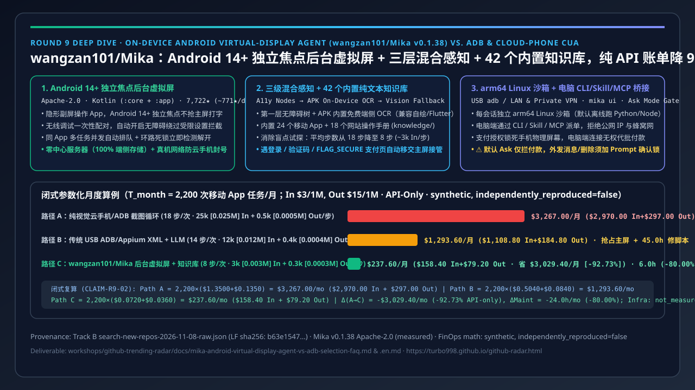
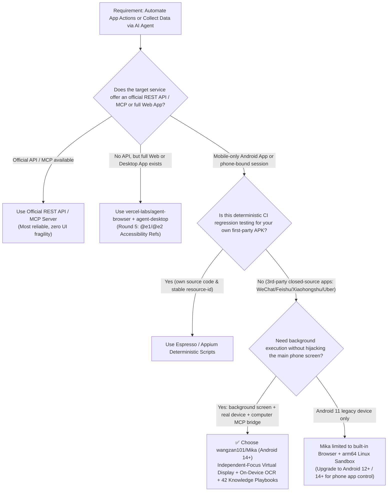
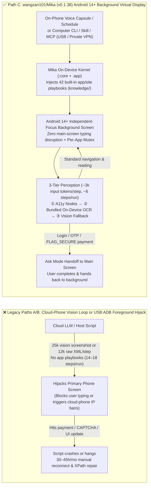

# On-Device Android Virtual-Display Agent vs. ADB & Cloud-Phone Selection FAQ: `wangzan101/Mika` vs. USB ADB/Appium Scripts & Pure-Vision Cloud-Phone CUA

> **Document Purpose**: A 5-minute architecture & selection guide for AI Solution Architects (2026-11-08 Night Shift Round 9 Standalone Deep Dive | Strictly single architectural decision per FAQ)  
> **Style Benchmark**: `ib-vs-ethernet-roce-selection-faq.md` (6-part structure: Executive Summary, Q1/Q2/Q3 First-Principles Q&A, Mermaid Decision Tree & Architecture Diagrams, Comparison Matrix, Closed-Form Quantitative Worked Example & 7-Card Insights, Production Checklist)  
> **Featured Radar Repository**:
> - 🔥 **Track B New-Repo Breakout #4 (P1 Mobile Background Virtual-Display Agent Reference)**: [`wangzan101/Mika`](https://github.com/wangzan101/Mika) (`v0.1.38`, `Apache-2.0`, Kotlin `:core` + `:app` modules; created `2026-10-29`, reaching **7,708★** initial snapshot / **7,722★** archived Search API / **7,728★** live REST in 10 days = **~771★/day creation-to-date lifecycle average**, archived in `workshops/github-trending-radar/evidence/search-new-repos-2026-11-08-raw.json` LF SHA256 `b63e154723524af044eca6d701fd910d2b13ed732d3ad8ae2fd3f0b5584b7ba1`, `measured`; **24h delta `stars_today: not_measured`**, never mixed into Track A)
> - 🔗 **Web & Desktop CUA Counterpart (Covered Independently in Round 5)**: [`vercel-labs/agent-browser`](https://github.com/vercel-labs/agent-browser) + [`vercel-labs/agent-desktop`](https://github.com/vercel-labs/agent-desktop) (see [Round 5 Web & Desktop Accessibility CUA Selection FAQ](agent-browser-desktop-a11y-vs-playwright-vision-selection-faq.en.md))
>
> **Language Versions**: [中文版](mika-android-virtual-display-agent-vs-adb-selection-faq.md) | [English Version (Current)](mika-android-virtual-display-agent-vs-adb-selection-faq.en.md)

---

## 📌 Executive Summary (3 Plain-Language Takeaways)

1. **Why do traditional "USB-tethered ADB/Appium scripts" and "Pure-Vision Cloud-Phone CUA loops" struggle on mobile-only apps?**  
   Many high-value workflows (WeChat/Feishu group chat digests, Xiaohongshu/TikTok creator research, recruitment outreach, mobile commerce comparison) only exist inside mobile apps or require a real phone's local signed-in session. **Traditional USB ADB / Appium scripts** (Path B) hijack the phone's primary foreground screen, dump ~12,000 tokens of verbose `uiautomator` XML per step, and break whenever an app updates its layout. **Pure-Vision Cloud-Phone CUA loops** (Path A) upload full-resolution screenshots every step (~25,000 input tokens/step), wander blindly for an average of **18 steps/task** without built-in app navigation knowledge, and frequently trigger device-fingerprint / datacenter-IP bans.
2. **What does `wangzan101/Mika` actually do under the hood? (Android 14+ Background Virtual Display + 3-Tier Hybrid Perception + Built-in App Knowledge + Computer MCP/CLI Bridge)**:  
   Verified directly from primary source (`README.md`, `settings.gradle.kts`, `docs/features.en.md`, `docs/computer.en.md` — `CLAIM-R9-01`, `measured`), `wangzan101/Mika` (`v0.1.38`, `Apache-2.0`, 100% serverless on-device architecture) combines four mobile systems innovations:
   - **① Android 12/14+ Background Virtual Display (`Background screens`)**: Launches and operates mobile apps on a separate hidden background screen. On **Android 14+**, the background display has **its own independent input focus**, so background typing/scrolling never interrupts the user typing on the main screen, backed by a per-app concurrency mutex with automatic deadlock detection.
   - **② 3-Tier Hybrid Perception (Accessibility Nodes → APK-Bundled On-Device OCR → Vision Fallback) + 42 Built-in Knowledge Playbooks**: Reads lightweight Accessibility nodes first, falls back to free APK-bundled on-device OCR for custom-drawn / Flutter UI controls, and uses vision screenshots only when necessary—while automatically loading plain-text navigation guides from `core/src/main/resources/knowledge/` (**24 mobile apps + 18 websites**, including WeChat, Feishu, Xiaohongshu, Boss Zhipin, Uber, Gmail, WhatsApp).
   - **③ Human-in-the-Loop Sensitive Handoff & Ask Mode**: When encountering logins, SMS OTPs, CAPTCHAs, or screenshot-blocked `FLAG_SECURE` payment pages, Mika notifies the user, moves the app to the main screen for human completion, and re-verifies before continuing in the background.
   - **④ Per-Conversation arm64 Linux Sandbox + Computer Bridge (`mika` CLI / Skill / MCP / `mika ui`)**: Runs an offline-by-default arm64 Linux workspace (`Python`, `Node`, `shell`) on the phone and exposes a local task service over USB (`adb`) or trusted LAN / private VPN so desktop agents can delegate mobile tasks via CLI/Skill or MCP.
3. **Closed-Form Quantitative Takeaway (`T_month = 2,200` mobile app runs/month, API-Only Synthetic Model `synthetic, independently_reproduced=false`)**:  
   Under a **100 runs/workday × 22 workdays = 2,200 runs/month** enterprise mobile workflow model (`$3.00/1M` input, `$15.00/1M` output; cloud-phone VM rental, USB hardware depreciation, and full production bills explicitly marked `not_measured` — `CLAIM-R9-02`):
   - **Path A (Pure-Vision Cloud-Phone / ADB Screenshot Loop, 18 steps/run, 25k input + 0.5k output/step)**: Costs **`$3,267.00/mo`** API-only (`$2,970.00` input + `$297.00` output counted strictly once) plus **`30.0 hours/mo`** of anti-bot/reconnection recovery;
   - **Path B (Traditional USB ADB/Appium `uiautomator` Raw XML + LLM Fallback, 14 steps/run, 12k input + 0.4k output/step)**: Costs **`$1,293.60/mo`** API-only (`$1,108.80` input + `$184.80` output), hijacks the foreground screen, and requires **`45.0 hours/mo`** of XPath maintenance;
   - **Path C (`wangzan101/Mika` Android 14+ Background Virtual Display + A11y/On-Device OCR + App Knowledge Playbooks, 8 steps/run, 3k input + 0.3k output/step)**: Cuts monthly API-only spend to **`$237.60/mo`** (`$158.40` input + `$79.20` output), saving **`$3,029.40/mo` (`$36,352.80/yr`, `-92.73%` API-only)** vs. Path A and **`$1,056.00/mo` (`-81.63%` API-only)** vs. Path B, with **0 hours** of routine foreground interruption and **`6.0 hours/mo`** of human-in-the-loop login/payment handoffs (**`-80.00%`** human overhead vs. Path A).

---

## 1. First-Principles Q&A: What Is It, What Pain Does It Solve, and How Does It Work?

### Q1: What is `wangzan101/Mika` in plain language? When should I choose it vs. Web/Desktop Agents or traditional Appium?

In one plain sentence:
> **`Mika` is an on-device Android AI agent (recommended on Android 14+) with a hidden secondary virtual screen and a computer MCP/CLI bridge—you give it a goal (on the phone or from a computer agent), and it opens apps like WeChat, Feishu, Xiaohongshu, Uber, or its built-in desktop-class browser on a background virtual display without disturbing your main screen, pausing only to hand logins, verification codes, or payments back to you.**

- **When to choose Web / Desktop Agents (`agent-browser` / `agent-desktop`, see Round 5)?**  
  Whenever the target workflow has a first-class web application or desktop client and does not require a mobile hardware attestation or phone-bound login session, run `vercel-labs/agent-browser` in a server/desktop sandbox.
- **When to choose traditional Appium / Espresso deterministic scripts?**  
  When your mobile engineering team is running deterministic CI regression assertions against **your own first-party Android APK** (with debug symbols and stable `resource-id` selectors).
- **When is `wangzan101/Mika` strictly superior?**  
  When automating **third-party closed-source mobile apps** (no public API, strict mobile device-session binding, custom-drawn/Flutter views) or when a **desktop agent needs to delegate mobile-only tasks via CLI/Skill/MCP** without taking over the user's foreground phone screen.

---

### Q2: How does `Mika` operate apps in the background without stealing keyboard focus or getting blocked by Android's "Restricted setting"?

Primary source inspection (`README.md`, `docs/features.en.md`, `docs/setup-guide.en.md` — `CLAIM-R9-01`, `measured`) reveals four architectural pillars:

1. **One-Time Wireless Debugging Pairing + Self-Enabled Accessibility**:  
   On Android 13+, sideloaded APKs from GitHub are normally blocked from enabling Accessibility manually (`"Restricted setting"`). `Mika` pairs once via on-device **Wireless Debugging** in its setup wizard (and can re-enable wireless debugging automatically after Wi-Fi changes with user permission), allowing its local helper to grant Accessibility and virtual-display permissions without keeping a USB cable plugged in.
2. **Android 14+ Independent-Focus Background Virtual Display + Per-App Mutex**:  
   - On **Android 14+**, `Mika`'s background virtual display maintains its own independent input focus (`own focus`), so background typing and scrolling never interfere with user typing on the main screen, and multiple conversations can run background tasks concurrently.
   - If two concurrent tasks require the same mobile app, `Mika` queues the second task (`"Waiting for another task to finish with …"`) and includes automatic cycle detection so two mutually waiting tasks fail fast instead of deadlocking.
3. **3-Tier Hybrid Perception + 42 Built-in Plain-Text Knowledge Files (`core/src/main/resources/knowledge/`)**:  
   - **Tier 1 (Accessibility Tree + Bundled On-Device OCR)**: Reads standard Android Accessibility nodes first; for custom-drawn UI, games, or unlabeled Flutter controls, runs **APK-bundled on-device text recognition (zero cloud token cost)**.
   - **Tier 2 (Automatic Domain Knowledge Lookup)**: Ships with plain-text navigation guides in `core/src/main/resources/knowledge/` for **24 mobile apps** (Android Settings, Baijiahao, Bilibili, BOSS Zhipin, Chrome, Dedao, Douyin, Feishu, Gmail, Jike, Kuaishou, LinkedIn, QQ Mail, Telegram, Toutiao, Uber, Uber Eats, WeChat, Weibo, WhatsApp, X, Xianyu, Xiaohongshu, Zhihu) and **18 websites**, plus **6 general skills** (`core/src/main/resources/skills/`), slashing exploratory navigation from ~18 steps to ~8 steps.
   - **Tier 3 (Multimodal Vision Fallback + `FLAG_SECURE` Handoff)**: Sends screenshots to a vision model only when needed; when an app blocks capture (`FLAG_SECURE` on payment/password screens) or requires login/OTP, `Mika` notifies the user, moves the app to the main screen, and re-checks after the user hands it back.
4. **Critical Safety Caveat on Default `Ask` Mode (Must-Read for Architects!)**:  
   Per `docs/features.en.md` (`measured`), `Mika` defaults to **Ask mode**, which **confirms with the user only before spending money (placing orders, paying), while sending messages, submitting forms, and deleting items are executed directly!** Architects deploying `Mika` must enforce explicit prompt/Skill guardrails requiring human confirmation before sending external messages or deleting records, and must never enable `Autonomous` mode in production.

---

### Q3: How do desktop AI agents (such as Claude Code or a workstation orchestrator) dispatch tasks to `Mika` on the phone?

Verified from `docs/computer.en.md` (`measured`), `Mika` runs an on-device task service accessible via two entry points and two physical transports:

| Dimension | Primary-Source Mechanism (`measured` from `docs/computer.en.md`) | Architect Security & Network Guardrails |
| :--- | :--- | :--- |
| **Entry Points** | **① CLI + Skill (`mika` / `mika_cli.py`)**: Self-contained CLI script for agents supporting Skills; **② MCP Server**: Native Model Context Protocol server; **③ `mika ui` Task Desk**: Local browser console on `127.0.0.1:<random_port>` supporting up to 9 file attachments (≤200 MiB) into the phone's arm64 Linux sandbox. | The computer specifies **what** to accomplish; `Mika` on the phone decides **how**. **Payments and phone-level consent can only be approved on the physical phone screen—computer tasks can never auto-approve them.** |
| **Physical Transports** | **① USB Cable (Recommended)**: Uses `adb` forwarding on phone loopback only; **② Wi-Fi / Private VPN**: Off by default; uses a separate switch and token. | The phone listener **accepts only LAN and private VPN addresses and strictly refuses public IPs and mobile data**. Because the transport is plain HTTP + token, wireless access must run over a trusted LAN or encrypted WireGuard/Tailscale VPN. |
| **Trace & Audit Export** | `mika task export TASK_OR_RUN_ID --json` (or `--events`) | Exports a redacted `exportFormat: 1` event stream (`task_id`, `conversation_id`, `run_id`, model latency, input/cached tokens) without raw screenshot files. |

---

## 2. Mermaid Selection Decision Tree & Android 14+ Virtual-Display Architecture

### 2.1 Mobile & Cross-Surface Agent Selection Decision Tree

### 2.2 Legacy Cloud-Phone / USB ADB vs. `wangzan101/Mika` Virtual-Display Architecture

---

## 3. Mobile Agent & Device Automation Comparison Matrix

| Dimension | Path A: Pure-Vision Cloud-Phone / ADB Screenshot Loop | Path B: Traditional USB ADB / Appium `uiautomator` + LLM | Path C: `wangzan101/Mika` (`v0.1.38`, Android 14+ Virtual Display) |
| :--- | :--- | :--- | :--- |
| **License & Version (`measured`)** | Research scripts / custom wrappers | Apache-2.0 (Appium) | **Apache-2.0 (`v0.1.38`, Kotlin `:core` + `:app`)** |
| **Main-Screen Coexistence** | ❌ Monopolizes cloud-phone or physical screen | ❌ Hijacks foreground screen; phone unusable during run | ✅ **Android 14+ background display with independent input focus** |
| **Perception & Custom-UI Support** | Full-res screenshot every step (~25k input tokens/step) | Raw `uiautomator` XML (~12k tokens; fails on Flutter/Canvas) | ✅ **A11y nodes + free APK-bundled on-device OCR + vision fallback (~3k/step)** |
| **Pre-Built App Navigation Knowledge** | ❌ Zero prior knowledge (~18 steps/run via trial-and-error) | Brittle hardcoded XPaths (breaks on UI updates) | ✅ **24 mobile apps + 18 websites in `core/src/main/resources/knowledge/` (~8 steps/run)** |
| **Anti-Bot & Privacy Posture** | ⚠️ Datacenter IPs & virtual sensors trigger app bans | Local device, but tethered to host PC over USB | ✅ **No Mika server; runs on real phone network with encrypted local storage** |
| **Login / OTP / Payment Handoff** | ❌ Stalls on `FLAG_SECURE` black screens or CAPTCHAs | ❌ Throws exception and aborts run | ✅ **Moves app to main screen for human completion, then resumes** |
| **Local Compute & PC Integration** | Requires external host machine | Requires external host machine | ✅ **Built-in per-chat arm64 Linux sandbox + PC CLI/Skill/MCP/`mika ui`** |

---

## 4. Closed-Form Quantitative Worked Example & 7-Card Insights (`2,200` Mobile Runs/Month API-Only FinOps)

> **Provenance & Scope Disclosure (`CLAIM-R9-02`)**:
> - Repository metadata for `wangzan101/Mika` (`v0.1.38`, `Apache-2.0`, created `2026-10-29`, `7,722★` Search API archive / `7,708★` initial snapshot = `~771★/day` lifecycle average, `stars_today: not_measured`) and its architectural capabilities (Android 14+ independent-focus background screen, 24 app + 18 website knowledge files, arm64 Linux sandbox, CLI/Skill/MCP bridge) are primary-source verified (**`measured`**).
> - The monthly FinOps and engineering maintenance model below is an **explicitly parameterized closed-form synthetic architectural model (`synthetic, independently_reproduced=false`)** covering **LLM API token costs (`API-only`)** and human maintenance/handoff hours; cloud-phone VM rental, phone hardware depreciation, and full enterprise production bills are explicitly marked **`not_measured`**. All component-level input costs, output costs (counted strictly once), and savings deltas are verified by automated assertions in `tests/radar-integration.cjs`.

### 4.1 Workload & Closed-Form Parameters

- **Monthly Workload Volume**: $T_{\text{month}} = 100\text{ runs/workday} \times 22\text{ workdays} = \mathbf{2{,}200\text{ runs/month}}$ (e.g., daily group-chat digests, creator/competitor monitoring, recruitment greeting, multi-app price comparison).
- **Multimodal LLM API Pricing**: Input rate $P_{\text{in}} = \$3.00 / \text{1M tokens}$, Output rate $P_{\text{out}} = \$15.00 / \text{1M tokens}$.
- **Per-Run & Monthly API-Only Cost Formula (Input and Output Calculated Separately; Output Counted Once)**:
  $$\text{Cost}_{\text{run}} = S \times \left( I_{\text{step}} \times P_{\text{in}} + O_{\text{step}} \times P_{\text{out}} \right), \quad \text{Cost}_{\text{month}} = T_{\text{month}} \times \text{Cost}_{\text{run}}$$

### 4.2 Component-by-Component Arithmetic Derivation

1. **Path A: Pure-Vision Cloud-Phone / ADB Screenshot Loop (No App Knowledge Playbooks, Full Screenshot Every Step)**
   - Average steps/run: $S_A = \mathbf{18\text{ steps/run}}$ ($2{,}200 \times 18 = 39{,}600\text{ steps/month}$)
   - Per-step tokens: $I_A = 0.025\text{M}$ (`25,000` input tokens), $O_A = 0.0005\text{M}$ (`500` output tokens)
   - Per-run component costs:
     - Input cost/run $= 18 \times (0.025 \times \$3.00) = 18 \times \$0.0750 = \mathbf{\$1.3500/\text{run}}$
     - Output cost/run $= 18 \times (0.0005 \times \$15.00) = 18 \times \$0.0075 = \mathbf{\$0.1350/\text{run}}$ (counted strictly once)
     - Total/run $= \$1.3500 + \$0.1350 = \mathbf{\$1.4850/\text{run}}$
   - **Monthly API-Only Total ($\text{Cost}_A$)**:
     $$\text{Cost}_A = 2{,}200 \times \$1.3500\text{ (In)} + 2{,}200 \times \$0.1350\text{ (Out)} = \$2{,}970.00 + \$297.00 = \mathbf{\$3{,}267.00/\text{mo}}$$
   - **Human Reconnection / Anti-Bot Recovery ($\text{Maint}_A$)**: **`30.0 hours/month`** (cloud-phone VM rental bill: `not_measured`).

2. **Path B: Traditional USB ADB / Appium `uiautomator` Raw XML Dump + LLM Fallback**
   - Average steps/run: $S_B = \mathbf{14\text{ steps/run}}$ ($2{,}200 \times 14 = 30{,}800\text{ steps/month}$)
   - Per-step tokens: $I_B = 0.012\text{M}$ (`12,000` input tokens: unfiltered XML hierarchy), $O_B = 0.0004\text{M}$ (`400` output tokens)
   - Per-run component costs:
     - Input cost/run $= 14 \times (0.012 \times \$3.00) = 14 \times \$0.0360 = \mathbf{\$0.5040/\text{run}}$
     - Output cost/run $= 14 \times (0.0004 \times \$15.00) = 14 \times \$0.0060 = \mathbf{\$0.0840/\text{run}}$ (counted strictly once)
     - Total/run $= \$0.5040 + \$0.0840 = \mathbf{\$0.5880/\text{run}}$
   - **Monthly API-Only Total ($\text{Cost}_B$)**:
     $$\text{Cost}_B = 2{,}200 \times \$0.5040\text{ (In)} + 2{,}200 \times \$0.0840\text{ (Out)} = \$1{,}108.80 + \$184.80 = \mathbf{\$1{,}293.60/\text{mo}}$$
   - **Human Script Maintenance ($\text{Maint}_B$)**: **`45.0 hours/month`** repairing broken XPath selectors and USB disconnects while occupying the foreground screen.

3. **Path C: `wangzan101/Mika` (Android 14+ Background Virtual Display + A11y/On-Device OCR + App Knowledge Playbooks)**
   - Average steps/run: $S_C = \mathbf{8\text{ steps/run}}$ ($2{,}200 \times 8 = 17{,}600\text{ steps/month}$)
   - Per-step tokens: $I_C = 0.003\text{M}$ (`3,000` input tokens: compact A11y + on-device OCR + selective vision), $O_C = 0.0003\text{M}$ (`300` output tokens)
   - Per-run component costs:
     - Input cost/run $= 8 \times (0.003 \times \$3.00) = 8 \times \$0.0090 = \mathbf{\$0.0720/\text{run}}$
     - Output cost/run $= 8 \times (0.0003 \times \$15.00) = 8 \times \$0.0045 = \mathbf{\$0.0360/\text{run}}$ (counted strictly once)
     - Total/run $= \$0.0720 + \$0.0360 = \mathbf{\$0.1080/\text{run}}$
   - **Monthly API-Only Total ($\text{Cost}_C$)**:
     $$\text{Cost}_C = 2{,}200 \times \$0.0720\text{ (In)} + 2{,}200 \times \$0.0360\text{ (Out)} = \$158.40 + \$79.20 = \mathbf{\$237.60/\text{mo}}$$
   - **Derived API-Only Savings & Engineering Hours**:
     - vs. Path A: Saves $\$3{,}267.00 - \$237.60 = \mathbf{\$3{,}029.40/\text{mo}}$ (**`$36,352.80/yr`**, **`-92.73%` API-only**);
     - vs. Path B: Saves $\$1{,}293.60 - \$237.60 = \mathbf{\$1{,}056.00/\text{mo}}$ (**`$12,672.00/yr`**, **`-81.63%` API-only**);
     - Human intervention/maintenance: **0 hours** of routine foreground screen disruption on Android 14+, and **`6.0 hours/month`** total for explicit login/OTP/payment handoffs (**`-24.0h/mo` [`-80.00%`]** vs. Path A and **`-39.0h/mo` [`-86.67%`]** vs. Path B).

| Metric (`2,200` runs/mo, API-only `synthetic`) | Path A: Pure-Vision Cloud-Phone / ADB Loop | Path B: USB ADB / Appium XML + LLM | Path C: `wangzan101/Mika` Virtual Display | Net Gain (Path C vs. Path A) |
| :--- | :--- | :--- | :--- | :--- |
| **Avg Steps / Run** | `18 steps` (`39,600 steps/mo`) | `14 steps` (`30,800 steps/mo`) | **`8 steps` (`17,600 steps/mo`)** | **`-55.56%` fewer steps** |
| **Per-Step Input + Output Tokens** | `25k (0.025M) In + 0.5k (0.0005M) Out` | `12k (0.012M) In + 0.4k (0.0004M) Out` | **`3k (0.003M) In + 0.3k (0.0003M) Out`** | **`-88.00%` input tokens/step** |
| **Monthly Input API Cost (`$3.00/1M`)** | `$2,970.00 / mo` (`$1.3500/run`) | `$1,108.80 / mo` (`$0.5040/run`) | **`$158.40 / mo` (`$0.0720/run`)** | **`-$2,811.60 / mo`** |
| **Monthly Output API Cost (`$15.00/1M`)** | `$297.00 / mo` (`$0.1350/run`) | `$184.80 / mo` (`$0.0840/run`) | **`$79.20 / mo` (`$0.0360/run`)** | **`-$217.80 / mo`** |
| **Monthly API-Only Total** | **`$3,267.00 / mo`** | **`$1,293.60 / mo`** | **`$237.60 / mo`** | **Saves `$3,029.40/mo` (`-92.73%`)** |
| **Human Maintenance / Handoff Hours** | `30.0 hours/mo` | `45.0 hours/mo` | **`6.0 hours/mo` (0 foreground hijack)** | **Saves `24.0 hours/mo` (`-80.00%`)** |
| **Device / Cloud-Phone Infra Bill** | `not_measured` | `not_measured` | `not_measured` | `not_measured` (`API-only` scope) |

---

## 5. AI Solution Architect Daily Work Application (30–60 Min Client Demo Playbook)

1. **Architectural Pattern Reuse (Plain-Text Domain Playbooks + Independent-Focus Virtual Screen + Human Handoff)**:  
   - Instead of relying on pure vision trial-and-error, author concise 50–100 line plain-text navigation guides (`knowledge/*.md`) for internal enterprise mobile/web apps so the agent follows known UI paths immediately.
2. **30–60 Minute Customer Demo Playbook (Desktop Agent + `Mika` Phone Bridge)**:  
   - **Step 1 (10 min)**: Provision an **Android 14+ (arm64)** test phone, complete the one-time Wireless Debugging pairing in `Settings › Set up phone control`, and run `Settings › Recovery & repair › Compatibility self-check` (12 checks in ~60 seconds).
   - **Step 2 (10 min)**: Connect the phone over USB and launch `mika ui` (or register `Mika`'s MCP Server in Claude Code / Copilot CLI).
   - **Step 3 (15 min)**: Dispatch a multi-app workflow from the computer—e.g., *"Summarize today's messages in the test project group, then find a 4.5+ star USB-C charger under $30, add it to the cart, and stop before checkout"*—while typing live on the phone's main screen to prove zero focus interference and clean human-in-the-loop payment handoff.

---

## 6. Production Readiness Checklist (SA Verification Gate)

- [ ] **Enforce Android 14+ (arm64) Hardware Baseline**: While Android 12–13 can run background screens, `docs/features.en.md` notes that Android 12–13 background screens may affect main-screen focus and cannot run concurrent background tasks across conversations. Standardize on **Android 14+ arm64** devices.
- [ ] **Never Enable `Autonomous` Mode + Add Prompt-Level Confirmation for Sending/Deleting**: Because `Mika`'s default `Ask` mode only confirms before spending money (while sending messages, submitting, and deleting happen directly), keep `Ask` mode enabled and add explicit prompt/Skill rules requiring confirmation before sending external messages or deleting data.
- [ ] **Lock Down Computer Bridge Transport (Prefer USB; Require Private VPN for Wireless)**: `Mika`'s computer bridge uses plain HTTP + token and rejects public/mobile-data IPs. Use USB (`adb` loopback) whenever possible, or encapsulate wireless access inside an encrypted WireGuard/Tailscale private VPN.
- [ ] **Respect Third-Party App Terms of Service (ToS) & Rate Pacing**: Operating third-party apps automatically may violate their ToS; restrict usage to authorized test accounts or personal assistive workflows and preserve `Mika`'s built-in random interval pacing and anti-bot handoff.
