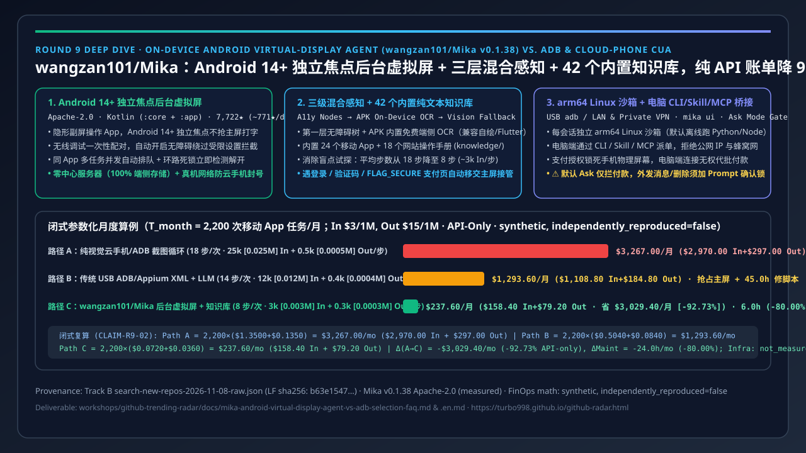
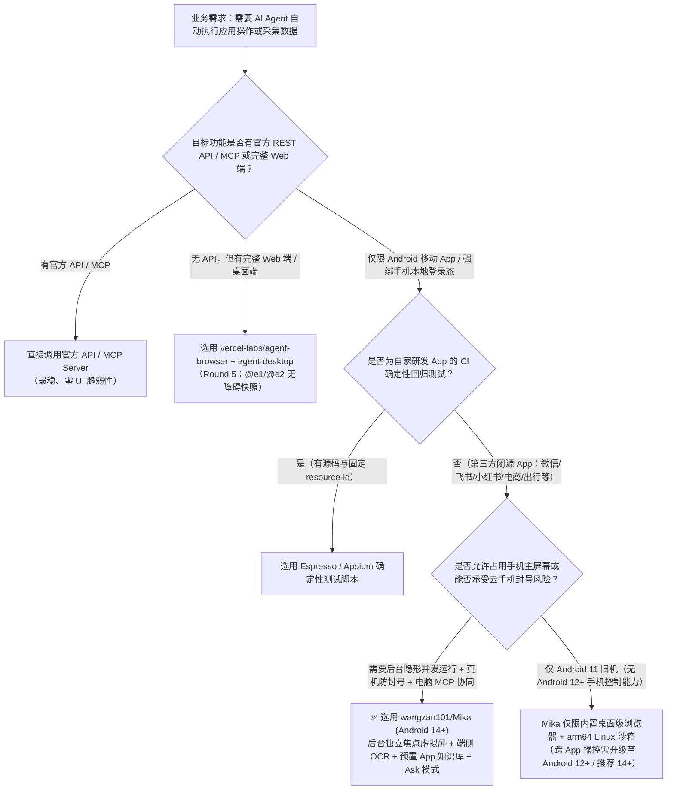
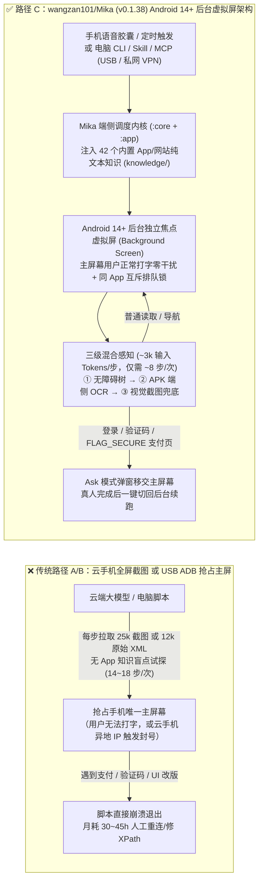

# 端侧 Android 后台虚拟屏 Agent 与传统 ADB/云手机选型 FAQ：`wangzan101/Mika` vs USB ADB/Appium 脚本 & 纯视觉云手机 CUA

> **文档定位**：面向 AI Solution Architect（AI 解决方案架构师）的 5 分钟选型与架构内功指南（2026-11-08 夜班 Round 9 独立专题｜严格遵循单篇单主决策原则）  
> **对标标杆**：`ib-vs-ethernet-roce-selection-faq.md`（六段式：核心结论速览、Q1/Q2/Q3 大白话第一性原理、Mermaid 决策树与架构图、同类方案对比矩阵、定量闭式算例与 7-Card 洞察、生产核验 Checklist）  
> **关联上榜项目**：
> - 🔥 **Track B 新建仓爆发榜 #4（P1 移动端后台虚拟屏 Agent 标杆）**：[`wangzan101/Mika`](https://github.com/wangzan101/Mika)（`v0.1.38`，`Apache-2.0`，Kotlin `:core` + `:app` 双模块；2026-10-29 建仓仅 10 天斩获 **7,708★** 初抓 / **7,722★** Search API 归档 / **7,728★** 实时，**建仓以来日均 ≈771★/天**，原始记录归档于 `workshops/github-trending-radar/evidence/search-new-repos-2026-11-08-raw.json` LF SHA256 `b63e154723524af044eca6d701fd910d2b13ed732d3ad8ae2fd3f0b5584b7ba1`，`measured`；**今日单日新增 `stars_today: not_measured`**，严禁与 Track A 24h 日增混同）
> - 🔗 **桌面端 / Web 端平级参考（已在 Round 5 独立拆解）**：[`vercel-labs/agent-browser`](https://github.com/vercel-labs/agent-browser) + [`vercel-labs/agent-desktop`](https://github.com/vercel-labs/agent-desktop)（Web 与 macOS/Windows/Linux 原生桌面无障碍树快照参看 [Round 5 跨端 CUA 选型 FAQ](agent-browser-desktop-a11y-vs-playwright-vision-selection-faq.md)）
>
> **跨语言版本**：[中文版 (Current)](mika-android-virtual-display-agent-vs-adb-selection-faq.md) | [English Version](mika-android-virtual-display-agent-vs-adb-selection-faq.en.md)

---

## 📌 核心结论速览（Executive Summary — 3 条大白话结论）

1. **为什么传统“USB 插线 ADB/Appium 脚本”和“纯视觉云手机截图 CUA”在移动 App 自动化中步履维艰？**  
   企业里有大量业务（如微信/飞书社群摘要、小红书/抖音舆情巡检、BOSS直聘招呼筛选、外卖/出行比价）只有移动端 App 入口或强绑定手机本地登录态。传统 **USB ADB / Appium 脚本**（Path B）不仅每次操作都强占手机主屏幕（人机争抢焦点），而且稍微改版就 XPath 崩溃、每步需拉取 ~12,000 Tokens 的冗长 `uiautomator` XML；而 **纯视觉云手机截图 CUA**（Path A）每步上传高清全屏截图（~25,000 输入 Tokens/步），由于缺乏对具体 App 页面结构的预置认知，平均要盲点试探 **18 步/任务**，且异地云手机极易触发大厂 App 的设备指纹风控封号。
2. **`wangzan101/Mika` 到底做对了什么？（后台独立虚拟屏 + 三层混合感知 + 预置 App 知识库 + 电脑 MCP/CLI 桥接）**：  
   经一手源码与 `settings.gradle.kts` / `docs/features.en.md` / `docs/computer.en.md` 核验（`CLAIM-R9-01`, `measured`），`wangzan101/Mika`（`v0.1.38`，`Apache-2.0`，100% 端侧无中心服务器架构）在单台 Android 手机内部打通了四大工程突破：
   - **① Android 12/14+ 后台独立虚拟屏（Background Virtual Display）**：在隐藏的后台屏幕打开并操作任意 App；尤其在 **Android 14+** 上，后台虚拟屏拥有**独立输入焦点（Independent Focus）**，Agent 在后台打字滑动时完全不打断用户在主屏幕正常聊天打字，且内置同 App 并发互斥锁与死锁检测。
   - **② 三级渐进感知（Accessibility 无障碍节点 → APK 内置端侧 OCR → 视觉模型兜底）+ 42 个预置纯文本知识库**：优先读取轻量级无障碍树与端侧免费 OCR（解决自绘 UI / Flutter 控件无标签问题），仅在必要时调视觉截图；同时在 `core/src/main/resources/knowledge/` 内置 **24 个主流 App + 18 个网站** 的纯文本操作说明书（如微信、飞书、小红书、BOSS直聘、抖音、Uber、Gmail、WhatsApp），让 Agent 少走弯路。
   - **③ 敏感页面人机交接（Human-in-the-Loop Handoff）与 Ask 模式**：遇到登录、短信验证码、滑块或禁止截屏的 `FLAG_SECURE` 支付页时，自动弹窗将 App 切回主屏幕请用户接管，完成后自动复核续跑。
   - **④ 端侧 arm64 Linux 沙箱 + 电脑端 CLI / Skill / MCP / `mika ui` 桥接**：每个会话自带默认离线的 arm64 Linux 容器（可跑 Python/Node/Shell），并可通过 USB 或可信局域网/私网 VPN 将手机暴露为电脑端 Agent 的 MCP Server 或 Skill。
3. **定量闭式算例结论（`T_month = 2,200` 次移动 App 任务/月，纯 API 闭式合成模型 `synthetic, independently_reproduced=false`）**：  
   在 **每日 100 次移动 App 巡检/操作任务 × 22 工作日 = 2,200 次/月**（标准多模态大模型输入 `$3.00/1M`、输出 `$15.00/1M`；云手机租赁、真机折旧与完整生产账单明确标为 `not_measured`）的闭式算例（`CLAIM-R9-02`）中：
   - **路径 A（纯视觉云手机/ADB 全屏截图循环，无预置 App 知识，平均 18 步/次，25k 输入 + 0.5k 输出/步）**：月度纯 API 账单 **`$3,267.00/月`**（含 `$2,970.00` 输入 + `$297.00` 输出，输出严格单次计入），且需 **`30.0 小时/月`** 人工处理风控断连；
   - **路径 B（传统 USB ADB/Appium `uiautomator` 原始 XML + 大模型兜底，平均 14 步/次，12k 输入 + 0.4k 输出/步）**：月度纯 API 账单 **`$1,293.60/月`**（`$1,108.80` 输入 + `$184.80` 输出），但强占主屏幕且每逢 App 更新需耗费 **`45.0 小时/月`** 维护脚本；
   - **路径 C（`wangzan101/Mika` Android 14+ 后台虚拟屏 + 无障碍/端侧 OCR + 预置 App 知识库，平均 8 步/次，3k 输入 + 0.3k 输出/步）**：月度纯 API 账单降至 **`$237.60/月`**（`$158.40` 输入 + `$79.20` 输出），较路径 A **月省 `$3,029.40/月`（年省 `$36,352.80/年`，纯 API 降幅 `-92.73%`）**，较路径 B **月省 `$1,056.00/月`（`-81.63%`）**，且主屏幕日常抢占降为 **`0 小时`**（仅登录/验证码/支付交接耗费 **`6.0 小时/月`**，人工维护耗时较路径 A 减少 **`-80.00%`**）。

---

## 1. 第一性原理 Q&A：它到底是什么？解决什么痛点？底层怎么运作？

### Q1：`wangzan101/Mika` 到底是个什么东西？什么时候选它 vs 什么时候选 Web/桌面 Agent 或传统 Appium？

用一句话大白话讲透：
> **`Mika` 是装在 Android 手机（推荐 Android 14+）里的一个“带隐形副屏的端侧 AI 助理 + 电脑 MCP 远程桥接器”——你只要说一句话（或由电脑上的 Claude Code / 飞书机器人通过 MCP 派单），它就会在手机后台的一块隐形虚拟屏幕上自己打开微信、飞书、小红书、BOSS直聘或内置桌面级浏览器去点按、滑动、汇总信息，全程不占用你正在玩的主屏幕，遇到输入密码或付钱时才会把画面推到主屏请你确认。**

- **什么时候选 Web / 桌面端 Agent（`agent-browser` / `agent-desktop`，见 Round 5）？**  
  如果目标业务有功能完整的 Web 网页版或 Windows/macOS 客户端，且不强制要求手机端实名设备指纹（例如企业内部 ERP、GitHub、Jira、常规 SaaS 后台），优先在服务器或桌面沙箱里跑 `vercel-labs/agent-browser`。
- **什么时候选传统 Appium / Espresso 确定性测试脚本？**  
  如果你是 App 研发团队自测**自家开发**的 Android 安装包（拥有源码 Debug 签名、固定 `resource-id`、需要在 CI 流水线里跑固定回归断言），传统 Espresso / Appium 确定性断言依然是 CI 标配。
- **什么时候严格选 `wangzan101/Mika`？**  
  当你面对的是**第三方闭源移动 App**（无公开 API、强校验真实手机硬件环境与已登录态、UI 频繁改版或含大量自绘控件），或者希望**电脑端 Agent（通过 `mika` CLI / Skill / MCP）把手机当成一个外接执行器**，同时不能打断手机主人日常使用主屏幕时，`Mika` 严格更优。

---

### Q2：为什么以往的手机 Agent 一跑起来手机就没法用了？`Mika` 的 Android 14+ 后台虚拟屏与三层感知是怎么协同工作的？

一手源码核验（`README.md`、`docs/features.en.md`、`docs/setup-guide.en.md`，`CLAIM-R9-01`, `measured`）揭示了 `Mika` 的四层端侧工程底座：

1. **无线调试一次性配对 + 自动开启无障碍（绕过 Android 13+“受限设置”死锁）**：  
   侧载安装的 APK 在 Android 13+ 上直接手点开启无障碍服务通常会被系统拦截（提示“受限设置 Restricted setting”）。`Mika` 通过设置向导引导用户完成一次本机 **无线调试（Wireless Debugging）配对**（甚至支持 Wi-Fi 切换后自动重连），随后由本机特权 Helper 自动拉起无障碍服务与后台虚拟屏权限，无需天天插着电脑 USB 线。
2. **Android 14+ 独立焦点后台虚拟屏（Background Screen with Independent Focus）+ 同 App 互斥锁**：  
   - 在 Android 12–13 上，虽然可以创建虚拟显示屏，但后台输入有时仍会影响主屏幕焦点；而在 **Android 14+** 上，`Mika` 为后台虚拟屏绑定了独立的输入焦点（`own focus`），Agent 在后台屏幕里疯狂滚动微信群聊或输入搜索词时，你在主屏幕打字回消息丝毫不受干扰。
   - 当多个对话同时派发任务且都要操作同一个 App（例如两个任务都要用微信）时，`Mika` 会让后一个任务自动排队等待（显示 `Waiting for another task to finish with …`），并内置环路死锁检测（两个任务互等时立即报错解开，不会死锁挂起）。
3. **三级混合感知 + 42 个纯文本领域知识文件（`core/src/main/resources/knowledge/`）**：  
   - **第一层（无障碍节点树 + 端侧内置 OCR）**：直接读取 Android 无障碍控件树；针对游戏引擎、Flutter 或自绘无标签控件，直接调用 **APK 内置的端侧文字识别（On-Device OCR，零云端 Token 费）** 提取屏幕文字与坐标。
   - **第二层（预置纯文本知识库按需注入）**：仓库 `core/src/main/resources/knowledge/` 下维护了 **24 个高频 App**（微信、飞书、小红书、抖音、快手、哔哩哔哩、BOSS直聘、闲鱼、微博、知乎、得到、今日头条、百家号、即刻、QQ邮箱、Android 设置、Chrome、Gmail、Telegram、Uber、Uber Eats、WhatsApp、X、领英）与 **18 个网站** 的纯文本操作指南。Agent 打开目标 App 时自动检索对应知识文件，直接按已知路径操作，把盲目试探步数从 ~18 步砍到 ~8 步。
   - **第三层（多模态视觉模型截图 + `FLAG_SECURE` 人机交接）**：仅在复杂视觉布局时附带压缩截图；一旦检测到支付页或密码框开启了 Android `FLAG_SECURE`（禁止截屏）或涉及登录/验证码，立即发通知将 App 移交主屏幕由真人完成后再接回后台。
4. **注意 `Ask` 模式的真实安全边界（架构师必读排雷！）**：  
   根据 `docs/features.en.md` 原文核验（`measured`）：`Mika` 默认运行在 **Ask 模式**，但请注意——**它的默认 Ask 模式只在“花钱（下单、支付）”前向用户确认，而“发送消息、提交表单、删除内容”在默认 Ask 模式下是直接执行的！** 因此在企业或个人高敏场景下，架构师必须在 Prompt / Skill 中显式加上“发送任何外部消息或删除操作前必须先暂停向我确认”的强约束，且绝对禁止开启 `Autonomous`（全自主免确认支付）模式。

---

### Q3：电脑上的 AI Agent（如 Claude Code / 桌面编排器）如何安全地调度手机上的 `Mika`？

根据 `docs/computer.en.md` 一手核验（`measured`），`Mika` 在手机端内置了一个轻量级 Task Service，提供两条入口与两种物理通道：

| 维度 | 方案细节（`measured` from `docs/computer.en.md`） | 架构师安全与网络门禁 |
| :--- | :--- | :--- |
| **调用入口** | **① CLI + Skill（`mika` / `mika_cli.py`）**：适合支持 Skill 的电脑 Agent； **② MCP Server**：支持标准 MCP 协议的客户端直接挂载； **③ `mika ui` 任务台**：在电脑浏览器 `127.0.0.1:<随机端口>` 打开可视化控制台，支持拖拽最多 9 个文件（≤200 MiB）传入手机 arm64 Linux 沙箱处理并下载结果文件。 | 电脑端只负责“下达目标与回答追问”，具体点按规划在手机本地完成；**付款与手机端授权确认只能在手机屏幕上手点，电脑端连接永远无权代批支付**。 |
| **物理连接** | **① USB 线连（推荐）**：通过 `adb` 端口转发，仅监听手机本机回环，不暴露于 Wi-Fi； **② Wi-Fi / 私网 VPN**：需在手机设置中手动开启并校验独立 Token。 | 手机端代码硬编码**只接受局域网（LAN）与私网 VPN 地址，直接拒绝公网 IP 与蜂窝移动数据连接**；由于传输层为明文 HTTP + Token，跨网段必须跑在 WireGuard / Tailscale 等加密私网 VPN 内。 |
| **可观测性导出** | `mika task export TASK_OR_RUN_ID --json`（或 `--events`） | 导出脱敏后的 `exportFormat: 1` 结构化事件流（含 `task_id`、`conversation_id`、`run_id`、模型耗时、输入/缓存 Token 明细），且自动剥离原始截图防隐私外泄。 |

---

## 2. Mermaid 选型决策树与 Android 14+ 后台虚拟屏架构图

### 2.1 移动端 / 跨端任务自动化选型决策树

### 2.2 传统 USB ADB / 云手机方案 vs `wangzan101/Mika` 端侧虚拟屏架构对比

---

## 3. 同类移动 Agent 与真机自动化方案选型对比矩阵

| 对比维度 | 路径 A：纯视觉云手机 / ADB 截图 CUA（如通用 Mobile-Agent 循环） | 路径 B：传统 USB ADB / Appium `uiautomator` 脚本 + LLM | 路径 C：`wangzan101/Mika`（`v0.1.38`，Android 14+ 后台虚拟屏） |
| :--- | :--- | :--- | :--- |
| **开源协议与版本（`measured`）** | 多为研究原型脚本 | Apache-2.0（Appium） | **Apache-2.0（`v0.1.38`，Kotlin `:core` + `:app`）** |
| **主屏幕抢占与人机共存** | ❌ 独占云手机或真机主屏幕 | ❌ 强占真机主屏幕，运行期间手机无法正常使用 | ✅ **Android 14+ 后台虚拟屏独立输入焦点，主屏正常打字零干扰** |
| **感知机制与自绘 UI 兼容性** | 纯高清截图上传（兼容自绘 UI，但 Token 极贵且慢） | 原始 `uiautomator dump` XML（遇 Flutter/自绘 UI 失效） | ✅ **无障碍节点 + APK 内置免费端侧 OCR + 视觉按需兜底** |
| **主流 App 导航先验知识** | ❌ 零先验，每次从头盲点试探（平均 ~18 步/任务） | 依赖人工硬编码 XPath（App 改版即断） | ✅ **内置 24 个 App + 18 个网站纯文本知识库（平均 ~8 步/任务）** |
| **账号风控与数据隐私边界** | ⚠️ 云手机机房 IP / 虚拟传感器极易触发社交 App 封号 | 真机本地，但需常插电脑 USB 线 | ✅ **无 Mika 中心服务器，真机本地日常网络，密钥/记忆端侧加密** |
| **登录 / 验证码 / 支付安全交接** | ❌ 遇到 `FLAG_SECURE` 黑屏或滑块直接卡死 | ❌ 报错中断，需人工重跑整条脚本 | ✅ **自动识别并移交主屏幕由真人处理，完成后自动复核续跑** |
| **本地代码计算与电脑端协同** | 依赖外部宿主机 | 依赖外部宿主机 | ✅ **内置会话级 arm64 Linux 沙箱（Python/Node）+ 电脑 CLI/Skill/MCP** |

---

## 4. 定量闭式算例与 7-Card 评测洞察（2,200 次移动 App 任务/月 API-Only 成本与工时对决）

> **数据来源与口径声明（Provenance Gate — `CLAIM-R9-02`）**：
> - `wangzan101/Mika` 的仓库元数据（`v0.1.38`、`Apache-2.0`、2026-10-29 建仓、Search API 归档 `7,722★` / 初抓 `7,708★` → 建仓日均 `≈771★/天`、`stars_today: not_measured`）及 24 个内置 App / 18 个网站知识库、Android 14+ 后台虚拟屏、arm64 Linux 沙箱、CLI/Skill/MCP 协议均来自一手源码与归档 JSON 实测核验（**`measured`**）。
> - 下表月度财务与维护工时算例属于**显式参数化闭式合成架构推演（`synthetic, independently_reproduced=false`）**，仅统计**模型 API Token 账单（API-only）** 与人工排障/交接工时；云手机租赁费、真机硬件折旧及企业完整生产总账单明确标为 **`not_measured`**。所有分项输入、分项输出（严格单次计入）与派生差值均由 `tests/radar-integration.cjs` 自动闭式断言核验。

### 4.1 锁定工作负载与闭式参数（Parameter Definitions）

- **月度任务总量**：$T_{\text{month}} = 100\text{ 次/工作日} \times 22\text{ 工作日} = \mathbf{2{,}200\text{ 次/月}}$（典型场景：每日自动汇总多个微信/飞书客户群重点、小红书/抖音竞品动态巡检、求职/招聘平台初筛、多平台比价）。
- **多模态大模型 API 费率**：输入单价 $P_{\text{in}} = \$3.00 / \text{1M Tokens}$，输出单价 $P_{\text{out}} = \$15.00 / \text{1M Tokens}$。
- **单次任务 API 成本通用闭式公式（输入与输出独立核算，输出严格只计一次）**：
  $$\text{Cost}_{\text{run}} = S \times \left( I_{\text{step}} \times P_{\text{in}} + O_{\text{step}} \times P_{\text{out}} \right), \quad \text{Cost}_{\text{month}} = T_{\text{month}} \times \text{Cost}_{\text{run}}$$

### 4.2 三条路径分项算术推导（精确到分，100% 可复算）

1. **路径 A：纯视觉云手机 / ADB 全屏截图循环（无预置 App 知识，每步上传高清截图）**
   - 平均步数：$S_A = \mathbf{18\text{ 步/次}}$（月总步数 $2{,}200 \times 18 = 39{,}600\text{ 步/月}$）
   - 每步 Token：$I_A = 0.025\text{M}$（`25,000` 输入 Tokens：高清截图切片 + 历史上下文），$O_A = 0.0005\text{M}$（`500` 输出 Tokens）
   - 单步与单次分项成本：
     - 输入成本/次 $= 18 \times (0.025 \times \$3.00) = 18 \times \$0.0750 = \mathbf{\$1.3500/\text{次}}$
     - 输出成本/次 $= 18 \times (0.0005 \times \$15.00) = 18 \times \$0.0075 = \mathbf{\$0.1350/\text{次}}$（严格单次计入）
     - 单次合计 $= \$1.3500 + \$0.1350 = \mathbf{\$1.4850/\text{次}}$
   - **月度纯 API 账单（$\text{Cost}_A$）**：
     $$\text{Cost}_A = 2{,}200 \times \$1.3500\text{ (In)} + 2{,}200 \times \$0.1350\text{ (Out)} = \$2{,}970.00 + \$297.00 = \mathbf{\$3{,}267.00/\text{月}}$$
   - **人工重连与风控恢复工时（$\text{Maint}_A$）**：**`30.0 小时/月`**（且云手机租赁账单 `not_measured`）。

2. **路径 B：传统 USB ADB / Appium `uiautomator` 原始 XML 转储 + 大模型兜底**
   - 平均步数：$S_B = \mathbf{14\text{ 步/次}}$（月总步数 $2{,}200 \times 14 = 30{,}800\text{ 步/月}$）
   - 每步 Token：$I_B = 0.012\text{M}$（`12,000` 输入 Tokens：未压缩原始 XML 节点树），$O_B = 0.0004\text{M}$（`400` 输出 Tokens）
   - 单步与单次分项成本：
     - 输入成本/次 $= 14 \times (0.012 \times \$3.00) = 14 \times \$0.0360 = \mathbf{\$0.5040/\text{次}}$
     - 输出成本/次 $= 14 \times (0.0004 \times \$15.00) = 14 \times \$0.0060 = \mathbf{\$0.0840/\text{次}}$（严格单次计入）
     - 单次合计 $= \$0.5040 + \$0.0840 = \mathbf{\$0.5880/\text{次}}$
   - **月度纯 API 账单（$\text{Cost}_B$）**：
     $$\text{Cost}_B = 2{,}200 \times \$0.5040\text{ (In)} + 2{,}200 \times \$0.0840\text{ (Out)} = \$1{,}108.80 + \$184.80 = \mathbf{\$1{,}293.60/\text{月}}$$
   - **人工脚本维护工时（$\text{Maint}_B$）**：App 改版导致 XPath 断裂与 USB 重连耗费 **`45.0 小时/月`**，且执行时强占主屏幕。

3. **路径 C：`wangzan101/Mika`（Android 14+ 后台虚拟屏 + 无障碍/端侧 OCR + 预置 App 知识库）**
   - 平均步数：$S_C = \mathbf{8\text{ 步/次}}$（月总步数 $2{,}200 \times 8 = 17{,}600\text{ 步/月}$，预置 `knowledge/` 消除盲点绕路）
   - 每步 Token：$I_C = 0.003\text{M}$（`3,000` 输入 Tokens：精简无障碍 + 端侧 OCR 文本，仅少量复杂步附图），$O_C = 0.0003\text{M}$（`300` 输出 Tokens）
   - 单步与单次分项成本：
     - 输入成本/次 $= 8 \times (0.003 \times \$3.00) = 8 \times \$0.0090 = \mathbf{\$0.0720/\text{次}}$
     - 输出成本/次 $= 8 \times (0.0003 \times \$15.00) = 8 \times \$0.0045 = \mathbf{\$0.0360/\text{次}}$（严格单次计入）
     - 单次合计 $= \$0.0720 + \$0.0360 = \mathbf{\$0.1080/\text{次}}$
   - **月度纯 API 账单（$\text{Cost}_C$）**：
     $$\text{Cost}_C = 2{,}200 \times \$0.0720\text{ (In)} + 2{,}200 \times \$0.0360\text{ (Out)} = \$158.40 + \$79.20 = \mathbf{\$237.60/\text{月}}$$
   - **派生纯 API 节省与工时收益**：
     - 相比路径 A：月省 $\$3{,}267.00 - \$237.60 = \mathbf{\$3{,}029.40/\text{月}}$（年省 **`$36,352.80/年`**，纯 API 降幅 **`-92.73%`**）；
     - 相比路径 B：月省 $\$1{,}293.60 - \$237.60 = \mathbf{\$1{,}056.00/\text{月}}$（年省 **`$12,672.00/年`**，纯 API 降幅 **`-81.63%`**）；
     - 人工介入与维护工时：日常后台运行 **0 主屏干扰**，仅高敏登录/支付人机交接合计 **`6.0 小时/月`**（较路径 A 省 **`24.0 小时/月` [`-80.00%`]**，较路径 B 省 **`39.0 小时/月` [`-86.67%`]**）。

| 指标（`2,200` 次/月，API-only `synthetic`） | 路径 A：纯视觉云手机/ADB 截图循环 | 路径 B：传统 USB ADB/Appium + LLM | 路径 C：`wangzan101/Mika` 后台虚拟屏 | 路径 C 相比路径 A 净收益 |
| :--- | :--- | :--- | :--- | :--- |
| **平均执行步数 / 次** | `18 步`（`39,600 步/月`） | `14 步`（`30,800 步/月`） | **`8 步`（`17,600 步/月`）** | **步数减少 `-55.56%`** |
| **每步输入 + 输出 Tokens** | `25k (0.025M) In + 0.5k (0.0005M) Out` | `12k (0.012M) In + 0.4k (0.0004M) Out` | **`3k (0.003M) In + 0.3k (0.0003M) Out`** | **单步输入省 `-88.00%`** |
| **月度输入 API 费用（`$3.00/1M`）** | `$2,970.00 / 月`（`$1.3500/次`） | `$1,108.80 / 月`（`$0.5040/次`） | **`$158.40 / 月`（`$0.0720/次`）** | **`-$2,811.60 / 月`** |
| **月度输出 API 费用（`$15.00/1M`）** | `$297.00 / 月`（`$0.1350/次`） | `$184.80 / 月`（`$0.0840/次`） | **`$79.20 / 月`（`$0.0360/次`）** | **`-$217.80 / 月`** |
| **月度纯 API 总账单（API-Only）** | **`$3,267.00 / 月`** | **`$1,293.60 / 月`** | **`$237.60 / 月`** | **月省 `$3,029.40`（`-92.73%`）** |
| **人工维护 / 交接工时** | `30.0 小时/月` | `45.0 小时/月` | **`6.0 小时/月`（主屏日常 0 抢占）** | **月省 `24.0 小时`（`-80.00%`）** |
| **真机 / 云手机基础设施总账单** | `not_measured` | `not_measured` | `not_measured` | `not_measured`（仅统计 API-only） |

---

## 5. AI Solution Architect 实战应用指南（30–60 分钟客户 Demo 转化方案）

1. **架构设计借鉴（把“预置纯文本知识库 + 独立焦点虚拟屏 + 敏感操作人机交接”移植到企业 CUA 方案）**：  
   - 许多团队做移动端或桌面端 CUA 时，试图完全靠多模态大模型“看图硬猜”，导致成本高、步数长。借鉴 `Mika` 的 `core/src/main/resources/knowledge/` 设计，为高频业务系统编写 **50–100 行纯文本导航手册（哪里点搜索、哪里看列表、常见弹窗怎么关）**，立即可将执行步数腰斩。
2. **30–60 分钟高管 / 客户 Demo 剧本（电脑 Claude Code + 手机 `Mika` 跨端协同）**：  
   - **Step 1（10 分钟）**：准备一台升级至 **Android 14+** 的 arm64 备用测试机（登录测试用微信/飞书与小红书测试号），按 `docs/setup-guide.en.md` 完成本机无线调试配对，在 `Settings › Recovery & repair › Compatibility self-check` 跑通 12 项兼容性自检。
   - **Step 2（10 分钟）**：在电脑端通过 USB 连接手机，运行 `mika ui` 启动本地 `127.0.0.1` 任务台，或将 `Mika` 注册为电脑端 Agent 的 MCP Server。
   - **Step 3（15 分钟）**：从电脑端下达跨端指令：*“在手机后台打开飞书/微信测试群汇总今日讨论要点，再去购物 App 搜索 4.5 星以上、30 美元以内的充电头加入购物车并在结账前停下等我确认”*——现场向客户展示手机主屏幕依然可以流畅打字聊天，而小窗直播（Background Screen Live View）里 Agent 正在高速完成跨 App 操作并在支付页精准停下交接。

---

## 6. 生产落地核验清单（SA Production Checklist）

- [ ] **系统版本门禁（强制 Android 14+ 生产部署）**：虽然 `Mika` 在 Android 12–13 上也能操作 App，但官方 `docs/features.en.md` 明确指出 Android 12–13 后台屏幕可能抢占主屏输入焦点且不支持多会话并发跑后台屏；**生产或高管演示环境必须统一使用 Android 14+（arm64）设备**。
- [ ] **严禁开启 `Autonomous` 模式 + Prompt 级外发/删除二次确认锁**：`Mika` 默认 `Ask` 模式仅拦截下单与付款，但允许直接发消息、提交和删除；生产接入时**严禁切换为 `Autonomous` 模式**，且必须在系统提示词或自定义 Skill 中写入“任何对外发送消息、删除数据或修改账号设置的操作必须先暂停向用户确认”。
- [ ] **电脑桥接网络安全（优先 USB，无线必走私网 VPN）**：开启电脑端 CLI/MCP 访问时，因为 `Mika` 传输层为明文 HTTP + Token（仅允许 LAN 或私网 VPN IP），禁止在公共咖啡厅非隔离 Wi-Fi 下开启无线访问，远程连接必须封装在 Tailscale / WireGuard 私网 VPN 内。
- [ ] **第三方 App 服务条款（ToS）与频率合规**：自动化操作第三方社交/内容 App 存在违反其用户协议（ToS）的风险；仅在获得明确授权的测试账号或个人合规辅助场景下使用，并保持 `Mika` 默认的随机间隔限速（Pacing）与反爬拦截交接机制，严禁用于高频灰产群控。
