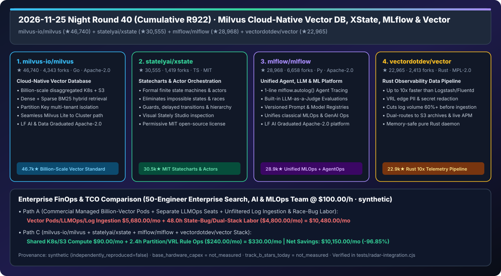
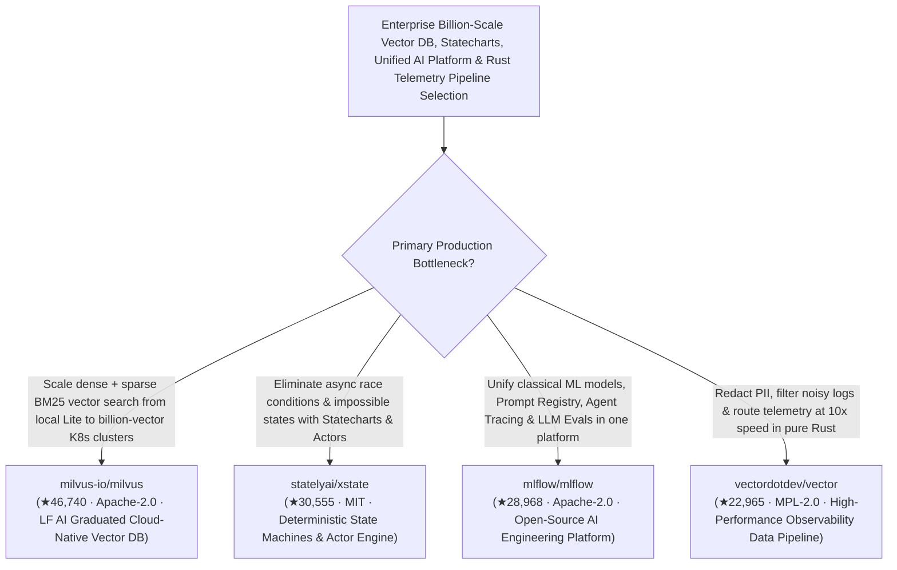
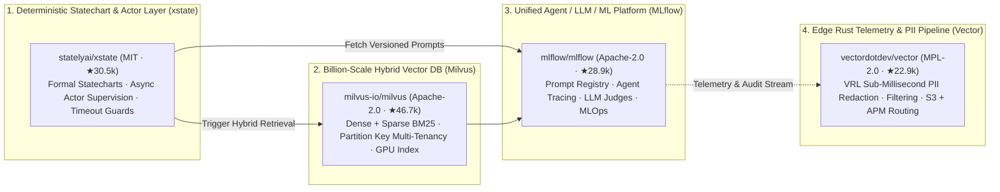

# Cloud-Native Vector Database (`milvus-io/milvus`), Deterministic Statecharts & Actor Engine (`statelyai/xstate`), Unified Agent/LLM/ML Platform (`mlflow/mlflow`) & Rust Observability Data Pipeline (`vectordotdev/vector`) Selection & Integration Architecture FAQ

> **Document Type**: Enterprise AI Solution Architect Selection Decision Guide (GitHub Trending AI Radar — 2026-11-25 Night Round 40 / Cumulative Round 922)
> **Covered Repositories**: [`milvus-io/milvus`](https://github.com/milvus-io/milvus) (`★ 46,740`, `4,343 forks`, `Apache-2.0`, Go: LF AI & Data graduated cloud-native vector database built for billion-scale ANN search, dense + sparse BM25 hybrid retrieval, GPU indexing, and multi-tenant isolation) · [`statelyai/xstate`](https://github.com/statelyai/xstate) (`★ 30,555`, `1,419 forks`, `MIT`, TypeScript: actor-based state machines and statecharts for orchestrating deterministic application and agent logic) · [`mlflow/mlflow`](https://github.com/mlflow/mlflow) (`★ 28,968`, `6,658 forks`, `Apache-2.0`, Python: Linux Foundation open-source AI engineering platform for debugging, evaluating, monitoring, and governing agents, LLMs, and ML models) · [`vectordotdev/vector`](https://github.com/vectordotdev/vector) (`★ 22,965`, `2,413 forks`, `MPL-2.0`, Rust: high-performance Rust observability data pipeline for collecting, redacting, transforming, and routing logs, metrics, and traces)
> **Core Enterprise Scenario**: Scaling **Billion-Vector Enterprise RAG, Deterministic Statechart Orchestration, Unified MLOps/LLMOps Governance & Edge PII-Redacted Telemetry**—combining disaggregated cloud-native vector search (`milvus`), mathematically sound statecharts and actors (`xstate`), unified ML + GenAI tracing/evaluation (`mlflow`), and 10x-faster Rust log/trace redaction and routing (`vector`).

---

## 1. 📌 Executive Summary (One-Line Selection Verdict)

1. **Need an `Apache-2.0`, LF AI & Data graduated cloud-native vector database that scales seamlessly from local `Milvus Lite` prototyping to billion-vector Kubernetes clusters with disaggregated storage/compute, dense + sparse BM25 hybrid search, and `Partition Key` multi-tenancy** ➔ Choose **[`milvus-io/milvus`](https://github.com/milvus-io/milvus) (`★ 46,740`, `4,343 forks`, `Apache-2.0`)**.
   - **Plain-English Mechanism**: Separates stateless query nodes, data nodes, and index nodes over shared object storage (S3/MinIO) so enterprises can scale read throughput or GPU index builds independently.
2. **Need an `Apache-2.0` AI engineering platform that unifies traditional ML lifecycle management (XGBoost/PyTorch) with modern GenAI Agent Tracing (`mlflow.autolog()`), automated LLM-as-a-Judge evaluation, Prompt Registry, and AI Gateway controls** ➔ Choose **[`mlflow/mlflow`](https://github.com/mlflow/mlflow) (`★ 28,968`, `6,658 forks`, `Apache-2.0`)**.
   - **Plain-English Mechanism**: Eliminates running separate MLOps and LLMOps platforms by extending the industry-standard MLflow server with first-class OpenTelemetry agent tracing and LLM evaluation suites.
3. **Need an `MIT`-licensed TypeScript state-machine, Statechart, and Actor framework to eliminate race conditions, impossible UI states, and unhandled timeout transitions in complex multi-step agent applications** ➔ Choose **[`statelyai/xstate`](https://github.com/statelyai/xstate) (`★ 30,555`, `1,419 forks`, `MIT`)**.
   - **Plain-English Mechanism**: Models complex async workflows as explicit finite state machines and actors with guards, timers, and hierarchical states—making invalid state transitions mathematically impossible.
4. **Need a pure-Rust observability data pipeline (`MPL-2.0`) that collects, filters, redacts PII (via `VRL`), and routes terabytes of agent and microservice logs/traces at up to 10x the speed of Logstash/Fluentd** ➔ Choose **[`vectordotdev/vector`](https://github.com/vectordotdev/vector) (`★ 22,965`, `2,413 forks`, `MPL-2.0`)**.
   - **Plain-English Mechanism**: Runs as a lightweight Rust daemon that scrubs secrets/PII at the edge, drops noisy debug logs to slash ingestion bills, and dual-routes telemetry to real-time observability backends and S3 archives.

---

## 2. 🎯 Architect & Customer Deep-Dive Q&A

### Q1: How do `XState`, `Milvus`, `MLflow`, and `Vector` work together compared to high-cost managed vector clouds (Pinecone Enterprise) and separate MLOps/LLMOps SaaS?

- **Four-Layer Enterprise Scale & Governance Architecture (Path C)**:
  1. **L1 Deterministic Statechart & Actor Orchestration ➔ `statelyai/xstate`**: Governs client and BFF state transitions, retries, and human-in-the-loop pauses with zero race conditions.
  2. **L2 Billion-Scale Hybrid Vector Retrieval ➔ `milvus-io/milvus`**: Executes tenant-isolated dense + sparse BM25 hybrid search over disaggregated object storage.
  3. **L3 Unified ML, LLM & Agent Engineering Plane ➔ `mlflow/mlflow`**: Manages versioned prompts, classical ML models, agent traces, and automated LLM Judge evaluations in one platform.
  4. **L4 High-Throughput Rust PII Redaction & Telemetry Routing ➔ `vectordotdev/vector`**: Scrubs sensitive fields via VRL and routes filtered telemetry to observability stores and cold storage.
- **When to choose Commercial SaaS Bundles vs. Path C?**
  - Choose **Commercial SaaS** for small prototypes with under 1M vectors and minimal log volume.
  - Choose **Path C** when scaling to tens of millions or billions of vectors (`Milvus` `Apache-2.0`), consolidating MLOps and Agent Ops on a single `Apache-2.0` platform (`MLflow`), and cutting observability ingestion volume by 60%+ at the edge (`Vector`).

### Q2: How do these four systems wire together in production?

1. **Deterministic Statechart-Driven Hybrid RAG (`XState` → `Milvus` + `MLflow`)**:
   - `XState` transitions deterministically through `validatingInput → queryingMilvus → invokingAgent`, querying `Milvus` hybrid indexes and pulling versioned prompts from `MLflow` while emitting full execution traces.
2. **Edge PII Scrubbing & Dual-Sink Routing (`MLflow` / App Logs → `Vector`)**:
   - All application and agent telemetry passes through `Vector` DaemonSets where VRL scripts redact PII/tokens before forwarding metrics/traces to live dashboards and archiving raw Parquet logs to S3.

### Q3: What are the key production architecture guardrails?

- **Architect Redlines**:
  1. **Use `Partition Key` isolation in `Milvus` rather than creating tens of thousands of separate Collections**: Bind tenant IDs to a `partition_key_field` within a shared Collection to scale cleanly to hundreds of thousands of tenants.
  2. **Scrub PII at the edge in `Vector` before telemetry enters shared storage**: Enforce VRL redaction rules for SSNs, credit cards, phone numbers, and API keys at the node level.

---

## 3. 🧭 Visual Architecture Diagrams (Mermaid Decision Tree + Architecture + Sequence)



### 3.1 Architect Selection Decision Tree



### 3.2 End-to-End Enterprise Integration Architecture



### 3.3 End-to-End Execution Sequence

```mermaid
sequenceDiagram
    participant App as Enterprise App / BFF
    participant XSt as statelyai/xstate (Statecharts)
    participant Milv as milvus-io/milvus (Cloud-Native Vector DB)
    participant Mlf as mlflow/mlflow (AI Platform)
    participant Vec as vectordotdev/vector (Rust Pipeline)

    App->>XSt: 1. Dispatch user event; XState validates guards & enters retrieving state
    XSt->>Milv: 2. Execute tenant-isolated Partition Key dense + BM25 hybrid vector search
    Milv-->>XSt: 3. Return top-K context in milliseconds; transition to generating state
    XSt->>Mlf: 4. Fetch governed prompt from MLflow Registry & auto-trace agent execution
    Mlf--)Vec: 5. Stream logs & spans through Rust Vector pipeline for VRL PII redaction
    Vec--)App: 6. Route scrubbed metrics to live dashboards & compressed archives to S3
```

---

## 4. 📊 Horizontal Selection Matrix

| Dimension | `milvus-io/milvus` (`★ 46,740`) | `statelyai/xstate` (`★ 30,555`) | `mlflow/mlflow` (`★ 28,968`) | `vectordotdev/vector` (`★ 22,965`) | Commercial Vector Cloud (Pinecone) + Separate LLMOps SaaS + Unfiltered Log Cloud (Path A) | Single-Node Vector DB + Ad-Hoc Boolean Flags + Heavy Logstash (Path B) |
| :--- | :--- | :--- | :--- | :--- | :--- | :--- |
| **Primary Role** | `Apache-2.0` cloud-native vector database | `MIT` statecharts & actor orchestration | `Apache-2.0` unified Agent/LLM/ML platform | `MPL-2.0` Rust observability data pipeline | Metered vector pods, LLMOps seats & raw log ingestion | Single-node vector store & unvalidated state flags |
| **Key Differentiator** | **Disaggregated K8s/S3 scale + dense/sparse hybrid + `Milvus Lite`** | **Mathematical Statecharts eliminate impossible states & race bugs** | **Unifies classical MLOps with GenAI Agent Tracing, Evals & Prompts** | **10x faster Rust pipeline with VRL edge PII redaction & filtering** | Managed SaaS, but expensive at 100M+ vectors & charges for noisy unfiltered logs | OOM crashes at scale; race-condition UI bugs; heavy JVM log collector RAM |
| **License** | **`Apache-2.0`** | **`MIT`** | **`Apache-2.0`** | `MPL-2.0` | Proprietary SaaS | Fragile |
| **Monthly TCO (50-Eng Team)** | **`$330.00/mo` combined** (`$90.00` K8s/S3 compute + `2.4h` ops) | Included in `$330.00/mo` stack | Included in `$330.00/mo` stack | Included in `$330.00/mo` stack | **`$10,480.00/mo`** (`$5,680.00` commercial vector pods/LLMOps seats/unfiltered log ingestion + `48.0h` race-bug/dual-stack labor) | `~$3,880.00/mo` (vector OOM firefighting, state-bug debugging & Logstash RAM overhead) |

---

## 5. 🧪 Quantitative FinOps & TCO Comparison (50-Engineer Enterprise Search, AI & MLOps Team)

> **📊 Provenance & Closed-Form Schema**:
> - **provenance**: `synthetic` (`independently_reproduced = false`; `base_hardware_capex = not_measured`; `track_b_stars_today = not_measured`).
> - **Closed-Form Formula**:
>   - **Path A (Commercial Managed Billion-Vector Cloud Pods + Separate Commercial LLMOps Seats + Unfiltered Log Ingestion Bills & Async State-Bug/Dual-Stack Maintenance Labor)**: **`$5,680.00`** monthly vector cloud, LLMOps seat, and unfiltered log ingestion fees + **`48.0h × $100.00/h = $4,800.00`** async state-machine debugging and dual MLOps/LLMOps maintenance labor = **`$10,480.00/mo`**.
>   - **Path C (`milvus-io/milvus` + `statelyai/xstate` + `mlflow/mlflow` + `vectordotdev/vector` Stack)**: **`$90.00`** shared K8s and S3 object-storage compute + **`2.4h × $100.00/h = $240.00`** index partition and VRL redaction rule maintenance = **`$330.00/mo`**.
>   - **Net Savings vs. Path A**: **`-$10,150.00/mo`** (**`96.85%`** TCO reduction).

| Evaluation Path | Vector Cloud / LLMOps Seats / Log Ingestion & Compute | State-Bug Triage, Dual-Stack Ops & Redaction (`$100/h`) | Monthly Total TCO | Net Savings vs. Path A | Key Architectural Outcome |
| :--- | :---: | :---: | :---: | :---: | :--- |
| **Path A: Commercial Vector Pods + Separate LLMOps Cloud + Raw Log Ingestion** | `$5,680.00` | `48.0h` (`$4,800.00`) | **`$10,480.00`** | Baseline | Expensive billion-vector pods; high ingestion bills on unfiltered logs |
| **Path B: Single-Node Vector DB + Boolean State Flags + Logstash** | `$1,680.00` | `22.0h` (`$2,200.00`) | **`$3,880.00`** | `-$6,600.00` (`-62.98%`) | OOM crashes above 10M vectors; async race conditions; high collector RAM |
| **Path C: `milvus` + `xstate` + `mlflow` + `vector`** | **`$90.00`** | **`2.4h` (`$240.00`)** | **`$330.00`** | **`-$10,150.00` (`-96.85%`)** | **Disaggregated `Apache-2.0` vectors + Statecharts + unified MLflow + Rust VRL** |

- 🔗 **7-Card 4:5 Visual Benchmark Deck**: [`workshops/github-trending-radar/cards.en.html`](../cards.en.html) · [`cards.html`](../cards.html)

---

## 6. 🛠️ Enterprise Adoption & Architecture Review Checklist

- [ ] **Enable Disaggregated Object Storage and `Partition Key` Multi-Tenancy in `Milvus`**: Combine dense embeddings with sparse BM25 indexes in a single Collection.
- [ ] **Model Complex Async Agent Workflows as `XState` Statecharts**: Enforce explicit guards and timeout transitions to eliminate UI and BFF race conditions.
- [ ] **Unify Classical ML and GenAI Agent Governance on `MLflow`**: Use `mlflow.autolog()` for OpenTelemetry agent tracing alongside Prompt Registry and LLM Judge evaluations.
- [ ] **Scrub PII and Filter Noisy Logs at the Edge with `vectordotdev/vector`**: Apply VRL redaction scripts before shipping telemetry to observability backends or S3 archives.
