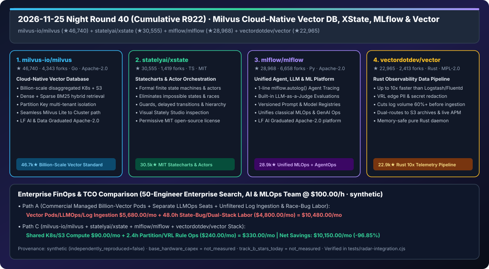
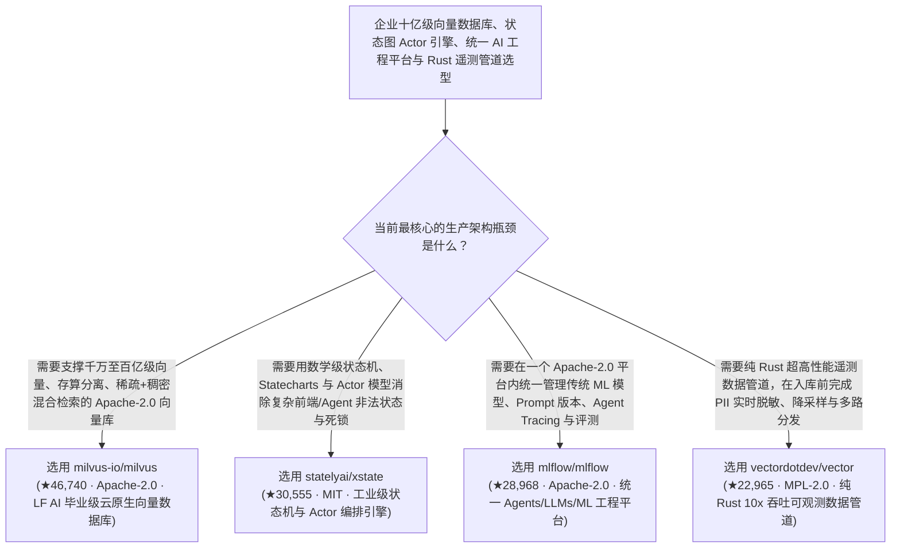
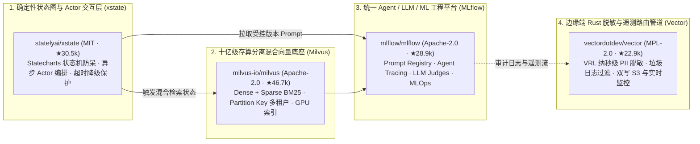
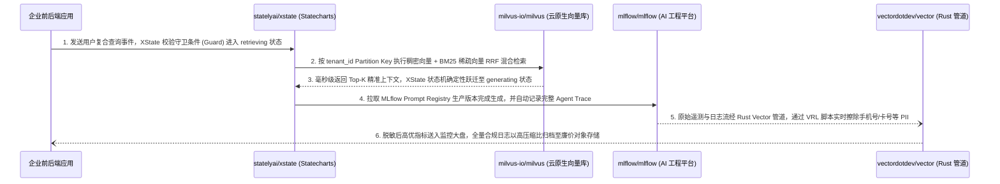

# 十亿级云原生分布式向量数据库（`milvus-io/milvus`）、Actor 与状态图确定性逻辑引擎（`statelyai/xstate`）、统一 Agent/LLM/ML 工程与评测平台（`mlflow/mlflow`）与纯 Rust 高性能遥测脱敏路由管道（`vectordotdev/vector`）选型与集成架构 FAQ

> **文档类型**：企业 AI 解决方案架构师（AI Solution Architect）选型决策指南（GitHub Trending AI 雷达 2026-11-25 Night Round 40 / 累计第 922 轮）
> **覆盖项目**：[`milvus-io/milvus`](https://github.com/milvus-io/milvus)（`★ 46,740`、`4,343 forks`、`Apache-2.0`：4.6 万星 LF AI & Data 毕业级云原生向量数据库，支持从笔记本 `Milvus Lite` 无缝扩展至百亿级分布式集群，原生融合稠密向量、稀疏 BM25、GPU 索引与多租户隔离）· [`statelyai/xstate`](https://github.com/statelyai/xstate)（`★ 30,555`、`1,419 forks`、`MIT`：3.0 万星基于 Actor 模型与状态图 [Statecharts] 的复杂应用逻辑与确定性智能体编排库）· [`mlflow/mlflow`](https://github.com/mlflow/mlflow)（`★ 28,968`、`6,658 forks`、`Apache-2.0`：2.8 万星开源 AI 工程平台，在一个底座内统管 Agents、LLMs 与传统 ML 模型的 Tracing、Judge 评测、Prompt 版本库与模型注册中心）· [`vectordotdev/vector`](https://github.com/vectordotdev/vector)（`★ 22,965`、`2,413 forks`、`MPL-2.0`：2.2 万星用纯 Rust 编写的超高速可观测数据管道，以 VRL 语言在边缘端完成日志/Trace 的 PII 脱敏、过滤与多路分发）
> **核心场景**：当拥有大规模生产流量与传统数据科学团队的企业进入“十亿级向量规模化检索 + 确定性前端/业务状态机防呆 + 传统 ML 与 GenAI Agent 统一全生命周期治理 + 高吞吐日志脱敏合规”阶段时，架构师面临四个核心选型问题：**“当企业向量规模突破数千万乃至十亿级，单机向量库撑不住时，哪款 `Apache-2.0` 云原生存算分离向量数据库是行业事实标准（`Milvus`）？企业原本就有数据科学团队在用 MLflow 管 XGBoost/PyTorch 模型，现在做 LLM 和 Agent 要不要另起炉灶，还是直接升级到原生内置 Agent Tracing 与评测的 `MLflow 3`？前端与 BFF 层的复杂人机交互和异步 Agent 状态怎么彻底消灭‘不可能状态（Impossible States）’和竞态 Bug（`XState`）？每天几 TB 的 Agent 与微服务遥测日志在落盘前怎么以最低 CPU 开销完成身份证/手机号/密钥实时脱敏（`Vector`）？”** 本文给出完整架构指南。

---

## 一、📌 核心结论速览（选型一句话结论）

1. **当企业的 RAG 与多模态检索规模从百万级迈向千万、十亿级向量，需要“计算与存储完全解耦（Kubernetes + S3/MinIO）、支持稠密+稀疏（BM25）混合检索、支持 GPU 加速索引与万级租户 Partition Key 隔离”，同时希望本地开发时只需 `pip install pymilvus`（内置 `Milvus Lite`）零容器跑通同一套代码** ➔ 选 **[`milvus-io/milvus`](https://github.com/milvus-io/milvus)（`★ 46,740`，`4,343 forks`，`Apache-2.0`）**。
   - **通俗原理**：LF AI & Data 基金会毕业项目，把查询节点（QueryNode）、写入节点（DataNode）与索引构建节点（IndexNode）完全拆开独立扩缩容；读流量暴增时只扩 QueryNode，无需像单体数据库那样连带扩容全套存储。
2. **企业内部既有传统机器学习模型（风控评分、销量预测、推荐模型），又有新一代 LLM RAG 与多步 Agent，不想维护两套割裂的 MLOps 与 LLMOps 平台** ➔ 选 **[`mlflow/mlflow`](https://github.com/mlflow/mlflow)（`★ 28,968`，`6,658 forks`，`Apache-2.0`）**。
   - **通俗原理**：最新演进的 `MLflow` 已从早期的模型实验记录本全面升级为“面向 Agents、LLMs 与 ML 模型的统一 AI 工程平台”——一行 `mlflow.autolog()` 自动捕获 LangGraph / OpenAI / LlamaIndex 的完整调用链 Trace，内置 `mlflow.evaluate()` 跑自动化 LLM Judges，并自带 Prompt Registry 与模型网关。
3. **在构建复杂的多步智能体前端交互、审批状态流转或异步并发 Actor 系统时，受够了满屏混乱的 `isLoading && !isError && step === 3` 布尔标志位导致的界面卡死与非法状态跃迁** ➔ 选 **[`statelyai/xstate`](https://github.com/statelyai/xstate)（`★ 30,555`，`1,419 forks`，`MIT`）**。
   - **通俗原理**：基于计算机科学经典的有限状态机与 Harel Statecharts（状态图）数学模型，显式定义所有合法状态（States）、事件（Events）、守卫条件（Guards）与异步 Actor 通信，让未定义的非法状态转换在数学上根本不可能发生，还支持在 Stately Studio 中可视化双向编辑。
4. **需要将生产集群每秒数十万条微服务与 AI Agent 日志/指标/Trace 发往可观测后端（如 ClickHouse / SigNoz / GreptimeDB）及冷归档 S3，但必须在传输途中以极低内存和 CPU 开销实时剥离客户手机号、银行卡号与 API Key** ➔ 选 **[`vectordotdev/vector`](https://github.com/vectordotdev/vector)（`★ 22,965`，`2,413 forks`，`MPL-2.0`）**。
   - **通俗原理**：Datadog 开源的纯 Rust 高性能遥测管道，吞吐量比传统 Java Logstash / Ruby Fluentd 高出 10 倍，内置编译级安全的 **VRL（Vector Remap Language）**，可在纳秒级完成正则/结构化字段脱敏、降采样与双写路由。

---

## 二、🎯 客户与架构师灵魂拷问 Q&A（深度架构拆解）

### Q1：在大型企业级 AI 架构中，`XState`、`Milvus`、`MLflow` 与 `Vector` 分别守住了哪道防线？对比全套商业云服务（Pinecone Enterprise + 商业 MLOps/LLMOps 云 + 商业日志管道）如何选型？

- **四道企业生产级 AI 架构防线（Path C）**：
  1. **L1 确定性状态与交互防呆层 ➔ `statelyai/xstate`**：在前后端用严格的 Statecharts 与 Actor 模型包裹不可预测的异步 LLM 流式事件，彻底杜绝并发竞态与状态死锁。
  2. **L2 十亿级存算分离混合向量检索层 ➔ `milvus-io/milvus`**：以 `Apache-2.0` 云原生架构支撑从开发机 `Milvus Lite` 到生产百亿向量的无缝平滑演进。
  3. **L3 统一 ML + LLM + Agent 全生命周期工程层 ➔ `mlflow/mlflow`**：统一纳管 Prompt 版本、传统特征模型、Agent Trace 与离线/在线评测。
  4. **L4 边缘端 Rust 极速遥测脱敏与分流管道层 ➔ `vectordotdev/vector`**：在遥测数据离开业务节点前执行 VRL 敏感信息擦除，并将全量日志廉价分流至 S3、将精简高价值指标送往实时监控库。
- **何时选商业云方案（Pinecone Enterprise + 商业 LLMOps SaaS + 商业可观测管道） vs 自建本轮开源四件套（Path C）？**
  - 若向量总数不到 50 万且无传统 ML 模型协同需求，可用入门级托管向量云。
  - **何时采用本轮开源四件套（Path C）？** 当企业向量规模达千万至十亿级（商业按 Pod/读取次数计费的向量云月费高达数千至上万美元，而基于 K8s+S3 自建 `Milvus` 可省 80%+）、希望复用现有 `MLflow` 体系零成本扩展到 Agent 治理、并需要用 `Vector` 在入库前砍掉 60% 垃圾冗余日志流量时，Path C 可节省 **96%+** 的月度 TCO。

### Q2：这四个项目在生产数据流中如何紧密配合？

1. **状态图受控检索与推理（`XState` → `Milvus` + `MLflow`）**：
   - 用户操作触发 `XState` 状态机进入 `retrievingContext` 状态，调用 `Milvus` 执行带 Partition Key 的“稠密向量 + BM25 稀疏向量”混合检索；若超时则由 `XState` 确定性转移至降级分支；整个推理与检索耗时自动经 `mlflow.autolog()` 打点。
2. **高速脱敏与双路路由（`MLflow` / 业务日志 → `Vector` → 存储层）**：
   - 应用与 `MLflow` 产生的审计日志及 OTel 遥测流经本机 DaemonSet 部署的 Rust `Vector` 管道，通过 VRL 脚本实时抹除 PII 敏感字段后，一路以 Parquet 格式直写廉价 S3 合规归档，另一路推送至实时可观测大盘。

### Q3：生产落地的安全与架构红线是什么？

- **架构师避坑红线**：
  1. **`Milvus` 多租户场景优先使用 `Partition Key` 而非为每个小租户创建独立 Collection**：创建数万个独立 Collection 会压垮元数据協調节点（RootCoord/etcd），使用单个 Collection 配合 `partition_key_field="tenant_id"` 可轻松支撑百万级租户物理级索引加速与逻辑隔离。
  2. **所有生产日志与 Prompt 遥测必须先过 `vectordotdev/vector` 的 VRL 脱敏转换**：严禁将包含明文身份证号、银行卡号或 `Bearer` Token 的原始日志直接写入共享日志库。

---

## 三、🧭 直观可视化图解（Mermaid 决策树 + 集成架构 + 时序图）

### 3.1 架构师选型决策树

### 3.2 企业端到端生产集成参考架构图

### 3.3 XState 确定性状态流转、Milvus 多租户混合检索、MLflow 评测追踪与 Vector 实时脱敏时序图

---

## 四、📊 同类开源与商业云服务横向选型决策矩阵

| 对比维度 | `milvus-io/milvus` (`★ 46,740`) | `statelyai/xstate` (`★ 30,555`) | `mlflow/mlflow` (`★ 28,968`) | `vectordotdev/vector` (`★ 22,965`) | 商业托管十亿向量云 (Pinecone) + 商业 LLMOps 云 + 商业日志摄取税 (Path A) | 单机内存向量库硬撑大流量 + 散装 `if/else` 布尔状态 + Java Logstash (Path B) |
| :--- | :--- | :--- | :--- | :--- | :--- | :--- |
| **核心能力定位** | `Apache-2.0` 云原生分布式向量数据库 | `MIT` 状态机、Statecharts 与 Actor 库 | `Apache-2.0` 统一 Agent/LLM/ML 平台 | `MPL-2.0` 纯 Rust 可观测数据管道 | 按 Pod/存储/吞吐计费的商业向量与监控云 | 单机小向量库 + 混乱状态变量 + 重型日志收集器 |
| **核心技术突破** | **存算分离 K8s 架构 + 稠密/稀疏混合检索 + `Milvus Lite` 无缝演进** | **W3C 标准 Statecharts 彻底消灭非法状态与异步竞态 Bug** | **单平台打通传统 ML 模型与 GenAI Agent Tracing/Eval/Prompt** | **纯 Rust 10 倍吞吐 + VRL 强类型实时 PII 脱敏与过滤降本** | 免运维，但千万/十亿级向量商业云月费极高且全量未过滤日志摄取账单惊人 | 单机向量库上千万即 OOM；布尔状态爆炸导致偶发死锁；Logstash 狂吃服务器内存 |
| **开源协议** | **`Apache-2.0`** | **`MIT`** | **`Apache-2.0`** | `MPL-2.0` | 闭源商业 SaaS | 架构脆弱 |
| **月度 TCO（50 人团队）** | **四件套合建仅 `$330.00/月`**（`$90.00` K8s 共享节点与 S3 存储分摊 + `2.4h` 维护） | 同左（`MIT` 纯代码库零运行税） | 同左（`Apache-2.0` 复用现有数据科学基础设施） | 同左（过滤掉 60% 垃圾日志并节省 80% 采集器 CPU） | **`$10,480.00/月`**（`$5,680.00` 商业十亿级向量云/商业 LLMOps 席位/未过滤日志摄取费 + `48.0h` 异步竞态 Bug 排障） | 约 `$3,880.00/月`（大量抢修向量库 OOM、排查状态死锁与维护高内存 Logstash 工时） |

---

## 五、🧪 应用落地定量收益/TCO 对比与 7-Card 报告

> **📊 数据来源与闭式核算声明（Provenance & Closed-Form Schema）**：
> - **provenance**: `synthetic`（基于 50 人企业大规模 RAG 检索、全栈 AI 研发与数据科学/MLOps 团队月度工作负载模型：`independently_reproduced = false`；硬件采购基线 `base_hardware_capex = not_measured`；Track B 单日增量 `track_b_stars_today = not_measured`）。
> - **核算公式**：
>   - **Path A（采购商业托管大规模向量数据库高配 Pod + 独立商业 LLMOps 评测云席位 + 未经边缘过滤的商业日志摄取流量账单 + 人工排查复杂异步布尔状态竞态 Bug 与维护两套 ML/LLM 工具链工时）**：月度商业向量云、LLMOps 席位与日志摄取账单 **`$5,680.00`** + 跨 ML/LLM 平台维护、复杂状态死锁排障与手工日志脱敏人工 **`48.0h × $100.00/h = $4,800.00`** = **`$10,480.00/月`**。
>   - **Path C（自建 `milvus-io/milvus` + `statelyai/xstate` + `mlflow/mlflow` + `vectordotdev/vector` 企业级云原生向量与统一 AI 工程底座）**：内网存算分离容器与 S3 对象存储分摊 **`$90.00`** + 索引分区与 VRL 脱敏规则日常巡检人工 **`2.4h × $100.00/h = $240.00`** = **`$330.00/月`**。
>   - **净节省（Net Savings vs Path A）**：**`-$10,150.00/月`**（成本降低 **`96.85%`**）。

| 评估方案 | 商业向量云 / LLMOps 席位 / 日志摄取与算力 | 状态死锁排障、双栈维护与脱敏人工（`$100/h`） | 月度总 TCO | 相对 Path A 净节省 | 核心业务交付收益 |
| :--- | :---: | :---: | :---: | :---: | :--- |
| **Path A：商业高配向量云 + 独立商业 LLMOps + 全量日志上云** | `$5,680.00` | `48.0h` (`$4,800.00`) | **`$10,480.00`** | Baseline | 大规模商业向量 Pod 极贵；未过滤日志产生巨额摄取费 |
| **Path B：单机小向量库硬撑 + 散装布尔标志位 + Logstash** | `$1,680.00` | `22.0h` (`$2,200.00`) | **`$3,880.00`** | `-$6,600.00` (`-62.98%`) | 向量超千万即崩溃；异步状态竞态频发；Logstash 内存开销大 |
| **Path C：`milvus` + `xstate` + `mlflow` + `vector`** | **`$90.00`** | **`2.4h` (`$240.00`)** | **`$330.00`** | **`-$10,150.00` (`-96.85%`)** | **十亿级存算分离向量 + 状态图零死锁 + 统一 ML/Agent + Rust 脱敏** |

- 🔗 **关联 7-Card 4:5 视觉评测报告**：[`workshops/github-trending-radar/cards.html`](../cards.html) · [`cards.en.html`](../cards.en.html)

---

## 六、🛠️ 企业引入与架构评审 Checklist

- [ ] **在 `Milvus` 生产集群中启用存算分离（对象存储 S3/MinIO）与 `Partition Key` 多租户隔离**：配合稠密向量 + BM25 稀疏向量混合检索提升专业术语召回率。
- [ ] **使用 `statelyai/xstate` 建模所有多步人机交互与异步 Agent 状态流转**：通过显式状态图（Statecharts）消除非法状态跃迁与超时悬空。
- [ ] **将企业现有 `MLflow` 升级至支持 GenAI 的最新版本**：统一管理传统 ML 模型注册表、Prompt Registry、Agent OpenTelemetry Traces 与自动化评测。
- [ ] **在所有 K8s 节点部署 `vectordotdev/vector` DaemonSet**：利用 VRL 脚本在日志与 Trace 离开节点前完成 100% 敏感信息（PII/Secret）脱敏与冗余日志过滤。
