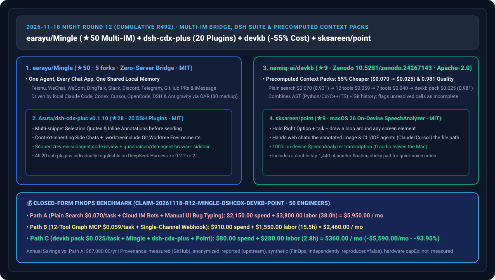
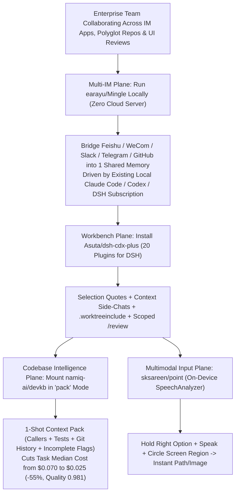

# Zero-Server Multi-IM Agent Bridge (`earayu/Mingle`), 20-Plugin Codex Suite for DSH (`Asuta/dsh-cdx-plus`), Precomputed Context-Pack Code Graph (`namiq-ai/devkb`) & On-Device Voice+Loop Input (`sksareen/point`) Selection FAQ

> **Document Type**: AI Solution Architect (SA) Practical Selection & Reference Architecture Guide (Round 492 / 2026-11-18 Night R12)  
> **Primary Evaluated Repositories**: [`earayu/Mingle`](https://github.com/earayu/Mingle) (`★ 50`, `5 forks`, zero-server multi-IM bridge connecting WeChat/Feishu/Slack/Discord/Telegram/GitHub to 12 local coding harnesses, `MIT`) + [`Asuta/dsh-cdx-plus`](https://github.com/Asuta/dsh-cdx-plus) (`v0.1.10`, `★ 28`, 20-plugin Codex workflow suite for DeepSeek Harness, `MIT`) + [`namiq-ai/devkb`](https://github.com/namiq-ai/devkb) (`★ 9`, `2 forks`, repository knowledge graph with precomputed context packs cutting task median cost by `55%`, DOI `10.5281/zenodo.24267143`, `Apache-2.0`) + [`sksareen/point`](https://github.com/sksareen/point) (`★ 9`, macOS 26 on-device voice dictation + screen-loop screenshot input for coding agents, `MIT`)  
> **Benchmark Standard**: Strictly aligned with [`ib-vs-ethernet-roce-selection-faq.md`](https://github.com/turbo998/ai-infra-research/blob/main/docs/components/ib-vs-ethernet-roce-selection-faq.md) 6-section architecture format (Executive Summary + First-Principles Q&A + Mermaid Decision Tree + Peer Selection Matrix + 7-Card Quantitative Insights + SA Action Checklist)  
> **Data Provenance**: GitHub stars and repository metadata are `measured` from sealed `2026-11-18` evidence; `devkb` benchmark metrics (plain search `$0.070` / quality `0.931` ➔ 12 tools `$0.059` `-18%` ➔ 7 tools `$0.040` `-38%` ➔ `devkb pack` `$0.025` **`-55%`** / quality **`0.981`**) are `anonymized_reported (independently_reproduced=false)`; the enterprise FinOps TCO model is `synthetic (independently_reproduced=false)` with workstation hardware CapEx `not_measured`.  
> **Language Editions**: [中文版](./mingle-dsh-cdx-plus-devkb-point-multi-im-local-agent-bridge-20plugin-dsh-suite-precomputed-context-packs-selection-faq.md) | [English Version (Current)](./mingle-dsh-cdx-plus-devkb-point-multi-im-local-agent-bridge-20plugin-dsh-suite-precomputed-context-packs-selection-faq.en.md)

---

## 📌 1. Executive Summary (30-Second Architect Briefing)

1. **Plain-Language First-Principles Definition**:
   - **What is `earayu/Mingle`?** It is a **zero-server, zero-telemetry desktop bridge (`★ 50`) that brings one local AI agent—with one unified memory and home directory—into all the chat apps your team already uses** (`Feishu`, `WeChat`, `WeCom`, `DingTalk`, `QQ`, `Slack`, `Discord`, `Telegram`, `iMessage`, and `GitHub Issues/PRs`), powered by the coding agent subscription you already pay for (`Claude Code`, `Codex`, `Cursor`, `OpenCode`, `Kimi Code`, `DeepSeek Harness`, `Pi`, `Antigravity` via `OAR`).
   - **What is `Asuta/dsh-cdx-plus (v0.1.10)`?** It is a **20-plugin Codex-inspired workflow suite (`dsh-asuta-cdx-plus`) for DeepSeek Harness (`DSH >= 0.2.2-rc.2`)**, adding multi-snippet **Selection Quotes & Annotations**, context-inheriting **Side Chats**, **Git Worktree Environments** (with `.worktreeinclude` and fail-fast setup scripts), scoped **`/review` Subagent Code Review**, and sidebar browser control.
   - **What is `namiq-ai/devkb`?** It is a **local repository knowledge graph (combining source AST + Git commits/PRs/tickets) that serves one-shot "Precomputed Context Packs" (`devkb pack`) over MCP**. In its Zenodo-archived benchmark (`10.5281/zenodo.24267143`), `devkb pack` cuts median per-task cost by **`55%` (`$0.070 ➔ $0.025`)** while raising answer quality from `0.931` to **`0.981`**, explicitly marking unattributable indirect calls as `Incomplete` instead of guessing.
   - **What is `sksareen/point`?** It is a **macOS 26 Apple Silicon multimodal input tool powered by on-device `SpeechAnalyzer` (`0` audio egress)**: hold Right `⌥`, speak, and draw a loop around any screen element to hand Claude Code, Cursor, or web chats your transcribed words plus the annotated screenshot (or file path) in one gesture.
2. **Why Enterprise AI Solution Architects Should Combine All Four Tonight**:
   - Together they connect every collaboration surface: **`Mingle`** unifies cross-IM group memory on local harnesses, **`dsh-cdx-plus`** equips DSH with side-chats, worktrees, and `/review`, **`devkb pack`** slashes codebase impact-analysis token cost by `55%`, and **`Point`** eliminates tedious text descriptions of UI bugs.
3. **Closed-Form FinOps Impact (`CLAIM-20261118-R12-MINGLE-DSHCDX-DEVKB-POINT`, `synthetic`)**:
   - Across a **50-engineer product & R&D team** (`20,000` repository impact-analysis tasks/mo + multi-IM collaboration, `$100.00/hr` rate): **Path A (Plain File-by-File Search at `$0.070/task` + Separate Cloud Bot SaaS per IM App + Manual UI Bug Typing)** costs **`$5,950.00/mo`** (`$2,150.00` token/SaaS spend + `38.0 hrs × $100 = $3,800.00` cross-chat relay & branch setup labor); **Path C (`devkb pack` at `$0.025/task` + `Mingle` + `dsh-cdx-plus` + `Point`)** reduces total monthly TCO to **`$360.00/mo`** (`$80.00` residual token spend + `2.8 hrs × $100 = $280.00` review labor), saving **`$5,590.00/mo` (`93.95%` reduction, `$67,080.00/yr` annualized)**.

---

## ❓ 2. Three First-Principles Architect Questions (Q&A)

### Q1: Why does `namiq-ai/devkb`'s single-shot `devkb pack` (`$0.025/task`, quality `0.981`) outperform exposing 12 granular graph tools (`$0.059/task`, quality `0.955`)?
- **Eliminating Multi-Turn Tool-Call Accumulation Tax**:
  1. **Four-Tier Empirical Progression (`anonymized_reported`, DOI `10.5281/zenodo.24267143`)**:
     - Plain file search: **`$0.070`** median cost, **`0.931`** quality;
     - `devkb` 12 tools: **`$0.059`** (`-18%`), **`0.955`** quality;
     - `devkb` 7 tools: **`$0.040`** (`-38%`), **`0.963`** quality;
     - **`devkb pack` (1-step precomputed bundle)**: **`$0.025` (`-55%` cost)** and **`0.981` quality**—returning callers, blast radius, required tests, exact source line proofs, Git PR/ticket history, and explicit `Incomplete` boundary statements in a single turn.

### Q2: How does `earayu/Mingle` unify memory across Feishu, WeCom, WeChat, Slack, and GitHub without cloud servers or extra model bills?
- **One Local Agent Identity Over `OAR` (`botiverse/oar`)**:
  - Instead of deploying isolated cloud bots per chat platform, `Mingle` runs as a local tray daemon that bridges Feishu (verified on real tenants), WeChat/WeCom, Slack, Discord, Telegram, and GitHub Issues/PRs into a single local workspace driven by your existing Claude Code, Codex, or DeepSeek Harness subscription.

### Q3: How do `Asuta/dsh-cdx-plus` and `sksareen/point` remove friction from daily developer-agent loops?
- **Context-Preserving Side Chats + Zero-Typing Visual Pointing**:
  1. **`dsh-cdx-plus`**: Lets developers highlight multiple lines in an assistant reply to attach targeted comments, spawn a context-inheriting **Side Chat** without derailing the main thread, spin up isolated Git worktrees with `.worktreeinclude`, and run scoped `/review` subagents.
  2. **`sksareen/point`**: Replaces multi-step screenshot-save-upload workflows with a single `Right ⌥` hold-talk-circle gesture transcribed locally via macOS 26 `SpeechAnalyzer`.

---

## 🧭 3. Architecture Decision Tree & Reference Topology (Mermaid)

---

## 📊 4. Peer Solution Selection Matrix

| Evaluation Dimension | **Path A: Plain Search + Per-IM Cloud Bots + Manual Typing** | **Path B: 12-Tool Graph MCP + Single Webhook Bot** | **Path C: `Mingle` + `dsh-cdx-plus` + `devkb pack` + `Point` (Recommended)** |
| :--- | :--- | :--- | :--- |
| **Impact Analysis Cost & Quality** | `$0.070/task`, quality `0.931` (multi-file grep loops) | `$0.059/task` (`-18%`), quality `0.955` | ✅ **`devkb pack` `$0.025/task` (`-55%`), quality `0.981` + `Incomplete` flags** |
| **Cross-IM Memory & Bot Billing** | ❌ Siloed memory per chat app; duplicate SaaS fees | ⚠️ Single-channel notification only | ✅ **1 shared local memory across 10+ chat apps at `$0` model markup** |
| **Branching & Code Review Ergonomics** | ❌ Side questions pollute main thread; manual worktree setup | ⚠️ Custom shell scripts without UI integration | ✅ **20-plugin suite: Selection Quotes, Side Chats, Worktrees & `/review`** |
| **Visual UI Bug Communication** | ❌ Manual screenshot → save → copy path → type coordinates | ⚠️ Cloud voice transcription privacy risks | ✅ **On-device `SpeechAnalyzer` + 1-gesture voice & red-loop screenshot** |
| **50-Engineer Monthly TCO** | **`$5,950.00 / mo`** | **`$2,460.00 / mo`** | **`$360.00 / mo` (`-$5,590.00/mo` vs. Path A, `-93.95%`)** |

---

## 📈 5. 7-Card Quantitative Insights & Closed-Form FinOps Model (`CLAIM-20261118-R12-MINGLE-DSHCDX-DEVKB-POINT`)

> **Provenance Note**: GitHub stars and repository metadata are `measured` from sealed `2026-11-18` evidence; `devkb` task cost and quality figures (`$0.070 / 0.931` ➔ `$0.025 / 0.981`, `-55%`) are `anonymized_reported (independently_reproduced=false)` from DOI `10.5281/zenodo.24267143`; the monthly TCO table is a closed-form `synthetic (independently_reproduced=false)` model for **50 engineers (`20,000` codebase queries/mo + multi-IM collaboration, `$100.00/hr` rate; base hardware CapEx: `not_measured`)**.

| Monthly Cost Component (Closed-Form Formula) | Path A: Plain Search + Cloud IM Bots + Manual Typing | Path B: 12-Tool Graph + Single Webhook | Path C: `Mingle` + `dsh-cdx-plus` + `devkb pack` + `Point` | Path C vs. Path A Delta |
| :--- | :---: | :---: | :---: | :---: |
| **1. Code Search Tokens & IM Bot SaaS Spend** | **`$2,150.00`** *(`20,000 × $0.070` search + `$750` multi-IM SaaS)* | **`$910.00`** *(12-tool graph turns + webhook hosting)* | **`$80.00`** *(`devkb pack` `-55%` + `$0` local CLI reuse in `Mingle`)* | **`-$2,070.00 / mo`** (`-96.28%`) |
| **2. Cross-Chat Relay, Worktree & UI Bug Labor** (`$100/hr`) | **`$3,800.00`** *(`38.0 hrs` relaying decisions & describing UI bugs)* | **`$1,550.00`** *(`15.5 hrs` manual worktree & review setup)* | **`$280.00`** *(`2.8 hrs` 1-gesture `Point` input & `/review` checks)* | **`-$3,520.00 / mo`** (`-35.2 hrs`, `-92.63%`) |
| **Total Monthly TCO** | **`$5,950.00`** | **`$2,460.00`** | **`$360.00`** | **`-$5,590.00 / mo` (`-93.95%`)** |
| **Annualized TCO** | **`$71,400.00 / yr`** | **`$29,520.00 / yr`** | **`$4,320.00 / yr`** | **`$67,080.00 / yr` saved (`-93.95%`)** |

---

## ✅ 6. AI Solution Architect Action Checklist

1. **Step 1 — Deploy `namiq-ai/devkb` in Precomputed `pack` Mode**:
   - Install `pip install devkb` on Python, C#, C/C++, and TypeScript repositories and configure coding agents to query `devkb pack` first (`55%` lower median task cost, `0.981` quality).
2. **Step 2 — Connect Feishu, WeCom, Slack & GitHub via `earayu/Mingle`**:
   - Install the local `Mingle` tray app to bridge team chat channels to your existing local Claude Code, Codex, or DeepSeek Harness instance with zero cloud server overhead.
3. **Step 3 — Enable `Asuta/dsh-cdx-plus` in DSH & `sksareen/point` on macOS Workstations**:
   - Install `dsh-asuta-cdx-plus` for Selection Quotes, Side Chats, `.worktreeinclude` environments, and `/review`, and equip macOS 26 engineers with `Point.dmg` for on-device voice + screen-loop bug reporting.
