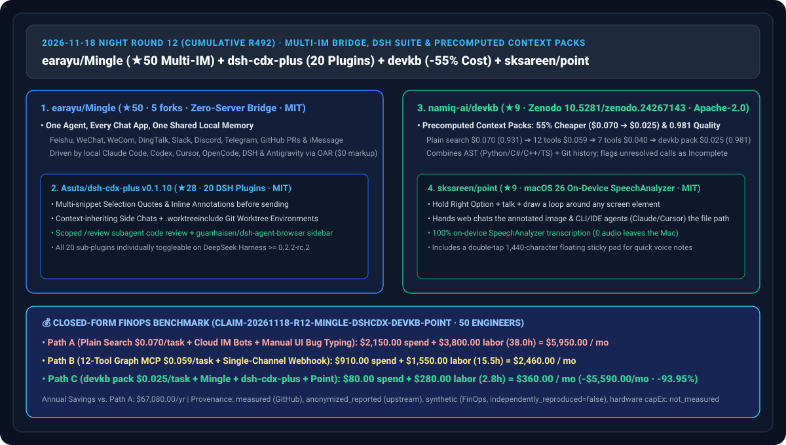
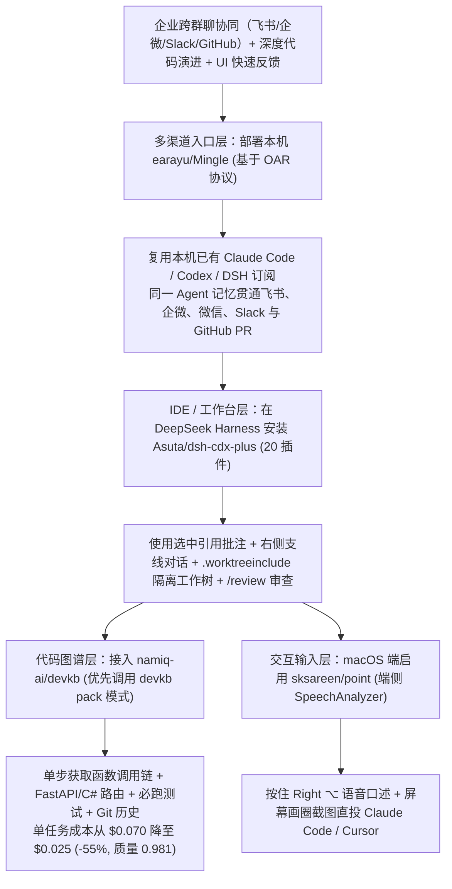

# 零服务端全渠道 IM 智能体桥（`earayu/Mingle`）、DeepSeek Harness 20 合 1 Codex 增强套件（`Asuta/dsh-cdx-plus`）、预计算上下文包代码图谱（`namiq-ai/devkb`）与端侧圈选语音输入器（`sksareen/point`）选型 FAQ

> **文档类型**：AI Solution Architect (SA) 实战选型与参考架构指南（Round 492 / 2026-11-18 Night R12）  
> **核心评估对象**：[`earayu/Mingle`](https://github.com/earayu/Mingle)（`★ 50`，`5 forks`，单智能体记忆贯通飞书/企微/微信/钉钉/Slack/Telegram 与 12 大本地 Harness 的零服务端桥接器，`MIT`） + [`Asuta/dsh-cdx-plus`](https://github.com/Asuta/dsh-cdx-plus)（`v0.1.10`，`★ 28`，为 DSH 补齐选中引用、侧边对话、Worktree 与 `/review` 的 20 子插件合集，`MIT`） + [`namiq-ai/devkb`](https://github.com/namiq-ai/devkb)（`★ 9`，`2 forks`，单步回答调用链/测试影响且降本 `55%` 的预计算上下文包图谱，DOI `10.5281/zenodo.24267143`，`Apache-2.0`） + [`sksareen/point`](https://github.com/sksareen/point)（`★ 9`，macOS 26 端侧语音听写+画圈截图直投 Claude Code/Cursor 工具，`MIT`）  
> **对标范式**：严格遵循 [`ib-vs-ethernet-roce-selection-faq.md`](https://github.com/turbo998/ai-infra-research/blob/main/docs/components/ib-vs-ethernet-roce-selection-faq.md) 六段式结构（核心结论速览 + 三大灵魂拷问 + Mermaid 决策树 + 选型对比矩阵 + 7-Card 定量洞察 + SA 落地 Checklist）  
> **数据溯源分级（Provenance）**：GitHub 星标与目录元数据为 `measured`；`devkb` 任务中位成本对比（普通搜索 `$0.070`/质量 `0.931` ➔ 12 工具 `$0.059` `-18%` ➔ 7 工具 `$0.040` `-38%` ➔ `devkb pack` `$0.025` **`-55%`** / 质量 **`0.981`**）标注为 `anonymized_reported (independently_reproduced=false)`；企业 FinOps 成本算例为 `synthetic (independently_reproduced=false)`，硬件折旧 `not_measured`。  
> **语言版本**：[中文版 (当前)](./mingle-dsh-cdx-plus-devkb-point-multi-im-local-agent-bridge-20plugin-dsh-suite-precomputed-context-packs-selection-faq.md) | [English Version](./mingle-dsh-cdx-plus-devkb-point-multi-im-local-agent-bridge-20plugin-dsh-suite-precomputed-context-packs-selection-faq.en.md)

---

## 📌 一、核心结论速览（Executive Summary — 30 秒看懂）

1. **大白话本质定义**：
   - **`earayu/Mingle` 是什么？** 它是 **完全跑在开发者本机（零中转服务器、零账号注册、零模型加价）、把你现有的本地 Coding Agent（Claude Code、Codex、Cursor、OpenCode、DeepSeek Harness、Antigravity 等 12 款工具）直接拉进飞书、企业微信、微信、钉钉、QQ、Slack、Discord、Telegram、iMessage 和 GitHub Issue 的全渠道分身桥接器**。同一个 Agent 共享同一份本地记忆：你在微信里问它“今天上午团队在飞书群里定了什么架构方案”，它能秒级调出飞书群上下文回答，或帮你把 Slack 决议同步到 Telegram。
   - **`Asuta/dsh-cdx-plus (v0.1.10)` 是什么？** 它是 **将 Codex 桌面版最核心的 20 项工程交互（多段选中引用批注、继承上下文的右侧支线对话、带 `.worktreeinclude` 与多行初始化脚本的 Git 工作树环境、四模式 `/review` 独立子代理代码审查、内置侧栏浏览器）完整移植到 DeepSeek Harness (`DSH >= 0.2.2-rc.2`) 的一站式增强插件包**。
   - **`namiq-ai/devkb` 是什么？** 它是 **结合源码 AST 与 Git 历史（Commit / PR / Ticket）、将“谁调用了它、改了会坏哪、该跑哪些测试”一次性打包为单步“预计算上下文包（Context Pack）”的仓库知识图谱**。在 Zenodo 归档基准（`10.5281/zenodo.24267143`）中，它将单任务中位 Token 成本从普通搜索的 `$0.070`（质量 `0.931`）一举压降至 **`$0.025`（降本 `55%`，且回答质量升至 `0.981`）**；遇到函数指针等静态分析无法完全确定的调用时，诚实标注 `Incomplete` 绝不瞎猜。
   - **`sksareen/point` 是什么？** 它是 **基于 macOS 26 端侧 `SpeechAnalyzer`（语音 100% 不出本机）的“按住快捷键说话 + 顺手在屏幕上画个红圈 = 自动把语音转文字连同带红圈的局部截图一起喂给 Claude Code / Cursor”的多模态极速输入器**。
2. **为什么企业 AI 解决方案架构师（SA）今晚要把这四款工具组合成“全触点研发协同工作流”？**
   - **`Mingle` 打通跨 IM 群聊记忆 ➔ `dsh-cdx-plus` 提供 Worktree 隔离与 `/review` 审查台 ➔ `devkb pack` 单步喂入源码+Git 历史上下文包省 `55%` Token ➔ `Point` 按键画圈秒传 UI 缺陷截图**！
3. **闭式 FinOps 量化收益（`CLAIM-20261118-R12-MINGLE-DSHCDX-DEVKB-POINT`，`synthetic`）**：
   - 以 **50 人跨职能研发与产品团队**（月均 20,000 次代码影响面分析查询 + 跨飞书/企微/Slack 协同，工程师时薪 `$100.00/hr`）计：**Path A（Agent 逐文件盲搜 `$0.070/次` + 多套独立商业 IM 机器人订阅 + 手工打字描述界面 Bug 位置）** 月均总成本 **`$5,950.00`**（搜索 Token 与机器人订阅 `$2,150.00` + 跨群人工传话与返工 `38.0h × $100 = $3,800.00`）；**Path C（`devkb pack` `$0.025/次` + `Mingle` 本地桥 + `dsh-cdx-plus` + `Point`）** 月均总成本降至 **`$360.00`**（精简上下文包 Token `$80.00` + 运维复核 `2.8h × $100 = $280.00`），**净省 `$5,590.00/月`（降幅 `93.95%`，年化节省 `$67,080.00`）**。

---

## ❓ 二、三大灵魂拷问（First-Principles Q&A）

### Q1：为什么给 Agent 挂 12 个细粒度代码图谱工具（`$0.059/任务`）反而不如 `namiq-ai/devkb` 的单命令 `Context Pack`（`$0.025/任务`）既便宜又准？
- **第一性原理：多轮 Tool Call 的往返上下文累积税 > 一次性预组装证据包**：
  1. **四档实测数据对比（`anonymized_reported`，Zenodo `10.5281/zenodo.24267143`）**：
     - 普通逐文件搜索（Plain Search）：中位成本 **`$0.070/任务`**，回答质量 `0.931`；
     - 暴露 12 个图谱工具（`devkb 12 tools`）：Agent 仍需多次调用工具拼接信息，成本 `$0.059`（`-18%`），质量 `0.955`；
     - 精简为 7 个图谱工具（`devkb 7 tools`）：成本 `$0.040`（`-38%`），质量 `0.963`；
     - **单步预计算上下文包（`devkb pack`）**：一条命令同时返回“调用方 + 破坏范围 + 必跑测试 + 证明行号 + Git 历史 PR/Ticket + 静态分析未覆盖声明（`Incomplete`）”，中位成本直接降至 **`$0.025/任务`（直降 `55%`）**，质量反而达到最高 **`0.981`**！
  2. **跨语言 C/Python 桥接与诚实边界**：支持 Python（含 FastAPI/Flask/Odoo 路由）、C#（经 5 个开源库编译器对表校验）、C/C++（识别 `extern "C"`、`ctypes`、`pybind11` 跨语言调用），遇到函数指针无法静态归因时明确输出 `Incomplete`。

### Q2：企业里飞书、企微、微信、Slack 各建各的 Bot 为什么沦为“信息孤岛”？`earayu/Mingle` 是怎么用本地已有订阅账号一统江湖的？
- **统一本地大脑 + 多触点轻量投射**：
  - 传统做法是在飞书配一套 Dify、在 Slack 配一套商業 Bot，两边不仅各自收一份 Token 钱，而且记忆完全割裂。`Mingle` 通过开源协议层 `OAR`（`botiverse/oar`）直接驱动你本机已经付费的 Claude Code / Codex / DeepSeek Harness，让同一个本地 Agent 同时驻留在飞书工作群、企微客户群、Slack 与 GitHub PR 中，数据 100% 留在本机目录，零云端中转。

### Q3：`Asuta/dsh-cdx-plus` 与 `sksareen/point` 如何把工程师日常微交互的时间损耗压到极致？
- **消除“主线污染”与“文字描述像素位置”两大内耗**：
  1. **`dsh-cdx-plus`（20 项独立可开关增强）**：看 Agent 回答时选中两段话分别批注后统一追问；遇到支线问题在右侧开启继承上下文的**侧边对话（Side Chat）**而不污染主线；一键拉起带 `.worktreeinclude` 的 Git 工作树并在提交前跑 `/review` 独立子代理审查。
  2. **`sksareen/point`（按住 `Right ⌥` 说话+画圈）**：不用再费劲打字写“右上角第二个蓝按钮偏左了 5 像素”——按住右 Option 键边说“把这个按钮往右对齐”边在屏幕上画个圈，网页端聊天直接收到带红圈原图，终端 Claude Code / Cursor 直接收到语音转写文本 + 本地截图绝对路径。

---

## 🧭 三、架构师选型决策树与端到端参考架构（Mermaid）

---

## 📊 四、同类方案横向选型对比矩阵（Peer Selection Matrix）

| 评估维度 | **Path A：逐文件盲搜 + 各 IM 独立买云端 Bot + 纯打字报 Bug** | **Path B：多工具细粒度图谱 + 单渠道 Webhook** | **Path C：`Mingle` + `dsh-cdx-plus` + `devkb pack` + `Point`（推荐）** |
| :--- | :--- | :--- | :--- |
| **代码变更影响分析成本与质量** | `$0.070/任务`，质量 `0.931`（多轮盲目搜文件） | 12 工具模式 `$0.059/任务`（质量 `0.955`） | ✅ **`devkb pack` `$0.025/任务`（省 `55%`，质量 `0.981`，标明 `Incomplete`）** |
| **跨 IM 平台（飞书/企微/Slack）记忆** | ❌ 各平台记忆割裂，按平台重复购买 SaaS 席位 | ⚠️ 仅支持单一 IM 群单向通知 | ✅ **单本地 Agent 贯通 10+ 渠道共享记忆，复用既有 CLI 订阅 `$0` 加价** |
| **DSH 支线探索与工作树审查体验** | ❌ 主对话被支线问题污染，手动切分支易丢未提交文件 | ⚠️ 手工写 git worktree 脚本 | ✅ **20 合 1 插件：选中引用、侧边对话、`.worktreeinclude` 与 `/review`** |
| **UI 缺陷指认与多模态输入效率** | ❌ 手工截图保存再找路径粘贴，打字描述位置极慢 | ⚠️ 云端语音转写存在隐私外发顾虑 | ✅ **端侧 `SpeechAnalyzer` 零外发 + 按键说话画圈一步直投路径/图片** |
| **50 人团队月均总拥有成本 (TCO)** | **`$5,950.00 / 月`** | **`$2,460.00 / 月`** | **`$360.00 / 月`（较 Path A 净省 `$5,590.00/月`，`-93.95%`）** |

---

## 📈 五、7-Card 定量洞察与闭式 FinOps 算例（`CLAIM-20261118-R12-MINGLE-DSHCDX-DEVKB-POINT`）

> **Provenance 声明**：GitHub 星标与目录元数据源自 `2026-11-18` 封存证据（`measured`）；`devkb` 四档任务成本与质量数据（`$0.070 / 0.931` ➔ `$0.059 / 0.955` ➔ `$0.040 / 0.963` ➔ `$0.025 / 0.981`，`-55%`）源自 Zenodo 归档基准（`anonymized_reported`, `independently_reproduced=false`）；月度 TCO 为面向 **50 人团队（月均 20,000 次代码分析任务 + 多 IM 协同）** 的闭式合成模型（`synthetic`, `independently_reproduced=false`；宿主机硬件折旧 CapEx：`not_measured`）。

| 成本构成项（月度闭式公式） | Path A：逐文件搜索 + 多套云端 IM Bot + 手工打字 | Path B：12 工具图谱 + 单渠道脚本 | Path C：`Mingle` + `dsh-cdx-plus` + `devkb pack` + `Point` | Path C 对比 Path A 净变化 |
| :--- | :---: | :---: | :---: | :---: |
| **1. 代码检索 Token 与多渠道 Bot 平台支出** | **`$2,150.00`** *(`20,000 × $0.070` 搜索 + `$750` 多平台 Bot 订阅)* | **`$910.00`** *(细粒度图谱多轮调用 + 单平台网关)* | **`$80.00`** *(`devkb pack` 省 55% + `Mingle` 复用本地订阅 `$0`)* | **`-$2,070.00 / 月`** (`-96.28%`) |
| **2. 跨群传话、分支环境配置与 UI 沟通人工** (`$100/hr`) | **`$3,800.00`** *(`38.0 hrs`：跨群同步决议、手工配 Worktree 与截图)* | **`$1,550.00`** *(`15.5 hrs`：手动整理支线对话与代码审查)* | **`$280.00`** *(`2.8 hrs`：按键画圈直投 + `/review` 自动审查)* | **`-$3,520.00 / 月`** (`-35.2 hrs`, `-92.63%`) |
| **月度总拥有成本 (Monthly Total TCO)** | **`$5,950.00`** | **`$2,460.00`** | **`$360.00`** | **`-$5,590.00 / 月` (`-93.95%`)** |
| **年化总拥有成本 (Annualized TCO)** | **`$71,400.00 / 年`** | **`$29,520.00 / 年`** | **`$4,320.00 / 年`** | **年省 `$67,080.00` (`-93.95%`)** |

---

## ✅ 六、AI 解决方案架构师（SA）实战落地 Checklist

1. **Step 1 — 部署 `namiq-ai/devkb` 并优先启用 `devkb pack` 模式**：
   - 在 Python / C# / C++ / TS 混合工程中安装 `pip install devkb`，将 MCP Server 设为 `pack` 聚合适配模式，让 Agent 单步获取调用链、关联测试与 Git PR 历史，把单次定位成本压至 `$0.025`。
2. **Step 2 — 用 `earayu/Mingle` 将本机主力 Harness 接入飞书/企微/Slack**：
   - 运行安装脚本启动本地托盘服务，绑定已验证的飞书租户与 GitHub 账号，实现跨群共享同一套本地记忆库。
3. **Step 3 — 升级 `Asuta/dsh-cdx-plus` 工作台并在 Mac 端配备 `sksareen/point`**：
   - 在 DeepSeek Harness 中安装 `dsh-asuta-cdx-plus` 开启选中引用、侧边对话与 `/review`；Mac 研发人员安装 `Point.dmg` 开启端侧 `Right ⌥` 语音画圈极速反馈。
