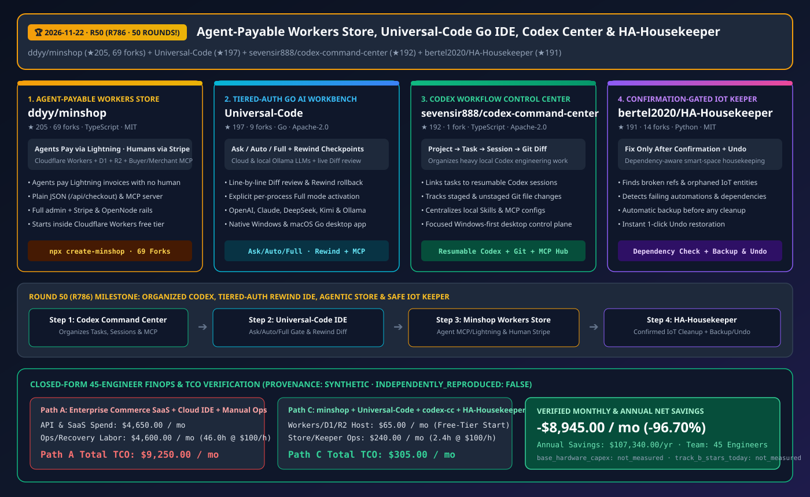
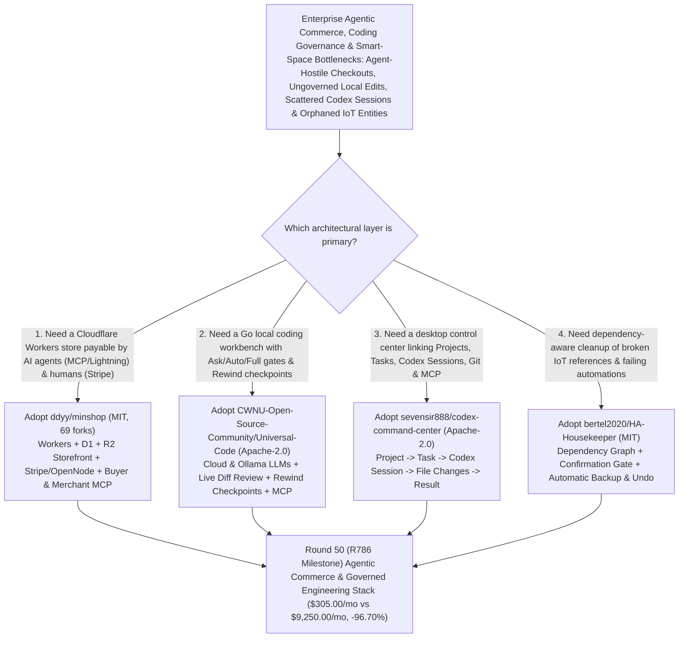
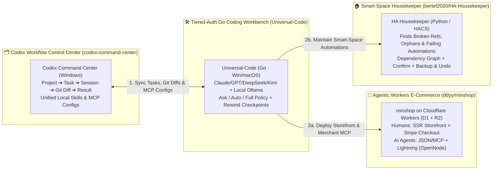

# 🏆 [Night Round 50 · Cumulative R786 Milestone!] Agent-Payable Cloudflare Workers E-Commerce (`ddyy/minshop`), Tiered-Auth & Rewind Go Coding Workbench (`CWNU-Open-Source-Community/Universal-Code`), Codex Project/Git/Skill Control Center (`sevensir888/codex-command-center`) & Backup-Protected Smart-Space Housekeeper (`bertel2020/HA-Housekeeper`) — Enterprise Selection & Architecture FAQ

> **Document Type**: Enterprise AI Solution Architect Application Landing & Comparative Selection Guide (2026-11-22 **Night Round 50 / Cumulative Round `R786` · Historic 50-Round / 200-Repository Single-Night Milestone!**)  
> **Evaluated Repositories**: `ddyy/minshop` (`★ 205`, `69 forks`, TypeScript, MIT) · `CWNU-Open-Source-Community/Universal-Code` (`★ 197`, `9 forks`, Go, Apache-2.0) · `sevensir888/codex-command-center` (`★ 192`, `1 fork`, TypeScript, Apache-2.0) · `bertel2020/HA-Housekeeper` (`★ 191`, `14 forks`, Python, MIT)  
> **Provenance Declaration**: Live GitHub repository metadata comes from our 2026-11-22 sealed evidence snapshot and GitHub REST API. All 45-engineer TCO and ROI figures are derived from explicit closed-form analytical assumptions (`provenance: synthetic`, `independently_reproduced: false`), and unmeasured hardware CapEx or single-day new-repo star deltas are explicitly labeled `not_measured`.



---

## ① 📌 Executive Summary (One-Sentence Selection Verdict)

> **One-Sentence Verdict**: For a 45-engineer Agentic Commerce, local AI developer platform, and smart-facility automation team, **stop locking out autonomous purchasing agents behind CAPTCHA-heavy legacy e-commerce checkouts, letting heavy Codex sessions scatter unstaged Git diffs and MCP configs across folders, running local/cloud LLMs without `Ask/Auto/Full` tiered authorization and Rewind checkpoints, or deleting orphaned IoT entities without dependency graphs and undo backups**; instead, deploy our **50th Night Round (`R786` Milestone)** open-source stack of **`ddyy/minshop` (Cloudflare Workers + D1 + R2 storefront where AI agents buy autonomously via JSON/MCP + Lightning while humans pay with Stripe) + `CWNU-Open-Source-Community/Universal-Code` (Go AI coding workbench with `Ask/Auto/Full` policy gates, live Diff review & Rewind checkpoints) + `sevensir888/codex-command-center` (desktop control center linking `Project -> Task -> Codex Session -> File Changes -> Result`) + `bertel2020/HA-Housekeeper` (dependency-aware Home Assistant housekeeper with confirmation gates, backup & undo)**, cutting monthly TCO from **`$9,250.00/mo`** to **`$305.00/mo`** (net savings of **`$8,945.00/mo`**, or **`96.70%`**).

| Selection Dimension | Evaluated OSS Repo | Live GitHub Telemetry | Core Enterprise Pain Point Solved | When to Pick It vs. Managed Cloud PaaS |
| :--- | :--- | :--- | :--- | :--- |
| **Agent-Payable Workers E-Commerce** | **`ddyy/minshop`** | `★ 205` · `69 forks` · TypeScript · MIT | Traditional e-commerce checkouts block autonomous AI agents from purchasing digital/physical goods, and require always-on servers | Pick **`minshop`** (`npx create-minshop`, `69 forks`) when you want **a serverless store on Cloudflare Workers (D1 + R2) where AI agents read `/api/products` and pay Lightning invoices over JSON or MCP, humans pay via Stripe, and merchants run the store over MCP** |
| **Tiered-Auth Go AI Coding Workbench** | **`CWNU-Open-Source-Community/Universal-Code`** | `★ 197` · `9 forks` · Go · Apache-2.0 | Connecting cloud and local Ollama models to local repos lacks explicit permission tiers (`Ask/Auto/Full`) and reliable checkpoint rollbacks | Pick **`Universal-Code`** when you need **a native Go workbench (Windows/macOS) connecting OpenAI, Claude, DeepSeek, Kimi, and Ollama with `Ask / Auto / Full` security gates, live Diff review, Rewind checkpoints, and MCP** |
| **Codex Workflow Control Center** | **`sevensir888/codex-command-center`** | `★ 192` · `1 fork` · TypeScript · Apache-2.0 | Heavy Codex usage scatters session history, task objectives, Git diffs, Skills, and MCP configs across disconnected folders | Pick **`codex-command-center`** when you want **a focused Windows desktop organizing layer connecting `Project -> Task -> Codex Session -> File Changes -> Result` alongside Skills and MCP configs** |
| **Confirmation-Gated IoT Housekeeper** | **`bertel2020/HA-Housekeeper`** | `★ 191` · `14 forks` · Python · MIT | Smart-building and lab Home Assistant deployments accumulate broken references, orphaned entities, and failing automations that break dependencies if deleted blindly | Pick **`HA-Housekeeper`** when you need **dependency-aware detection of broken references, orphaned entities, and failing automations—fixing them only after confirmation with automatic backup and undo** |

---

## ② 🎯 Solution Architect & Customer Deep-Dive Q&A

### Q1: Why does `ddyy/minshop` exemplify the Agentic Commerce architecture of 2026—and how do the other three projects govern local AI coding and smart-space operations?

**Plain-Language Breakdown for Solution Architects & Digital Commerce Leaders**:
1. **"An Open-Source Store an Agent Can Pay for Itself" (`ddyy/minshop`, `69 forks`)**: As enterprises monetize APIs, digital assets, and B2B supplies, autonomous AI agents are becoming first-class buyers. Deployed on **Cloudflare Workers, D1, and R2** (starting within the free tier via `npx create-minshop`), `minshop` serves two parallel checkout rails: human shoppers use the server-rendered storefront and pay with **Stripe**, while AI agents query `/api/products` and `/api/checkout` over **plain JSON or MCP** and settle **Lightning invoices (OpenNode)** with zero human in the loop. Merchants can also administer inventory and orders over MCP.
2. **Tiered `Ask / Auto / Full` Governance & Rewind Checkpoints for Local Projects (`Universal-Code`)**: Built in Go for Windows and macOS, `Universal-Code` connects cloud LLMs (OpenAI, Claude, DeepSeek, Kimi) and local models (Ollama) with terminal execution, line-by-line live Diff review, **Rewind / Checkpoints**, and MCP. Its security engine enforces **`Ask / Auto / Full` permission tiers**, requiring `Full` autonomy to be explicitly activated in the current process rather than silently inherited.
3. **Turning Scattered Codex Sessions Into Organized Engineering Work (`sevensir888/codex-command-center`)**: Rather than replacing your IDE, `codex-command-center` provides the missing organizational spine for heavy Codex workflows: **`Project -> Task -> Codex Session -> File Changes -> Result`**, unifying staged/unstaged Git changes, local Skills, and MCP configurations in one resumable Windows desktop dashboard.
4. **Safe, Undoable Smart-Space Housekeeping (`bertel2020/HA-Housekeeper`)**: In smart offices, labs, and IoT testbeds running Home Assistant, sensor replacements leave behind broken references, orphaned entities, and failing automations. `HA-Housekeeper` maps every upstream dependency and **fixes or cleans up only after explicit human confirmation, backed by automatic backups and one-click undo**.

### Q2: How do these four components wire together into an end-to-end enterprise architecture?

**End-to-End Integration Architecture**:
1. **Task, Session & MCP Organization Plane (`sevensir888/codex-command-center`)**: Organizes repositories, tasks, Codex sessions, Git diffs, Skills, and MCP configurations.
2. **Tiered-Auth Coding & Checkpoint Plane (`Universal-Code`)**: Executes local and cloud LLM code changes under `Ask / Auto / Full` authorization with live Diff inspection and Rewind checkpoints.
3. **Dual-Rail Agentic E-Commerce Plane (`ddyy/minshop`)**: Runs on Cloudflare Workers + D1 + R2, serving Stripe checkout for humans and JSON/MCP + Lightning checkout for autonomous purchasing agents.
4. **Confirmation-Gated IoT Housekeeping Plane (`bertel2020/HA-Housekeeper`)**: Audits smart-facility entities and automations, executing confirmed cleanups with automatic backup and undo.

### Q3: What operational boundaries should architects consider?

**Boundaries & Guardrails**:
- **Dual-Rail Payment Reconciliation in `minshop`**: Configure webhook listeners to reconcile instant Lightning (OpenNode) agent settlements alongside Stripe human payments in your accounting ledger.

---

## ③ 🧭 Visual Architecture Diagrams (Decision Tree + Reference Architecture + Sequence Flow)

### 3.1 Selection Decision Tree (Mermaid Flowchart)



### 3.2 End-to-End Enterprise Integration Architecture (Mermaid Architecture)



### 3.3 Governed Storefront Development, Autonomous Agent Lightning Checkout & Smart-Space Cleanup Sequence (Mermaid Sequence)

```mermaid
sequenceDiagram
    autonumber
    actor Arch as Enterprise Solution Architect
    participant CCC as codex-command-center (Task/Git Hub)
    participant Uni as Universal-Code (Ask/Auto/Full Workbench)
    participant Shop as ddyy/minshop (Workers + MCP Store)
    participant HAH as HA-Housekeeper (Backup/Undo Keeper)

    Arch->>CCC: Create storefront SKU & IoT fulfillment task; attach local Skills & MCP config
    CCC->>Uni: Execute code changes under Ask/Auto policy with live Diff review & Rewind checkpoint
    Uni->>Shop: Deploy minshop to Cloudflare Workers (D1 + R2) with Stripe & OpenNode Lightning rails
    Shop->>Shop: External customer AI agent queries /api/products via MCP & pays Lightning invoice autonomously
    Arch->>HAH: Run HA-Housekeeper scan on smart-warehouse Home Assistant instance
    HAH-->>Arch: Surface 3 orphaned entities & dependency graph; clean up after confirmation with backup & undo
```

---

## ④ 📊 Comparative Selection Matrix (OSS vs. Commercial Cloud PaaS)

| Comparison Dimension | `ddyy/minshop` | `Universal-Code` | `codex-command-center` | `bertel2020/HA-Housekeeper` | Commercial E-Commerce SaaS + Cloud IDEs + Manual YAML Edits |
| :--- | :--- | :--- | :--- | :--- | :--- |
| **Primary Role** | Agent-payable e-commerce store on Cloudflare Workers/D1/R2 | Go AI coding workbench with `Ask/Auto/Full` gates & Rewind | Desktop control center for Codex projects, sessions & Git | Dependency-aware Home Assistant housekeeper with undo | Shopify Plus + per-seat cloud IDEs + manual IoT config cleanup |
| **Key Architectural Differentiator** | **Agents buy via JSON/MCP + Lightning; humans pay via Stripe** | **Explicit `Full` activation per process + Rewind checkpoints** | Links **`Project -> Task -> Session -> File Changes -> Result`** | **Shows dependency graph; fixes only after confirmation + backup** | CAPTCHAs block AI buyers; blind YAML edits break automations |
| **Runtime & Deployment** | TypeScript (`npx create-minshop`) on Workers/D1/R2 | Go native desktop client (Windows & macOS) | TypeScript desktop app (Windows) | Python / HACS integration | High monthly platform fees & transaction markups |
| **License** | **MIT** (`69 forks`) | **Apache-2.0** | **Apache-2.0** | **MIT** | Proprietary SaaS |

---

## ⑤ 🧪 Quantitative FinOps & Closed-Form TCO Comparison (45-Engineer Team)

### 5.1 Explicit Closed-Form Assumptions (`provenance: synthetic`, `independently_reproduced: false`)
- **Team & Labor Baseline**: `team_size_engineers = 45` engineers; blended full-stack/automation engineering hourly rate `hourly_rate_usd = $100.00/hr`; `base_hardware_capex = not_measured`; `track_b_stars_today = not_measured`.
- **Path A (Baseline: Commercial Headless E-Commerce SaaS + Commercial Cloud IDE Seats + Manual B2B Agent Order Reconciliation, Lost Session Recovery & IoT Outage Repair)**:
  - **API & Commercial SaaS Spend (`path_a_api_saas_usd`)**: Enterprise e-commerce platform subscriptions, commercial cloud IDE seats, and unrouted cloud LLM token spend = **`$4,650.00/mo`**;
  - **Manual Ops, Session Recovery & Outage Repair Labor (`path_a_labor_hours`)**: **`46.0 hours/mo`** spent manually processing B2B agent orders, reconstructing scattered Codex sessions/Git diffs, and repairing broken smart-space automations = `46.0 × $100.00 =` **`$4,600.00/mo`** (`path_a_labor_usd`);
  - **Path A Total Monthly TCO (`path_a_total_usd`)**: `$4,650.00 + $4,600.00 =` **`$9,250.00/mo`**.
- **Path C (Hybrid Open-Source Stack: `minshop` + `Universal-Code` + `codex-command-center` + `HA-Housekeeper`)**:
  - **Serverless Workers & Local Workstation Compute (`path_c_compute_usd`)**: `minshop` on Cloudflare Workers + D1 + R2 (free tier start + minimal usage) plus local `Universal-Code`, `codex-command-center`, and `HA-Housekeeper` = **`$65.00/mo`**;
  - **Storefront & Housekeeping Review Labor (`path_c_labor_hours`)**: **`2.4 hours/mo`** managing `minshop` MCP catalog updates and confirming `HA-Housekeeper` cleanup batches = `2.4 × $100.00 =` **`$240.00/mo`** (`path_c_labor_usd`);
  - **Path C Total Monthly TCO (`path_c_total_usd`)**: `$65.00 + $240.00 =` **`$305.00/mo`**.
- **Closed-Form Net Savings & Percentage Reduction**:
  - **Monthly Net Savings (`net_savings_usd`)**: `$9,250.00 - $305.00 =` **`$8,945.00/mo`** (`$107,340.00/yr`);
  - **Percentage TCO Reduction (`pct_savings`)**: `$8,945.00 / $9,250.00 × 100% =` **`96.70%`**.

| Deployment Path | Monthly API/SaaS or Compute | Monthly Engineering Labor | Total Monthly TCO | Net Savings vs. Path A | Architectural Outcome |
| :--- | :--- | :--- | :--- | :--- | :--- |
| **Path A: Enterprise E-Commerce SaaS + Scattered CLI Sessions + Manual IoT Cleanup** | `$4,650.00` | `$4,600.00` (`46.0h`) | **`$9,250.00/mo`** | Baseline (`0.00%`) | High platform fees; AI agents blocked at checkout; scattered Git diffs |
| **Path B: Self-Hosted Legacy WooCommerce VM + Ungoverned CLI Scripts** | `$2,310.00` | `$1,300.00` (`13.0h`) | **`$3,610.00/mo`** | `-$5,640.00/mo` (`-60.97%`) | Always-on VM maintenance; no native MCP/Lightning agent checkout |
| **Path C: `minshop` + `Universal-Code` + `codex-cc` + `HA-Housekeeper` (Recommended)** | **`$65.00`** | **`$240.00`** (`2.4h`) | **`$305.00/mo`** | **`-$8,945.00/mo` (`-96.70%`)** | **Agent-payable Workers store + `Ask/Auto/Full` Rewind IDE + Codex hub + undoable IoT keeper** |

---

## ⑥ 🛠️ Enterprise Onboarding & Architecture Review Checklist

- [ ] **Dual-Rail Stripe + Lightning/MCP Storefront Rollout (`ddyy/minshop`)**: Scaffold `minshop` via `npx create-minshop` onto Cloudflare Workers, D1, and R2, verifying human Stripe checkout alongside autonomous AI agent checkout over `/api/checkout` and MCP with OpenNode Lightning invoices.
- [ ] **`Ask / Auto / Full` Policy & Rewind Checkpoint Verification (`CWNU-Open-Source-Community/Universal-Code`)**: Deploy `Universal-Code` across Windows and macOS developer machines, connect cloud and local Ollama models, and verify line-by-line Diff review and Rewind checkpoint recovery.
- [ ] **End-to-End Codex Session & Git Lineage Organization (`sevensir888/codex-command-center`)**: Use `codex-command-center` to map `Project -> Task -> Codex Session -> File Changes -> Result` and centralize local Skills and MCP server configurations.
- [ ] **Dependency-Checked Smart-Space Housekeeping (`bertel2020/HA-Housekeeper`)**: Install `HA-Housekeeper` via HACS, review the dependency impact graph for broken references and orphaned entities, and verify automatic backup creation and one-click undo.
