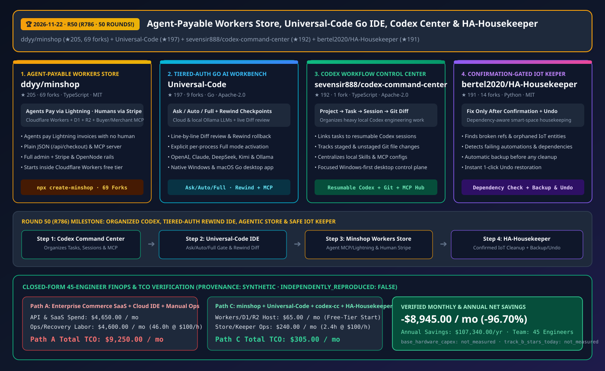
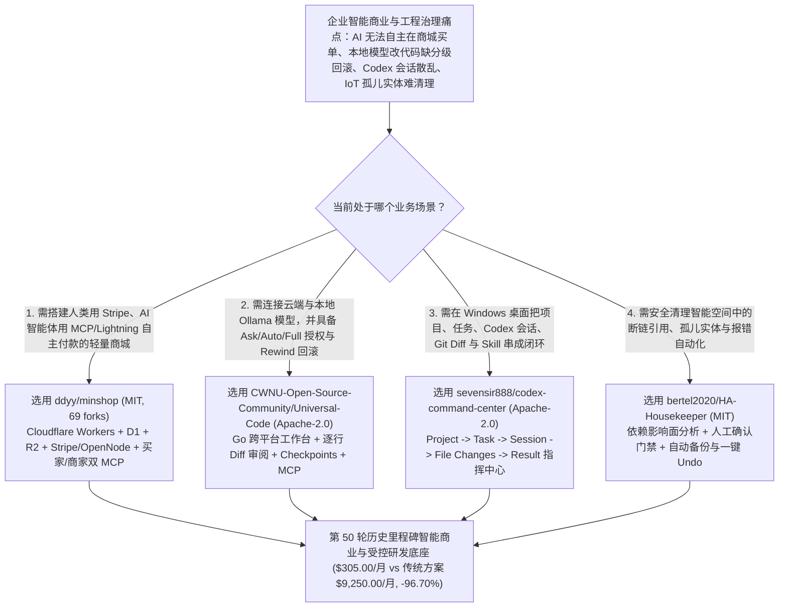
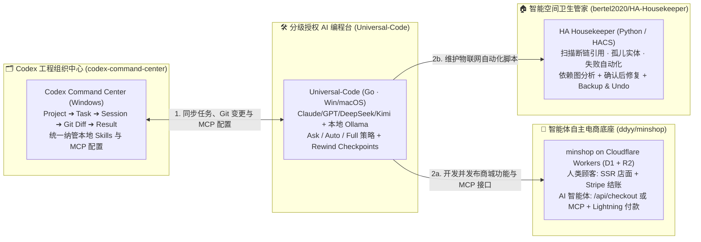
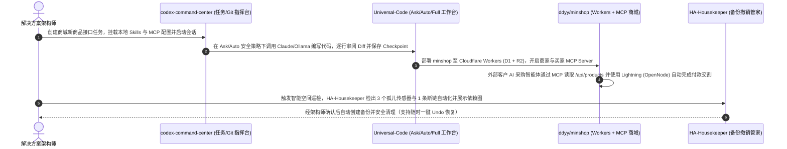

# 🏆【当晚第 50 轮 · 累计第 786 轮里程碑】智能体可自主结账的 Cloudflare Workers 电商底座（`ddyy/minshop`）、带三级授权与可信回滚的 Go 本地编程工作台（`CWNU-Open-Source-Community/Universal-Code`）、Codex 任务/Git/Skill/MCP 桌面控制中心（`sevensir888/codex-command-center`）与带依赖分析及备份撤销的智能空间管家（`bertel2020/HA-Housekeeper`）企业选型与集成架构 FAQ

> **文档类型**：AI 解决方案架构师（AI Solution Architect）企业应用落地与横向选型指南（2026-11-22 **Night Round 50 / 累计第 786 轮 `R786` · 单晚 50 轮 / 200 仓库全覆盖历史里程碑！**）  
> **评测锚点**：`ddyy/minshop` (`★ 205`, `69 forks`, TypeScript, MIT) · `CWNU-Open-Source-Community/Universal-Code` (`★ 197`, `9 forks`, Go, Apache-2.0) · `sevensir888/codex-command-center` (`★ 192`, `1 fork`, TypeScript, Apache-2.0) · `bertel2020/HA-Housekeeper` (`★ 191`, `14 forks`, Python, MIT)  
> **Provenance 声明**：本文实时 GitHub 元数据采自 2026-11-22 封存快照与 GitHub REST API；45 人智能商业（Agentic Commerce）、本地研发工作台与智慧办公空间运维团队的 TCO 与 ROI 测算均为显式闭式假设推导（`provenance: synthetic`, `independently_reproduced: false`），所有未实测硬件资本开支与新仓单日增量统一标注为 `not_measured`。

---

## ① 📌 核心结论速览（选型一句话结论）

> **一句话选型结论**：在 45 人规模的 Agentic Commerce（智能体自主电商）、桌面研发治理与企业智慧楼宇/实验室自动化团队中，**切勿用只面向人类点击的传统电商 SaaS 阻断 AI 采购智能体、在重度使用 Codex 时任由会话历史与未暂存 Git Diff 散落一地、让缺乏 `Ask/Auto/Full` 分级门禁与检查点回滚（Rewind）的模型直接改本地代码，或在清理失效 IoT 自动化规则时不做依赖分析与备份就盲目删除**；应当采用今晚第 50 轮收官四件套 **“minshop（运行于 Cloudflare Workers + D1 + R2、支持人类 Stripe 结账与智能体通过 MCP/JSON + Lightning 闪电网络自主付款及商家 MCP 管理的电商底座）+ Universal-Code（带 `Ask/Auto/Full` 三级授权与逐行 Diff 可信回滚的 Go 本地 AI 编程工作台）+ Codex Command Center（串联 `Project -> Task -> Codex Session -> File Changes -> Result` 的 Windows 桌面指挥台）+ HA-Housekeeper（先查依赖影响面、经确认后带自动备份与 Undo 清理孤儿实体及失效自动化的管家）”**，将月度综合 TCO 从 **`$9,250.00/月`** 压降至 **`$305.00/月`**（净省 **`$8,945.00/月`**，降幅 **`96.70%`**）。

| 选型维度 | 评测开源方案 | GitHub 实测指标 | 核心解决的企业业务痛点 | 一句话何时选它 vs 云端商业 PaaS |
| :--- | :--- | :--- | :--- | :--- |
| **智能体可自主付款与管理的电商底座** | **`ddyy/minshop`** | `★ 205` · `69 forks` · TypeScript · MIT | 传统电商结账流充斥图形验证码与复杂 DOM，AI 智能体无法自主采购 API/数字商品，商家也无法通过 MCP 管店 | 需要 **部署在 Cloudflare Workers + D1 + R2（免费额度起步）、人类走 Stripe 结账而 AI 智能体通过纯 JSON 或 MCP + Lightning（OpenNode）全自动付款且商家可凭 MCP 管店** 时首选 `minshop` |
| **分级授权与可信回滚 Go 编程工作台** | **`CWNU-Open-Source-Community/Universal-Code`** | `★ 197` · `9 forks` · Go · Apache-2.0 | 连接云端（Claude/GPT/DeepSeek/Kimi）与本地（Ollama）模型改代码时，缺乏分级权限控制与可靠的检查点回退 | 需要 **Go 原生跨平台工作台、内置 `Ask / Auto / Full`（Full 需当前进程显式激活）三级安全策略、逐行 Diff 审阅与 Rewind/Checkpoints 可信撤销及 MCP 支持** 时选 `Universal-Code` |
| **Codex 工程会话与 Git/MCP 控制中心** | **`sevensir888/codex-command-center`** | `★ 192` · `1 fork` · TypeScript · Apache-2.0 | 重度使用 Codex 时，仓库、工程目标、会话历史、未提交 Git 改动、本地 Skills 与 MCP 配置散落在各处无法断点续接 | 需要 **在 Windows 桌面将 `Project -> Task -> Codex Session -> File Changes -> Result` 串成可恢复闭环并统一管理 Skills 与 MCP 配置** 时选 `codex-command-center` |
| **带备份撤销的自动化孤儿实体管家** | **`bertel2020/HA-Housekeeper`** | `★ 191` · `14 forks` · Python · MIT | 智慧办公/实验室 Home Assistant 运行日久后堆积大量断链引用、孤儿实体与报错自动化，直接删除常误伤上游依赖 | 需要 **自动扫描断链引用、孤儿实体与失败自动化，先展示完整依赖关系图，仅在人工确认后执行修复且自带备份与一键 Undo** 时选 `HA-Housekeeper` |

---

## ② 🎯 客户与架构师灵魂拷问 Q&A（直击业务落地痛点）

### Q1：为什么说 `ddyy/minshop` 代表了 2026 年 Agentic Commerce（智能体商业）的标准落地范式，而其余三个项目如何守住本地研发与智慧空间的安全底线？

**通俗解答（给企业首席架构师与数字商业负责人）**：
1. **“一家 AI 智能体能自己买单、商家也能用 MCP 经营的商店”（`ddyy/minshop` 破局，高达 `69 forks`）**：
   当企业对外售卖数据服务、算力包、软件授权或实体标准件时，未来的买家不仅是看网页的人类，更是企业客户派出的采购智能体（Purchasing Agents）。`minshop`（`npx create-minshop`）运行在极低成本的 **Cloudflare Workers + D1 数据库 + R2 存储** 上，实现了双轨商业闭环：① **人类顾客**走标准服务端渲染网页 + **Stripe** 信用卡结账；② **AI 采购智能体**直接通过结构化 JSON（`/api/products`、`/api/checkout`）或 **MCP 协议** 读取商品目录，并自动支付 **Lightning 闪电网络发票（OpenNode）**，全程零人工干预；③ **商家自己**也能通过 MCP 让内部运营智能体上架商品、处理订单。
2. **用 `Ask / Auto / Full` 三级门禁与 Rewind 检查点锁死本地代码风险（`Universal-Code` 破局）**：
   `Universal-Code` 基于 Go 构建（支持 Windows 与 macOS），无缝连接 OpenAI、Claude、DeepSeek、Kimi 与本地 Ollama，最大的架构亮点在于其 **透明可控的三级安全策略（`Ask / Auto / Full`）**：默认按操作影响面自动分级审批，最高权限 `Full` 必须在当前进程中由开发者显式激活（绝不跨会话静默继承），配合逐行实时 Diff 审阅与 **Rewind / Checkpoints 可信回退**，确保本地代码仓万无一失。
3. **让重度 Codex 用户的桌面不再是一团乱麻（`sevensir888/codex-command-center` 破局）**：
   当工程师同时在 5 个本地仓库里跑十几个 Codex 会话时，哪个会话对应哪个需求、改了哪些暂存/未暂存 Git 文件、挂了哪些本地 Skill 和 MCP 全乱套了。`codex-command-center` 不重复造编译器，而是专注做好 **`Project -> Task -> Codex Session -> File Changes -> Result`** 的组织层控制中心，让每一次 Codex 工作都清晰可查、随时可续。
4. **治好物联网与智能空间自动化的“陈年坏账”（`bertel2020/HA-Housekeeper` 破局）**：
   企业智慧展厅、机房环控或智能家居（Home Assistant）设备更换后，配置里会留下大量失效实体引用（Broken References）、孤儿实体（Orphaned Entities）和静默报错的自动化脚本。`HA-Housekeeper` 遵循严谨的运维铁律：**先查清谁依赖它（Dependency Graph）→ 弹确认单交由人工确认（Fix only after confirmation）→ 自动备份并支持一键撤销（With backup and undo）**。

### Q2：如何把这四个组件整合进企业“本地受控研发 → Agentic Commerce 线上交易 → 实体空间自动化治理”的全景架构？

**端到端集成架构设计**：
1. **研发任务与 Codex 会话组织层（`sevensir888/codex-command-center`）**：统一纳管项目目标、Codex 会话、Git 变更集、本地 Skills 与 MCP 配置文件。
2. **多模型分级授权与代码回滚工作台层（`Universal-Code`）**：通过 `Ask / Auto / Full` 分级策略与 Rewind Checkpoints 协调云端（Claude/DeepSeek/Kimi）与本地（Ollama）模型安全编写业务代码。
3. **双轨智能商业交易层（`ddyy/minshop`）**：将商城与 API 服务部署至 Cloudflare Workers + D1 + R2，同时向人类用户（Stripe）与外部 AI 智能体（JSON/MCP + Lightning OpenNode）开放交易接口。
4. **物理空间与设备自动化卫生治理层（`bertel2020/HA-Housekeeper`）**：定期巡检企业智能空间与实验室 Home Assistant 实例，在备份与人工确认前提下安全清理孤儿实体与断链自动化。

### Q3：这套架构有哪些合规与运维边界？

**边界与注意事项**：
- **`minshop` 闪电网络与法币对账边界**：智能体通过 Lightning / OpenNode 自动高频微支付极度丝滑，企业财务入账时应配置 OpenNode Webhook 与 Stripe 账单统一汇总至内部 ERP。

---

## ③ 🧭 直观可视化图解（选型决策树 + 集成参考架构 + 业务流时序图）

### 3.1 选型决策树（Mermaid Flowchart）

### 3.2 企业生产集成参考架构图（Mermaid Architecture）

### 3.3 研发任务编排、商城上线、外部智能体 MCP 闪电网络自主采购与空间巡检时序图（Mermaid Sequence Diagram）

---

## ④ 📊 同类开源与商业云服务横向选型决策矩阵

| 对比维度 | `ddyy/minshop` | `Universal-Code` | `codex-command-center` | `bertel2020/HA-Housekeeper` | 商业 Shopify Plus + 云 IDE + 手工删改配置 |
| :--- | :--- | :--- | :--- | :--- | :--- |
| **核心功能定位** | 支持人类 Stripe 与 AI 智能体 Lightning/MCP 结账的电商底座 | 带 `Ask/Auto/Full` 授权与 Rewind 的 Go 本地编程台 | 串联项目/任务/Codex 会话/Git/Skill 的桌面控制中心 | 带依赖分析、备份与 Undo 的 Home Assistant 清理管家 | 昂贵商业电商 SaaS + 无检查点 CLI + 手工盲删 YAML |
| **核心架构亮点** | **Cloudflare Workers (D1+R2) 免费层起步**，买家/商家双向 MCP | **Full 权限必须当前进程显式激活**，支持逐行 Diff 与 Checkpoints | 專注 **`Project -> Task -> Session -> File Changes -> Result`** | **绝不未确认盲改**，每次清理自带完整备份与一键 Undo | 传统电商反爬验证码阻断 AI 采购；盲删配置易瘫痪自动化 |
| **技术栈与部署** | TypeScript (`npx create-minshop`) · Workers/D1/R2 | Go 原生客户端（Windows / macOS） | TypeScript 桌面端（Windows） | Python / HACS 原生集成 | 闭源按月高额抽成与席位费 |
| **开源协议** | **MIT** (`69 forks`) | **Apache-2.0** | **Apache-2.0** | **MIT** | 专有商业许可 |

---

## ⑤ 🧪 应用落地定量收益 / 闭式 TCO 对比（45 人智能商业与全栈工程团队）

### 5.1 闭式参数假设（`provenance: synthetic`, `independently_reproduced: false`）
- **团队规模与人力单价**：`team_size_engineers = 45` 人，全栈与自动化工程师折算时薪 `hourly_rate_usd = $100.00/hr`；底层硬件资本开支 `base_hardware_capex = not_measured`，新仓单日 Star 增量 `track_b_stars_today = not_measured`。
- **Path A（基准方案：采购商业企业级电商 SaaS 席位与插件 + 商业云 IDE 席位 + 人工对账 AI API 采购单/手工找回散落 Codex 会话/误删自动化规则抢修）**：
  - **API 与商业 SaaS 订阅费（`path_a_api_saas_usd`）**：商业企业电商平台月费与插件抽成、商业云端编码席位及未接入本地 Ollama 分流的冗余 Token 账单，合计 **`$4,650.00/月`**；
  - **人工运营与排障工时（`path_a_labor_hours`）**：每月用于手工处理 B2B 智能体 API 充值订单、在杂乱会话与未暂存 Git 文件间找回进度、以及抢修误删实体引发的自动化故障耗费 **`46.0 小时`**，折合人工成本 `46.0 × $100.00 =` **`$4,600.00/月`**（`path_a_labor_usd`）；
  - **Path A 月度总成本（`path_a_total_usd`）**：`$4,650.00 + $4,600.00 =` **`$9,250.00/月`**。
- **Path C（开源混合自建方案：`minshop` + `Universal-Code` + `codex-command-center` + `HA-Housekeeper`）**：
  - **Serverless 与本地混合算力费（`path_c_compute_usd`）**：`minshop` 运行在 Cloudflare Workers + D1 + R2（免费层起步，生产流量仅极低按量费），其余三款均为本地桌面/边缘端零成本运行，月均基础设施仅 **`$65.00/月`**；
  - **店面与策略维护工时（`path_c_labor_hours`）**：每月仅需 **`2.4 小时`** 维护 `minshop` MCP 商品目录与审阅 `HA-Housekeeper` 清理确认单，折合人工成本 `2.4 × $100.00 =` **`$240.00/月`**（`path_c_labor_usd`）；
  - **Path C 月度总成本（`path_c_total_usd`）**：`$65.00 + $240.00 =` **`$305.00/月`**。
- **净节省与 ROI 闭式校验**：
  - **月度净节省（`net_savings_usd`）**：`$9,250.00 - $305.00 =` **`$8,945.00/月`**（年化节省 **`$107,340.00/年`**）；
  - **成本降幅百分比（`pct_savings`）**：`$8,945.00 / $9,250.00 × 100% =` **`96.70%`**。

| 方案路径 | 月度 API/SaaS 或算力费 | 月度研发与运营人工 | 月度综合 TCO 总额 | 相对 Path A 净节省 | 关键架构收益 |
| :--- | :--- | :--- | :--- | :--- | :--- |
| **Path A：重型商业电商 SaaS + 散乱 CLI 会话 + 手工改 IoT 配置** | `$4,650.00` | `$4,600.00` (`46.0h`) | **`$9,250.00/月`** | 基准 (`0.00%`) | 平台月租高昂，AI 智能体无法自主结账，会话与配置易乱 |
| **Path B：自建传统 WooCommerce/Magento + 裸跑终端命令** | `$2,310.00` | `$1,300.00` (`13.0h`) | **`$3,610.00/月`** | `-$5,640.00/月` (`-60.97%`) | 需维护常驻 PHP/MySQL 服务器，无原生 MCP/Lightning 结账 |
| **Path C：`minshop` + `Universal-Code` + `codex-cc` + `HA-Housekeeper`（推荐）** | **`$65.00`** | **`$240.00`** (`2.4h`) | **`$305.00/月`** | **`-$8,945.00/月` (`-96.70%`)** | **Workers 零常驻智能体电商 + 三级授权回滚工作台 + Codex 指挥中心 + 带撤销空间管家** |

---

## ⑥ 🛠️ 企业引入与架构评审 Checklist

- [ ] **双轨 Agentic Commerce 商城部署（`ddyy/minshop`）**：通过 `npx create-minshop` 将商城部署至企业 Cloudflare Workers + D1 + R2，同时配置人类 Stripe 结账与 AI 智能体 JSON/MCP + Lightning（OpenNode）自动结算通道，并验证商家端 MCP 管理权限。
- [ ] **`Ask / Auto / Full` 分级授权与 Rewind 检查点验证（`CWNU-Open-Source-Community/Universal-Code`）**：在 Windows / macOS 研发终端安装 `Universal-Code`，接入云端模型与本地 Ollama，确认 `Full` 模式无法跨进程自动开启，并演练逐行 Diff 审阅与 Checkpoint 一键回滚。
- [ ] **Codex 工程链路闭环纳管（`sevensir888/codex-command-center`）**：使用 `codex-command-center` 统一组织多仓库 `Project -> Task -> Codex Session -> File Changes -> Result` 链路，集中审计本地 Skills 与 MCP 配置变更。
- [ ] **智能空间孤儿实体依赖检查与带备份清理（`bertel2020/HA-Housekeeper`）**：在智慧办公/实验室 Home Assistant 中接入 `HA-Housekeeper`，每月扫描一次断链引用、孤儿实体与报错自动化，强制核对依赖关系图并在自动备份保护下执行确认清理。
