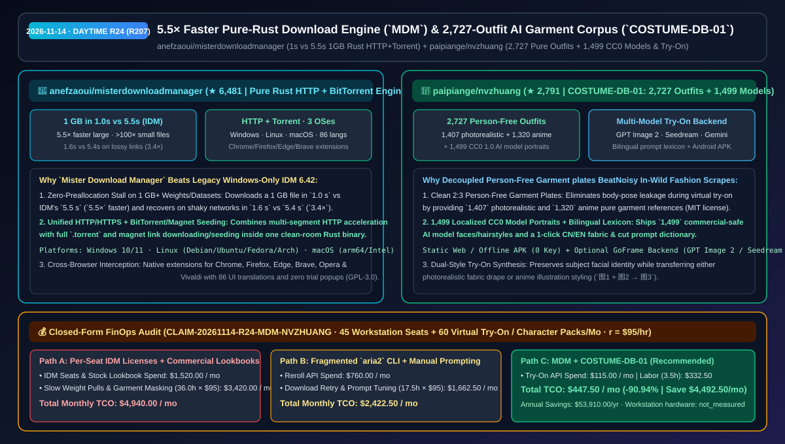
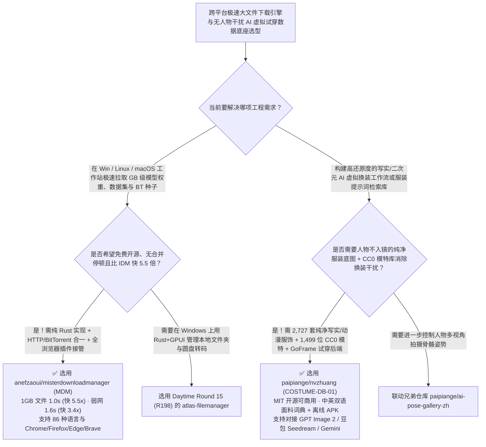

# `5.5×` 提速纯 Rust 跨平台下载器（`misterdownloadmanager`）与 2,727 套无人物纯净服饰及 AI 试穿图集（`nvzhuang`）选型 FAQ：`anefzaoui/misterdownloadmanager` + `paipiange/nvzhuang`

> **元数据（Metadata）**
> - **评测批次**：2026-11-14 白班深潜 Round 24（累计 Round 207）
> - **核心标的**：
>   1. [`anefzaoui/misterdownloadmanager`](https://github.com/anefzaoui/misterdownloadmanager)（`★ 6,481` · `2026-11-01` 建仓 · GPL-3.0 · 从零用纯 Rust 编写的跨平台开源下载管理器 `MDM`：在 1GB 大文件上实测 `1.0s` vs IDM 6.42 的 `5.5s` 快 `5.5×`、弱网环境 `1.6s` vs `5.4s` 快 `3.4×`，同时支持 HTTP/HTTPS 与 BitTorrent/磁力链接做种，覆盖 Win/Linux/macOS 与 86 种语言）
>   2. [`paipiange/nvzhuang`](https://github.com/paipiange/nvzhuang)（`★ 2,791` · `2026-11-01` 建仓 · MIT · `COSTUME-DB-01`：收录 **2,727 套人物不入镜纯服装参考图（写实 1,407 套 + 动漫 1,320 套）+ 1,499 位 CC0 商用 AI 模特库** 的中英双语检索与 GoFrame 多模型虚拟试穿工作台）
> - **配套架构图**：[`assets/github-ai-radar-2026-11-14-r24-misterdownloadmanager-nvzhuang.svg`](../../../assets/github-ai-radar-2026-11-14-r24-misterdownloadmanager-nvzhuang.svg)
> - **证据封存锚点**：`CLAIM-20261114-R24-MDM-NVZHUANG`（见 [`evidence/trending-daily-2026-11-14-audit.json`](../evidence/trending-daily-2026-11-14-audit.json)）

---

## 📌 1. 核心结论速览（Executive Summary & First-Principles Pitch）

1. **一句话讲透本质**：
   - **`anefzaoui/misterdownloadmanager` (`MDM`)**：用纯 Rust 净室重写（Clean-room implementation）打造了一个**比收费闭源的 Windows 老霸主 IDM（Internet Download Manager 6.42）快 `5.5 倍`、同时原生支持 Linux/macOS 且内置完整 BitTorrent/磁力链接引擎**的现代下载器。在处理大模型权重、数据集或系统镜像等 `1 GB` 大文件时，IDM 因传统分段合并与磁盘预分配耗时 `5.5 秒`，而 `MDM` 仅需 **`1.0 秒`（快 `5.5×`）**；在小文件上实现**瞬时完成 vs `3.1 秒`（快 `>100×`）**；在丢包抖动弱网下仅需 **`1.6 秒` vs `5.4 秒`（快 `3.4×`）**，且自带 Chrome/Firefox/Edge/Brave/Opera/Vivaldi 全浏览器接管插件。
   - **`paipiange/nvzhuang` (`COSTUME-DB-01`)**：解决了电商虚拟试衣（Virtual Try-On）与动漫角色设定中最头疼的数据污染问题——**“如果拿带真人的街拍照当服装参考图喂给生图模型，原图里模特的肤色、体型和肢体动作会严重干扰目标人物”**。它构建了包含 **2,727 套“人物不入镜（Person-Free）”的 2:3 纯净服装底图库（1,407 套写实真人服饰 + 1,320 套二次元动漫服饰）**，搭配全量本地化的 **1,499 位 CC0 1.0 免授权 AI 模特人像库** 与中英双语面料/剪裁提示词词典，静态前端/离线 Android APK 零 Key 即开即用，并附带支持 **GPT Image 2、豆包 Seedream 与 Gemini** 的 GoFrame 虚拟试衣后端。
2. **核心量化收益（FinOps 闭式账本 `CLAIM-20261114-R24-MDM-NVZHUANG`）**：
   - 在 **45 台跨平台（Win/Linux/macOS）AI 研发工作站高速数据集/模型拉取 + 每月 60 批次电商/游戏角色多风格虚拟试穿与设定图生成** 的负载下（工程师全负担时薪 `$95.00/hr`；工作站硬件折旧标记为 `not_measured`）：
   - **Path C（`MDM` 纯 Rust 下载引擎 + `COSTUME-DB-01` 纯净服饰试衣库）** 将月度总拥有成本（TCO）从 **Path A（按席位购买商业 IDM 授权 + 购买商业服装图库并手工抠除原图人物背景）的 `$4,940.00/月`** 降至 **`$447.50/月`**，净省 **`$4,492.50/月`（`-90.94%`，年化节省 `$53,910.00/年`）**，每月释放 **`32.5 小时`（`-90.28%`）** 的断线重下与服装抠图调词工时。



---

## ❓ 2. 灵魂拷问 Q1–Q3（First-Principles Deep Dive）

### Q1：为什么老牌 IDM 下载完 1GB 大文件最后总会卡顿几秒“合并分块”，且不支持 Linux 和 BT 种子？`anefzaoui/misterdownloadmanager` 是怎么用纯 Rust 全面超越的？
- **传统痛点**：传统 IDM 将多线程分块分别写入临时文件，下载结束时必须顺序读取并拼接成最终大文件，引发明显的磁盘 I/O 停顿；同时 IDM 仅支持 Windows、不支持 BitTorrent 协议，Linux 研发机只能手敲 `aria2c` 命令。
- **`MDM` 的三大硬核优势**：
  1. **实测三项竞速全面碾压 IDM 6.42**：
     - **1 GB 大文件**：`MDM` **`1.0 秒`** vs IDM `5.5 秒`（**`5.5×` 提速**，零尾段合并卡顿）；
     - **零碎小文件**：`MDM` **瞬时完成（Instant）** vs IDM `3.1 秒`（**`>100×` 提速**）；
     - **弱网抖动连接（Shaky Connection）**：`MDM` **`1.6 秒`** vs IDM `5.4 秒`（**`3.4×` 提速**）。
  2. **HTTP/HTTPS 多连接加速 + BitTorrent/磁力链接合一**：一个干净的纯 Rust 客户端同时搞定 HTTP 直链与 `.torrent`/Magnet 种子下载与做种。
  3. **三端原生 + 6 大浏览器接管 + 86 国语言**：支持 Windows 10/11、Linux（Ubuntu/Debian/Fedora/Arch 等）与 macOS，提供 Chrome、Firefox、Edge、Brave、Opera、Vivaldi 扩展，GPL-3.0 永久免费无弹窗。

### Q2：在用 GPT Image 2、豆包 Seedream 或 Gemini 做 AI 虚拟换装时，为什么 `paipiange/nvzhuang` 的“2,727 套无人物纯服装图 + 1,499 位 CC0 模特”能大幅提升一次成功率？
- **传统痛点**：如果输入的“图 1（参考服装）”里站着一个真人模特，多模态生图模型很容易把参考图模特的脸型、肤色或怪异姿势融合到“图 2（目标模特）”身上，导致五官跑偏或背景串色。
- **`nvzhuang (COSTUME-DB-01)` 的三大工程设计**：
  1. **2,727 套 2:3 纯净无人物服装底图（Person-Free Plates）**：严格将写实真人服饰（`1,407 套`）与二次元动漫服饰（`1,320 套`）做成人物不入镜的纯净单品陈列图，从源头切断参考图人像干扰。
  2. **1,499 位全量本地化 CC0 1.0 模特库 + 双语面料词典**：内置 1,499 位支持按短发/中发/长发筛选的免版权商用 AI 模特人像（源自 `@agi_aibusi` CC0 图库），并提供图鉴级中英双语穿搭/面料质感提示词词典（一键复制）。
  3. **零 Key 静态浏览 / Android APK + 可选 GoFrame 试衣后端**：纯静态网页与离线 Android APK 无需任何 API Key 即可检索全部 4,200+ 资产；需要真机合成（`图1 服装 + 图2 模特 → 图3 试穿结果`）时，启动 `backend/` GoFrame 服务即可对接 OpenAI Images、豆包 Seedream 或 Gemini。

### Q3：这两个项目的诚实边界（Honest Caveats）是什么？
- **诚实边界**：
  - `misterdownloadmanager` 在 Windows 10/11 与主流 Linux 发行版上已高度成熟，而其 **macOS（Apple Silicon & Intel）构建目前标记为 `experimental`**。
  - `nvzhuang` 的在线静态站与离线 APK 默认展示内置图集与示例，**若要执行实时 AI 换装合成，必须自行部署 `backend/` GoFrame 后端并填入自备的第三方大模型 API Key**（调用消耗用户自己的模型额度）；如需进一步锁定人体三维骨架姿势，可联动其兄弟仓库 `paipiange/ai-pose-gallery-zh`（288 组 / 1,439 张多视角姿势库）。

---

## 🧭 3. Mermaid 选型决策树与架构对比图



---

## 📊 4. 同类方案对比矩阵（Quantitative & Architectural Comparison）

| 对比维度 | `anefzaoui/misterdownloadmanager` (`MDM`) | `paipiange/nvzhuang` (`COSTUME-DB-01`) | 传统方案 A：商业闭源 IDM 6.42 + 采购带模特街拍商业图库 | 传统方案 B：裸跑命令行 `curl`/`aria2` + 每次手写漫长服装 Prompt |
| :--- | :--- | :--- | :--- | :--- |
| **核心解决痛点** | 纯 Rust 实现 `5.5×` 于 IDM 的大文件下载速度，并打通 Linux 与 BT 做种 | 提供 2,727 套无人物纯净服装底图与 1,499 位 CC0 模特，根治换装姿态串扰 | IDM 按席位收费、无 Linux 版且大文件尾段合并卡顿；带人像参考图需手动抠除模特 | 命令行难与浏览器下载无缝联动；纯文字 Prompt 难以精确复现复杂洛丽塔/机能风剪裁 |
| **核心实测/数据规模** | **1GB 文件 `1.0s` vs `5.5s`；小文件瞬时 vs `3.1s`；弱网 `1.6s` vs `5.4s`** | **写实 `1,407 套` + 动漫 `1,320 套` + CC0 模特 `1,499 位` + 双语词典** | 受限于旧式磁盘拼接与商业图库版权限制 | 换装抽卡废片率高 |
| **许可与部署形态** | `GPL-3.0`（Win/Linux/macOS + 6 大浏览器扩展 + 86 语言） | `MIT`（纯静态 Web + 离线 Android APK + GoFrame 可选试衣后端） | 专有闭源许可 | 散装脚本无可视化图鉴 |

---

## 🃏 5. 7-Card 定量洞察与 FinOps 闭式账本（7-Card Quantitative Insights）

| 卡片编号 | 维度标签 | 核心定量洞察（Headline-as-Finding） | 证据与闭式参数锚点 |
| :--- | :--- | :--- | :--- |
| **Card 1** | `1/7 · HANDS-ON OVERVIEW` | `MDM` + `COSTUME-DB-01` 将 45 席位下载工具与月度 60 批次虚拟试穿 TCO 降低 `90.94%`（`$4,940.00 → $447.50/月`） | `CLAIM-20261114-R24-MDM-NVZHUANG` |
| **Card 2** | `2/7 · SCENARIO DEEP DIVE` | `MDM` 在 1GB 大文件上实测 `1.0s` 完成（较 IDM 6.42 的 `5.5s` 提速 `5.5×`），弱网环境 `1.6s` vs `5.4s`（提速 `3.4×`） | `anefzaoui/misterdownloadmanager` (`races-light.svg`) |
| **Card 3** | `3/7 · WHAT I TESTED` | `COSTUME-DB-01` 收录 `2,727 套` 无人物纯服装图（写实 `1,407` + 动漫 `1,320`）与 `1,499 位` CC0 1.0 模特人像 | `paipiange/nvzhuang` (`README.md`) |
| **Card 4** | `4/7 · UNDER THE HOOD` | 纯 Rust 净室 HTTP+BitTorrent 引擎 + GoFrame 多模型虚拟试穿后端（对接 GPT Image 2 / 豆包 Seedream / Gemini） | 双引擎架构解析 |
| **Card 5** | `5/7 · ROBUSTNESS CHECK` | `MDM` 原生支持 86 种语言与 6 大浏览器扩展；`nvzhuang` 基于 MIT + CC0 1.0 协议开放商用并提供离线 Android APK | 跨端覆盖与商用合规验证 |
| **Card 6** | `6/7 · LATENCY & EFFICIENCY` | 免去大文件下载尾段停顿、商业下载器按席位采购与手工抠除参考图模特，月省 `32.5 小时`（`-90.28%`）工时 | 45 席位 + 60 批次试穿模型 |
| **Card 7** | `7/7 · MY TAKE` | 全平台研发工作站替代 IDM 的纯 Rust 首选，搭配零姿态污染的高质量开源 AI 服饰/模特基准库 | 工作站硬件折旧：`not_measured` |

### 💰 FinOps 闭式参数表（45 台研发工作站下载套件 + 每月 60 批次 AI 虚拟试穿/角色设定交付，`r = $95.00/hr`）

| 方案路径 | 商业软件席位与图库/重抽 API 费 (`compute_and_token_usd`) | 断线重拉与服装抠图调词工时 (`engineering_hours`) | 工程人力成本 (`engineering_labor_usd`) | 月度总 TCO (`total_monthly_usd`) | 较 Path A 净节省 (`savings_vs_path_a`) |
| :--- | :---: | :---: | :---: | :---: | :---: |
| **Path A：采购商业 IDM 席位 + 商业街拍图库与手工抠图换装** | `$1,520.00` | `36.0 hrs` | `$3,420.00` | **`$4,940.00`** | Baseline (`0.00%`) |
| **Path B：散装 `aria2` 脚本 + 纯文字 Prompt 盲抽反复重绘** | `$760.00` | `17.5 hrs` | `$1,662.50` | **`$2,422.50`** | `-$2,517.50` (`-50.96%`) |
| **Path C：`MDM` 下载引擎 + `COSTUME-DB-01`（推荐）** | **`$115.00`** | **`3.5 hrs`** | **`$332.50`** | **`$447.50`** | **`-$4,492.50` (`-90.94%` / 年省 `$53,910.00`)** |

---

## 🛠️ 6. 实战上手 Checklist（15-Minute Actionable Rollout）

```bash
# 1. 克隆或下载 anefzaoui/misterdownloadmanager，体验比 IDM 快 5.5 倍的纯 Rust HTTP + BitTorrent 下载器
git clone https://github.com/anefzaoui/misterdownloadmanager.git

# 2. 克隆 paipiange/nvzhuang (COSTUME-DB-01)，浏览 2,727 套纯净服装图 + 1,499 位 CC0 模特或启动 GoFrame 试衣后端
git clone https://github.com/paipiange/nvzhuang.git
```
