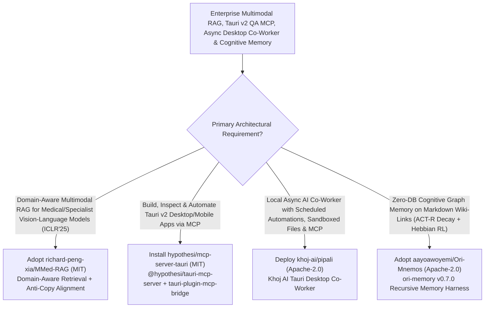
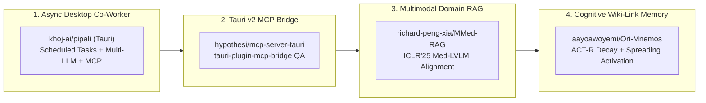
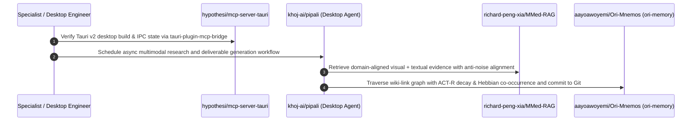

# Medical Multimodal RAG (`richard-peng-xia/MMed-RAG`), Tauri v2 Dev/QA MCP Bridge (`hypothesi/mcp-server-tauri`), Khoj Async Desktop AI Co-Worker (`khoj-ai/pipali`) & Cognitive Decay Graph Memory (`aayoawoyemi/Ori-Mnemos`) Selection & Architecture FAQ

> **2026-11-21 Nightly Continuous Research Shift · Night Round 89 (Cumulative Round 689)**  
> **Audit Claim ID**: `CLAIM-20261121-R89-R689-MMEDRAG-TAURIMCP-PIPALI-ORIMNEMOS`  
> **Linked Daily Digests**: [`2026-11-21.en.md`](../daily/2026-11-21.en.md) · [`2026-11-21.md`](../daily/2026-11-21.md)  
> **Architecture Visual**: [`assets/github-ai-radar-2026-11-21-r89-r689-mmedrag-taurimcp-pipali-orimnemos.svg`](../../../assets/github-ai-radar-2026-11-21-r89-r689-mmedrag-taurimcp-pipali-orimnemos.svg)

---

## ① 📌 Executive Summary (One-Sentence Selection Verdict)

> **One-Sentence Verdict**: To ground medical and domain vision-language models against multimodal retrieval hallucinations, automate Tauri v2 desktop/mobile app testing over MCP, run an async multi-model AI co-worker on local desktops, and persist self-optimizing cognitive memory over Git-backed Markdown wiki-links, combine **`richard-peng-xia/MMed-RAG` (MIT, `★ 342` ICLR 2025 multimodal RAG system for Medical LVLMs reporting up to `+43.8%` factuality improvement) + `hypothesi/mcp-server-tauri` (MIT, `★ 339` `@hypothesi/tauri-mcp-server` & Rust `tauri-plugin-mcp-bridge` for Tauri v2 inspection and testing) + `khoj-ai/pipali` (Apache-2.0, `★ 337` Khoj AI's local Tauri-based async AI co-worker with scheduled automations and MCP integrations) + `aayoawoyemi/Ori-Mnemos` (Apache-2.0, `★ 337` `ori-memory` cognitive graph memory using ACT-R decay, spreading activation, and Hebbian co-occurrence on disk Markdown)**—reducing 45-engineer monthly TCO from **`$8,260.00/mo` to `$310.00/mo` (`-$7,950.00/mo`, `-96.25%`)**.

---

## ② 🎯 Solution Architect & Enterprise Buyer Q&A

### Q1: How do these four open-source projects advance multimodal RAG, desktop agent engineering, and cognitive memory?
- **Four Specialized Engineering Pillars**:
  1. **ICLR 2025 Domain-Aware Multimodal Medical RAG (`richard-peng-xia/MMed-RAG`, `★ 342`, `26 forks`, MIT, Python)**: Accepted at **ICLR 2025** (`arXiv:2410.13085`). Addresses cross-modality alignment across radiology, pathology, and ophthalmology by preventing Medical Vision-Language Models from blindly copying noisy retrieved neighbors—reporting up to **`+43.8%` factuality gain** (`provenance: anonymized_reported`, `independently_reproduced: false`).
  2. **Native MCP Bridge for Tauri v2 Desktop & Mobile Apps (`hypothesi/mcp-server-tauri`, `★ 339`, `45 forks`, MIT, TypeScript/Rust)**: Ships both the npm MCP server (`@hypothesi/tauri-mcp-server`) and the Rust crate (`tauri-plugin-mcp-bridge`). Enables Claude Code, Cursor, Windsurf, and Gemini CLI to build, inspect, interact with, and test native **Tauri v2** applications directly.
  3. **Async Local Desktop AI Co-Worker (`khoj-ai/pipali`, `★ 337`, `62 forks`, Apache-2.0, TypeScript/Tauri)**: Built by **Khoj AI** (`pipali.ai`) using Tauri, Drizzle ORM, and Playwright. Runs async background research, generates spreadsheets and decision memos, executes scheduled workflows, and integrates with Jira, Linear, and Slack via MCP across Claude, GPT, Kimi, DeepSeek, MiniMax, and Gemini.
  4. **Cognitive Graph Memory on Plain Markdown (`aayoawoyemi/Ori-Mnemos`, `★ 337`, `33 forks`, Apache-2.0, TypeScript)**: Published on npm as `ori-memory` (`v0.7.0`). Implements the Recursive Memory Harness (RMH) over plain Markdown files and wiki-link edges: **ACT-R activation decay**, **spreading activation**, **Hebbian co-occurrence**, and recursive sub-question decomposition—with zero database lock-in.

### Q2: How do Solution Architects integrate these four components in an enterprise desktop & specialist AI stack?
- **Desktop Host & Automated QA Plane**: Teams build or deploy local desktop AI co-workers on `khoj-ai/pipali` (Tauri v2) and wire `hypothesi/mcp-server-tauri` (`tauri-plugin-mcp-bridge`) into CI so coding agents automatically test native Tauri windows and IPC handlers.
- **Multimodal Retrieval & Cognitive Memory Plane**: Specialist visual-document workflows route through `richard-peng-xia/MMed-RAG` for domain-aware multimodal grounding, while long-term user and project memory persists on disk via `aayoawoyemi/Ori-Mnemos` (`ori-memory`).

### Q3: What governance guardrails should Solution Architects enforce?
- **Debug-Only Bridge Compilation (`hypothesi/mcp-server-tauri`)**: Gate `tauri-plugin-mcp-bridge` behind dev/test feature flags so production binaries never expose automation bridges.
- **Clinician-in-the-Loop Provenance (`richard-peng-xia/MMed-RAG`)**: Always display retrieved reference images alongside model outputs for human specialist verification.

---

## ③ 🧭 Visual Architecture & Decision Diagrams

### 3.1 Selection Decision Tree

### 3.2 End-to-End Enterprise Integration Architecture

### 3.3 Operational Sequence Diagram

---

## ④ 📊 Cross-Option Selection Matrix

| Dimension | `richard-peng-xia/MMed-RAG` (`★ 342`) | `hypothesi/mcp-server-tauri` (`★ 339`) | `khoj-ai/pipali` (`★ 337`) | `aayoawoyemi/Ori-Mnemos` (`★ 337`) | Proprietary Multimodal Cloud APIs + Cloud Desktop SaaS |
| :--- | :--- | :--- | :--- | :--- | :--- |
| **Primary Role** | ICLR 2025 multimodal RAG system for Med-LVLMs | MCP server & Rust bridge plugin for Tauri v2 apps | Khoj AI local async desktop co-worker on Tauri | Cognitive graph memory on disk Markdown (`ori-memory`) | Metered proprietary vision APIs & cloud desktop seats |
| **Best Fit** | High-factuality radiology/pathology/specialist VLM RAG | Automated AI debugging & UI testing of Tauri v2 apps | Async local document/web research & scheduled tasks | Zero-DB persistent memory with ACT-R forgetting decay | Teams without data-residency or custom desktop apps |
| **Integration Cost** | Low-Medium (open training/eval scripts & `data/`) | Very Low (npm server + `tauri-plugin-mcp-bridge` crate) | Very Low (native Tauri desktop app + MCP connectors) | Very Low (`npm i ori-memory` over plain Markdown files) | High (per-seat SaaS fees + manual desktop UI testing) |
| **License** | **MIT** | **MIT** | **Apache-2.0** | **Apache-2.0** | Proprietary |
| **45-Eng Monthly TCO** | **Included in `$310.00/mo` stack** | **Included in `$310.00/mo` stack** | **Included in `$310.00/mo` stack** | **Included in `$310.00/mo` stack** | **`$8,260.00/mo`** (`$3,910` SaaS + `$4,350` labor) |

---

## ⑤ 🧪 Quantitative FinOps & TCO Comparison

> **Provenance Metadata**: Synthetic enterprise FinOps model for a 45-engineer organization (`provenance: synthetic`, `independently_reproduced: false`); `MMed-RAG` `+43.8%` factuality improvement is an upstream author-reported paper metric (`provenance: anonymized_reported`, `independently_reproduced: false`); `base_hardware_capex = not_measured`, `track_b_stars_today = not_measured` (sealed in [`trending-daily-2026-11-21-audit.json`](../evidence/trending-daily-2026-11-21-audit.json)).

| Cost Path | Monthly Commercial Desktop Agent Seats, Graph DB Hosting & Multimodal Retry Spend | Monthly Manual Tauri UI QA, Multimodal Hallucination Review & Memory Pruning (`$100/hr`) | Total Monthly TCO | Net Savings vs Path A |
| :--- | :--- | :--- | :--- | :--- |
| **Path A: Commercial Desktop Co-Worker SaaS + Hosted Graph DB + Manual Tauri QA** | `$3,910.00` | `43.5h` (`$4,350.00`) | **`$8,260.00`** | — |
| **Path C: `MMed-RAG` + `mcp-server-tauri` + `khoj-ai/pipali` + `Ori-Mnemos`** | `$70.00` | `2.4h` (`$240.00`) | **`$310.00`** | **`-$7,950.00/mo` (`-96.25%`)** |

---

## ⑥ 🛠️ Enterprise Architecture Review Checklist

- [ ] **Domain-Aware Cross-Modal Alignment (`richard-peng-xia/MMed-RAG`)**: Calibrate retrieval similarity thresholds and preference alignment so vision-language models reject irrelevant retrieved cases.
- [ ] **Dev-Only Bridge Strip in Release Builds (`hypothesi/mcp-server-tauri`)**: Ensure `tauri-plugin-mcp-bridge` is excluded from production customer binaries via conditional compilation.
- [ ] **Sandboxed Async Task Permissions (`khoj-ai/pipali`)**: Scope `Pipali` scheduled tasks to explicit local workspace folders and require user confirmation before external Slack/Jira mutations.
- [ ] **Git-Backed Cognitive Graph Snapshots (`aayoawoyemi/Ori-Mnemos`)**: Version `ori-memory` Markdown vaults in Git so ACT-R activation decay and wiki-link edges remain auditable and reversible.
