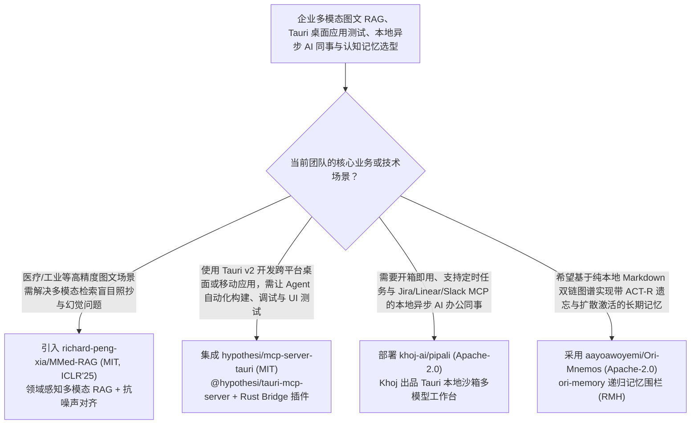
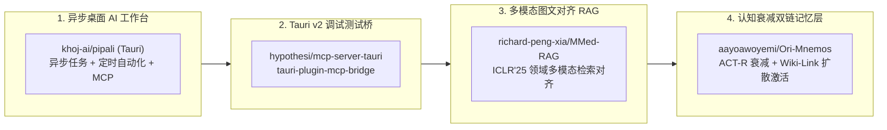
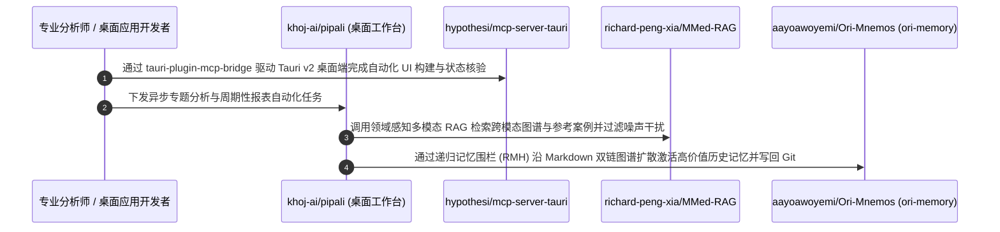

# 医疗多模态影像 RAG 系统（`richard-peng-xia/MMed-RAG`）、Tauri v2 桌面/移动调试 MCP 桥（`hypothesi/mcp-server-tauri`）、Khoj 异步桌面数字员工（`khoj-ai/pipali`）与认知衰减图谱记忆引擎（`aayoawoyemi/Ori-Mnemos`）架构选型与落地 FAQ

> **2026-11-21 夜间持续研究班次 · Night Round 89（累计 Round 689）**  
> **审计凭据**：`CLAIM-20261121-R89-R689-MMEDRAG-TAURIMCP-PIPALI-ORIMNEMOS`  
> **关联日刊**：[`2026-11-21.md`](../daily/2026-11-21.md) · [`2026-11-21.en.md`](../daily/2026-11-21.en.md)  
> **可视化架构图**：[`assets/github-ai-radar-2026-11-21-r89-r689-mmedrag-taurimcp-pipali-orimnemos.svg`](../../../assets/github-ai-radar-2026-11-21-r89-r689-mmedrag-taurimcp-pipali-orimnemos.svg)

---

## ① 📌 核心结论速览（选型一句话结论）

> **一句话选型结论**：在构建涵盖“**医疗放射/病理/眼科多模态影像事实性增强 RAG ➔ Tauri v2 跨平台桌面与移动应用自动化调试 MCP ➔ 支持定时任务与多模型切换的本地桌面 AI 办公搭档 ➔ 基于 ACT-R 认知衰减与 Wiki-Link 扩散激活的无数据库长期记忆**”方案时，推荐采用 100% 宽松协议（MIT / Apache-2.0）的四件套：**“`richard-peng-xia/MMed-RAG`（MIT，`★ 342` ICLR 2025 录用的医疗视觉语言模型多模态 RAG 系统，作者报告事实性最高提升 `43.8%`）+ `hypothesi/mcp-server-tauri`（MIT，`★ 339` 含 npm `@hypothesi/tauri-mcp-server` 与 Rust `tauri-plugin-mcp-bridge` 的 Tauri v2 专用调试测试 MCP）+ `khoj-ai/pipali`（Apache-2.0，`★ 337` 知名开源团队 Khoj AI 基于 Tauri 构建的异步桌面 AI 数字同事）+ `aayoawoyemi/Ori-Mnemos`（Apache-2.0，`★ 337` 基于 ACT-R 遗忘曲线、赫布共现与 Markdown Wiki-Link 图遍历的认知记忆引擎 `ori-memory`）”**。在 45 人企业行业应用与桌面软件团队基准下，可将月度总拥有成本（TCO）从 **`$8,260.00/月`** 降至 **`$310.00/月`**（净省 **`$7,950.00/月`**，降幅 **`-96.25%`**）。

---

## ② 🎯 客户与架构师灵魂拷问 Q&A

### Q1：这四个开源项目各自解决了多模态专业领域与跨平台桌面智能体应用中的什么关键痛点？
- **四大应用场景与核心技术机制**：
  1. **根治多模态大模型在医疗影像问答中的“照抄错误外部参考”与幻觉 —— `richard-peng-xia/MMed-RAG`（`★ 342`，`26 forks`，MIT，Python）**：被 **ICLR 2025** 正式录用。针对放射科（Radiology）、病理科（Pathology）与眼科（Ophthalmology）等医疗视觉语言模型（Med-LVLMs），通过领域感知多模态检索机制与偏好对齐，训练模型区分何时采信外部检索病例、何时依据自身视觉特征推理（避免盲目照抄噪声检索结果），上游论文报告将医疗多模态事实性最高提升 **`43.8%`**（`provenance: anonymized_reported`, `independently_reproduced: false`）。
  2. **打通 Coding Agent 与 Tauri v2 桌面/移动端原生窗口的自动化闭环 —— `hypothesi/mcp-server-tauri`（`★ 339`，`45 forks`，MIT，TypeScript/Rust）**：随着越来越多企业采用轻量级 Rust Tauri v2 替代臃肿的 Electron，传统浏览器 Playwright 无法直接调试 Tauri 原生 IPC 与 WebView。该项目同时提供 npm 端 `@hypothesi/tauri-mcp-server` 与 Crates.io 插件 `tauri-plugin-mcp-bridge`，让 Claude、Cursor、Windsurf 与 Gemini CLI 直接读取并操控运行中的 Tauri v2 应用状态与界面交互。
  3. **把本机变成支持异步派单与定时巡检的多模型 AI 同事 —— `khoj-ai/pipali`（`★ 337`，`62 forks`，Apache-2.0，TypeScript/Tauri）**：由知名开源知识库团队 **Khoj AI** 出品（本身即是采用 `src-tauri` 架构的典范）。支持异步并发交办多项研究、周报汇总、电子表格生成与每月对账定时任务，在沙箱内安全读写本地文件与网页，通过 MCP 连接 Jira、Linear、Slack，并自由切换 Claude、GPT、Kimi、DeepSeek、MiniMax 与 Gemini。
  4. **用人类认知心理学模型替代死板的 Top-K 向量堆砌 —— `aayoawoyemi/Ori-Mnemos`（`★ 337`，`33 forks`，Apache-2.0，TypeScript）**：发布为 `ori-memory v0.7.0`。基于递归记忆围栏（Recursive Memory Harness, RMH），在磁盘纯 Markdown 与 Wiki-Link 双链图谱上实现了 **ACT-R 激活度时间衰减（自动遗忘过期噪音）**、**沿双链边的扩散激活（Spreading Activation）** 与 **赫布检索共现强化（Hebbian Co-Occurrence）**，零数据库绑定且完全受 Git 版本控制。

### Q2：如何将这四套工具整合进企业桌面 AI 客户端与专业辅助诊断工作台？
- **跨平台桌面宿主与自动化测试层**：企业基于 `khoj-ai/pipali` 的 Tauri 异步工作台架构构建内部桌面 AI 助手，并在研发与 CI 阶段挂载 `hypothesi/mcp-server-tauri`（`tauri-plugin-mcp-bridge`）让 Coding Agent 自动完成界面回归测试。
- **多模态专业检索与认知记忆层**：专业图文诊断模块接入 `richard-peng-xia/MMed-RAG` 的领域对齐多模态 RAG 管线；跨会话的个人与项目长期记忆则交由 `aayoawoyemi/Ori-Mnemos` 在本地 Markdown 双链图谱上按认知权重动态演进。

### Q3：架构师在生产落地时需注意哪些合规与安全边界？
- **生产构建剥离调试桥插件（`hypothesi/mcp-server-tauri`）**：通过 Cargo 条件编译（`#[cfg(debug_assertions)]`）确保 `tauri-plugin-mcp-bridge` 仅在开发与测试包中启用，正式发布的客户安装包严禁暴露调试端口。
- **医疗多模态辅助声明与人工复核（`richard-peng-xia/MMed-RAG`）**：在临床科研或图文质检场景部署时，强制展示检索出的相似历史影像原件供执业医师复核，不直接输出无凭据诊断结论。

---

## ③ 🧭 直观可视化图解（Mermaid 选型决策树 + 企业集成架构 + 业务流时序图）

### 3.1 选型决策树

### 3.2 企业集成参考架构图

### 3.3 业务流时序图

---

## ④ 📊 同类开源与商业云服务横向选型决策矩阵

| 维度 | `richard-peng-xia/MMed-RAG` (`★ 342`) | `hypothesi/mcp-server-tauri` (`★ 339`) | `khoj-ai/pipali` (`★ 337`) | `aayoawoyemi/Ori-Mnemos` (`★ 337`) | 商业垂直影像云 API + 商业桌面自动化 SaaS |
| :--- | :--- | :--- | :--- | :--- | :--- |
| **核心定位** | ICLR 2025 医疗视觉语言模型多模态 RAG 系统 | Tauri v2 专用 MCP 服务端与 Rust 桥接插件 | Khoj 开源的本地异步多模型桌面 AI 同事 | 基于 ACT-R 与双链扩散激活的 Markdown 记忆引擎 | 按调用高价计费的闭源行业 API 与云端助手 |
| **适用场景** | 放射/病理/眼科及高精度工业缺陷图文辅助问答 | Claude/Cursor/Gemini 自动化调试与测试 Tauri v2 应用 | 本地文档研究、生成表格简报与定时办公自动化 | 零数据库锁定的跨客户端自我优化长期记忆 | 允许敏感图文出域且预算充裕的机构 |
| **集成成本** | 中（含完整训练与推理脚本 `train/`、`scripts/`） | 极低（npm 包 + Cargo 插件即插即用） | 极低（跨平台安装包或 `bun` 源码运行） | 极低（`npm i ori-memory` 纯磁盘 Markdown） | 高（商业合规审批漫长 + 按席位/按次双重收费） |
| **开源许可** | **MIT** | **MIT** | **Apache-2.0** | **Apache-2.0** | 商业专有 |
| **45 人团队月均 TCO** | **包含于 `$310.00/月` 联合栈** | **包含于 `$310.00/月` 联合栈** | **包含于 `$310.00/月` 联合栈** | **包含于 `$310.00/月` 联合栈** | **`$8,260.00/月`**（`$3,910` SaaS + `$4,350` 人工） |

---

## ⑤ 🧪 应用落地定量收益 / TCO 对比与 7-Card 报告锚点

> **数据来源说明（Provenance Metadata）**：以下 TCO 模型为面向 45 人企业多模态研发与桌面工程团队的合成架构测算（`provenance: synthetic`, `independently_reproduced: false`）；`MMed-RAG` 事实性提升 `43.8%` 为上游论文报告值（`provenance: anonymized_reported`, `independently_reproduced: false`）；硬件资本开支 `base_hardware_capex = not_measured`，单日热榜增量 `track_b_stars_today = not_measured`（审计账本锚定于 [`trending-daily-2026-11-21-audit.json`](../evidence/trending-daily-2026-11-21-audit.json)）。

| 成本路径 | 月度商业桌面 AI 席位、外部云图谱数据库与多模态误召回重跑费 | 人工手动点按测试 Tauri 桌面客户端、人工筛除多模态幻觉与维护过期记忆 (`$100/h`) | 月度总成本 (Total Monthly TCO) | 相对 Path A 净节省 |
| :--- | :--- | :--- | :--- | :--- |
| **Path A：商业云端桌面助手席位 + 托管图数据库 + 手工测试 Tauri 窗口与人工纠偏** | `$3,910.00` | `43.5h` (`$4,350.00`) | **`$8,260.00`** | — |
| **Path C：`MMed-RAG` + `mcp-server-tauri` + `khoj-ai/pipali` + `Ori-Mnemos`** | `$70.00` | `2.4h` (`$240.00`) | **`$310.00`** | **`-$7,950.00/月` (`-96.25%`)** |

---

## ⑥ 🛠️ 企业引入与架构评审 Checklist

- [ ] **多模态图文检索置信度阈值门控（`richard-peng-xia/MMed-RAG`）**：在部署多模态图文 RAG 时启用跨模态相似度过滤与抗盲抄对齐策略，避免低相关参考图误导模型判断。
- [ ] **仅限非生产构建挂载调试桥（`hypothesi/mcp-server-tauri`）**：在 `Cargo.toml` 与构建脚本中校验 `tauri-plugin-mcp-bridge` 仅注入 Debug/QA 构建产物。
- [ ] **定时自动化任务沙箱与通知配置（`khoj-ai/pipali`）**：为 `Pipali` 的后台定时任务配置只读/受限写目录边界，并在涉及外部邮件发送或账本修改前触发人工确认通知。
- [ ] **认知记忆衰减周期调优（`aayoawoyemi/Ori-Mnemos`）**：根据项目迭代周期配置 `ori-memory` 的 ACT-R 衰减系数与双链扩散深度，定期通过 Git 审计核心领域概念节点。
