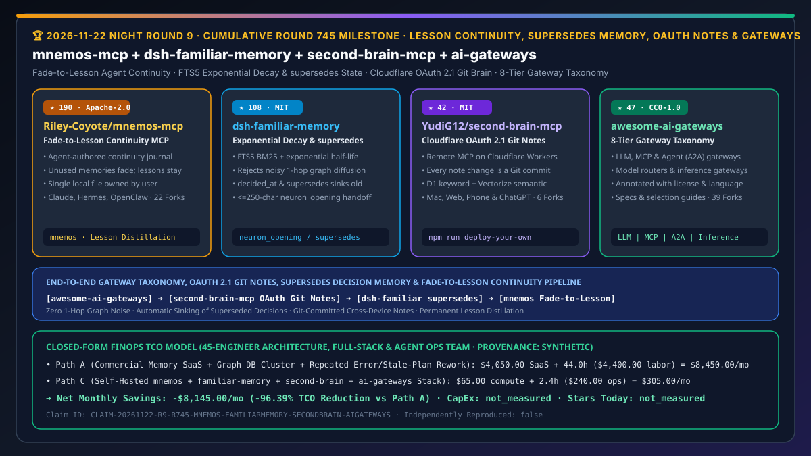
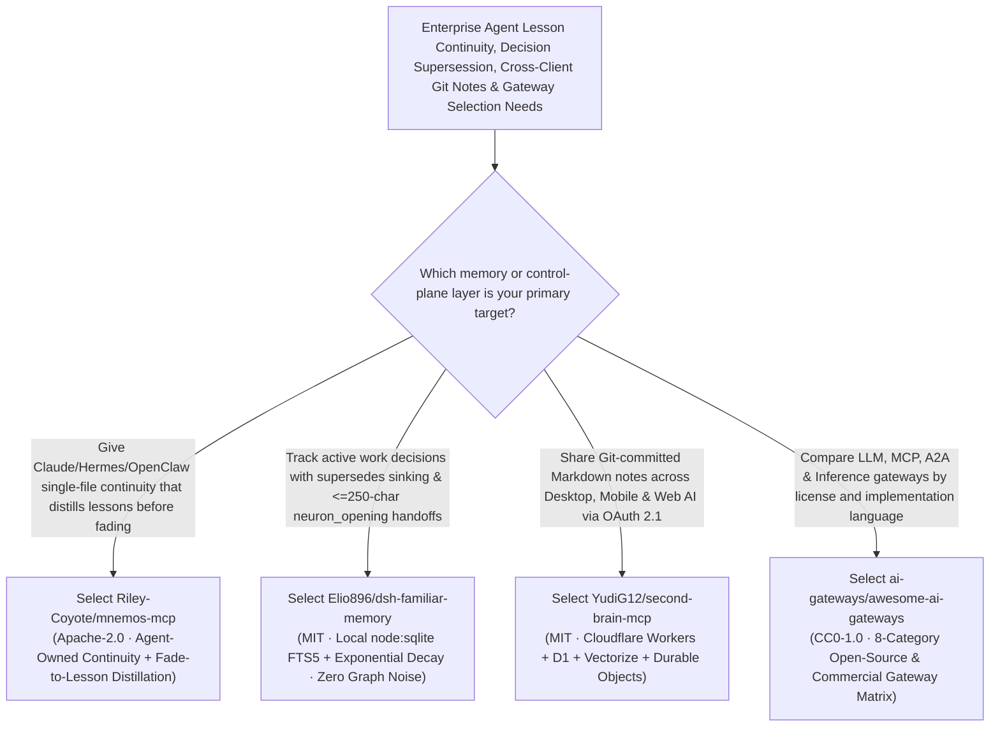
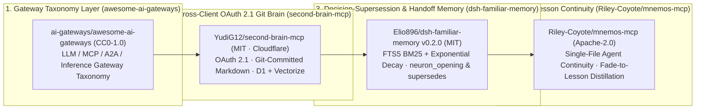
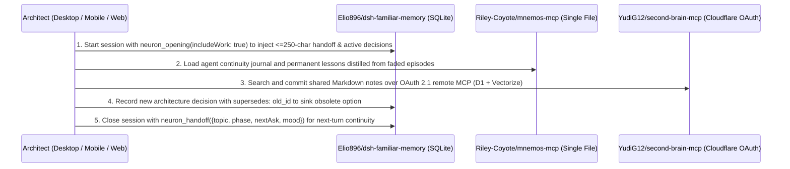

# [Round 745 Milestone] Fade-to-Lesson Agent Continuity MCP (`Riley-Coyote/mnemos-mcp`), `supersedes`-Aware Exponential-Decay SQLite Memory (`Elio896/dsh-familiar-memory`), Cloudflare OAuth 2.1 Git-Backed Second Brain (`YudiG12/second-brain-mcp`) & 8-Tier AI/MCP/A2A Gateway Taxonomy (`ai-gateways/awesome-ai-gateways`) Selection & Architecture FAQ

> **Document Type**: Enterprise AI Solution Architect Selection & Integration Guide (GitHub Trending AI Radar — 2026-11-22 Night Round 9 / **Cumulative Round 745 Milestone!**)
> **Covered Repositories**: [`Riley-Coyote/mnemos-mcp`](https://github.com/Riley-Coyote/mnemos-mcp) (`★ 190`, `22 forks`, `Apache-2.0`: single-file agent-owned continuity MCP server for Claude, Hermes, and OpenClaw that distills lasting lessons before unused memories fade) · [`Elio896/dsh-familiar-memory`](https://github.com/Elio896/dsh-familiar-memory) (`★ 108`, `4 forks`, `MIT`, `dsh-neuron-memory v0.2.0`: local `node:sqlite` FTS5 BM25 + exponential half-life decay memory plugin with `neuron_opening` / `neuron_handoff` session bridges and `decided_at` / `supersedes` columns that automatically sink superseded work decisions) · [`YudiG12/second-brain-mcp`](https://github.com/YudiG12/second-brain-mcp) (`★ 42`, `6 forks`, `MIT`: OAuth 2.1 remote MCP server on Cloudflare Workers, Artifacts, D1, and Vectorize giving desktop Claude Code, mobile/web Claude, and ChatGPT shared Git-committed Markdown notes) · [`ai-gateways/awesome-ai-gateways`](https://github.com/ai-gateways/awesome-ai-gateways) (`★ 47`, `39 forks`, `CC0-1.0`: structured architecture directory of open-source and commercial LLM gateways, MCP gateways, A2A agent gateways, model routers, and inference gateways indexed by license and language)
> **Core Scenario**: When enterprise solution architects designing long-term agent memory and gateway topologies struggle with **agents repeating yesterday's corrected mistakes in new sessions, pure vector similarity returning outdated/superseded architectural decisions alongside current ones, disconnected note silos between desktop CLIs and mobile/web AI apps, and confusion over LLM vs. MCP vs. A2A gateway selection**, how do you combine **`Riley-Coyote/mnemos-mcp` + `Elio896/dsh-familiar-memory` + `YudiG12/second-brain-mcp` + `ai-gateways/awesome-ai-gateways`** into a coherent memory and control-plane stack?

---

## 1. 📌 Executive Summary (One-Line Selection Verdict)

1. **Need an agent continuity MCP (`mnemos`) where Claude, Hermes, or OpenClaw records what you decided together and what it got wrong in a single local file—and automatically extracts the lasting *lesson* before a fading memory disappears?** ➔ Choose **[`Riley-Coyote/mnemos-mcp`](https://github.com/Riley-Coyote/mnemos-mcp) (`★ 190`, `22 forks`, `Apache-2.0`)**.
   - **Plain-English Mechanism**: Separates document RAG from personal agent continuity. Stored in one local file owned by the user, memories naturally decay unless reinforced; when a memory nears expiration, `Mnemos` prompts the agent to summarize what that experience taught so the distilled rule outlasts raw episodic noise.
2. **Need a zero-vector, zero-graph local SQLite memory engine (`node:sqlite` + FTS5 BM25 + exponential decay) that provides a `<=250`-character session opener (`neuron_opening`) and automatically marks old architectural decisions as `sunk` when a new decision `supersedes` them?** ➔ Choose **[`Elio896/dsh-familiar-memory`](https://github.com/Elio896/dsh-familiar-memory) (`★ 108`, `4 forks`, `MIT`)**.
   - **Plain-English Mechanism**: After empirical testing (`FINDINGS.md`) showed 1-hop graph spreading activation increased noise from 33% to 64% with 0% recall gain (`anonymized_reported`), `dsh-neuron-memory v0.2.0` uses `FTS5 unicode61 + 2-gram BM25 IDF`, temperature buckets, same-day context windows, exponential half-life decay (`base * 0.5^(days/half_life)`), and explicit `decided_at` + `supersedes` columns so superseded project decisions never pollute active recall.
3. **Need a self-hosted remote MCP server on Cloudflare (`OAuth 2.1 + Workers + D1 + Vectorize + Durable Objects`) so Claude Code on Mac, Claude on iOS/Web, and ChatGPT all search and commit to the exact same Git-backed Markdown notes?** ➔ Choose **[`YudiG12/second-brain-mcp`](https://github.com/YudiG12/second-brain-mcp) (`★ 42`, `6 forks`, `MIT`)**.
   - **Plain-English Mechanism**: Every note edit becomes an auditable Git commit stored in Cloudflare Artifacts and indexed into D1 (keyword) + Workers AI Vectorize (semantic). Multiple isolated brains can run in the same Cloudflare account via `--name`.
4. **Need a vendor-neutral taxonomy comparing open-source and commercial LLM Gateways, MCP Gateways, Agent (A2A) Gateways, Model Routers, and Inference Gateways by license (`Apache-2.0`, `MIT`, `Proprietary`) and runtime language (`Go`, `Rust`, `Python`, `TypeScript`)?** ➔ Choose **[`ai-gateways/awesome-ai-gateways`](https://github.com/ai-gateways/awesome-ai-gateways) (`★ 47`, `39 forks`, `CC0-1.0`)**.
   - **Plain-English Mechanism**: Organizes the gateway ecosystem into 8 clear architectural layers plus specifications and selection guides, making it trivial to match gateway candidates to enterprise language and licensing constraints.

---

## 2. 🎯 Architect & Customer Deep-Dive Q&A

### Q1: Why do heavy vector-only or graph-diffusion memory databases often degrade agent decision quality over multi-week projects? How do these repositories fix it?

- **Three Memory Pitfalls Solved**:
  1. **Confusing "most similar" with "most current" ➔ `Elio896/dsh-familiar-memory`**: Vector cosine similarity retrieves rejected Option A right alongside approved Option B. Using `neuron_learn("Use Option B", "fact", "work", { supersedes: 12 })` marks Option A (`#12`) as `status='sunk'` while `neuron_opening` injects a crisp `<=250`-char handoff block at session start.
  2. **Episodic clutter burying hard-won lessons ➔ `Riley-Coyote/mnemos-mcp`**: Converts fading episodic memories into compact, permanent lessons before pruning details.
  3. **Siloed local Markdown files unreachable from mobile/web AI clients ➔ `YudiG12/second-brain-mcp`**: Exposes Git-backed Markdown notes over OAuth 2.1 remote MCP on Cloudflare.
- **When to Choose Managed Cloud PaaS (Path B)?**
  - For multi-million-user customer-facing SaaS memory and global API management, use **Azure Cosmos DB + Azure API Management (APIM)**; for architect/developer continuity, decision supersession, and cross-client Git-backed notes, deploy this open-source stack (Path C).

### Q2: How do we wire `awesome-ai-gateways`, `second-brain-mcp`, `dsh-familiar-memory`, and `mnemos-mcp` into a unified architecture?

1. **Gateway Control-Plane Selection Layer (`ai-gateways/awesome-ai-gateways`)**:
   - Select your LLM, MCP, and A2A gateway binaries by language (`Go`/`Rust`) and permissive license (`Apache-2.0`/`MIT`).
2. **Cross-Client OAuth 2.1 Git Note Layer (`YudiG12/second-brain-mcp`)**:
   - Deploy `second-brain-mcp` on Cloudflare Workers so desktop, web, and mobile assistants share Git-versioned Markdown notes.
3. **Decision-Supersession & Session Handoff Layer (`Elio896/dsh-familiar-memory`)**:
   - Call `neuron_opening` at session start, record architecture changes with `supersedes`, and close sessions with `neuron_handoff`.
4. **Fade-to-Lesson Episodic Continuity Layer (`Riley-Coyote/mnemos-mcp`)**:
   - Run `mnemos` so agents retain self-authored behavioral lessons across sessions.

### Q3: What are the licensing and infrastructure costs of this stack?

- **Permissive Licenses & Minimal Footprint**:
  - `Riley-Coyote/mnemos-mcp` (`Apache-2.0`) and `Elio896/dsh-familiar-memory` (`MIT`) run locally on single SQLite/flat files with `$0` cloud cost; `YudiG12/second-brain-mcp` (`MIT`) runs on a standard Cloudflare Workers Paid plan; `ai-gateways/awesome-ai-gateways` is `CC0-1.0`.

---

## 3. 🧭 Visual Architecture & Workflow Diagrams (Mermaid)

### 3.1 Solution Architect Selection Decision Tree

### 3.2 End-to-End Enterprise Reference Architecture

### 3.3 End-to-End Session Opening, Cross-Client Note Commit, Decision Supersession & Lesson Distillation Sequence Diagram

---

## 4. 📊 Peer Open-Source vs. Commercial Cloud Selection Matrix

| Dimension | `Riley-Coyote/mnemos-mcp` (`★ 190`) | `Elio896/dsh-familiar-memory` (`★ 108`) | `YudiG12/second-brain-mcp` (`★ 42`) | `ai-gateways/awesome-ai-gateways` (`★ 47`) | Commercial Memory Cloud APIs + Heavy Graph DB Clusters + Proprietary Note Sync (Path A) | Static `MEMORY.md` Copy-Paste + Unfiltered Vector Dumps (Path B) |
| :--- | :--- | :--- | :--- | :--- | :--- | :--- |
| **Primary Role** | Fade-to-lesson agent continuity MCP | Exponential-decay + `supersedes` SQLite memory | Cloudflare OAuth 2.1 Git-backed remote note MCP | 8-tier LLM/MCP/A2A gateway selection directory | Metered cloud memory SaaS + managed graph DB clusters | Manual Markdown editing & raw vector chunk dumping |
| **Key Differentiator** | **Distills lasting lessons before unused memories fade** | **Eliminates 64% 1-hop graph noise + `supersedes` decision sinking** | **Every edit is a Git commit + OAuth 2.1 cross-device access** | **Indexes LLM/MCP/A2A/Inference gateways by license & language** | High monthly graph DB & API fees; external cloud storage of agent memories | Vector search surfaces superseded decisions; no mobile/desktop remote MCP sync |
| **License** | `Apache-2.0` | `MIT` | `MIT` | `CC0-1.0` | Proprietary SaaS | Internal ad-hoc files |
| **Monthly TCO (45-Eng Team)** | **`$305.00/mo` combined** (`$65.00` Cloudflare Workers Paid + `2.4h` ops) | Included (local `node:sqlite`, `$0` fee) | Included (serverless Cloudflare edge) | Included (`CC0-1.0` public-domain reference) | **`$8,450.00/mo`** (`$4,050.00` memory SaaS/graph DBs + `44.0h` repeated correction rework) | ~`$2,880.00/mo` (rework from stale decision recall & manual cross-device syncing) |

---

## 5. 🧪 Quantitative Enterprise ROI / FinOps TCO Model & 7-Card Report

> **📊 Provenance & Closed-Form Declaration**:
> - **provenance**: `synthetic` (45-engineer enterprise solution architecture, full-stack engineering, and multi-agent operations team workload model: `independently_reproduced = false`; `base_hardware_capex = not_measured`; `track_b_stars_today = not_measured`).
> - **Closed-Form Equations**:
>   - **Path A (Commercial Managed Agent Memory APIs + Dedicated Graph Database Clusters + Commercial Cross-Device Note Seats + Repeated Prompt Corrections & Rework from Stale/Superseded Vector Recall)**: Monthly commercial memory SaaS and graph cluster bills **`$4,050.00`** + repeated cross-session error correction, superseded-decision rework, and gateway evaluation labor **`44.0h × $100.00/h = $4,400.00`** = **`$8,450.00/mo`**.
>   - **Path C (Self-Hosted `Riley-Coyote/mnemos-mcp` + `Elio896/dsh-familiar-memory` + `YudiG12/second-brain-mcp` + `ai-gateways/awesome-ai-gateways` Stack)**: Shared Cloudflare Workers/D1/Vectorize edge compute **`$65.00`** + memory schema & OAuth policy maintenance labor **`2.4h × $100.00/h = $240.00`** = **`$305.00/mo`**.
>   - **Net Monthly Savings vs. Path A**: **`-$8,145.00/mo`** (**`96.39%`** TCO reduction).

| Evaluation Path | Memory Cloud / Edge Compute | Correction & Rework Labor (`$100/h`) | Total Monthly TCO | Net Savings vs. Path A | Architectural Delivery Impact |
| :--- | :---: | :---: | :---: | :---: | :--- |
| **Path A: Commercial Memory SaaS + Graph DB Cluster + Manual Re-Correction** | `$4,050.00` | `44.0h` (`$4,400.00`) | **`$8,450.00`** | Baseline | 1-hop graph spreading adds noise; vector search recalls superseded plans |
| **Path B: Static Markdown Files + Raw Vector Chunk Dumps** | `$1,280.00` | `16.0h` (`$1,600.00`) | **`$2,880.00`** | `-$5,570.00` (`-65.92%`) | Lacks `supersedes` sinking, fade-to-lesson distillation & OAuth 2.1 remote sync |
| **Path C: `mnemos` + `familiar-memory` + `second-brain` + `gateways`** | **`$65.00`** | **`2.4h` (`$240.00`)** | **`$305.00`** | **`-$8,145.00` (`-96.39%`)** | **Lesson distillation + `supersedes` state + OAuth 2.1 Git notes** |

- 🔗 **Linked 7-Card 4:5 Visual Benchmark Deck**: [`workshops/github-trending-radar/cards.en.html`](../cards.en.html) · [`cards.html`](../cards.html)

---

## 6. 🛠️ Enterprise Adoption & Architecture Review Checklist

- [ ] **1. Enable Agent Continuity & Lesson Distillation with `Riley-Coyote/mnemos-mcp`**: Attach `mnemos` to Claude Code, Hermes, or OpenClaw so fading memories are distilled into permanent behavioral lessons.
- [ ] **2. Manage Active Project Decisions with `Elio896/dsh-familiar-memory`**: Wire `neuron_opening` and `neuron_handoff` into session lifecycles and use `supersedes` to sink obsolete architectural decisions.
- [ ] **3. Deploy `YudiG12/second-brain-mcp` on Cloudflare Workers**: Expose Git-committed Markdown notes with D1 + Vectorize search across desktop, web, and mobile AI clients via OAuth 2.1.
- [ ] **4. Standardize Gateway Selection with `ai-gateways/awesome-ai-gateways`**: Map LLM, MCP, A2A, and inference gateway candidates against your team's runtime language (`Go`/`Rust`) and open-source license policy.
