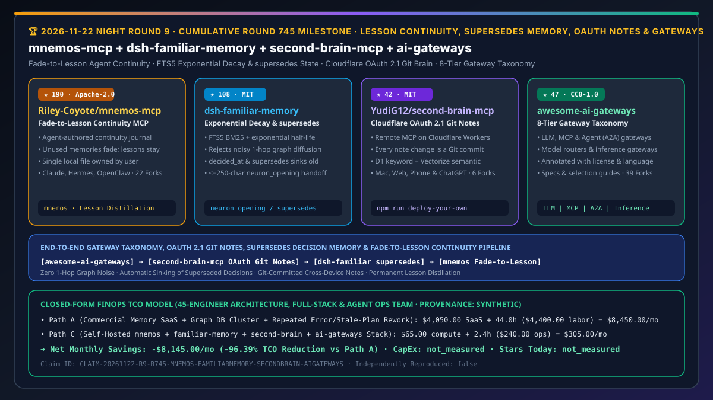
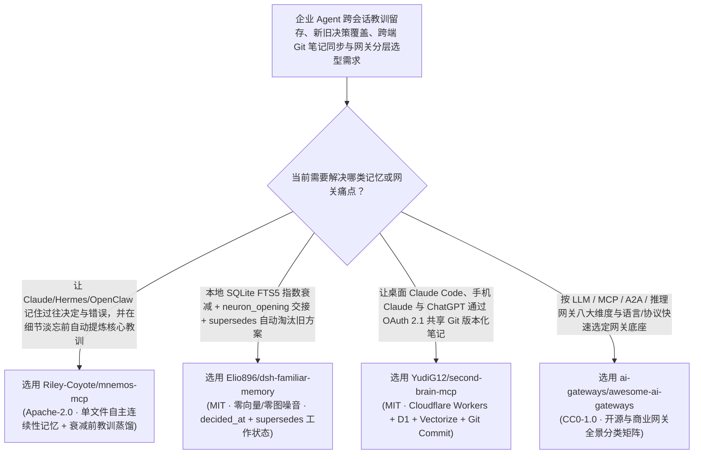
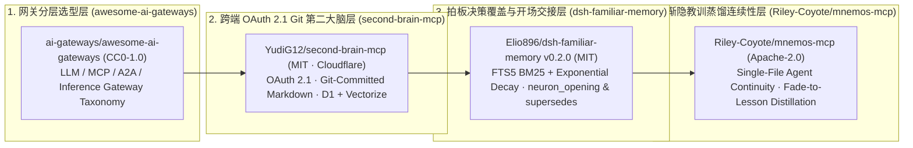
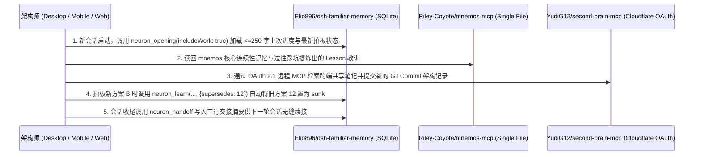

# 【第 745 轮里程碑】渐隐提炼教训式智能体连续性记忆 MCP（`Riley-Coyote/mnemos-mcp`）、带 `supersedes` 拍板覆盖的 SQLite 指数衰减记忆（`Elio896/dsh-familiar-memory`）、Cloudflare OAuth 2.1 跨端 Git 笔记远程 MCP（`YudiG12/second-brain-mcp`）与 LLM/MCP/A2A 网关全景选型图谱（`ai-gateways/awesome-ai-gateways`）选型与集成架构 FAQ

> **文档类型**：企业 AI 解决方案架构师（AI Solution Architect）选型决策指南（GitHub Trending AI 雷达 2026-11-22 Night Round 9 / **累计第 745 轮里程碑！**）
> **覆盖项目**：[`Riley-Coyote/mnemos-mcp`](https://github.com/Riley-Coyote/mnemos-mcp)（`★ 190`、`22 forks`、`Apache-2.0`，支持 Claude、Hermes 与 OpenClaw 的单文件智能体自主连续性记忆 MCP，当低频记忆即将衰减消失前自动提炼保留“核心教训 Lesson”）· [`Elio896/dsh-familiar-memory`](https://github.com/Elio896/dsh-familiar-memory)（`★ 108`、`4 forks`、`MIT`，`dsh-neuron-memory v0.2.0`：实测否决高噪音图扩散，采用本地 `node:sqlite` FTS5 BM25 + 指数半衰期衰减 + 同日上下文窗口，并通过 `neuron_opening`/`neuron_handoff` 与 `decided_at`/`supersedes` 字段解决“新架构决策覆盖旧方案”痛点）· [`YudiG12/second-brain-mcp`](https://github.com/YudiG12/second-brain-mcp)（`★ 42`、`6 forks`、`MIT`，部署于 Cloudflare Workers + D1 + Vectorize + Durable Objects + OAuth 2.1 的远程 MCP，让桌面 Claude Code、网页/手机端 Claude 与 ChatGPT 共享同一套每次修改皆为 Git Commit 的 Markdown 第二大脑）· [`ai-gateways/awesome-ai-gateways`](https://github.com/ai-gateways/awesome-ai-gateways)（`★ 47`、`39 forks`、`CC0-1.0`，系统梳理开源与商业 **LLM 网关、MCP 网关、A2A 智能体网关、模型路由器与推理网关** 的权威选型谱系，逐一标注开源协议与实现语言）
> **核心场景**：当企业架构师在设计跨终端、跨会话的 Agent 长期记忆与网关底座时，面临**“明天换个新会话 Agent 又犯昨天刚纠正过的低级错误、传统向量检索分不清哪个架构方案是最新拍板的（常把已废弃的旧方案排第一）、桌面端 Claude Code 与手机端 Claude/ChatGPT 的笔记无法实时互通、以及面对市面上几十种 LLM/MCP/A2A 网关不知如何按语言与协议选型”**四大痛点时，如何组合**`Riley-Coyote/mnemos-mcp` + `Elio896/dsh-familiar-memory` + `YudiG12/second-brain-mcp` + `ai-gateways/awesome-ai-gateways`** 构建一套层次分明的企业记忆与网关参考架构？

---

## 一、📌 核心结论速览（选型一句话结论）

1. **想让 Claude、Hermes 或 OpenClaw 智能体拥有“跨会话不失忆的自我连续性”，在每次新会话开口前先读回上次一起做过的决定与踩过的坑，且当某条细节记忆随时间淡忘前自动将“它教会了什么教训”永久留存** ➔ 选 **[`Riley-Coyote/mnemos-mcp`](https://github.com/Riley-Coyote/mnemos-mcp)（`★ 190`，`22 forks`，`Apache-2.0`）**。
   - **通俗原理**：明确区分“文档库 RAG”与“智能体自身的经验连续性（Agent Continuity）”。它将全部记忆存为本机单个文件（卸载插件文件也归你所有），记忆按使用频率自然衰减，而**在一条记忆即将消退前，系统会要求 Agent 提炼出“这件事带来的核心教训（Lesson）”，让经验法则比琐碎细节活得更久**。
2. **想用最干净的本地 SQLite（零向量库、零图数据库膨胀）实现高准召记忆，特别是要求在工作场景中“新拍板的方案 B 自动把旧方案 A 标记为已废弃（`supersedes`）”，防止检索时新旧方案打架** ➔ 选 **[`Elio896/dsh-familiar-memory`](https://github.com/Elio896/dsh-familiar-memory)（`★ 108`，`4 forks`，`MIT`）**。
   - **通俗原理**：作者通过严谨实测（`FINDINGS.md`）发现 1 跳图扩散会让噪音从 33% 暴增至 64% 且零有效增量（`anonymized_reported`），果断砍掉图扩散，改用 **`FTS5 unicode61 + 2-gram BM25 IDF` + 情绪温度桶 + 同日上下文窗口 + 指数半衰期衰减（`base × 0.5^(天/半衰期)`）**。更提供极简的 `neuron_opening()`（开场返回 `<=250` 字精准交接摘要）与 `supersedes` 决策覆盖列（写入新决定时自动将旧决定置为 `status='sunk'`）。
3. **想在电脑上的 Claude Code、网页端/手机端 Claude App 以及 ChatGPT 里随时读写同一份个人或团队 Markdown 知识库，要求每次增删改都是标准的 Git Commit，且兼具关键词与语义向量混合检索** ➔ 选 **[`YudiG12/second-brain-mcp`](https://github.com/YudiG12/second-brain-mcp)（`★ 42`，`6 forks`，`MIT`）**。
   - **通俗原理**：基于 Cloudflare 全家桶（Workers + Artifacts + Durable Objects + Queues + Workflows + D1 + Vectorize + OAuth 2.1）构建的自托管远程 MCP。支持通过 `--name` 在同一 Cloudflare 账号下部署完全隔离的多套实例，让多端 AI 客户端通过标准 OAuth 2.1 安全共享同一套带 Git 版本历史的 Markdown 笔记。
4. **想在架构评审会上快速厘清“LLM 网关 vs MCP 网关 vs A2A 智能体网关 vs 推理网关”的技术边界，并按许可证（`Apache-2.0` / `MIT` / 商业）与开发语言（`Go` / `Rust` / `Python` / `TS`）选出最匹配团队技术栈的网关实现** ➔ 选 **[`ai-gateways/awesome-ai-gateways`](https://github.com/ai-gateways/awesome-ai-gateways)（`★ 47`，`39 forks`，`CC0-1.0`）**。
   - **通俗原理**：将市面上纷繁复杂的网关产品按 **AI Gateways、MCP Gateways、Agent (A2A) Gateways、API Gateways with AI Features、Cloud/Platform Gateways、Model Routers、Inference Gateways、Specifications** 八大维度标准化建档，是解决方案架构师做网关选型矩阵的极佳案头参考字典。

---

## 二、🎯 客户与架构师灵魂拷问 Q&A（深度架构拆解）

### Q1：为什么很多企业花了大价钱搭向量数据库和 GraphRAG 做 Agent 记忆，结果 Agent 在跨会话工作时依然“既记不住教训、又分不清哪个决定是最新的”？

- **三大记忆设计误区与工程纠偏**：
  1. **误把“查文档”当成“记教训” ➔ `Riley-Coyote/mnemos-mcp`**：把海量文档塞进向量库只会淹没 Agent 昨天的踩坑教训；`mnemos` 专为“自我经验连续性”设计，在细节衰减前自动蒸馏出可长期复用的教训（Lesson）。
  2. **迷信图激活扩散且缺乏“新决定覆盖旧决定”机制 ➔ `Elio896/dsh-familiar-memory`**：普通余弦相似度分不清“上周讨论的方案 A”和“今天刚拍板的方案 B”；通过 `decided_at` + `supersedes` 字段直接将旧决定置为 `sunk`，配合 `<=250` 字的 `neuron_opening` 交接块，既准又省 Token。
  3. **桌面 CLI 与移动端/网页端 AI 记忆孤岛 ➔ `YudiG12/second-brain-mcp`**：用 Cloudflare OAuth 2.1 远程 MCP + Git Commit + Vectorize 实现跨端统一笔记读写。
- **何时直接用云厂商托管方案（Path B）？**
  - 若企业构建面向百万外部消费者的 SaaS 客服记忆与高并发 API 网关，优先使用 **Azure Cosmos DB Vector Search + Azure API Management (APIM)**；若针对研发与架构团队跨会话经验沉淀、拍板决策覆盖与跨端 Markdown 第二大脑，则采用本轮开源栈（Path C）。

### Q2：典型企业级“网关分层选型 (`awesome-ai-gateways`) + 跨端 OAuth 2.1 Git 笔记 (`second-brain`) + 决策覆盖工作记忆 (`dsh-familiar`) + 渐隐教训记忆 (`mnemos`)”架构怎么搭？

1. **统一网关控制面选型层（`ai-gateways/awesome-ai-gateways`）**：
   - 依据八维分类矩阵选定匹配企业语言栈（Go/Rust）的 LLM、MCP 与 A2A 网关。
2. **跨端共享 Git 笔记与语义检索层（`YudiG12/second-brain-mcp`）**：
   - 在自有 Cloudflare 账号运行 `npm run deploy-your-own`，通过 OAuth 2.1 为桌面端 Claude Code、移动端 Claude 与 ChatGPT 提供统一的 Git 版本化 Markdown 知识库。
3. **项目决策状态与开场交接记忆层（`Elio896/dsh-familiar-memory`）**：
   - 会话开始调用 `neuron_opening(includeWork: true)` 注入 `<=250` 字交接上下文；架构变更时调用 `neuron_learn(..., { supersedes: old_id })` 淘汰旧方案；会话结束调用 `neuron_handoff` 写入三行交接单。
4. **长周期错题与教训蒸馏层（`Riley-Coyote/mnemos-mcp`）**：
   - 挂载 `mnemos` 单文件记忆，让 Agent 自动在低频细节消退前总结保留长期工程教训。

### Q3：这套记忆与网关组合的运维成本与隐私安全性如何？

- **极低运维与强数据主权**：
  - `mnemos-mcp` 与 `dsh-familiar-memory` 均为本机单文件存储（零云端依赖、卸载后文件仍归用户）；`second-brain-mcp` 运行在用户自有的 Cloudflare Workers Paid 账号（`$5/月` 基础计划即可跑通全套 D1/Vectorize/DO），每次修改都有完整 Git Commit 审计记录。

---

## 三、🧭 直观可视化图解（Mermaid 决策树 + 集成架构 + 时序图）

### 3.1 架构师选型决策树

### 3.2 企业端到端生产集成参考架构图

### 3.3 会话开场交接、跨端 Git 笔记检索、`supersedes` 决策覆盖与渐隐教训蒸馏时序图

---

## 四、📊 同类开源与商业云服务横向选型决策矩阵

| 对比维度 | `Riley-Coyote/mnemos-mcp` (`★ 190`) | `Elio896/dsh-familiar-memory` (`★ 108`) | `YudiG12/second-brain-mcp` (`★ 42`) | `ai-gateways/awesome-ai-gateways` (`★ 47`) | 商业托管记忆云 SaaS + 重型图数据库集群 + 商业笔记同步席位 (Path A) | 手工维护静态 `MEMORY.md` + 裸向量库全量塞入 (Path B) |
| :--- | :--- | :--- | :--- | :--- | :--- | :--- |
| **核心能力定位** | 渐隐前自动提炼教训的连续性记忆 MCP | 指数衰减 + `supersedes` 决策覆盖本地记忆 | Cloudflare OAuth 2.1 跨端 Git 笔记远程 MCP | LLM/MCP/A2A 网关八维选型图谱 | 按调用次数与存储量计费的商业 Memory API 与重型图数据库 | 人工手动改 Markdown 或把所有历史对话全量灌入向量库 |
| **核心技术突破** | **记忆淡忘前自动追问并保留 Lesson 核心教训** | **实测剔除 64% 噪音图扩散 + `supersedes` 淘汰旧方案** | **每次修改皆为 Git Commit + 跨桌面/手机/网页 OAuth 互通** | **按 LLM/MCP/A2A/Inference 与语言/协议精确分级** | 重型图数据库运维复杂且 1 跳噪音高；商业记忆云存在隐私外传顾虑 | 向量检索把已废弃的旧方案排前排；换电脑或手机即断联 |
| **开源协议** | `Apache-2.0` | `MIT` | `MIT` | `CC0-1.0` | 闭源商业 SaaS | 内部手工维护 |
| **月度 TCO（45 人团队）** | **组合仅 `$305.00/月`**（`$65.00` Cloudflare Workers Paid + `2.4h` 维护） | 同左（本地 `node:sqlite` 零费用） | 同左（Cloudflare 边缘无服务器架构） | 同左（CC0 公共领域选型标准） | **`$8,450.00/月`**（`$4,050.00` 商业记忆云/图数据库集群 + `44.0h` 跨会话重复纠错人工） | 约 `$2,880.00/月`（大量因旧方案误召回导致的返工与跨端手动同步工时） |

---

## 五、🧪 应用落地定量收益/TCO 对比与 7-Card 报告

> **📊 数据来源与闭式核算声明（Provenance & Closed-Form Schema）**：
> - **provenance**: `synthetic`（基于 45 人企业架构师、全栈研发与多智能体运营团队月度工作负载模型：`independently_reproduced = false`；硬件采购基线 `base_hardware_capex = not_measured`；Track B 单日增量 `track_b_stars_today = not_measured`）。
> - **核算公式**：
>   - **Path A（采购商业托管 Agent 记忆 API + 独立托管图数据库集群 + 商业跨端笔记协作席位 + 工程师每天在新会话重复纠正 Agent 相同错误、因向量检索召回已废弃旧方案导致的架构返工）**：月度商业记忆云与图数据库账单 **`$4,050.00`** + 跨会话重复纠偏、新旧决策混淆返工与网关选型试错人工 **`44.0h × $100.00/h = $4,400.00`** = **`$8,450.00/月`**。
>   - **Path C（自建 `Riley-Coyote/mnemos-mcp` + `Elio896/dsh-familiar-memory` + `YudiG12/second-brain-mcp` + `ai-gateways/awesome-ai-gateways` 开源栈）**：Cloudflare Workers Paid / D1 / Vectorize 资源开销 **`$65.00`** + 记忆归档与 OAuth 策略巡检人工 **`2.4h × $100.00/h = $240.00`** = **`$305.00/月`**。
>   - **净节省（Net Savings vs Path A）**：**`-$8,145.00/月`**（成本降低 **`96.39%`**）。

| 评估方案 | 记忆云/图库与边缘算力成本 | 跨会话纠偏与返工人工（`$100/h`） | 月度总 TCO | 相对 Path A 净节省 | 关键架构交付指标 |
| :--- | :---: | :---: | :---: | :---: | :--- |
| **Path A：商业托管记忆 SaaS + 独立图数据库 + 重复人工纠偏** | `$4,050.00` | `44.0h` (`$4,400.00`) | **`$8,450.00`** | Baseline | 图扩散引入高比例无关噪音；旧方案与新决定混杂召回 |
| **Path B：手工改静态文件 + 裸向量检索无状态管理** | `$1,280.00` | `16.0h` (`$1,600.00`) | **`$2,880.00`** | `-$5,570.00` (`-65.92%`) | 缺少 `supersedes` 拍板覆盖、衰减前 Lesson 蒸馏与跨端 OAuth 同步 |
| **Path C：`mnemos` + `familiar-memory` + `second-brain` + `gateways`** | **`$65.00`** | **`2.4h` (`$240.00`)** | **`$305.00`** | **`-$8,145.00` (`-96.39%`)** | **衰减前教训蒸馏 + `supersedes` 状态覆盖 + 跨端 Git 笔记** |

- 🔗 **关联 7-Card 4:5 视觉评测报告**：[`workshops/github-trending-radar/cards.html`](../cards.html) · [`cards.en.html`](../cards.en.html)

---

## 六、🛠️ 企业引入与架构评审 Checklist

- [ ] **1. 挂载 `Riley-Coyote/mnemos-mcp` 沉淀跨会话工程教训**：为 Claude Code、Hermes 或 OpenClaw 开启单文件自主记忆，确保踩坑经验在细节衰减前蒸馏为永久 Lesson。
- [ ] **2. 引入 `Elio896/dsh-familiar-memory` 管理项目拍板状态与会话交接**：在会话首尾标准调用 `neuron_opening` 与 `neuron_handoff`，并对架构变更使用 `supersedes` 自动淘汰旧决定。
- [ ] **3. 在自有 Cloudflare 部署 `YudiG12/second-brain-mcp`**：通过 OAuth 2.1 打通桌面端、网页端与手机端 AI 客户端的 Git 版本化 Markdown 第二大脑。
- [ ] **4. 对照 `ai-gateways/awesome-ai-gateways` 完成网关技术栈标准化**：按 LLM、MCP、A2A 与推理网关四个层级及团队主力语言（Go/Rust）确定生产网关选型。
