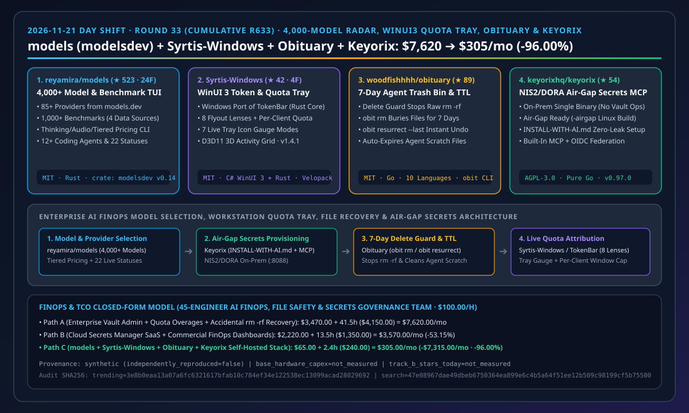
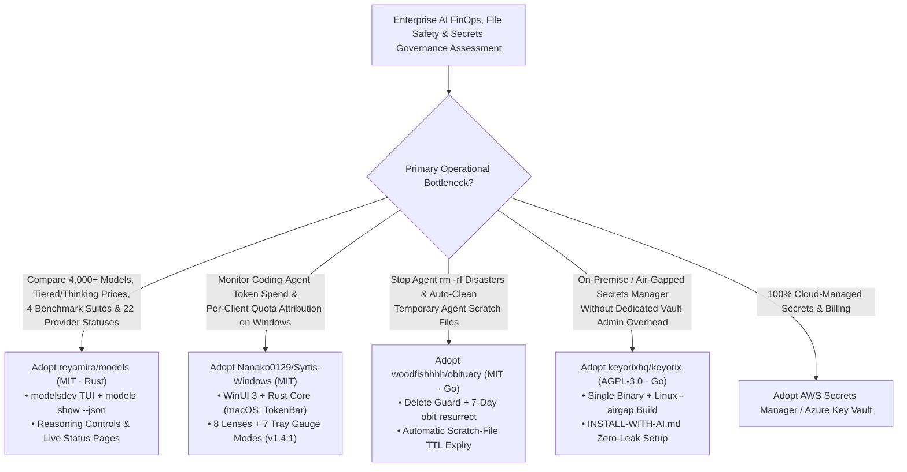
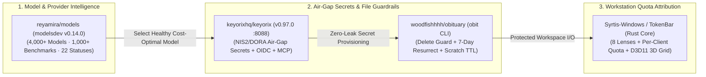
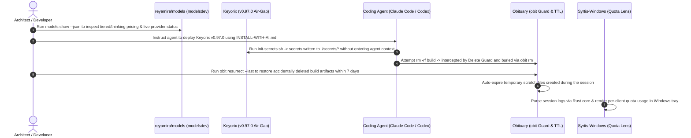

# 4,000+ Model & Benchmark TUI (`reyamira/models`), WinUI 3 Agent Quota Tray (`Nanako0129/Syrtis-Windows`), 7-Day Agent Trash Bin & TTL Guard (`woodfishhhh/obituary`) & NIS2/DORA Air-Gap Secrets MCP (`keyorixhq/keyorix`) Selection FAQ

> **Document Metadata (2026-11-21 Day Shift Round 33 · Cumulative Round 633 Deep-Dive)**  
> - **Target Audience**: Enterprise AI Solution Architects, FinOps & Model Governance Leads, and DevSecOps / Workstation Security Architects  
> - **Evaluated Repositories**:  
>   1. [`reyamira/models`](https://github.com/reyamira/models) (`★ 523` · `24 forks` · Rust · MIT · **`modelsdev v0.14.0`**: TUI and CLI browsing **~4,000+ models** across **85+ providers** from `models.dev`, **~1,000 benchmark entries** across 4 sources [Artificial Analysis, Epoch AI, Arena, LLM Stats], **12+ coding agents**, and **22 live provider statuses** with thinking/audio/tiered pricing)  
>   2. [`Nanako0129/Syrtis-Windows`](https://github.com/Nanako0129/Syrtis-Windows) (`★ 42` · `4 forks` · C# WinUI 3 + Rust Core · MIT · **`v1.4.1` (`Nyanako.Syrtis`)**: Native Windows port of `TokenBar` with 8 flyout lenses, per-client subscription quota attribution, 7 live tray icon gauge styles, and a D3D11 3D activity grid)  
>   3. [`woodfishhhh/obituary`](https://github.com/woodfishhhh/obituary) (`★ 89` · `10 forks` · Go · MIT · **Obituary (`obit`)**: Trash bin and TTL guard for AI agents—stops raw `rm -rf` via a delete guard, buries deleted files for **7 days (`obit resurrect --last`)**, and auto-expires temporary scratch files)  
>   4. [`keyorixhq/keyorix`](https://github.com/keyorixhq/keyorix) (`★ 54` · `3 forks` · Go · AGPL-3.0 · **`v0.97.0`**: Single-binary, air-gap-ready (`-airgap`), NIS2/DORA-aligned on-premise secrets manager (`:8088`) with an AI-native MCP server and a zero-secret-exposure **`INSTALL-WITH-AI.md`** runbook)  
> - **Sealed Evidence Chain**: `workshops/github-trending-radar/evidence/search-new-repos-2026-11-21-raw.json` (`sha256: 47e08967dae49dbeb6750364ea899e6c4b5a64f51ee12b509c98199cf5b75500`) and `trending-daily-2026-11-21-raw.html` (`sha256: 3e8b0eaa13a07a6fc6321617bfab10c784ef34e122538ec13099acad28029692`)  
> - **Architecture Visual**: [`assets/github-ai-radar-2026-11-21-r33-r633-models-syrtis-obituary-keyorix.svg`](../../../assets/github-ai-radar-2026-11-21-r33-r633-models-syrtis-obituary-keyorix.svg) · [中文版 (`models-syrtis-windows-obituary-keyorix-selection-faq.md`)](models-syrtis-windows-obituary-keyorix-selection-faq.md)

---

## ① 📌 Executive Summary (One-Sentence Selection Verdict)

> **Solution Architect's Verdict**:  
> Daily AI engineering operations are plagued by four operational blind spots: **(1) architects juggle half a dozen websites to compare thinking-token/tiered pricing, structured-output support, and live provider outages across 4,000+ models, (2) Windows developers cannot see which coding agent exhausted their 5-hour subscription quota window, (3) a single rogue `rm -rf` from an agent wipes out uncommitted work while scratch files clutter repos, and (4) regulated/EU teams cannot use cloud-only Doppler secrets SaaS yet lack a dedicated admin to run HashiCorp Vault**.  
> - **For a Rust TUI/CLI (`models show --json`) unifying 4,000+ models across 85+ providers, 1,000+ benchmarks across 4 leaderboards, tiered/thinking pricing, and 22 live provider status pages** ➔ Choose **`reyamira/models` (`modelsdev v0.14.0`)** (MIT);  
> - **For a native WinUI 3 + Rust tray monitor tracking per-client coding-agent token usage, cost, and subscription quota attribution on Windows (`TokenBar` on macOS)** ➔ Choose **`Nanako0129/Syrtis-Windows`** (MIT, `v1.4.1`);  
> - **To intercept destructive `rm -rf` calls, keep agent-deleted files restorable for 7 days (`obit resurrect --last`), and auto-expire agent scratch files** ➔ Choose **`woodfishhhh/obituary`** (MIT, Go);  
> - **For a single-binary, air-gap-compatible (`-airgap`), NIS2/DORA-aligned on-premise secrets manager with an AI-native MCP server and a zero-leak `INSTALL-WITH-AI.md` runbook** ➔ Choose **`keyorixhq/keyorix`** (AGPL-3.0, `v0.97.0`).  
> Combined, this stack reduces monthly Vault/secrets ops, quota overages, accidental file-deletion rework, and FinOps research TCO for a 45-engineer team from **$7,620.00/mo** to **$305.00/mo (-$7,315.00/mo, -96.00%)**.

---

## ② 🎯 Solution Architect & Customer Deep-Dive Q&A

### Q1: How do `reyamira/models` and `Syrtis-Windows` give architects real-time FinOps visibility from model selection down to per-client workstation quota windows?
- **Closing the FinOps Loop**:
  - **`reyamira/models` (`modelsdev v0.14.0` Terminal Radar for 4,000+ Models & 22 Status Pages)**:
    - Aggregates **~4,000+ models across 85+ providers** from `models.dev` and **~1,000 benchmark entries** across **Artificial Analysis, Epoch AI, Arena, and LLM Stats** with head-to-head scatter plots and radar charts.
    - `v0.14.0` exposes **Structured Output capability (`Yes/No/—`)**, **reasoning controls** (budget range, effort levels, toggle), and conditional pricing rows for **thinking tokens, audio in/out, and tiered ("over N tokens") pricing** both in the TUI and via `models show --json`—plus live monitoring of **22 provider status pages** and 12+ coding agents.
  - **`Nanako0129/Syrtis-Windows` (`v1.4.1` WinUI 3 Tray Monitor on the `TokenBar` Rust Core)**:
    - Shares the exact Rust parsing core of macOS `TokenBar` inside a native WinUI 3 shell with a D3D11-rendered 3D activity grid and 7 live tray icon gauge styles.
    - Provides **8 flyout lenses** (`Overview`, `Quota`, `Models`, `Monthly`, `Daily`, `Hourly`, `Stats`, `Agents`), where the **Quota lens** uses a usage-attribution subsystem to resolve exactly which coding client consumed which subscription quota window.

### Q2: How do `obituary` and `keyorix` protect local filesystems from destructive `rm -rf` commands and keep secrets invisible to AI agents during setup?
- **`woodfishhhh/obituary` (`obit`: 7-Day Agent Trash Bin & Scratch-File TTL)**:
  - Stops destructive `rm -rf` commands via a delete guard, buries deleted trees with `obit rm -rf build` so they remain restorable for **7 days** via **`obit resurrect --last`**, and assigns expiration TTLs to temporary files left behind by AI agents so scratch clutter disappears automatically.
- **`keyorixhq/keyorix` (`v0.97.0` Single-Binary Air-Gap Secrets Manager + `INSTALL-WITH-AI.md`)**:
  - Bridges the gap between complex HashiCorp Vault (BSL) and SaaS-only Doppler: ships as a pure-Go single binary (including a Linux `-airgap` build and optional OIDC machine-identity federation) aligned with European **NIS2 / DORA** requirements.
  - Includes **`INSTALL-WITH-AI.md`** and `./scripts/selfhost/init-secrets.sh` (which writes generated credentials directly to `./secrets/admin_password` on disk) so an AI coding agent can stand up the entire `:8088` stack without ever seeing a secret in its context window.

### Q3: What installer-channel and release-tag rules should Solution Architects follow?
- **Key Deployment Rules**:
  - **`Syrtis-Windows` Permanent Installer Channels**: Choose `win-x64` or `win-arm64` (**Bundled Full**, recommended default) vs. `-lite` (requires `.NET 10` pre-installed); channels are permanent and non-interchangeable once installed under Velopack ID `Nyanako.Syrtis`.
  - **Pin `keyorix` Release Tags**: Always clone a specific release tag (e.g., `git clone --branch v0.97.0`) when self-hosting with Docker Compose so the compose files match published container images.

---

## ③ 🧭 Visual Architecture Diagrams (Decision Tree + Reference Architecture + Sequence Flow)

### 3.1 Solution Architect Selection Decision Tree (Mermaid Flowchart)

### 3.2 Enterprise AI FinOps, File Recovery & Air-Gap Secrets Architecture (Mermaid Architecture)

### 3.3 Model Selection, Zero-Leak Secret Setup, Instant `obit resurrect` & Quota Attribution Sequence (Mermaid Sequence Diagram)

---

## ④ 📊 Horizontal Selection Matrix (Open-Source Quartet vs. Enterprise Vault/SaaS)

| Dimension | `reyamira/models` (`★ 523`) | `Syrtis-Windows` (`★ 42`) | `woodfishhhh/obituary` (`★ 89`) | `keyorixhq/keyorix` (`★ 54`) | HashiCorp Vault / Doppler + Cloud FinOps |
| :--- | :--- | :--- | :--- | :--- | :--- |
| **Primary Role** | 4,000+ model, benchmark & status TUI/CLI | Native WinUI 3 + Rust tray token & quota monitor | 7-day AI agent trash bin & scratch-file TTL guard | Lightweight NIS2/DORA air-gap secrets manager & MCP | Heavy enterprise Vault clusters or cloud-only SaaS |
| **Best-Fit Scenario** | Comparing model capabilities, tiered pricing & outages from terminal | Real-time Windows tray monitoring of multi-agent quota windows | Preventing `rm -rf` data loss and cleaning agent scratch clutter | On-prem / air-gapped secrets management without a Vault admin | Large cloud-native teams with dedicated Vault SREs |
| **Key Differentiator** | 85+ providers, 4 benchmark suites, 22 status pages, `models show --json` | Shared `TokenBar` Rust core, 8 lenses, per-client quota attribution | Delete guard, `obit resurrect --last` (7-day retention), auto-TTL | Pure-Go single binary, `-airgap` Linux asset, `INSTALL-WITH-AI.md` | Enterprise scale, high admin overhead or SaaS lock-in |
| **Integration & Ops Effort** | Very Low (`cargo install modelsdev` or Nix flake) | Very Low (`win-x64` / `win-arm64` Velopack installer) | Very Low (single Go binary `obit` CLI) | Low (`--branch v0.97.0` Docker Compose or single binary) | High (dedicated Vault ops or per-seat SaaS fees) |
| **License** | MIT | MIT | MIT | AGPL-3.0 | BSL (Vault) / Proprietary |
| **45-Eng Monthly TCO** | **Combined `$305.00/mo`** (`$65` shared `keyorix` host + `2.4h` ops) | Included (prevents quota window overages) | Included (eliminates accidental deletion rework) | Included (replaces paid per-seat Doppler/Vault licenses) | **`$3,570.00 – $7,620.00/mo`** |

---

## ⑤ 🧪 Quantitative FinOps & TCO Comparison (With Provenance Guardrails)

> **Provenance & Guardrails Declaration**:  
> - `provenance`: `"synthetic"` (`independently_reproduced: false`, closed-form FinOps model for a 45-engineer AI FinOps, workstation security, and secrets governance team at `$100.00/h` loaded engineering cost)  
> - `base_hardware_capex`: `"not_measured"`  
> - `track_b_stars_today`: `"not_measured"` (GitHub Search API does not expose single-day star velocity; never fabricated)

| Cost Component (45-Engineer Team / Month) | Path A: Enterprise Vault Admin + Quota Overages + Accidental `rm -rf` Recovery | Path B: Cloud Secrets Manager SaaS + Commercial FinOps Dashboards | Path C: `models` + `Syrtis-Windows` + `Obituary` + `Keyorix` Self-Hosted Stack |
| :--- | :--- | :--- | :--- |
| **Secrets SaaS Seats / Quota Overage & Model Mispricing** | `$3,470.00 / mo` | `$2,220.00 / mo` | **`$65.00 / mo`** (shared self-hosted `keyorix-server` instance) |
| **Vault Ops, Deleted-File Rework & Manual Price Tracking** | `41.5 hours / mo` | `13.5 hours / mo` | **`2.4 hours / mo`** (`modelsdev` JSON CLI + `obit resurrect` + tray quota) |
| **Engineering Labor Cost (`$100.00/h`)** | `$4,150.00 / mo` | `$1,350.00 / mo` | **`$240.00 / mo`** |
| **Total Monthly TCO** | **`$7,620.00 / mo`** | **`$3,570.00 / mo`** | **`$305.00 / mo`** |
| **Net Monthly Savings vs. Path A** | Baseline (`0.00%`) | `-$4,050.00 / mo` (`-53.15%`) | **`-$7,315.00 / mo` (`-96.00%`)** |

---

## ⑥ 🛠️ Enterprise Adoption & Architecture Review Checklist

- [ ] **Check Tiered Pricing, Reasoning Controls & Live Status Before Routing (`reyamira/models`)**: Use `modelsdev` (`v0.14.0+`) TUI or `models show --json` to verify structured-output support, thinking/tiered pricing, and live provider status across all 22 monitored status pages.
- [ ] **Deploy Bundled Full Installers for Tray Quota Attribution (`Syrtis-Windows`)**: Roll out `Syrtis-Windows` (`win-x64` or `win-arm64` Full channel; `TokenBar` on macOS) so engineers monitor per-client subscription quota consumption in real time.
- [ ] **Enable the `obit` Delete Guard & Scratch TTL (`obituary`)**: Install `woodfishhhh/obituary` on developer machines and agent runners so `rm -rf` operations are buried for 7-day `obit resurrect --last` recovery and temporary agent files auto-expire.
- [ ] **Follow `INSTALL-WITH-AI.md` on Tagged Releases (`keyorix`)**: Clone a pinned release tag (`--branch v0.97.0`) or use the `-airgap` Linux binary, and follow `INSTALL-WITH-AI.md` (`./scripts/selfhost/init-secrets.sh`) so AI assistants never read plaintext secrets.
