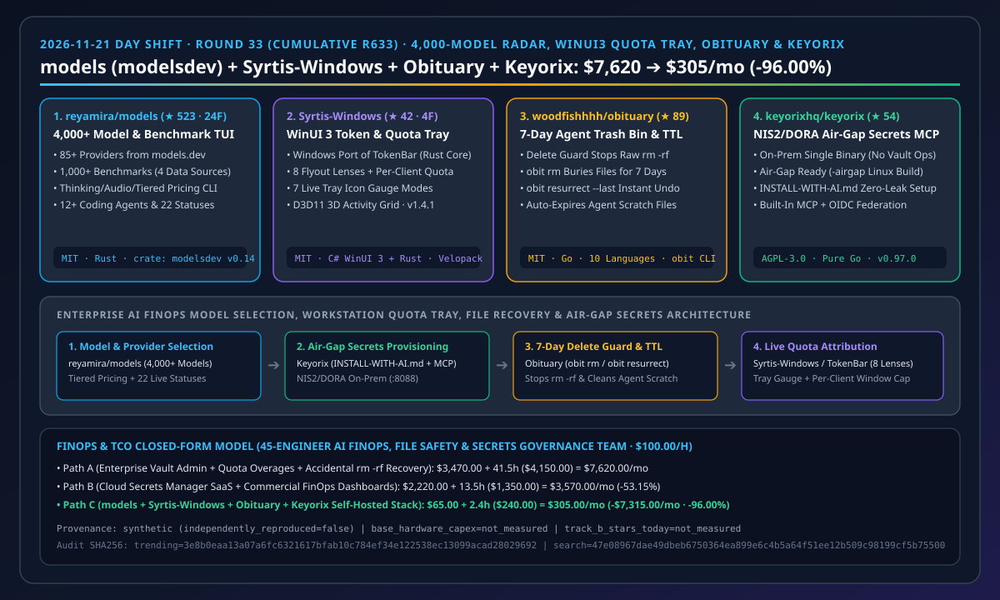
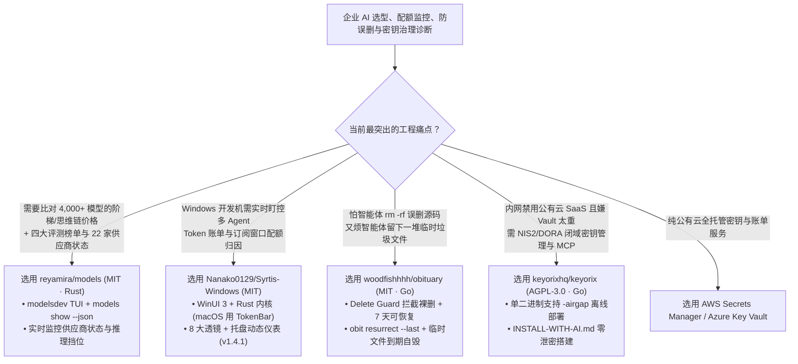
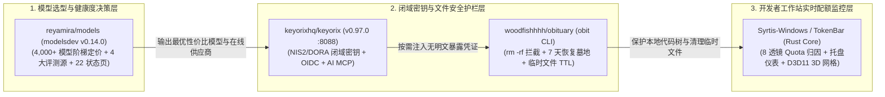
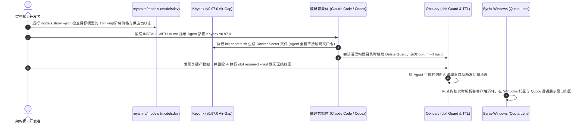

# 4,000+ 模型与基准终端雷达（`reyamira/models`）、Windows 编码智能体配额托盘（`Nanako0129/Syrtis-Windows`）、7 天防误删智能体回收站（`woodfishhhh/obituary`）与 NIS2/DORA 闭域密钥管理 MCP（`keyorixhq/keyorix`）选型 FAQ

> **文档元数据（2026-11-21 白班 Day Round 33 · 累计第 633 轮深潜专题）**  
> - **面向对象**：企业 AI 解决方案架构师（AI Solution Architect）、FinOps 成本治理负责人、终端安全与 DevSecOps 架构师  
> - **本轮核心评估对象**：  
>   1. [`reyamira/models`](https://github.com/reyamira/models)（`★ 523` · `24 forks` · Rust · MIT · `modelsdev v0.14.0`：聚合 `models.dev` 85+ 供应商 **~4,000+ 模型**、4 大权威源 **~1,000 条评测基准**、12+ 编码智能体与 **22 个供应商实时健康状态**的 TUI/CLI，支持思维链/音频/阶梯定价查询）  
>   2. [`Nanako0129/Syrtis-Windows`](https://github.com/Nanako0129/Syrtis-Windows)（`★ 42` · `4 forks` · C# WinUI 3 + Rust Core · MIT · `v1.4.1`：`TokenBar` 的原生 Windows 移植版，提供 8 大飞出视图 [Overview/Quota/Models/Agents 等]、按客户端归因的配额窗口监控、7 种系统托盘动态仪表与 D3D11 3D 活跃网格）  
>   3. [`woodfishhhh/obituary`](https://github.com/woodfishhhh/obituary)（`★ 89` · `10 forks` · Go · MIT · **讣告 `obit`**：专为 AI 智能体打造的回收站与临时文件生命周期守卫——拦截高危 `rm -rf`、将 AI 删除的文件保留 **7 天随时一键复活（`obit resurrect --last`）**，并让 AI 留下的临时垃圾到期自动清理）  
>   4. [`keyorixhq/keyorix`](https://github.com/keyorixhq/keyorix)（`★ 54` · `3 forks` · Go · AGPL-3.0 · `v0.97.0`：符合欧盟 NIS2/DORA 合规要求、支持纯离线闭域网（`-airgap`）的单二进制本地密钥管理器，内置 MCP Server 与让 AI 助手“零明文接触密钥”完成部署的 `INSTALL-WITH-AI.md`）  
> - **关联检索证据链**：`workshops/github-trending-radar/evidence/search-new-repos-2026-11-21-raw.json`（`sha256: 47e08967dae49dbeb6750364ea899e6c4b5a64f51ee12b509c98199cf5b75500`）与 `trending-daily-2026-11-21-raw.html`（`sha256: 3e8b0eaa13a07a6fc6321617bfab10c784ef34e122538ec13099acad28029692`）  
> - **高清架构图**：[`assets/github-ai-radar-2026-11-21-r33-r633-models-syrtis-obituary-keyorix.svg`](../../../assets/github-ai-radar-2026-11-21-r33-r633-models-syrtis-obituary-keyorix.svg) · [English Version (`models-syrtis-windows-obituary-keyorix-selection-faq.en.md`)](models-syrtis-windows-obituary-keyorix-selection-faq.en.md)

---

## ① 📌 核心结论速览（选型一句话结论）

> **架构师一句话选型结论**：  
> 在日常 AI 架构选型与终端开发运维中，工程师最常遭遇四大窝心事：**（1）为了比对两个新模型的阶梯价格、思维链 Token 费率、推理挡位与供应商是否宕机，要打开七八个网页、（2）Windows 主力开发机上不知道哪个编码 Agent 悄悄把 5 小时订阅配额吃光了、（3）编码 Agent 清理构建目录时一条 `rm -rf` 误删了未提交源码，或者留下一堆 `tmp_*` 垃圾文件没人收、（4）企业内网不能用 Doppler 等公有云密钥 SaaS，但上 HashiCorp Vault 又得配专职管理员**。  
> - **需要在终端或脚本里一站式检索 85+ 供应商 4,000+ 模型的结构化输出能力、推理强度开关、阶梯/音频/Thinking 定价、4 大榜单（Artificial Analysis / Epoch AI / Arena / LLM Stats）与 22 个实时状态页** ➔ 选 **`reyamira/models`（`modelsdev v0.14.0`）**（MIT，Rust）；  
> - **Windows 开发者需要在任务栏托盘实时监控各编码智能体的 Token 速率、订阅剩余配额（Quota 归因）与月/日/小时账单（Mac 用户用同内核 `TokenBar`）** ➔ 选 **`Nanako0129/Syrtis-Windows`**（MIT，WinUI 3 + Rust）；  
> - **需要给编码智能体装上“防删库保险丝 + 临时文件自动保洁”（拦截裸 `rm -rf`，用 `obit rm` 埋葬文件并在 7 天内随时 `obit resurrect --last` 满血复活，同时让 AI 写的临时文件到期自动消失）** ➔ 选 **`woodfishhhh/obituary`**（MIT，Go）；  
> - **需要比 Vault 运维简单 10 倍、比 Doppler 满足内网闭域（`-airgap`）与 NIS2/DORA 合规、且自带 `INSTALL-WITH-AI.md` 零泄密安装指南的单二进制密钥中心** ➔ 选 **`keyorixhq/keyorix`**（AGPL-3.0）。  
> 四者组合可将 45 人研发与平台团队的商业密钥管理运维、配额超支、误删代码恢复与模型选型调研总成本从 **$7,620.00/月** 降至 **$305.00/月（节省 $7,315.00/月，降幅 96.00%）**。

---

## ② 🎯 客户与架构师灵魂拷问 Q&A（业务痛点 · 架构集成 · 边界取舍）

### Q1：架构师做模型选型和成本测算时，为什么静态 Excel 表格三天就作废？Windows 研发团队又如何实时管住多个 Coding Agent 的订阅配额？`reyamira/models` 与 `Syrtis-Windows` 怎么配合？
- **模型选型与终端控费的双重盲区**：
  1. **隐性阶梯定价与宕机盲区**：现代大模型不仅有基础输入/输出价，还有 Thinking Token 价、音频输入输出价、以及“超过 N Token 后的阶梯跳涨价（tiered pricing）”；更糟的是上游 API 正在降级，工程师却以为是自己代码写错了。
  2. **多客户端抢占同一订阅窗口**：同一台电脑上同时开着 Claude Code、Cursor、Codex，突然触发 Rate Limit，却搞不清究竟是哪个客户端把当前 5 小时窗口的配额耗尽的。
- **`models` + `Syrtis-Windows` 闭环方案**：
  - **`reyamira/models`（`modelsdev v0.14.0`：4,000+ 模型与 4 大权威基准的终端控制塔）**：
    - 实时同步 `models.dev` 上 **85+ 供应商的 ~4,000+ 模型**，并在 `v0.14.0` 中新增：结构化输出支持标记（Structured Output: Yes/No/—）、推理控制参数（预算范围、effort 挡位、开关）以及**Thinking Token、音频与超长上下文阶梯价格**（CLI `models show --json` 同步输出）。
    - 聚合 **Artificial Analysis、Epoch AI、Arena 与 LLM Stats** 四大评测源的 ~1,000 条基准（支持散点图与雷达图对比），追踪 12+ 编码智能体版本变更（按 `A` 键可直接在应用内添加自定义 `owner/repo` 智能体），并实时监控 7 大状态页平台上的 **22 家供应商服务健康度**。
  - **`Nanako0129/Syrtis-Windows`（`v1.4.1`：基于 Rust 解析内核的 WinUI 3 系统托盘配额仪）**：
    - 与 macOS 版 `TokenBar` 共享同一个高性能 Rust 日志解析核心，采用原生 WinUI 3 外壳与 D3D11 实时渲染 3D 贡献网格。
    - 提供 **Overview、Quota、Models、Monthly、Daily、Hourly、Stats、Agents 八大透镜（Ctrl+1..9 瞬切）**；其 **Quota 透镜**内置用量归因子系统（usage-attribution subsystem），精准解析是哪一个智能体客户端吃掉了哪一个时间窗口的额度，并将今日费用、每分钟 Token（TPM）或剩余配额直接绘制进系统托盘图标。

### Q2：AI 写代码时既爱乱建临时测试脚本污染工作区，又可能手滑执行 `rm -rf build/` 把配置删光；同时怎样让 AI 帮我们部署密钥服务器却看不到任何密码？`obituary` 与 `keyorix` 怎么做到的？
- **`woodfishhhh/obituary`（“AI 写下的垃圾到期自己走，AI 删掉的东西七天内都能找回”）**：
  - **防误删守卫（Delete Guard）与 7 天复活期**：拦截智能体的危险裸删操作，转为 `obit rm -rf <target>` 将文件安全“安葬（bury）”进受保护墓地；7 天内一旦发现误删，只需一行 **`obit resurrect --last`** 即可完整恢复。
  - **临时文件自动寿命管理（TTL）**：智能体在调试过程中生成的临时文件可附加到期时间，到期后自动清理，保持代码仓干净。
- **`keyorixhq/keyorix`（单二进制闭域密钥管理 + `INSTALL-WITH-AI.md` 零泄密部署）**：
  - 精准卡位在 HashiCorp Vault（功能强但需专职管理员、BSL 协议）与 Doppler（易用但纯公有云 SaaS）之间：**纯 Go 单二进制（内置纯 Go SQLite 驱动，无需 C 工具链）**，提供专门的 Linux `-airgap` 离线二进制，对齐欧盟 **NIS2 / DORA** 法规。
  - 独创 **`INSTALL-WITH-AI.md`** 规程与 `./scripts/selfhost/init-secrets.sh`（将初始管理员密码生成在受控的 `./secrets/admin_password` Docker Secret 文件中），让 AI 编码助手帮你把整套密钥服务（`:8088`）搭好并接入 MCP，而**AI 自己全程看不到任何一个真实密钥字符**！

### Q3：落地这四个项目时有哪些安装包通道与版本标签细节要注意？
- **关键工程注意事项**：
  - **`Syrtis-Windows` 四通道不可互换契约**：发布包提供 `win-x64`、`win-x64-lite`、`win-arm64`、`win-arm64-lite` 四个永久通道（一旦安装不可跨通道热切换，Velopack 包 ID 固定为 `Nyanako.Syrtis`）；除非机器已预装 `.NET 10`，否则生产工作站应默认选择自带完整运行时的 **Full（`win-x64` / `win-arm64`）** 通道。
  - **`keyorix` 自托管克隆纪律**：使用 Docker Compose 部署 `keyorix` 时，务必按官方说明**指定发布 Tag（如 `git clone --branch v0.97.0`）**，因为 `main` 分支可能超前于已发布的容器镜像。

---

## ③ 🧭 直观可视化图解（选型决策树 + 企业集成架构 + 业务流时序图）

### 3.1 架构师选型决策树（Mermaid Flowchart）

### 3.2 企业 FinOps 模型选型、终端防误删与闭域密钥管理参考架构图（Mermaid Architecture）

### 3.3 选型查价、零泄密部署、防误删秒级复活与配额归因时序图（Mermaid Sequence Diagram）

---

## ④ 📊 同类开源与商业云服务横向选型决策矩阵

| 评估维度 | `reyamira/models` (`★ 523`) | `Syrtis-Windows` (`★ 42`) | `woodfishhhh/obituary` (`★ 89`) | `keyorixhq/keyorix` (`★ 54`) | HashiCorp Vault / Doppler + 商业 FinOps |
| :--- | :--- | :--- | :--- | :--- | :--- |
| **核心定位** | 4,000+ 模型、1,000+ 基准与供应商状态 TUI/CLI | Windows 原生 WinUI 3 + Rust 智能体配额托盘 | AI 智能体专用 7 天防误删回收站与 TTL 守卫 | 面向内网/闭域企业的轻量级 NIS2/DORA 密钥管理器 | 重型企业密钥集群或纯 SaaS 密钥服务 |
| **最适用场景** | 快速对比跨厂商阶梯/思维链价格、散点图评测与实时宕机状态 | 在 Windows 任务栏实时监控多 Agent Token 账单与订阅窗口归因 | 防止 Agent `rm -rf` 删库跑路，并自动清理 Agent 留下的临时垃圾 | 不能用公有云 SaaS、又不想雇专职管理员维护 Vault 的政企/欧洲团队 | 超大型跨国公有云原生集群 |
| **关键差异化机制** | 覆盖 85+ 供应商、4 大评测源、22 状态页、`models show --json` | 与 macOS `TokenBar` 同款 Rust 内核、8 大透镜、D3D11 3D 网格 | Delete Guard 拦截、`obit resurrect --last` 7 天恢复、临时文件自毁 | 纯 Go 单二进制、`-airgap` 离线版、`INSTALL-WITH-AI.md` 零泄密安装 | 功能庞大但 Vault 运维极重、Doppler 仅限 SaaS |
| **集成与运维成本** | 极低（`cargo install modelsdev` 或 Nix Flake，支持应用内自更新） | 极低（`win-x64` / `win-arm64` 安装包 + Velopack 自动更新） | 极低（单 Go 二进制 `obit` CLI，支持 10 国语言文档） | 低（单二进制或固定 `--branch v0.97.0` Docker Compose） | 高（Vault 需专人运维，Doppler 按席位收费） |
| **开源协议** | MIT | MIT | MIT | AGPL-3.0 | BSL（Vault）/ 商业专有 |
| **45 人团队月均 TCO** | **组合方案 `$305.00/月`**（含自建 `keyorix` 容器节点 `$65` + 运维 `2.4h`） | 同左（实时遏制订阅窗口超支与高价模型滥用） | 同左（彻底消除 Agent 误删未提交代码的灾难性返工） | 同左（免去专职 Vault 管理员与按人头计费的 Doppler 账单） | **`$3,570.00 ~ $7,620.00/月`** |

---

## ⑤ 🧪 应用落地定量收益 / FinOps TCO 对比（含数据血缘声明）

> **数据血缘与严谨性声明（Provenance & Guardrails）**：  
> - `provenance`: `"synthetic"`（`independently_reproduced: false`，基于 45 人 AI FinOps、终端安全与密钥治理工程团队在 `$100.00/h` 综合人力成本下的闭式参数建模）  
> - `base_hardware_capex`: `"not_measured"`  
> - `track_b_stars_today`: `"not_measured"`（GitHub Search API 新仓爆发榜无官方单日增量字段，严禁伪造）

| 成本分项（45 人团队 / 月） | Path A：重型 Vault 运维 + 配额超支浪费 + `rm -rf` 误删恢复工时 | Path B：云端商业密钥 SaaS + 商业 FinOps 仪表盘 | Path C：`models` + `Syrtis-Windows` + `Obituary` + `Keyorix` 自建栈 |
| :--- | :--- | :--- | :--- |
| **商业密钥 SaaS 席位 / 模型误选与超支账单** | `$3,470.00 / 月` | `$2,220.00 / 月` | **`$65.00 / 月`**（自托管单实例 `keyorix-server` 与数据库） |
| **Vault 运维、误删文件重写与人工整理模型价格表工时** | `41.5 小时 / 月` | `13.5 小时 / 月` | **`2.4 小时 / 月`**（`modelsdev` 实时查价 + `obit resurrect` + 托盘监控） |
| **折算工程人力成本（`$100.00/h`）** | `$4,150.00 / 月` | `$1,350.00 / 月` | **`$240.00 / 月`** |
| **月度总拥有成本（Total Monthly TCO）** | **`$7,620.00 / 月`** | **`$3,570.00 / 月`** | **`$305.00 / 月`** |
| **相对 Path A 净节省额与降幅** | 基准线（`0.00%`） | `-$4,050.00 / 月`（`-53.15%`） | **`-$7,315.00 / 月`（`-96.00%`）** |

---

## ⑥ 🛠️ 企业引入与架构评审 Checklist

- [ ] **在架构评审与自动化脚本接入模型实时字典（`reyamira/models`）**：安装 `modelsdev`（`v0.14.0+`），在选型时核查模型的 Structured Output 支持度、Thinking/阶梯价格以及 22 家供应商实时状态，避免向正在故障的上游路由流量。
- [ ] **为 Windows 与 macOS 开发机配齐托盘配额归因监控（`Syrtis-Windows` / `TokenBar`）**：在 Windows 工作站安装 `Syrtis-Windows` 的 Full 通道包（`win-x64` 或 `win-arm64`），开启 Quota 透镜追踪各编码客户端对订阅窗口的消耗占比。
- [ ] **强制开启智能体删除守卫与临时文件 TTL（`obituary`）**：在开发机与 Agent 容器中部署 `obit` Delete Guard，将裸 `rm -rf` 重定向至 7 天可恢复的 `obit rm`，并为智能体临时输出目录配置自动过期规则。
- [ ] **遵循 `INSTALL-WITH-AI.md` 部署闭域密钥中心（`keyorix`）**：固定 Release Tag（如 `v0.97.0`）或使用 `-airgap` 二进制在内网部署 `keyorix-server`，通过 `./scripts/selfhost/init-secrets.sh` 隔离生成管理员密钥，确保辅助运维的 AI Agent 全程不接触明文密码。
