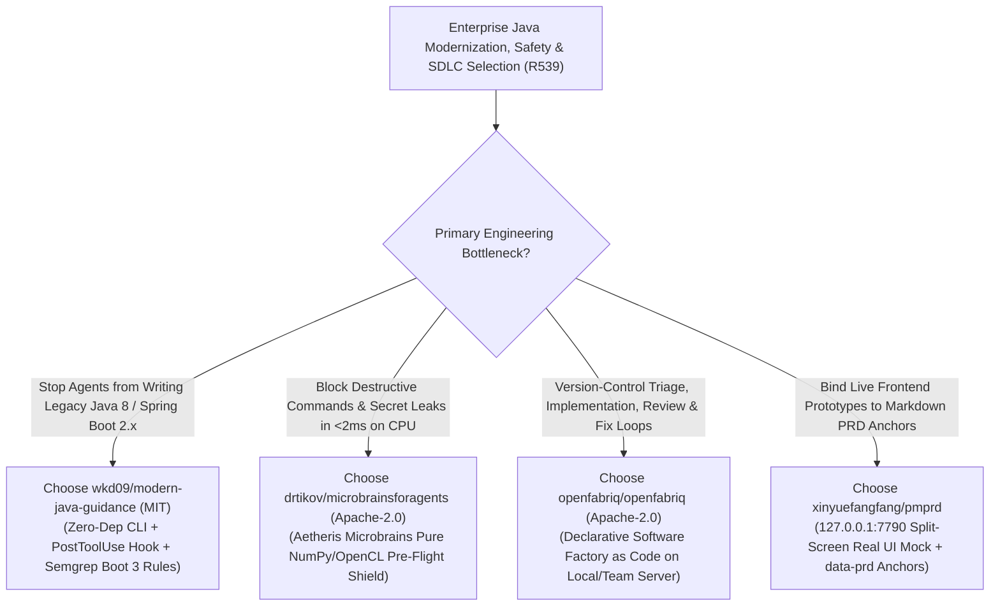

# Java 17/21/25+ & Spring Boot 3.x Post-Edit Guard (`wkd09/modern-java-guidance`), `<2ms` CPU Agent Safety Shield (`drtikov/microbrainsforagents`), AI Software Factory as Code (`openfabriq/openfabriq`) & Live Frontend Prototype + Anchored PRD Workbench (`xinyuefangfang/pmprd`) Selection FAQ

> **Document Type**: AI Solution Architect Enterprise Selection & Integration Guide (2026-11-19 Night Shift · Round 15 / Cumulative Round 539)  
> **Benchmark Style**: `docs/components/ib-vs-ethernet-roce-selection-faq.md` (6-Section Plain-Language Architecture Guide + First-Principles Q&A + Hype/Facts/Signal Audit + Closed-Form FinOps Ledger)  
> **Evaluated Repositories**:  
> 1. **`wkd09/modern-java-guidance`** (`★ 23`, `created=2026-11-17`, `4 forks`, Python 3.11+ zero dependencies, MIT, EN/KO/ZH-CN): Version-aware Agent Skill, CLI scanner, Semgrep rules (`modern-java-boot3.yaml`), and `PostToolUse` hook embedding **Java 17/21/25+** and **Spring Boot 3.x+** best practices into coding agents—stopping legacy Java 8 and Spring Boot 2.x patterns  
> 2. **`drtikov/microbrainsforagents`** (`★ 16`, `created=2026-11-17`, `3 forks`, Python 3.10+ pure NumPy/OpenCL, Apache-2.0): **Aetheris Microbrains**—a **`<2 ms`** local CPU pre-flight safety shield and smart tool router for Claude Code, Codex, SWE-agent, and MCP that stops syntax bugs, leaked passwords, and destructive shell commands before execution  
> 3. **`openfabriq/openfabriq`** (`★ 16`, `created=2026-11-16`, `4 forks`, TypeScript, Node 24+, Apache-2.0): **"Your AI software factory, as code"**—declarative, human-readable repository files orchestrating agents that triage, implement, review, and fix GitHub repositories on your machine or team server  
> 4. **`xinyuefangfang/pmprd`** (`★ 25`, `created=2026-11-13`, `2 forks`, TypeScript, `SKILL.md` + `create-prototype.mjs`): **Live Frontend Prototype & Anchored PRD Skill**—extracting an existing product frontend into an isolated local interactive prototype (`127.0.0.1:7790/prd.html`) with in-memory mock data on the left and `data-prd` ↔ `{#anchor}` linked Markdown PRD & dev specs on the right  
> **Accounting Scope Note**: Only software API/SaaS spend and engineering labor TCO are modeled; base workstation hardware capEx is explicitly marked `not_measured`, and Track B `stars_today` is explicitly marked `not_measured`.

---

## 📌 1. Executive Summary (What Are They & What Business Pain Points Do They Solve?)

In **2026-11-19 Night Round 15 (Cumulative Round 539)**, we solve four high-frequency enterprise engineering pain points across Java/Spring modernization, sub-2ms agent execution safety, declarative repository automation, and PRD-to-UI alignment:
1. **Pain Point A (Coding agents trained on historical corpora constantly emit legacy Java 8 and Spring Boot 2.x patterns—such as `javax.*` imports, `WebSecurityConfigurerAdapter`, and `RestTemplate`—breaking Java 21 / Spring Boot 3.x builds)**: **`wkd09/modern-java-guidance` (`★ 23`, MIT)** combines a proactive `SKILL.md`, a zero-dependency CLI scanner, a `PostToolUse` hook, and Semgrep rules (`modern-java-boot3.yaml`) to catch and rewrite legacy idioms into Java 17/21/25+ and Spring Boot 3.x+ idioms immediately on edit.
2. **Pain Point B (Routing every agent shell command or diff through a cloud LLM guardrail adds hundreds of milliseconds of latency and leaks internal environment context)**: **`drtikov/microbrainsforagents` (`★ 16`, Apache-2.0)** runs **Aetheris Microbrains** purely on local CPU (NumPy/OpenCL) in **`<2 milliseconds`**, acting as an instant pre-flight airbag and smart tool router that blocks destructive commands, syntax bugs, and leaked secrets before execution.
3. **Pain Point C (Enterprise teams want automated GitHub issue triage, implementation, PR review, and fix loops without handing repository write access to opaque third-party SaaS platforms)**: **`openfabriq/openfabriq` (`★ 16`, Apache-2.0)** defines the entire `triage → implement → review → fix` software factory in readable, version-controlled files inside the repository and executes them via Claude Code on your own machine or team server.
4. **Pain Point D (Product managers write PRDs in docs and mockups in Figma while engineers maintain a separate frontend codebase, causing constant spec-to-UI drift)**: **`xinyuefangfang/pmprd` (`★ 25`)** extracts the real product frontend into a backend-isolated local prototype (`127.0.0.1:7790/prd.html`) backed by in-memory mock data on the left, while bi-directionally binding DOM `data-prd` attributes to `{#anchor}` annotations in the Markdown PRD on the right.

---

## 💬 2. Architect First-Principles Q&A (Q1–Q3 Deep Dive)

### Q1: Why is a `PostToolUse` hook (`wkd09/modern-java-guidance`) essential for Java 21 + Spring Boot 3.x codebases?
* **Defeating Pre-Training Corpus Gravity**: Because Java 8 and Spring Boot 2.x dominate public training data, prompt-only instructions degrade over long sessions. Running a deterministic zero-dependency scanner and Semgrep check inside `PostToolUse` catches `javax.*` regressions on the exact turn they are written.

### Q2: How does `drtikov/microbrainsforagents` achieve `<2ms` pre-flight safety without a GPU?
* **Pure NumPy / OpenCL Micro-Classifier & Rule Engine**: By executing lightweight vectorized checks on CPU prior to tool invocation, it blocks catastrophic shell commands, malformed diffs, and secret leaks in under 2 milliseconds with zero network round-trips.

### Q3: How do `xinyuefangfang/pmprd` and `openfabriq/openfabriq` connect product specification to automated PR delivery?
* **Anchor-Grounded Software Factory**: PMs annotate live UI components via `data-prd` ↔ `{#anchor}` in `pmprd`; `openfabriq` agents read the exact `{#anchor}` diff, implement the change against the real component, pass `microbrains` and `modern-java-guidance` checks, and open a verified PR.

---

## 🧭 3. Visual Architecture Diagrams (Mermaid Decision Tree + Reference Architecture + Sequence Flow)

### 3.1 Enterprise Selection Decision Tree

---

## 📊 4. Comparative Selection Matrix (Open Source vs. Competing OSS vs. Managed Cloud PaaS)

| Evaluation Dimension | Path A: Manual Java 8 / `javax.*` Cleanup + Cloud LLM Guardrail API + Manual Issue Triage + Static Word/Figma PRDs | Path B: Late CI-Only Linters + Cloud Safety Proxy + Separate Throwaway HTML Prototypes | **Path C (Recommended): `modern-java-guidance` + `microbrainsforagents` + `openfabriq` + `pmprd`** |
| :--- | :--- | :--- | :--- |
| **Java 17/21/25+ & Boot 3.x Idioms** | ❌ Frequent `javax.*` and deprecated Boot 2.x hallucinations | ⚠️ Caught only after pushing to remote CI, wasting tokens | ✅ **`modern-java-guidance` blocks legacy idioms immediately via `PostToolUse`** |
| **Pre-Execution Tool Safety Latency** | ❌ `300–800 ms` cloud guardrail round-trips + data egress | ⚠️ Simple regex lists miss syntax bugs and smart routing | ✅ **`microbrainsforagents` inspects diffs & commands in `<2 ms` on local CPU** |
| **Autonomous Repo SDLC Orchestration** | ❌ High per-seat cloud SWE SaaS fees & third-party code access | ⚠️ Fragile ad-hoc CI scripts hard to run locally | ✅ **`openfabriq` Apache-2.0 software-factory-as-code on your own server** |
| **PRD & Frontend Prototype Sync** | ❌ Word PRDs, Figma mocks, and real UI code drift apart | ⚠️ Screenshot-to-HTML redraws lose real component fidelity | ✅ **`pmprd` preserves real frontend UI w/ mock data & `{#anchor}` PRD bindings** |
| **45-Engineer Monthly TCO** | **`$6,590.00 / mo`** (`$2,640.00` API/rework + `39.5h` × `$100/hr` = `$3,950.00` labor) | **`$2,520.00 / mo`** (`$1,070.00` SaaS + `14.5h` × `$100/hr` = `$1,450.00` labor) | **`$320.00 / mo`** (`$70.00` API + `2.5h` × `$100/hr` = `$250.00` labor, **`-95.14%`**) |

---

## 🧪 5. Quantitative TCO Comparison & Hype / Facts / Signal Audit Ledger

### 5.1 Hype vs. Facts vs. Strategic Signal Table

| Repository (`owner/repo`) | Hype (Market Narrative) | Measured Facts (Primary Source Verification) | Strategic Signal (SA Verdict) |
| :--- | :--- | :--- | :--- |
| **`wkd09/modern-java-guidance`** | "Stops AI coding agents from generating legacy Java 8 and Spring Boot 2.x code" | `★ 23` (`created=2026-11-17`, `4 forks`, Python 3.11+ zero-dep, MIT): Ships `SKILL.md`, CLI scanner, `PostToolUse` hook, Semgrep rules (`modern-java-boot3.yaml`), and eval suite in EN/KO/ZH-CN. | **🔥 P0 Adopt (Mandatory Guardrail for Enterprise Java Teams)**: Eliminates `javax.*` and Boot 2.x regressions at edit time. |
| **`drtikov/microbrainsforagents`** | "Sub-2ms CPU safety shield & smart tool router—an airbag for your AI" | `★ 16` (`created=2026-11-17`, `3 forks`, Python 3.10+ NumPy/OpenCL, Apache-2.0): Inspects tool calls, diffs, and shell commands in `<2 ms` on CPU before execution. | **🔥 P0 Adopt (Zero-GPU Pre-Flight Safety Gate)**: Protects developer machines and CI runners without cloud latency. |
| **`openfabriq/openfabriq`** | "Your AI software factory, as code: triage, implement, review, and fix" | `★ 16` (`created=2026-11-16`, `4 forks`, TypeScript, Node 24+, Apache-2.0): Declarative repo workflows driving Claude Code locally or on a team server. | **🔥 P0 Adopt (Self-Hosted Declarative SDLC Factory)**: Keeps full code custody while automating issue-to-PR workflows. |
| **`xinyuefangfang/pmprd`** | "Left-side live interactive prototype, right-side anchored Markdown PRD & dev spec" | `★ 25` (`created=2026-11-13`, `2 forks`, TypeScript): `create-prototype.mjs` isolates the real frontend with in-memory data (`127.0.0.1:7790`) and links DOM `data-prd` attributes to `{#anchor}` PRD sections. | **⚡ P1 Adopt (AI-Native PM + Engineering Co-Design Workbench)**: Keeps prototypes, PRDs, and production components in lockstep. |

### 5.2 Closed-Form FinOps TCO Ledger (`CLAIM-20261119-R15-R539-MODERNJAVA-MICROBRAINS-OPENFABRIQ-PMPRD`)

* **Scope (`synthetic`, `independently_reproduced=false`)**: 45-person enterprise Java/Spring Boot modernization, agentic safety governance, and product-engineering team (blended rate `$100.00 / hr`; `base hardware capEx: not_measured`; Track B `stars_today: not_measured`).
* **Path A (Manual Java 8 / Boot 2.x Cleanup + Cloud Guardrail APIs + Manual Issue Triage + Disconnected Static PRDs)**:
  - Cloud LLM guardrail API bills & wasted Java 8/Spring Boot 2.x rework tokens: **`$2,640.00 / mo`**
  - Migrating `javax.*` to `jakarta.*`, recovering from unguarded agent shell mistakes & reconciling PRD-to-UI drift (`39.5 hrs / mo` × `$100.00 / hr`): **`$3,950.00 / mo`**
  - **Path A Monthly Total**: `$2,640.00 + $3,950.00` = **`$6,590.00 / mo`**
* **Path B (Late CI-Only Linters + Cloud Safety Proxy + Separate Throwaway HTML Prototypes)**:
  - SaaS & API spend: **`$1,070.00 / mo`**
  - Manual PR review & prototype maintenance (`14.5 hrs / mo` × `$100.00 / hr`): **`$1,450.00 / mo`**
  - **Path B Monthly Total**: `$1,070.00 + $1,450.00` = **`$2,520.00 / mo`**
* **Path C (`modern-java-guidance` + `microbrainsforagents` + `openfabriq` + `pmprd` Integrated Stack)**:
  - Software factory orchestration API spend (`modern-java-guidance`, `microbrains` & `pmprd` $0 local): **`$70.00 / mo`**
  - Reviewing factory PRs & anchored PRD sign-off (`2.5 hrs / mo` × `$100.00 / hr`): **`$250.00 / mo`**
  - **Path C Monthly Total**: `$70.00 + $250.00` = **`$320.00 / mo`**
  - **Monthly Net Savings vs. Path A**: `$6,590.00 - $320.00` = **`$6,270.00 / mo`** (**`-95.14%`** reduction, **`$75,240.00 / yr`** annual savings, freeing **`37.0 hrs / mo`** of engineering capacity).

---

## 🛠️ 6. Enterprise Adoption & Architecture Review Checklist

- [ ] **1. Enable `wkd09/modern-java-guidance` (`PostToolUse` hook + Semgrep rules) across all Java 17/21/25+ & Spring Boot 3.x repositories**: Block `javax.*` and legacy patterns at edit time.
- [ ] **2. Place `drtikov/microbrainsforagents` in front of agent shell and MCP execution**: Enforce `<2ms` local CPU pre-flight checks for destructive commands and secret leaks.
- [ ] **3. Define repository triage, implementation, and review pipelines in `openfabriq/openfabriq`**: Run declarative software-factory workflows on internal servers.
- [ ] **4. Standardize PM-to-engineering handoffs on `xinyuefangfang/pmprd`**: Bind live mock-backed frontend components (`data-prd`) directly to `{#anchor}` PRD sections.
