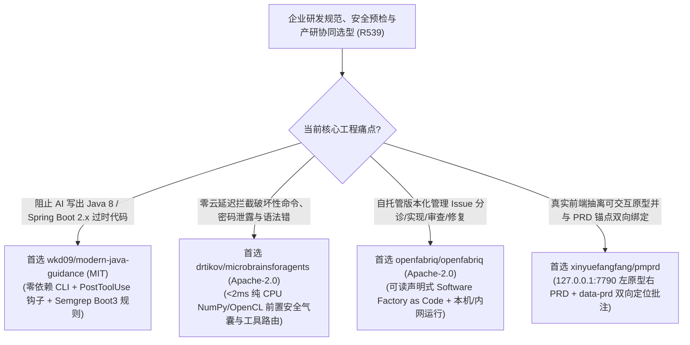
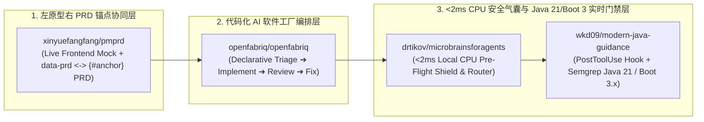
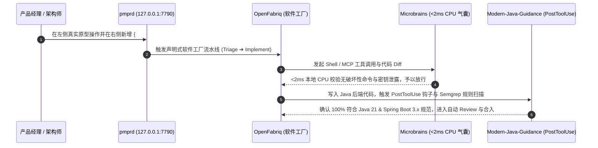

# Java 17/21/25+ 与 Spring Boot 3.x 防退化钩子（`wkd09/modern-java-guidance`）、`<2ms` 纯 CPU 智能体安全气囊（`drtikov/microbrainsforagents`）、代码化软件工厂（`openfabriq/openfabriq`）与左原型右 PRD 锚点工作台（`xinyuefangfang/pmprd`）选型 FAQ

> **文档类型**：AI Solution Architect（AI 解决方案架构师）实战选型与架构内功指南（2026-11-19 Night Shift · Round 15 / 累计第 539 轮）  
> **对标标杆**：`docs/components/ib-vs-ethernet-roce-selection-faq.md`（六段式架构拆解 + 第一性原理大白话 + Hype/Facts/Signal 审计 + 闭式 TCO 账本）  
> **本轮评估对象**：  
> 1. **`wkd09/modern-java-guidance`**（`★ 23`，`created=2026-11-17`，`4 forks`，Python 3.11+ 零依赖，MIT，支持中/英/韩）：集 Agent Skill、CLI 扫描器、Semgrep 规则包（`modern-java-boot3.yaml`）与 `PostToolUse` 钩子于一体的 **Java 17/21/25+ 与 Spring Boot 3.x+ 防退化护栏**——实时阻止 Coding Agent 生成过时的 Java 8 与 Spring Boot 2.x 代码  
> 2. **`drtikov/microbrainsforagents`**（`★ 16`，`created=2026-11-17`，`3 forks`，Python 3.10+ 纯 NumPy/OpenCL，Apache-2.0）：**Aetheris Microbrains**——运行在本地 CPU 上、延迟 **`<2 ms`** 的智能体安全气囊与工具路由器，在 Claude Code、Codex 或 MCP 执行命令/写入代码前实时拦截危险指令、语法错误与密码泄露  
> 3. **`openfabriq/openfabriq`**（`★ 16`，`created=2026-11-16`，`4 forks`，TypeScript，Node 24+，Apache-2.0）：“**代码化的 AI 软件工厂（Your AI Software Factory, as Code）**”——将仓库级 Issue 分诊、功能实现、代码审查与自动修复定义为可读声明式文件，直接在本机或团队服务器上驱动 Claude Code 运行  
> 4. **`xinyuefangfang/pmprd`**（`★ 25`，`created=2026-11-13`，`2 forks`，TypeScript，`SKILL.md` + `create-prototype.mjs`）：**左原型右 PRD 双向锚点协同技能**——把真实产品前端抽离为本地内存数据隔离的可交互原型（`127.0.0.1:7790/prd.html`），右侧通过 `data-prd` 与 `{#anchor}` 精准绑定中文 PRD、研发说明与原位批注  
> **审计折算说明**：本报告仅计量软件算力、商业 SaaS 与工程运维人力 TCO，底层研发工作站硬件采购（base hardware capEx）显式标注为 `not_measured`，新仓今日增量显式标注为 `not_measured`，严禁捏造坐标。

---

## 📌 一、核心结论速览（Executive Summary：它到底是什么？解决什么业务痛点？）

在 **2026-11-19 Night Round 15（累计第 539 轮）** 中，我们面向企业架构师解决“大模型写 Java 老是退回 Java 8 / Spring Boot 2.x 过时写法、Agent 执行危险 Shell 命令缺乏亚毫秒本地拦截、团队 Issue 分诊到修 Bug 缺乏可版本化编排、以及产品经理 PRD 文档与前端真实代码两张皮”四大核心痛点：
1. **痛点 A（大模型训练语料里充斥着十年前的 Java 8 与 Spring Boot 2.x 代码，导致 Agent 一上手就狂写 `javax.persistence.*`、已废弃的 `WebSecurityConfigurerAdapter`、`RestTemplate` 和传统阻塞线程池，在 Java 21 / Spring Boot 3.x 项目里编译全红）**：用零依赖版本感知钩子在每次改文件瞬间纠偏。**`wkd09/modern-java-guidance` (`★ 23`, MIT) 的破局之道**：同时提供事前 `SKILL.md` 引导、事中 `PostToolUse` 钩子自动扫描与 CI `rules/semgrep/modern-java-boot3.yaml` 门禁，一旦检测到 Agent 写出 Java 8 / Boot 2.x 遗留模式，当场阻断并提示替换为 `jakarta.*`、Record、Sealed Class、Virtual Threads 与 Spring Security 6 `SecurityFilterChain`。
2. **痛点 B（把 Agent 每次生成的 Bash 命令或代码 Diff 发给云端安全大模型审核，不仅每次增加几百毫秒延迟和额外账单，而且代码和内网环境变量还得外发）**：在本地 CPU 上装一个 **`<2 毫秒`** 的前置“安全气囊”。**`drtikov/microbrainsforagents` (`★ 16`, Apache-2.0) 的破局之道**：纯 NumPy/OpenCL 实现的 **Aetheris Microbrains** 部署在 LLM 与系统终端/MCP 之间，耗时不到 `2 ms` 即可在本地 CPU 上拦截破坏性删除指令、硬编码密钥泄露与明显语法错误，并充当智能工具路由器。
3. **痛点 C（团队想让 Agent 自动做 GitHub Issue 分诊、提 PR、做 Code Review 并根据评论修代码，但市面上的云端 AI 研发平台要么按席位收天价且要求交出源码权限，要么是一堆没法纳入 Git 版本管理的碎脚本）**：把软件工厂定义为仓库里的可读代码。**`openfabriq/openfabriq` (`★ 16`, Apache-2.0) 的破局之道**：用清晰可读的声明式文件描述 `triage → implement → review → fix` 四阶段研发流水线，直接跑在工程师本机或团队内网服务器上驱动 Claude Code，全流程随仓库 Git 版本化演进。
4. **痛点 D（产品经理在飞书/Word 写一套 PRD、在 Figma 画一套静态图，前端研发在代码库里又是另一套实现，需求一改三边严重脱节）**：直接从真实前端代码抽离出“左可交互原型 + 右锚点绑定 PRD”同屏工作台。**`xinyuefangfang/pmprd` (`★ 25`) 的破局之道**：通过 `node scripts/create-prototype.mjs` 保留真实产品 UI 组件并用本地内存假数据隔离后端（`127.0.0.1:7790/prd.html`），页面元素通过 `data-prd` 属性与右侧 Markdown PRD 中的 `{#anchor}` 精准绑定，产品经理口述需求即可让 Agent 同步更新交互原型与 PRD/技术规格文档。

---

## 💬 二、客户与架构师灵魂拷问 Q&A（Q1–Q3 First-Principles Deep Dive）

### Q1：为什么银行和大型政企在 Java 21 / Spring Boot 3 升级项目中必须挂载 `wkd09/modern-java-guidance` 的 `PostToolUse` 钩子？
* **克服预训练语料先验偏差（Overcoming Pre-Training Prior Bias）**：开源世界中 Java 8 + Spring Boot 2 的历史代码量远大于 Java 21 + Boot 3，单靠系统提示词说“请用 Spring Boot 3”在长上下文后极易失效。`PostToolUse` 钩子在每次文件编辑落盘后立刻执行零依赖 AST/正则与 Semgrep 校验，把错误扼杀在单步之内。

### Q2：`drtikov/microbrainsforagents` 的 `<2ms` 本地 CPU 预检如何与企业现有的权限审批流配合？
* **三层分级熔断**：`<2ms` CPU 微脑将工具调用即时分为：① 安全只读操作（直接放行）、② 含硬编码密码或语法损坏的无效调用（直接本地打回让 Agent 重写，省去人工打扰）、③ 涉及高危变更但格式合法的操作（转交人类审批卡）。

### Q3：`xinyuefangfang/pmprd` 与 `openfabriq/openfabriq` 组合后如何重塑“从产品需求到 PR 合入”的端到端研发链路？
* **锚点驱动软件工厂**：产品经理在 `pmprd` 左侧点击真实前端组件、在右侧更新带 `{#anchor}` 的 Markdown PRD 批注；提交后触发自托管 `openfabriq` 软件工厂，Agent 直接读取 `{#anchor}` 对应的 `data-prd` 源码组件完成开发、通过 `modern-java-guidance` 与 `microbrains` 校验并自动提交 PR。

---

## 🧭 三、直观可视化图解（Mermaid 选型决策树 + 企业集成参考架构 + 业务流时序图）

### 3.1 Java 现代规范、亚毫秒安全气囊、代码化软件工厂与原型 PRD 选型决策树

### 3.2 企业集成参考架构图

### 3.3 端到端业务流时序图

---

## 📊 四、同类开源与商业云服务横向选型决策矩阵（Decision Matrix）

| 评估维度 | 路径 A：人工修大模型写的 Java 8 / `javax.*` Bug + 云端 LLM 护栏 API + 手工分诊 Issue + 静态 Figma/Word PRD | 路径 B：仅靠事后 CI 报错 + 云端审核代理 + 手工维护独立原型仓 | **路径 C（推荐）：`modern-java-guidance` + `microbrainsforagents` + `openfabriq` + `pmprd`** |
| :--- | :--- | :--- | :--- |
| **Java 17/21/25+ 与 Boot 3.x 合规率** | ❌ Agent 频繁写出 `javax.*` 与过时 Security 配置，靠人工编译排错 | ⚠️ 等到推送到远端 CI 才报错，已浪费多轮上下文 Token | ✅ **`modern-java-guidance` 在每次编辑后通过 `PostToolUse` 钩子毫秒级纠偏** |
| **危险命令与密码泄露拦截延迟** | ❌ 调云端审核模型耗时 `300–800 ms` 且敏感代码需出内网 | ⚠️ 正则黑名单漏报率高且不具备智能工具路由能力 | ✅ **`microbrainsforagents` 纯本地 CPU `<2 ms` 拦截危险命令与语法错** |
| **Issue 分诊到 PR 修复自动化** | ❌ 人工分诊与催促修评审意见，或采购昂贵黑盒云研发 SaaS | ⚠️ 零散 GitHub Actions 脚本难以在本地复现与调试 | ✅ **`openfabriq` Apache-2.0 声明式软件工厂即代码，本机/内网同构运行** |
| **产品 PRD 与前端原型一致性** | ❌ Word 文档、Figma 画图与真实前端代码三套体系各自漂移 | ⚠️ 让 AI 看截图重画 HTML 原型，丢失原项目真实组件与样式 | ✅ **`pmprd` 直接复用源前端 UI + 本地假数据 + `data-prd` 双向绑定 PRD** |
| **45 人团队月度综合 TCO** | **`$6,590.00 / 月`**（云端护栏与返工 Token `$2,640` + 改 `javax.*`/修误删/对 PRD 耗时 `39.5h / $3,950`） | **`$2,520.00 / 月`**（云代理与 SaaS `$1,070` + 人工 Review 与原型同步 `14.5h / $1,450`） | **`$320.00 / 月`**（软件工厂编排 API `$70` + 评审验收 `2.5h / $250`，3 个本地工具 $0，**净省 `-95.14%`**） |

---

## 🧪 五、应用落地定量收益/TCO 对比与 Hype / Facts / Signal 审计账本

### 5.1 Hype vs. Facts vs. Strategic Signal 审计表

| 仓库 (`owner/repo`) | Hype（市场宣传口径） | Measured Facts（一手源码与文档实证事实） | Strategic Signal（架构师选型信号） |
| :--- | :--- | :--- | :--- |
| **`wkd09/modern-java-guidance`** | “阻止 AI 编码智能体生成过时的 Java 8 与 Spring Boot 2.x 代码” | `★ 23`（`created=2026-11-17`，`4 forks`，Python 3.11+ 零依赖，MIT）：提供中/英/韩文档、`SKILL.md`、CLI 扫描器、`PostToolUse` 钩子与 `modern-java-boot3.yaml` Semgrep 规则。 | **🔥 P0 采纳（金融与政企 Java 团队必装护栏）**：精准根治大模型在 Spring Boot 3 项目中乱写 `javax.*` 的顽疾。 |
| **`drtikov/microbrainsforagents`** | “2 毫秒以内的纯 CPU 智能体安全气囊与智能工具路由器” | `★ 16`（`created=2026-11-17`，`3 forks`，Python 3.10+ 纯 NumPy/OpenCL，Apache-2.0）：在本地 CPU 上以 `<2 ms` 延迟预检工具调用、Diff 与 Shell 指令，拦截破坏性操作与密码泄露。 | **🔥 P0 采纳（零 GPU 超低延迟前置安全闸门）**：无需外发云端即可为 Claude Code / MCP 提供亚毫秒级防误删保护。 |
| **`openfabriq/openfabriq`** | “代码化的 AI 软件工厂：在可读文件中定义分诊、实现、评审与修复” | `★ 16`（`created=2026-11-16`，`4 forks`，TypeScript，Node 24+，Apache-2.0）：将 Issue Triage、Implement、Review、Fix 编排为可读仓库文件，驱动本机或团队服务器上的 Claude Code。 | **🔥 P0 采纳（自托管声明式研发流水线底座）**：比黑盒云端 SWE SaaS 更透明、更符合企业内网代码不出域要求。 |
| **`xinyuefangfang/pmprd`** | “保留真实前端交互，左侧可运行原型、右侧关联 PRD 与可定位批注” | `★ 25`（`created=2026-11-13`，`2 forks`，TypeScript）：通过 `create-prototype.mjs` 抽离真实前端并注入本地内存假数据（`127.0.0.1:7790`），用 `data-prd` 与 `{#anchor}` 双向关联页面与 PRD。 | **⚡ P1 采纳（AI 时代产品经理与研发同屏评审标杆）**：不按截图重画，直接复用真实前端组件库写 PRD。 |

### 5.2 闭式 FinOps TCO 核算账本（Claim ID：`CLAIM-20261119-R15-R539-MODERNJAVA-MICROBRAINS-OPENFABRIQ-PMPRD`）

* **核算范围（Synthetic Parametric Model · `independently_reproduced=false`）**：45 人企业 Java/Spring Boot 现代化改造、Agent 安全治理与产研协同团队（工程师综合时薪 `$100.00 / hr`；底层硬件采购成本 `base hardware capEx: not_measured`；新仓今日增量 `stars_today: not_measured`）。
* **路径 A（人工修复 Java 8 / Boot 2.x 幻觉代码 + 云端护栏 API + 手工分诊 Issue + 静态 Figma/Word PRD 脱节返工）**：
  - 云端安全护栏 API 账单与 Java 8/Boot 2.x 返工重跑 Token 支出：**`$2,640.00 / 月`**
  - 手工替换过时 `javax.*` 代码、恢复误操作环境与对齐 PRD/前端差异耗时：**`39.5 小时 / 月`** × `$100.00 / hr` = **`$3,950.00 / 月`**
  - **路径 A 月度总成本**：`$2,640.00 + $3,950.00` = **`$6,590.00 / 月`**
* **路径 B（仅靠事后 CI 报错 + 云端审核代理 + 手工维护独立原型仓）**：
  - 商业服务与 API 支出：**`$1,070.00 / 月`**
  - 人工 PR 评审与原型维护耗时：**`14.5 小时 / 月`** × `$100.00 / hr` = **`$1,450.00 / 月`**
  - **路径 B 月度总成本**：`$1,070.00 + $1,450.00` = **`$2,520.00 / 月`**
* **路径 C（`modern-java-guidance` + `microbrainsforagents` + `openfabriq` + `pmprd` 组合方案）**：
  - 自托管软件工厂编排 API 支出（`modern-java-guidance`、`microbrains` 与 `pmprd` 100% 本地 $0）：**`$70.00 / 月`**
  - 软件工厂 PR 终审与锚点 PRD 评审签收耗时：**`2.5 小时 / 月`** × `$100.00 / hr` = **`$250.00 / 月`**
  - **路径 C 月度总成本**：`$70.00 + $250.00` = **`$320.00 / 月`**
  - **月度净节省（对比路径 A）**：`$6,590.00 - $320.00` = **`$6,270.00 / 月`**（降幅 **`-95.14%`**，年度净省 **`$75,240.00 / 年`**，每月释放高价值工程时间 **`37.0 小时`**）。

---

## 🛠️ 六、企业引入与架构评审 Checklist（SA Action Items）

- [ ] **1. 在所有 Java 17/21/25+ 与 Spring Boot 3.x 仓库启用 `wkd09/modern-java-guidance` 的 `PostToolUse` 钩子**：零容忍拦截 `javax.*` 与过时配置。
- [ ] **2. 在研发终端与 MCP 调用链前串联 `drtikov/microbrainsforagents`**：以 `<2 ms` 本地 CPU 预检阻断高危命令与凭据外泄。
- [ ] **3. 使用 `openfabriq/openfabriq` 将 Issue 分诊、实现与自动评审纳入 Git 代码化管理**：在团队内网服务器自托管运行。
- [ ] **4. 推广 `xinyuefangfang/pmprd` 建立“左真实前端原型 + 右 `{#anchor}` PRD”评审标准**：用本地内存假数据隔离后端，实现需求与代码同源演进。
