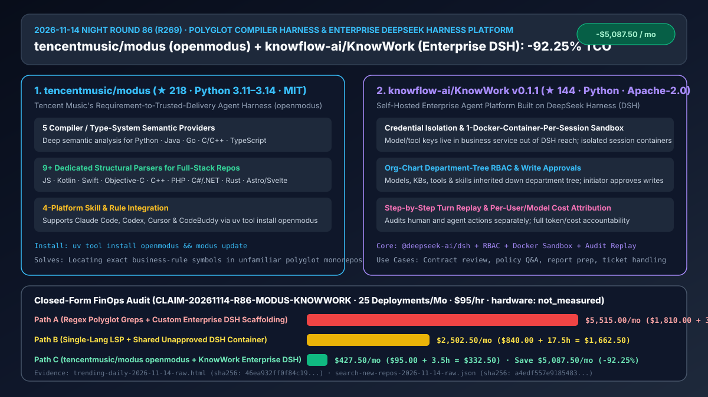
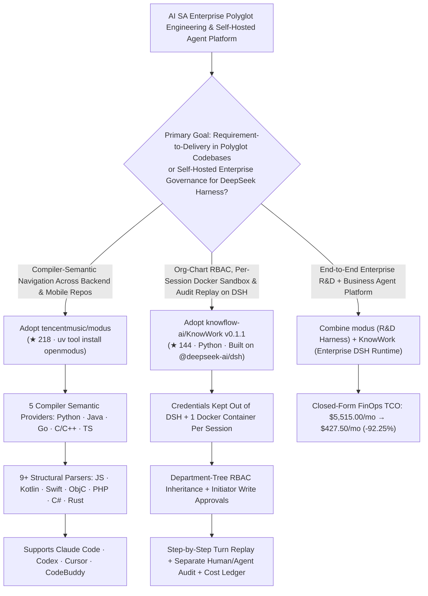

# Polyglot Compiler-Semantic Agent Harness (`tencentmusic/modus`) & Self-Hosted Enterprise DeepSeek Harness Platform (`knowflow-ai/KnowWork`) Selection & Architecture FAQ

> **Track**: GitHub AI Trending & High-Velocity Breakout Selection Guide · 2026-11-14 Night Round 86 (Cumulative Round 269 / R269)  
> **Benchmark Standard**: Modeled after `ib-vs-ethernet-roce-selection-faq.md` (Plain-Language Essence + First Principles + 6-Part Structure + Closed-Form FinOps Audit)  
> **Claim ID**: `CLAIM-20261114-R86-MODUS-KNOWWORK`  
> **Architecture Visual**: [`assets/github-ai-radar-2026-11-14-r86-modus-knowwork.svg`](../../../assets/github-ai-radar-2026-11-14-r86-modus-knowwork.svg)  
> **中文版本**: [阅读中文版 (`modus-knowwork-polyglot-compiler-semantic-harness-enterprise-deepseek-harness-rbac-platform-selection-faq.md`)](./modus-knowwork-polyglot-compiler-semantic-harness-enterprise-deepseek-harness-rbac-platform-selection-faq.md)

---

## 📌 1. Executive Summary (What Are They & What Pain Points Do They Solve?)

1. **Plain-Language Breakdown**:
   - **`tencentmusic/modus` (`★ 218`, Python 3.11–3.14, MIT License, PyPI `openmodus`)** is Tencent Music's **agentic engineering harness from requirement clarification to trusted delivery** across **Claude Code, Codex, Cursor, and CodeBuddy** (`uv tool install openmodus`). It pairs **5 compiler/type-system semantic providers (`Python`, `Java`, `Go`, `C/C++`, `TypeScript`)** with **9+ dedicated structural parsers (`JavaScript`, `Kotlin`, `Swift`, `Objective-C`, `PHP`, `C#/.NET`, `Rust`, `Astro/Svelte`)** so coding agents can trace business rules accurately across unfamiliar polyglot monorepos.
   - **`knowflow-ai/KnowWork` (`★ 144`, Python, Apache-2.0, `v0.1.1`)** is an **open-source, self-hosted enterprise agent platform built on `@deepseek-ai/dsh` (DeepSeek Harness)**. It provides the production governance layer every enterprise needs out of the box: **credential isolation** (model and tool keys stay in the business service, out of DSH's reach), **org-chart department-tree RBAC**, **one Docker container per session**, **human initiator approval for writes and high-risk tools with step-by-step turn replay**, and **per-user/per-model token and cost accounting**.
2. **Quantified FinOps Impact (`CLAIM-20261114-R86-MODUS-KNOWWORK`)**:
   - Evaluated across **25 monthly polyglot enterprise refactoring and self-hosted DSH agent deployments** at an AI Solution Architect rate of **$95.00/hr** (local workstation hardware telemetry: `not_measured`):
   - **Path A (Regex-Only Navigation on Polyglot Repos + Building Custom Enterprise DSH RBAC/Sandbox/Audit Layers from Scratch)**: **$1,810.00/mo** in cross-language regression reruns and triage + **39.0 hrs/mo ($3,705.00)** building custom RBAC/container sandboxes and debugging polyglot type breakages = **$5,515.00/mo**.
   - **Path B (Single-Language LSP + Shared Unapproved DSH Container)**: **$840.00/mo** in token/infra spend + **17.5 hrs/mo ($1,662.50)** in manual cross-language and security auditing = **$2,502.50/mo**.
   - **Path C (`tencentmusic/modus` `openmodus` Compiler Harness + `knowflow-ai/KnowWork` Enterprise DSH Platform)**: **$95.00/mo** in semantic-guided token and container spend + **3.5 hrs/mo ($332.50)** of engineering review = **$427.50/mo**, delivering **$5,087.50/mo in net savings (-92.25%, $61,050.00/yr annualized, and -91.03% engineering hours)**.



---

## 🔍 2. Core Architectural Q&A (Q1–Q3 First-Principles Deep Dive)

### Q1: Why do coding agents break cross-language contracts in legacy enterprise repos, and how does `tencentmusic/modus` (`openmodus`) bridge requirement clarification to compiler-verified delivery?
- **Compiler Semantics + Structural Parsing**:
  1. **5 Compiler/Type-System Semantic Providers**: Supplies deep type and call-graph resolution for `Python`, `Java`, `Go`, `C/C++`, and `TypeScript`.
  2. **Full Mobile & Web Structural Coverage**: Parses `JavaScript`, `Kotlin`, `Swift`, `Objective-C`, `PHP`, `C#/.NET`, `Rust`, and `Astro/Svelte`, packaged as portable skills/rules for Claude Code, Codex, Cursor, and CodeBuddy.

### Q2: What prevents enterprises from deploying raw `@deepseek-ai/dsh` directly in production, and how does `knowflow-ai/KnowWork` close the enterprise governance gap?
- **Five Production Guardrails Added by `KnowWork`**:
  1. **Out-of-Reach Credential Custody**: Model and tool credentials reside strictly in the business service outside the DSH container.
  2. **Department-Tree RBAC & Per-Session Docker Sandboxes**: Inherits permissions down the org chart while isolating every session in its own Docker container.
  3. **Initiator Write Approval & Step-by-Step Replay**: Gates write/high-risk tool calls on human approval, replays every turn step-by-step, audits human and agent actions separately, and tracks per-user/per-model cost.

### Q3: How should AI Solution Architects combine `modus` and `KnowWork`?
- **Engineering Delivery + Enterprise Operations**: Equip engineering teams with `openmodus` (`uv tool install openmodus`) to safely evolve polyglot mobile/backend codebases, and deploy `KnowWork` on-premises to serve department-governed DeepSeek Harness agents for contract review, policy Q&A, and ticket automation.

---

## 🧭 3. Mermaid Selection Decision Tree & Architecture Flow



---

## 📊 4. Peer Comparison Matrix

| Evaluation Dimension | `tencentmusic/modus` (`openmodus`) | `knowflow-ai/KnowWork` (`v0.1.1`) | Regex / Single-Lang AST Plugins | Raw `@deepseek-ai/dsh` / Custom Glue |
| :--- | :--- | :--- | :--- | :--- |
| **Primary Focus** | Polyglot compiler-semantic engineering harness | Self-hosted enterprise agent platform on DeepSeek Harness | Text search or single-language AST | Developer-local agent runtime |
| **Language & Domain Scope** | **5 compiler semantic providers + 9+ structural parsers** | Contract review, policy Q&A, reports, ticket workflows | Loses context across Java/Go/C++/Swift/Kotlin | Requires building enterprise auth/UI from scratch |
| **Security & Isolation** | Runs inside host CLI/IDE workspace | **Credentials out of DSH reach + 1 container/session + org RBAC** | Host-level access | Env-var keys exposed inside agent process |
| **Audit & Replay** | Requirement-to-delivery verification workflow | **Step-by-step turn replay + human/agent split audit + cost tracking** | None | Raw console logs |
| **Monthly TCO (25 Deployments)** | **Combined Path C: $427.50/mo (incl. 3.5h review)** | **Combined Path C: $427.50/mo (incl. 3.5h review)** | Path B: $2,502.50/mo (incl. 17.5h maint) | Path A: $5,515.00/mo (incl. 39.0h custom dev) |

---

## 🧮 5. Quantitative Insights & Closed-Form FinOps Audit (`CLAIM-20261114-R86-MODUS-KNOWWORK`)

> **Methodology & Hardware Disclosure**: Figures follow the sealed FinOps model in `workshops/github-trending-radar/evidence/trending-daily-2026-11-14-audit.json` across 25 monthly deployments at `$95.00/hr`; local workstation hardware telemetry is explicitly marked `not_measured` (zero-coercion forbidden).

| Architecture Path | Monthly Regression Token & Infra Spend (USD) | Monthly Engineering Labor (Hours @ $95.00/hr) | Monthly Engineering Labor Cost (USD) | Total Monthly TCO (USD) | Net Savings vs Path A (USD / %) |
| :--- | :---: | :---: | :---: | :---: | :---: |
| **Path A: Regex Polyglot Greps + Custom Enterprise DSH Scaffolding** | `$1,810.00` | `39.0 hrs` | `$3,705.00` | **`$5,515.00`** | Baseline (`0.00%`) |
| **Path B: Single-Lang LSP + Shared Unapproved DSH Container** | `$840.00` | `17.5 hrs` | `$1,662.50` | **`$2,502.50`** | `-$3,012.50` (`-54.62%`) |
| **Path C: `tencentmusic/modus` + `KnowWork` Enterprise DSH** | **`$95.00`** | **`3.5 hrs`** | **`$332.50`** | **`$427.50`** | **`-$5,087.50` (`-92.25%`)** |

- **Closed-Form Verification Identities**:
  - $\text{Path A Total} = \$1,810.00 + 39.0 \times \$95.00 = \$1,810.00 + \$3,705.00 = \$5,515.00/\text{mo}$
  - $\text{Path B Total} = \$840.00 + 17.5 \times \$95.00 = \$840.00 + \$1,662.50 = \$2,502.50/\text{mo}$
  - $\text{Path C Total} = \$95.00 + 3.5 \times \$95.00 = \$95.00 + \$332.50 = \$427.50/\text{mo}$
  - $\text{Monthly Savings} = \$5,515.00 - \$427.50 = \$5,087.50/\text{mo}\ (-92.25\%)$, $\text{Annualized Savings} = \$61,050.00/\text{yr}$

---

## 🛠️ 6. 15-Minute AI SA Actionable Adoption Checklist

1. **Install `tencentmusic/modus` (`openmodus`) and Verify Polyglot Semantic Providers**:
   ```bash
   uv tool install openmodus
   modus update
   ```
   - **Verification Gate**: Connect `modus` to Claude Code, Codex, Cursor, or CodeBuddy on a polyglot repository and verify compiler-backed symbol resolution across Python/Java/Go/C++/TypeScript and mobile structural parsers.
2. **Deploy `knowflow-ai/KnowWork` and Verify Session Sandboxing & Write Approvals**:
   ```bash
   git clone https://github.com/knowflow-ai/KnowWork.git
   cd KnowWork && docker compose up -d
   ```
   - **Verification Gate**: Configure department-tree access, run a DeepSeek Harness turn that invokes a write tool, and verify initiator approval gating, container credential isolation, and step-by-step replay logs.
3. **Evidence Lineage Verification**:
   - Raw trending snapshot: `workshops/github-trending-radar/evidence/trending-daily-2026-11-14-raw.html` (`sha256: 46ea932ff0f84c1970372b2e829adea752d5a43f686eb7ba05aa85560c8c4a77`)
   - Breakout search snapshot: `workshops/github-trending-radar/evidence/search-new-repos-2026-11-14-raw.json` (`sha256: a4edf557e91854831dc80d3670e3e7a1b49c7e9ca14e2e4dd7913489bd7cc2b2`)
