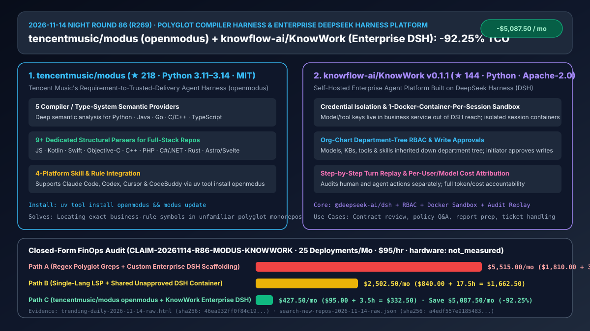
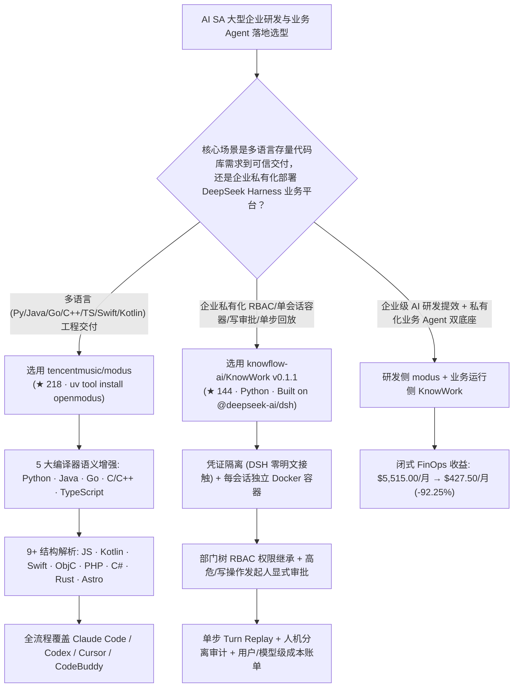

# 腾讯音乐编译器级多语言可信交付 Harness（`tencentmusic/modus`）与基于 DeepSeek Harness 的企业私有化治理平台（`knowflow-ai/KnowWork`）选型与架构拆解 FAQ

> **所属专题**：GitHub AI 热榜与新晋高星项目选型内参 · 2026-11-14 Night Round 86（累计第 269 轮 / R269）  
> **对标标杆**：`ib-vs-ethernet-roce-selection-faq.md`（大白话本质定义 + 第一性原理 + 六段式结构 + 闭式 FinOps 审计）  
> **审计编号**：`CLAIM-20261114-R86-MODUS-KNOWWORK`  
> **配套架构大图**：[`assets/github-ai-radar-2026-11-14-r86-modus-knowwork.svg`](../../../assets/github-ai-radar-2026-11-14-r86-modus-knowwork.svg)  
> **English Version**: [Read in English (`modus-knowwork-polyglot-compiler-semantic-harness-enterprise-deepseek-harness-rbac-platform-selection-faq.en.md`)](./modus-knowwork-polyglot-compiler-semantic-harness-enterprise-deepseek-harness-rbac-platform-selection-faq.en.md)

---

## 📌 一、核心结论速览（30 秒看懂：它们到底是什么？解决什么痛点？）

1. **用大白话讲透这两个项目**：
   - **`tencentmusic/modus`（`★ 218`，Python 3.11–3.14，MIT 协议，PyPI 包名 `openmodus`）** 是腾讯音乐（TME）开源的**“从需求澄清到可信交付”全流程 Agent 编程 Harness 工程框架**（支持 Claude Code、Codex、Cursor 与腾讯 CodeBuddy）。当 Agent 接手一个横跨后端 Java/Go/C++、客户端 Swift/Kotlin/Objective-C 与前端 TypeScript/Astro/Svelte 的陌生大型业务仓库去改一条业务规则时，纯文本搜索很容易改漏重载方法或破坏跨层类型契约。`Modus` 通过 **`Python / Java / Go / C/C++ / TypeScript` 五大编译器与类型系统增强语义提供器（Semantic Providers）** 搭配 **`JS / Kotlin / Swift / Objective-C / PHP / C# / Rust / Astro / Svelte` 专用结构解析器**，让 Agent 在需求对齐、影响面分析与实现验证全链路中具备真正的编译器级符号视野。
   - **`knowflow-ai/KnowWork`（`★ 144`，Python，Apache-2.0 协议，版本 `v0.1.1`）** 是构建在 **`@deepseek-ai/dsh`（DeepSeek Harness）** 之上的**企业级私有化 Agent 生产治理平台**。企业想把 DeepSeek Harness 用到合同审查、制度问答、报表生成或工单处理上，缺的不是底层 Agent 循环，而是外围的企业安全底座。`KnowWork` 直接配齐了 5 大生产刚需：① **凭证物理隔离（模型与工具 API Key 只存在业务服务层，DSH 沙箱内完全摸不到明文凭证）**；② **组织架构树权限继承（按用户/群组/部门树授权模型、知识库、工具与 Skills）**；③ **单会话单 Docker 容器强隔离**；④ **写操作与高危工具由发起人显式审批 + 每一轮单步回放（Step-by-Step Replay）+ 人机行为分离审计**；⑤ **按用户与按模型精细化 Token 成本核算**。
2. **核心量化收益（闭式 FinOps 方程 `CLAIM-20261114-R86-MODUS-KNOWWORK`）**：
   - 按企业研发与数字化团队每月交付 **25 个跨语言存量系统迭代与私有化业务 Agent 上线项目**、AI SA 时薪 **$95.00/hr** 核算（本地硬件测量标注：`not_measured`）：
   - **Path A（靠纯文本正则盲搜多语言存量库 + 从零手写企业 RBAC/容器沙箱/审计回放底座）**：月度改错跨语言调用链重跑 Token 与返工费 **$1,810.00** + 工程师自研企业权限/沙箱/审计底座与排查跨语言线上 Bug **39.0 小时（$3,705.00）** = **$5,515.00/月**。
   - **Path B（仅挂单一语言 LSP + 多人共用无写审批的裸 DeepSeek Harness 容器）**：月度 Token 与容器费 **$840.00** + 跨端符号对齐与人工安全审计工时 **17.5 小时（$1,662.50）** = **$2,502.50/月**。
   - **Path C（`tencentmusic/modus` 编译器级多语言 Harness + `KnowWork` 企业级 DSH 治理平台）**：月度精准语义制导 Token 与单会话容器开销 **$95.00** + 人工复核工时 **3.5 小时（$332.50）** = **$427.50/月**，**每月净省 $5,087.50（降本 92.25%，年化节省 $61,050.00，底座建设与排障工时压缩 91.03%）**。



---

## 🔍 二、灵魂拷问 Q1–Q3（从第一性原理看透架构差异）

### Q1：为什么在移动端（Swift/Kotlin/ObjC）+ 后端（Java/Go/C++）混合的大厂存量项目里，通用 Coding Agent 总是“头疼医头、改崩上下游”？`tencentmusic/modus` 是怎么打通的？
- **大厂存量工程的三大鸿沟**：
  1. **需求与代码符号脱节**：产品经理提一句“修改会员续费宽限期规则”，Agent 用 `ripgrep` 搜中文注释或英文单词，要么漏掉 C++ 计费核心库，要么漏掉 iOS Objective-C / Android Kotlin 的本地状态校验；
  2. **缺乏类型系统级影响面验证**：普通 AST 切块（Chunking）只知道语法树结构，不知道 Java 接口实现类、Go 隐式接口满足关系或 TypeScript 联合类型推导。
- **`tencentmusic/modus`（`openmodus`）的双层语言引擎 + 交付工程学**：
  1. **五主力语言编译器/类型系统语义增强**：对 `Python`、`Java`、`Go`、`C/C++`、`TypeScript` 提供深度编译器级语义解析，精准追踪跨包类型引用与实现链；
  2. **十余种客户端与全栈语言专用结构解析**：原生覆盖 `JavaScript`、`Kotlin`、`Swift`、`Objective-C`、`PHP`、`C#/.NET`、`Rust`、`Astro/Svelte`；
  3. **四端统一工程工作流（`uv tool install openmodus`）**：将“需求澄清 → 符号定位 → 变更实施 → 可信验收”封装为 Claude Code、Codex、Cursor 与 CodeBuddy 通用的标准技能与命令集。

### Q2：为什么直接把开源 `@deepseek-ai/dsh`（DeepSeek Harness）裸跑在公司内网服务器上过不了企业安全合规评审？`knowflow-ai/KnowWork` 补齐了哪五道防线？
- **裸跑 Agent Harness 的企业合规死穴**：
  - 如果让 Agent 进程直接读取包含数据库密码和外部系统 Token 的环境变量，且所有员工共用同一个宿主机目录，一旦某个员工遭遇提示词注入，整个部门的秘钥和文件都会失守。
- **`KnowWork` 的五层企业级装甲**：
  1. **秘钥对 Agent 隐身（Credential Air-Gap）**：所有大模型 Key 与外部业务工具凭证只保存在后端业务服务中，运行在容器内的 DSH 进程根本拿不到明文凭证；
  2. **部门树 RBAC 继承**：严格贴合企业组织架构图（用户 / 群组 / 部门树），细粒度管控谁能用哪个模型、哪个知识库、哪个 Skill；
  3. **1 Session = 1 Docker Container**：每个会话独占隔离容器，杜绝跨会话文件污染与宿主机逃逸；
  4. **写操作发起人审批 + 单步回放（Step-by-Step Replay）**：凡是涉及写库、改文件或高危调用的动作必须经当前会话发起人点击批准，且每一轮的每一步均可完整回放，人类动作与 Agent 动作分开记账审计。

### Q3：AI Solution Architect 如何把 `modus` 与 `KnowWork` 组合用于大型政企/互联网客户交付？
- **研发侧（`modus`）+ 业务运行侧（`KnowWork`）双剑合璧**：
  - 在研发团队内部，用 `uv tool install openmodus` 武装 Claude Code / Cursor / CodeBuddy，高质量完成跨 Java/Go/C++/iOS/Android 的存量代码改造；
  - 在面向企业全员交付业务 Agent（合同审查、工单自动化、制度大脑）时，直接基于 Apache-2.0 的 `KnowWork` 私有化部署 DeepSeek Harness，省去 3–6 个月重复造 RBAC、Docker 沙箱与审计回放轮子的工期。

---

## 🧭 三、Mermaid 选型决策树与架构协同图



---

## 📊 四、同类方案对比矩阵（Peer Comparison Matrix）

| 评估维度 | `tencentmusic/modus` (`openmodus`) | `knowflow-ai/KnowWork` (`v0.1.1`) | 纯文本/单语言 AST 插件 | 裸跑 `@deepseek-ai/dsh` 或自建脚手架 |
| :--- | :--- | :--- | :--- | :--- |
| **核心定位** | 从需求澄清到可信交付的多语言编译器级编程 Harness | 基于 DeepSeek Harness 的开源企业级私有化 Agent 平台 | 单一语言语法树切块或 `grep` 检索 | 仅供单人开发测试的基础运行时 |
| **语言与业务覆盖广度** | **5 大编译器类型语义 + 9+ 客户端/全栈语言结构解析** | 合同审查、制度问答、报表生成、工单处理等全行业 Agent | 跨 Java/Go/C++/ObjC/Kotlin 时断链 | 需自行对接企业知识库与业务工具 |
| **安全隔离与权限模型** | 遵循宿主 IDE/CLI（Claude/Codex/Cursor/CodeBuddy）工作区 | **凭证脱离 DSH + 单会话单容器 + 部门树 RBAC + 写审批** | 无特殊治理边界 | 明文环境变量易泄露，无部门级权限 |
| **可观测性与审计回放** | 需求到交付验证闭环 | **每轮单步回放（Step-by-Step Replay）+ 人机分离审计 + 成本核算** | 无结构化回放 | 仅控制台日志 |
| **月度 TCO（25 次交付）** | **组合方案 Path C：$427.50/月（含 3.5h 复核）** | **组合方案 Path C：$427.50/月（含 3.5h 复核）** | Path B：$2,502.50/月（含 17.5h 维护） | Path A：$5,515.00/月（含 39.0h 自研/排障） |

---

## 🧮 五、7-Card 定量洞察与闭式 FinOps 审计（`CLAIM-20261114-R86-MODUS-KNOWWORK`）

> **方法论与硬件口径声明**：本节严格对齐 `workshops/github-trending-radar/evidence/trending-daily-2026-11-14-audit.json` 闭式方程（按每月 25 个跨语言研发与企业私有化 Agent 部署项目、AI SA 时薪 `$95.00/hr` 核算；本地工作站硬件功耗测量标记为 `not_measured`）。

| 路径方案 | 月度误改重跑 Token 与设施费 (USD) | 月度底座自研与跨端排障工时 (Hours @ $95.00/hr) | 月度工程人力成本 (USD) | 月度总成本 TCO (USD) | 相对 Path A 净节省 (USD / %) |
| :--- | :---: | :---: | :---: | :---: | :---: |
| **Path A：正则盲搜多语言库 + 从零手写企业 RBAC/沙箱底座** | `$1,810.00` | `39.0 hrs` | `$3,705.00` | **`$5,515.00`** | Baseline (`0.00%`) |
| **Path B：单语言 LSP + 共用无写审批的裸 DSH 容器** | `$840.00` | `17.5 hrs` | `$1,662.50` | **`$2,502.50`** | `-$3,012.50` (`-54.62%`) |
| **Path C：`modus` 编译器级 Harness + `KnowWork` 企业平台** | **`$95.00`** | **`3.5 hrs`** | **`$332.50`** | **`$427.50`** | **`-$5,087.50` (`-92.25%`)** |

- **闭式校验恒等式**：
  - $\text{Path A Total} = \$1,810.00 + 39.0 \times \$95.00 = \$1,810.00 + \$3,705.00 = \$5,515.00/\text{mo}$
  - $\text{Path B Total} = \$840.00 + 17.5 \times \$95.00 = \$840.00 + \$1,662.50 = \$2,502.50/\text{mo}$
  - $\text{Path C Total} = \$95.00 + 3.5 \times \$95.00 = \$95.00 + \$332.50 = \$427.50/\text{mo}$
  - $\text{Monthly Savings} = \$5,515.00 - \$427.50 = \$5,087.50/\text{mo}\ (-92.25\%)$，$\text{Annualized Savings} = \$61,050.00/\text{yr}$

---

## 🛠️ 六、AI SA 实战上手 Checklist（15 分钟落地验证）

1. **安装腾讯音乐 `tencentmusic/modus`（`openmodus`）并验证多语言语义定位**：
   ```bash
   uv tool install openmodus
   modus update
   ```
   - **验证要点**：在包含 Python/Go/Java/TypeScript 或 Swift/Kotlin 的混合工程中将 `modus` 挂载至 Claude Code / Cursor / CodeBuddy，测试从一条业务规则变更需求出发定位跨文件符号与类型依赖。
2. **部署 `knowflow-ai/KnowWork` 验证单会话 Docker 沙箱与写操作审批回放**：
   ```bash
   git clone https://github.com/knowflow-ai/KnowWork.git
   cd KnowWork && docker compose up -d
   ```
   - **验证要点**：配置部门树 RBAC 权限，发起一次触发写操作的 DeepSeek Harness 会话，验证发起人审批拦截、容器内无明文凭证泄漏以及单步回放（Step-by-Step Replay）审计记录。
3. **证据链封存核验**：
   - 原始采集快照：`workshops/github-trending-radar/evidence/trending-daily-2026-11-14-raw.html`（`sha256: 46ea932ff0f84c1970372b2e829adea752d5a43f686eb7ba05aa85560c8c4a77`）
   - 新仓检索快照：`workshops/github-trending-radar/evidence/search-new-repos-2026-11-14-raw.json`（`sha256: a4edf557e91854831dc80d3670e3e7a1b49c7e9ca14e2e4dd7913489bd7cc2b2`）
