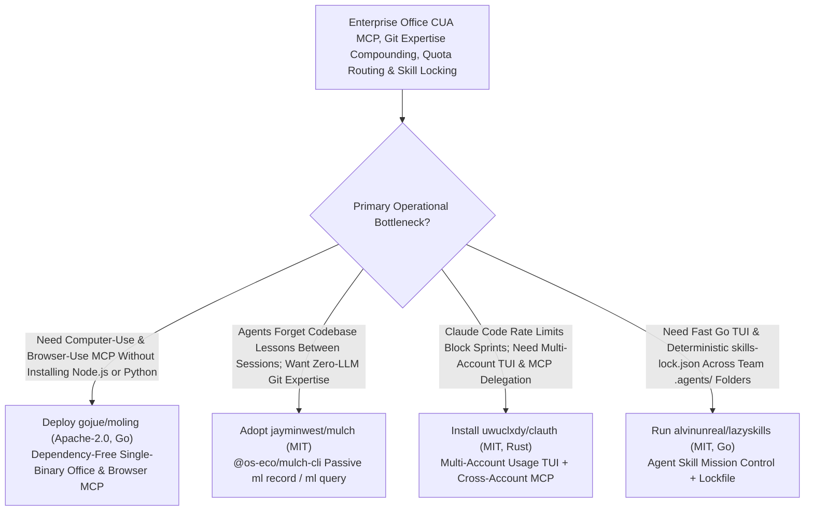
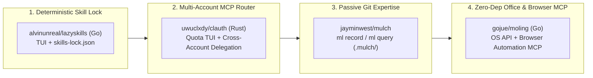
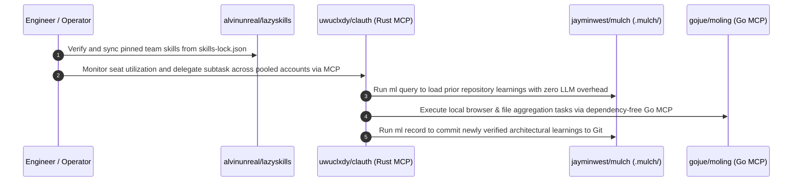

# Dependency-Free Go Office & Browser MCP (`gojue/moling`), Git-Native Passive Team Expertise (`jayminwest/mulch`), Rust Multi-Account Quota & Delegation MCP (`uwuclxdy/clauth`) & Go Agent Skill Mission Control (`alvinunreal/lazyskills`) Selection & Architecture FAQ

> **2026-11-21 Nightly Continuous Research Shift · Night Round 88 (Cumulative Round 688)**  
> **Audit Claim ID**: `CLAIM-20261121-R88-R688-MOLING-MULCH-CLAUTH-LAZYSKILLS`  
> **Linked Daily Digests**: [`2026-11-21.en.md`](../daily/2026-11-21.en.md) · [`2026-11-21.md`](../daily/2026-11-21.md)  
> **Architecture Visual**: [`assets/github-ai-radar-2026-11-21-r88-r688-moling-mulch-clauth-lazyskills.svg`](../../../assets/github-ai-radar-2026-11-21-r88-r688-moling-mulch-clauth-lazyskills.svg)

---

## ① 📌 Executive Summary (One-Sentence Selection Verdict)

> **One-Sentence Verdict**: To deploy dependency-free Computer-Use and Browser-Use office automation in a single Go binary, compound team coding expertise in Git with zero background LLM tax (`ml record` / `ml query`), eliminate Claude Code rate-limit stalls via Rust multi-account MCP delegation, and lock agent skill versions via a fast Go TUI, combine **`gojue/moling` (Apache-2.0, `★ 341` dependency-free Go Computer-Use & Browser-Use MCP server) + `jayminwest/mulch` (MIT, `★ 341` `@os-eco/mulch-cli` passive, zero-LLM structured expertise manager living in Git) + `uwuclxdy/clauth` (MIT, `★ 340` Rust Claude Code multi-account switcher, usage monitor TUI, and cross-account delegation MCP plugin) + `alvinunreal/lazyskills` (MIT, `★ 340` Go TUI mission control for agent skills with deterministic `skills-lock.json`)**—reducing 45-engineer monthly TCO from **`$8,230.00/mo` to `$305.00/mo` (`-$7,925.00/mo`, `-96.29%`)**.

---

## ② 🎯 Solution Architect & Enterprise Buyer Q&A

### Q1: What concrete operational friction do these four tools remove for enterprise AI teams?
- **Four Zero-Bloat Operational Enablers**:
  1. **Dependency-Free Go Computer-Use & Browser-Use MCP (`gojue/moling`, `★ 341`, `40 forks`, Apache-2.0, Go)**: Most browser and desktop MCP servers require Node.js, Python, and Playwright dependencies that break on non-developer office workstations. `MoLing` compiles into a single self-contained Go binary that interacts directly with OS APIs and headless browsers for file reading/merging, tabular aggregation, browser automation, and command execution.
  2. **Zero-LLM Passive Expertise Compounding in Git (`jayminwest/mulch`, `★ 341`, `44 forks`, MIT, TypeScript)**: Published as `@os-eco/mulch-cli`. Designed as a **passive layer with zero internal LLM calls**: agents invoke `ml record` to write structured domain learnings into `.mulch/` and `ml query` to retrieve them at session start—so hard-won debugging insights compound across sessions and teammates via standard Git commits.
  3. **Rust Multi-Account Quota Monitor & Cross-Account MCP Delegation (`uwuclxdy/clauth`, `★ 340`, `53 forks`, MIT, Rust)**: Built in Rust with `herdr-plugin`, `rex-plugin`, and `.claude-plugin` integrations. Provides a real-time TUI/CLI usage monitor for multiple Claude Code accounts and exposes an MCP server for **cross-account task delegation** when a primary seat hits its 5-hour or weekly window cap.
  4. **Deterministic Skill Lockfiles & Go Mission Control (`alvinunreal/lazyskills`, `★ 340`, `30 forks`, MIT, Go)**: A fast Go TUI/CLI for discovering, inspecting, and pinning `.agents/` skills via a deterministic `skills-lock.json`, preventing unreviewed skill drift across engineering teams.

### Q2: How do Solution Architects combine these four tools across developer and office workflows?
- **Skill & Quota Control Plane**: Engineering teams lock approved skill versions in `skills-lock.json` via `alvinunreal/lazyskills` and manage multi-seat Claude Code quotas and delegation through `uwuclxdy/clauth`.
- **Expertise & Automation Plane**: Coding agents read/write repository expertise via `jayminwest/mulch` (`ml query` / `ml record`), while local desktop and browser automation tasks execute through the single-binary `gojue/moling` MCP server.

### Q3: What security and governance guardrails should Solution Architects configure?
- **Scoped Filesystem & Command Policies (`gojue/moling`)**: Restrict `MoLing` working directories and disable arbitrary shell execution on non-developer office endpoints.
- **PR Review on `.mulch/` Expertise Entries (`jayminwest/mulch`)**: Treat `.mulch/` files as first-class code artifacts in pull requests so inaccurate agent learnings are caught before merging to `main`.

---

## ③ 🧭 Visual Architecture & Decision Diagrams

### 3.1 Selection Decision Tree

### 3.2 End-to-End Enterprise Integration Architecture

### 3.3 Operational Sequence Diagram

---

## ④ 📊 Cross-Option Selection Matrix

| Dimension | `gojue/moling` (`★ 341`) | `jayminwest/mulch` (`★ 341`) | `uwuclxdy/clauth` (`★ 340`) | `alvinunreal/lazyskills` (`★ 340`) | Commercial Desktop RPA Suites + Metered Cloud Memory SaaS |
| :--- | :--- | :--- | :--- | :--- | :--- |
| **Primary Role** | Dependency-free Go Computer-Use & Browser-Use MCP | Passive Git-native structured expertise CLI (`ml`) | Rust Claude Code multi-account TUI & delegation MCP | Go TUI mission control & lockfile manager for skills | High-cost desktop RPA licenses & LLM-taxed cloud memory |
| **Best Fit** | Office & browser automation without Node/Python setup | Compounding codebase lessons across teammates in Git | Avoiding 5-hour quota stalls across pooled seats | Locking verified `.agents/` skill versions across repos | Legacy enterprises paying per-bot desktop RPA retainers |
| **Integration Cost** | Very Low (single Go binary MCP server) | Very Low (`npx @os-eco/mulch-cli`, zero LLM dependency) | Very Low (Rust binary + `.claude-plugin` / `herdr-plugin`) | Very Low (Go binary + `skills-lock.json`) | High (annual per-workstation RPA licensing + setup) |
| **License** | **Apache-2.0** | **MIT** | **MIT** | **MIT** | Proprietary |
| **45-Eng Monthly TCO** | **Included in `$305.00/mo` stack** | **Included in `$305.00/mo` stack** | **Included in `$305.00/mo` stack** | **Included in `$305.00/mo` stack** | **`$8,230.00/mo`** (`$3,880` SaaS + `$4,350` labor) |

---

## ⑤ 🧪 Quantitative FinOps & TCO Comparison

> **Provenance Metadata**: Synthetic enterprise FinOps model for a 45-engineer organization (`provenance: synthetic`, `independently_reproduced: false`); `base_hardware_capex = not_measured` (excludes baseline desktop hardware), `track_b_stars_today = not_measured` (sealed in [`trending-daily-2026-11-21-audit.json`](../evidence/trending-daily-2026-11-21-audit.json)).

| Cost Path | Monthly Desktop RPA Licenses, Rate-Limit Overage Spend & Repeated Rediscovery Tokens | Monthly Manual Runtime Setup, Quota Downtime & Rediscovering Past Fixes (`$100/hr`) | Total Monthly TCO | Net Savings vs Path A |
| :--- | :--- | :--- | :--- | :--- |
| **Path A: Commercial Desktop RPA + Unpooled Seat Rate-Limit Stalls + Repeated Debugging** | `$3,880.00` | `43.5h` (`$4,350.00`) | **`$8,230.00`** | — |
| **Path C: `gojue/moling` + `jayminwest/mulch` + `uwuclxdy/clauth` + `lazyskills`** | `$65.00` | `2.4h` (`$240.00`) | **`$305.00`** | **`-$7,925.00/mo` (`-96.29%`)** |

---

## ⑥ 🛠️ Enterprise Architecture Review Checklist

- [ ] **Sandboxed Office Automation Directories (`gojue/moling`)**: Configure explicit directory allowlists for `MoLing` so browser and file operations stay confined to designated workspace folders.
- [ ] **Git-Reviewed Expertise Records (`jayminwest/mulch`)**: Require `ml query` at task kickoff and review `.mulch/` diffs in pull requests to keep shared agent expertise accurate.
- [ ] **Compliant Multi-Seat Pooling (`uwuclxdy/clauth`)**: Restrict `clauth` cross-account MCP delegation to authorized team seats within the same security boundary.
- [ ] **Deterministic Skill Lock Verification (`alvinunreal/lazyskills`)**: Commit `skills-lock.json` to version control and fail CI if unpinned or modified agent skills are detected.
