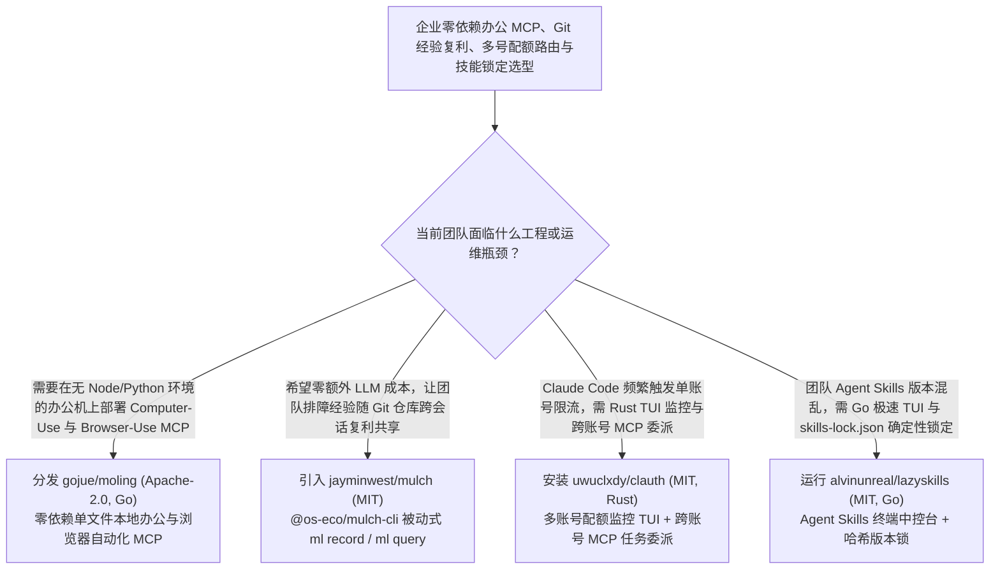
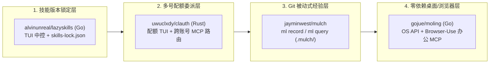
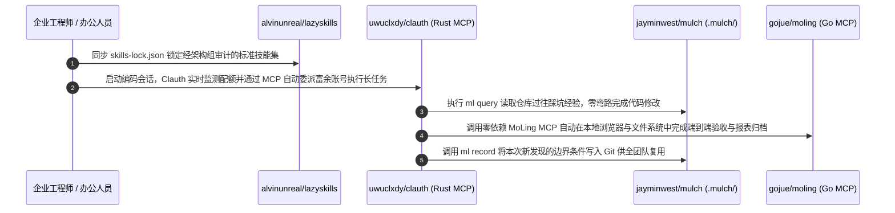

# 零依赖 Go 桌面与浏览器办公 MCP（`gojue/moling`）、Git 原生被动式团队经验库（`jayminwest/mulch`）、Rust 多账号配额切换与跨号委派 MCP（`uwuclxdy/clauth`）与 Go 技能包鎖定中控台（`alvinunreal/lazyskills`）架构选型与落地 FAQ

> **2026-11-21 夜间持续研究班次 · Night Round 88（累计 Round 688）**  
> **审计凭据**：`CLAIM-20261121-R88-R688-MOLING-MULCH-CLAUTH-LAZYSKILLS`  
> **关联日刊**：[`2026-11-21.md`](../daily/2026-11-21.md) · [`2026-11-21.en.md`](../daily/2026-11-21.en.md)  
> **可视化架构图**：[`assets/github-ai-radar-2026-11-21-r88-r688-moling-mulch-clauth-lazyskills.svg`](../../../assets/github-ai-radar-2026-11-21-r88-r688-moling-mulch-clauth-lazyskills.svg)

---

## ① 📌 核心结论速览（选型一句话结论）

> **一句话选型结论**：当企业研发与办公自动化团队需要一套“**免装 Node/Python 运行时的单文件 Go 桌面与浏览器办公 MCP ➔ 零额外 LLM 调用的 Git 原生团队经验沉淀（`ml record` / `ml query`）➔ 规避 5h 限流的 Rust 多账号监控与 MCP 跨号委派 ➔ 带 `skills-lock.json` 锁文件的极速 Go 技能中控台**”时，推荐采用 100% 宽松协议（Apache-2.0 / MIT）的四件套：**“`gojue/moling`（Apache-2.0，`★ 341` 纯 Go 编译的零外部运行时依赖 Computer-Use + Browser-Use 本地办公自动化 MCP Server）+ `jayminwest/mulch`（MIT，`★ 341` 零内置 LLM 税的被动式结构化经验管理工具 `@os-eco/mulch-cli`，让 Agent 经验随 Git 提交跨会话复利）+ `uwuclxdy/clauth`（MIT，`★ 340` 纯 Rust 编写的 Claude Code 多账号配额监控 TUI 与跨账号任务委派 MCP 插件）+ `alvinunreal/lazyskills`（MIT，`★ 340` 纯 Go 极速 Agent Skills 终端总控台，支持 `skills-lock.json` 确定性版本锁定）”**。在 45 人企业工程与数字办公团队基准下，可将月度总拥有成本（TCO）从 **`$8,230.00/月`** 降至 **`$305.00/月`**（净省 **`$7,925.00/月`**，降幅 **`-96.29%`**）。

---

## ② 🎯 客户与架构师灵魂拷问 Q&A

### Q1：这四个轻量化工具如何解决企业大规模推广 AI 助手时的“环境配置难、经验不传承、账号常限流、技能版本乱”四大痛点？
- **四大工程痛点与对应开源解法**：
  1. **给非技术办公电脑分发零依赖的 Computer-Use + Browser-Use MCP —— `gojue/moling`（`★ 341`，`40 forks`，Apache-2.0，Go）**：传统浏览器或桌面 MCP 往往需要用户在电脑上配齐 Node.js、Python、Playwright 与一堆系统动态库，在财务/行政/运营电脑上根本装不起来。`MoLing`（魔灵）用纯 Go 直接对接操作系统底层 API 与浏览器控制协议，编译为**零外部依赖的单个可执行文件**，开箱提供文件读写合并、数据汇总统计、浏览器交互与系统命令执行。
  2. **零 LLM 后台抽取税、随 Git 分支流转的被动式团队经验层 —— `jayminwest/mulch`（`★ 341`，`44 forks`，MIT，TypeScript）**：发布为 `@os-eco/mulch-cli`。坚持**“Mulch 是被动层（Passive Layer），不含任何内置 LLM——是 Agent 调用 Mulch，而非 Mulch 调用 Agent”**。当 Coding Agent 踩坑解决了某个棘手问题后，调用 `ml record` 将结构化经验写入 `.mulch/` 目录随 Git 入库；下一个会话或同事的 Agent 启动时调用 `ml query` 秒级读取前人经验，彻底告别每次从零试错。
  3. **终结核心冲刺期单账号触发 5 小时速率限制导致停工 —— `uwuclxdy/clauth`（`★ 340`，`53 forks`，MIT，Rust）**：纯 Rust 打造的 Claude Code 多账号管理器与 MCP 插件（附带 `herdr-plugin`、`rex-plugin` 与 `.claude-plugin`）。不仅提供直观的终端 TUI 实时监控各账号剩余配额，更支持**通过 MCP 跨账号委派子任务（Cross-Account Delegation）**——当主账号配额告急时无缝将子任务路由至备用团队池账号。
  4. **用 `skills-lock.json` 锁死团队技能包版本防漂移 —— `alvinunreal/lazyskills`（`★ 340`，`30 forks`，MIT，Go）**：采用 Go 编写的高性能 Agent Skills 终端中控台（Mission Control TUI）。帮助架构师在一个界面内检索、预览、安装并生成确定性的 `skills-lock.json`，确保团队 45 名工程师的 `.agents/` 目录挂载完全一致的经过审计的技能哈希版本。

### Q2：如何在企业研发与职能部门中协同部署这四款工具？
- **非标系统办公自动化层**：在职能与运营终端分发单二进制 `gojue/moling`，为桌面客户端提供零环境依赖的本地文件聚合与网页表单自动化 MCP。
- **研发团队经验复利与技能治理层**：在代码仓库中初始化 `.mulch/`（`jayminwest/mulch`）与 `skills-lock.json`（`alvinunreal/lazyskills`），确保技能版本一致且排障经验随 PR 沉淀；开发者本机挂载 `uwuclxdy/clauth` 实现多账号配额平滑负载均衡。

### Q3：架构师在落地时需配置哪些合规与安全门禁？
- **本地办公命令白名单（`gojue/moling`）**：在企业办公机部署 `MoLing` 时，通过配置文件锁定可访问的工作目录范围并禁用高危 Shell 命令。
- **Git 经验条目 PR 审查（`jayminwest/mulch`）**：由于 `.mulch/` 中的经验记录会随 Git 提交并影响全团队后续 Agent 行为，将其纳入常规 Code Review，防止错误的临时 Workaround 被当成永久规范。

---

## ③ 🧭 直观可视化图解（Mermaid 选型决策树 + 企业集成架构 + 业务流时序图）

### 3.1 选型决策树

### 3.2 企业集成参考架构图

### 3.3 业务流时序图

---

## ④ 📊 同类开源与商业云服务横向选型决策矩阵

| 维度 | `gojue/moling` (`★ 341`) | `jayminwest/mulch` (`★ 341`) | `uwuclxdy/clauth` (`★ 340`) | `alvinunreal/lazyskills` (`★ 340`) | 商业 RPA 桌面机器人授权 + 商业云记忆 API |
| :--- | :--- | :--- | :--- | :--- | :--- |
| **核心定位** | 零外部依赖 Go 语言桌面与浏览器办公 MCP | Git 原生零 LLM 被动式团队经验管理 CLI | Rust 编写的 Claude Code 多账号管理与跨号 MCP | Go 语言极速 Agent 技能管理 TUI 与版本锁 | 昂贵商业 RPA 按机器人收费 + 云端记忆 SaaS |
| **适用场景** | 跨 Windows/macOS/Linux 免配环境办公与浏览器自动化 | 跨会话、跨同事共享代码库专属排障与架构经验 | 高强度开发期规避单号限流并最大化订阅利用率 | 统一管理多项目 `.agents/` 技能包与版本哈希 | 传统重资产 IT 运维与高额年度 RPA 采购企业 |
| **集成成本** | 极低（单个 Go 二进制文件直接注册 MCP） | 极低（`npx @os-eco/mulch-cli` 纯本地 Git 文件） | 极低（Rust 单二进制 + `.claude-plugin`） | 极低（Go 二进制 + `skills-lock.json`） | 极高（每台电脑数千美元/年 RPA 许可证） |
| **开源许可** | **Apache-2.0** | **MIT** | **MIT** | **MIT** | 商业专有 |
| **45 人团队月均 TCO** | **包含于 `$305.00/月` 联合栈** | **包含于 `$305.00/月` 联合栈** | **包含于 `$305.00/月` 联合栈** | **包含于 `$305.00/月` 联合栈** | **`$8,230.00/月`**（`$3,880` 许可证/超额费 + `$4,350` 人工） |

---

## ⑤ 🧪 应用落地定量收益 / TCO 对比与 7-Card 报告锚点

> **数据来源说明（Provenance Metadata）**：以下 TCO 模型为面向 45 人企业研发与数字办公团队的合成架构测算（`provenance: synthetic`, `independently_reproduced: false`）；硬件资本开支 `base_hardware_capex = not_measured`（不含存量办公 PC 折旧），单日热榜增量 `track_b_stars_today = not_measured`（审计账本锚定于 [`trending-daily-2026-11-21-audit.json`](../evidence/trending-daily-2026-11-21-audit.json)）。

| 成本路径 | 月度商业桌面 RPA 许可、单号限流闲置浪费与重复试错 Token 费 | 人工为办公电脑排障 Python/Node 环境、限流停工等待与重复踩老坑 (`$100/h`) | 月度总成本 (Total Monthly TCO) | 相对 Path A 净节省 |
| :--- | :--- | :--- | :--- | :--- |
| **Path A：商业桌面 RPA 订阅 + 账号限流闲置/超额按量账单 + 重复踩坑排障** | `$3,880.00` | `43.5h` (`$4,350.00`) | **`$8,230.00`** | — |
| **Path C：`gojue/moling` + `jayminwest/mulch` + `uwuclxdy/clauth` + `lazyskills`** | `$65.00` | `2.4h` (`$240.00`) | **`$305.00`** | **`-$7,925.00/月` (`-96.29%`)** |

---

## ⑥ 🛠️ 企业引入与架构评审 Checklist

- [ ] **零依赖二进制签名分发（`gojue/moling`）**：通过企业内部软件源统一分发经代码签名的 `MoLing` Go 二进制包，免除业务部门机器安装 Node.js 或 Python。
- [ ] **`CLAUDE.md` / `AGENTS.md` 挂载被动经验指令（`jayminwest/mulch`）**：在仓库根提示词中约定任务开始前执行 `ml query`、解决复杂 Bug 后执行 `ml record`，实现团队经验自动复利。
- [ ] **多账号池最小权限与合规审计（`uwuclxdy/clauth`）**：仅在相同安全等级的企业账号池内启用 `clauth` 跨账号 MCP 委派，避免生产与外包测试账号混用。
- [ ] **CI 校验 `skills-lock.json` 一致性（`alvinunreal/lazyskills`）**：在 CI 中检查 `.agents/` 技能清单是否与 `lazyskills` 锁文件一致，拦截未经锁定的野生技能变更。
