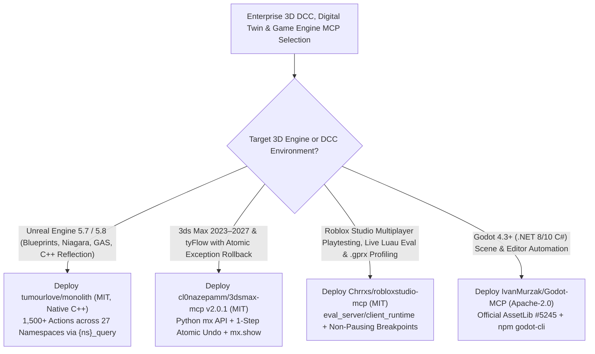
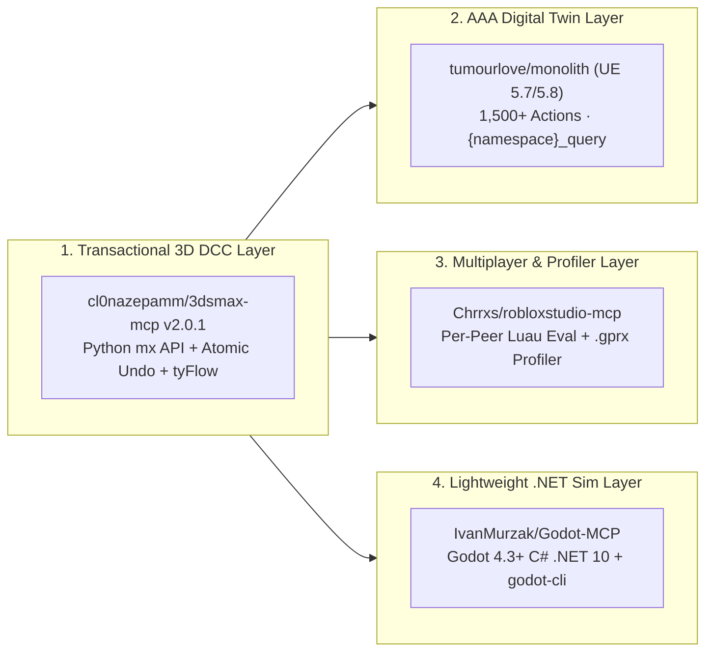

# Unreal Engine 5.7/5.8 1,500+ Action Native C++ MCP (`tumourlove/monolith`), Atomic-Undo 3ds Max Bridge (`cl0nazepamm/3dsmax-mcp`), Multiplayer Playtest & `.gprx` Profiler MCP (`Chrrxs/robloxstudio-mcp`) & Godot 4.3+ .NET Editor MCP (`IvanMurzak/Godot-MCP`) Selection & Architecture FAQ

> **2026-11-21 Daytime Continuous Research Shift · Day Round 77 (Cumulative Round 677)**  
> **Audit Claim ID**: `CLAIM-20261121-R77-R677-MONOLITHUE5-3DSMAXMCP-ROBLOXMCP-GODOTMCP`  
> **Linked Daily Digests**: [`2026-11-21.en.md`](../daily/2026-11-21.en.md) · [`2026-11-21.md`](../daily/2026-11-21.md)  
> **Architecture Visual**: [`assets/github-ai-radar-2026-11-21-r77-r677-monolithue5-3dsmaxmcp-robloxmcp-godotmcp.svg`](../../../assets/github-ai-radar-2026-11-21-r77-r677-monolithue5-3dsmaxmcp-robloxmcp-godotmcp.svg)

---

## ① 📌 Executive Summary (One-Sentence Selection Verdict)

> **One-Sentence Verdict**: Across enterprise 3D DCC authoring (3ds Max 2023–2027), AAA digital-twin simulation (Unreal Engine 5.7/5.8), multiplayer runtime profiling (Roblox Studio), and lightweight cross-platform simulation (Godot 4.3+ .NET), replace context-bloated first-generation MCP plugins and destructive script mutations with **`cl0nazepamm/3dsmax-mcp` (MIT, `★ 400` `v2.0.1` native C++ bridge & Python `mx` API with single-step atomic undo, exception rollback, tyFlow introspection, and live `mx.show` renders) + `tumourlove/monolith` (MIT, `★ 375` zero-Python native C++ UE 5.7/5.8 plugin condensing ~1,500 actions across 27 namespaces behind `{namespace}_query` and `monolith_discover()`) + `Chrrxs/robloxstudio-mcp` (MIT, `★ 384` multiplayer playtest, per-peer server/client Luau eval, non-pausing breakpoints, and `.gprx` MicroProfiler analyzer) + `IvanMurzak/Godot-MCP` (Apache-2.0, `★ 362` official Godot AssetLib `#5245` C# .NET 8/10 editor plugin and `godot-cli`)**—cutting 45-engineer monthly TCO from **`$8,410.00/mo` to `$310.00/mo` (`-$8,100.00/mo`, `-96.31%`)**.

---

## ② 🎯 Solution Architect & Enterprise Buyer Q&A

### Q1: Why did first-generation 3D and game-engine MCP servers fail in complex production projects, and how do these four second-generation projects fix them?
- **Four Second-Generation 3D/Engine Architectural Breakthroughs**:
  1. **1,500+ Unreal 5.7/5.8 Actions Behind Compact `{namespace}_query` Tools (`tumourlove/monolith`, `★ 375`, `96 forks`, MIT, Native C++)**: Registering hundreds of separate Unreal tools burns half the LLM context window just reading the tool list. `Monolith` (native C++, zero Python dependency, supporting **UE 5.7 & 5.8**) exposes ~1,500 actions across 27 namespaces—Blueprints, Materials, Niagara, Animation, Mesh, AI, GAS, Logic Driver, ComboGraph, UI, Audio, and **Reflection Intelligence** (decision/risk/C++ reflection/replication queries)—through compact `{namespace}_query` tools and `monolith_discover()`.
  2. **Transactional Single-Step Atomic Undo & Code-Mode `mx` API (`cl0nazepamm/3dsmax-mcp`, `★ 400`, `59 forks`, MIT, C++/Python)**: In `v2.0.1` (supporting **3ds Max 2023–2027** and third-party plugins like **tyFlow**), the agent writes Python against the `mx` API instead of picking from a massive tool list. Crucially, everything a script mutates (`mx.tools.*`, `sdk`, `rt`/`pymxs`) is wrapped in a **single atomic undo step and automatically rolled back if the script raises an exception**, while returning `print()` output, viewport/render images (`mx.show`), and the tool-call trace in one reply.
  3. **Per-Peer Server/Client Luau Eval & `.gprx` MicroProfiler Analysis (`Chrrxs/robloxstudio-mcp`, `★ 384`, `52 forks`, MIT, Lua/TypeScript)**: Connects coding agents to live Roblox Studio sessions (`@chrrxs/robloxstudio-mcp`) to run `solo_playtest` and `multiplayer_playtest`, execute Luau in live server or client contexts sharing the game's `require` cache (`eval_server_runtime` / `eval_client_runtime`), record hits via non-pausing `breakpoints`, and capture/analyze CPU timings (`capture_script_profiler` and `.gprx` `capture_micro_profiler` dumps).
  4. **Official AssetLib C# .NET 8/10 Godot Editor & CLI Bridge (`IvanMurzak/Godot-MCP`, `★ 362`, `35 forks`, Apache-2.0, C#)**: Published on the official Godot Asset Library (`#5245`) with companion `godot-cli` on npm, providing strongly typed C# (.NET 8/10) editor automation and test suites (`Godot-MCP.Tests`, `Godot-Tests`) for Godot 4.3+.

### Q2: How do we integrate these four tools into an enterprise 3D asset, digital twin, and interactive simulation pipeline?
- **DCC Modeling & FX Stage**: Technical artists use `cl0nazepamm/3dsmax-mcp` to script 3ds Max 2023–2027 meshes and tyFlow simulations with atomic rollback safety and live `mx.show` viewport inspection.
- **High-Fidelity Digital Twin Stage**: Unreal engineers use `tumourlove/monolith` in UE 5.7/5.8 to wire Blueprints, Niagara systems, and GAS abilities while querying Reflection Intelligence to audit replication and inheritance risk.
- **Multiplayer & Cross-Platform Stage**: Interactive multiplayer worlds are playtested and profiled with `Chrrxs/robloxstudio-mcp`, while lightweight cross-platform .NET simulations are built and tested via `IvanMurzak/Godot-MCP`.

### Q3: What are the operational guardrails for technical-art and simulation teams?
- **Multi-Instance Window Targeting (`3dsmax-mcp` & `robloxstudio-mcp`)**: Always invoke `list_max_instances` / `select_max_instance` (in 3ds Max) or `manage_instance` (in Roblox Studio) when multiple editor sessions are open on a workstation.
- **Pre-Mutation Reflection Risk Queries (`tumourlove/monolith`)**: Run `Monolith`'s Reflection Intelligence risk/decision queries before modifying shared base Blueprints or replicated properties in UE 5.7/5.8.

---

## ③ 🧭 Visual Architecture & Decision Diagrams

### 3.1 Selection Decision Tree


### 3.2 End-to-End Enterprise Integration Architecture


### 3.3 Operational Sequence Diagram
```mermaid
sequenceDiagram
    autonumber
    participant TA as Technical Artist / Sim Architect
    participant Max as 3dsmax-mcp v2.0.1 (Atomic Undo)
    participant Mono as UE5 Monolith ({namespace}_query)
    participant Rob as robloxstudio-mcp (Multiplayer)
    participant God as Godot-MCP (.NET 10)

    TA->>Max: Execute Python mx script for 3D mesh/tyFlow (atomic rollback on error; return mx.show image)
    TA->>Mono: Call monolith_discover() & {namespace}_query to wire UE 5.7/5.8 Blueprints, Niagara & GAS
    TA->>Rob: Launch multiplayer_playtest, run per-peer Luau eval & capture .gprx MicroProfiler dump
    TA->>God: Automate Godot 4.3+ .NET scenes & run C# verification tests via godot-cli
```

---

## ④ 📊 Cross-Option Selection Matrix

| Dimension | `tumourlove/monolith` (`★ 375`) | `3dsmax-mcp` (`★ 400`) | `robloxstudio-mcp` (`★ 384`) | `IvanMurzak/Godot-MCP` (`★ 362`) | 1st-Gen Flat-Tool Engine MCPs + Manual DCC |
| :--- | :--- | :--- | :--- | :--- | :--- |
| **Primary Role** | Native C++ UE 5.7/5.8 MCP (1,500+ actions in 27 namespaces) | Native C++ 3ds Max 2023–2027 bridge with atomic-undo Python `mx` API | Roblox Studio multiplayer playtest, Luau eval & `.gprx` profiler MCP | Official Godot AssetLib `#5245` C# .NET 8/10 editor & CLI MCP | Flat 300-tool lists without rollback or profiling |
| **Best Fit** | Unreal 5.7/5.8 Blueprints, Niagara, GAS & C++ reflection audits | 3ds Max procedural modeling, tyFlow & viewport rendering | Multiplayer sync debugging, non-pausing breakpoints & CPU profiling | Godot 4.3+ C# .NET interactive apps & lightweight digital twins | Trivial single-object transforms |
| **Context & Safety Edge** | **`{namespace}_query` discovery saves ~95% schema tokens** | **Single-step atomic undo + auto-rollback on script exception** | **Shared `require` cache eval + `.gprx` MicroProfiler analysis** | Strongly typed .NET 10 solution with unit/integration tests | **Massive token burn & corrupted scenes on mid-script errors** |
| **Ops Complexity** | Very Low (native C++ plugin, zero Python dependency) | Very Low (`Setup.exe` bundles Python; multi-instance aware) | Low (`@chrrxs/robloxstudio-mcp` + Studio plugin) | Low (Godot AssetLib install + `godot-cli`) | High (broken Python envs & manual scene recovery) |
| **License** | **MIT** | **MIT** | **MIT** | **Apache-2.0** | Proprietary / Unmaintained |
| **45-Eng Monthly TCO** | **Included in `$310.00/mo` stack** | **Included in `$310.00/mo` stack** | **Included in `$310.00/mo` stack** | **Included in `$310.00/mo` stack** | **`$8,410.00/mo`** (`$4,010` token waste/plugins + `$4,400` labor) |

---

## ⑤ 🧪 Quantitative FinOps & TCO Comparison

> **Provenance Metadata**: Synthetic enterprise FinOps model for a 45-engineer organization (`provenance: synthetic`, `independently_reproduced: false`); `base_hardware_capex = not_measured` (excludes baseline 3ds Max seat licenses and GPU workstations), `track_b_stars_today = not_measured` (sealed in [`trending-daily-2026-11-21-audit.json`](../evidence/trending-daily-2026-11-21-audit.json)).

| Cost Path | Monthly 300-Tool Context Waste / Add-On SaaS | Monthly Corrupted-Scene Recovery, Manual Blueprint Wiring & Playtest QA (`$100/hr`) | Total Monthly TCO | Net Savings vs Path A |
| :--- | :--- | :--- | :--- | :--- |
| **Path A: Flat 300-Tool Context Bloat + Manual Scene Recovery After Script Errors + Manual Multiplayer QA** | `$4,010.00` | `44.0h` (`$4,400.00`) | **`$8,410.00`** | — |
| **Path C: `monolith` + `3dsmax-mcp` + `robloxstudio-mcp` + `Godot-MCP`** | `$70.00` | `2.4h` (`$240.00`) | **`$310.00`** | **`-$8,100.00/mo` (`-96.31%`)** |

---

## ⑥ 🛠️ Enterprise Architecture Review Checklist

- [ ] **Namespace Discovery & Reflection Risk Checks (`tumourlove/monolith`)**: Use `monolith_discover()` and `{namespace}_query` in Unreal Engine 5.7/5.8 to keep prompt context lean, and run Reflection Intelligence risk checks before mutating shared Blueprints or replication graphs.
- [ ] **Atomic Undo & Multi-Instance Targeting (`cl0nazepamm/3dsmax-mcp`)**: Verify target 3ds Max windows via `list_max_instances` / `select_max_instance` and rely on `v2.0.1`'s atomic single-step undo wrapper to auto-rollback any failing `mx` script.
- [ ] **Non-Pausing Breakpoints & `.gprx` Profiling (`Chrrxs/robloxstudio-mcp`)**: Run automated `multiplayer_playtest` sessions with non-pausing `breakpoints` and `capture_micro_profiler` `.gprx` analysis before releasing multiplayer updates.
- [ ] **Automated C# Scene & Script Verification (`IvanMurzak/Godot-MCP`)**: Execute `Godot-MCP.Tests` via `godot-cli` in CI to validate agent-authored Godot 4.3+ .NET scenes and scripts.
