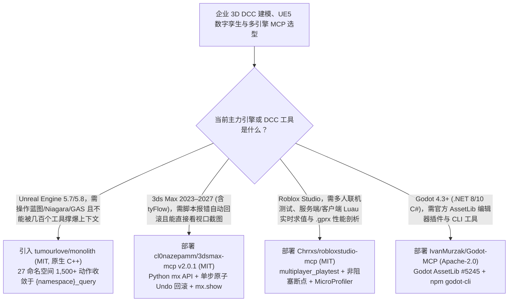
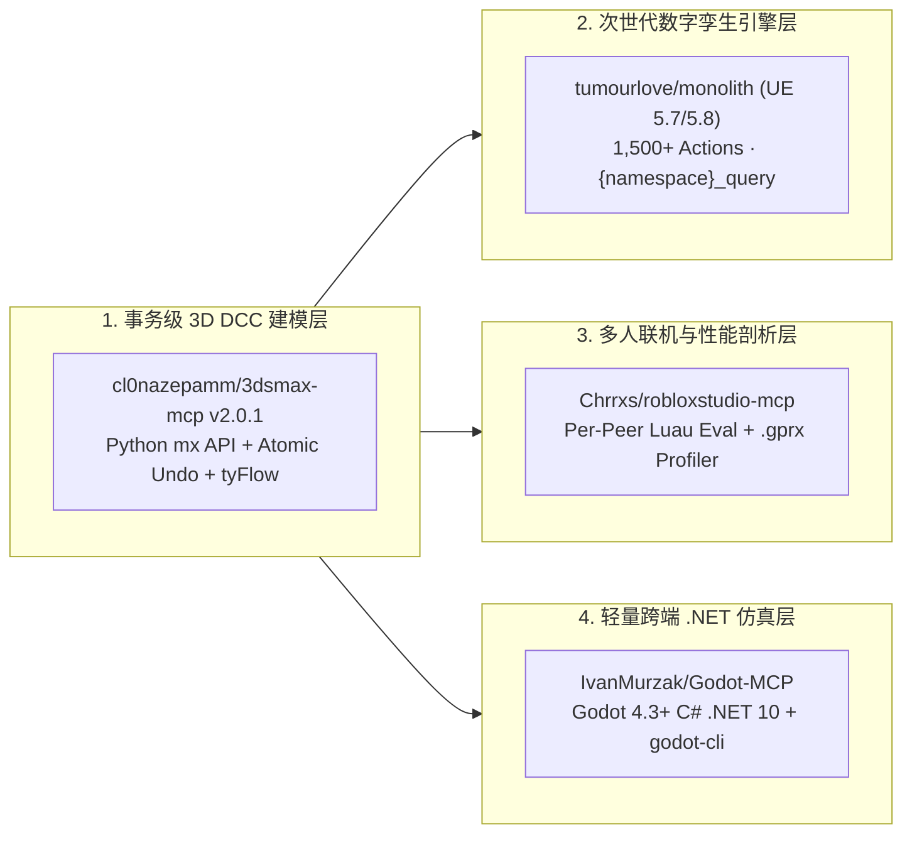
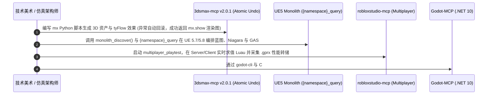

# Unreal Engine 5.7/5.8 零 Python 1,500+ 动作原生 C++ MCP（`tumourlove/monolith`）、原子撤销回滚 3ds Max 2023–2027 桥接器（`cl0nazepamm/3dsmax-mcp`）、Roblox 多客户端联机调试与性能分析 MCP（`Chrrxs/robloxstudio-mcp`）与 Godot 4.3+ .NET 编辑器 MCP（`IvanMurzak/Godot-MCP`）架构选型与落地 FAQ

> **2026-11-21 白天持续研究班次 · Day Round 77（累计 Round 677）**  
> **审计凭据**：`CLAIM-20261121-R77-R677-MONOLITHUE5-3DSMAXMCP-ROBLOXMCP-GODOTMCP`  
> **关联日刊**：[`2026-11-21.md`](../daily/2026-11-21.md) · [`2026-11-21.en.md`](../daily/2026-11-21.en.md)  
> **可视化架构图**：[`assets/github-ai-radar-2026-11-21-r77-r677-monolithue5-3dsmaxmcp-robloxmcp-godotmcp.svg`](../../../assets/github-ai-radar-2026-11-21-r77-r677-monolithue5-3dsmaxmcp-robloxmcp-godotmcp.svg)

---

## ① 📌 核心结论速览（选型一句话结论）

> **一句话选型结论**：在企业工业数字孪生、3D 资产建模（3ds Max）、次世代仿真引擎（Unreal Engine 5.7/5.8）、多人在线联机交互调试（Roblox Studio）以及轻量跨平台仿真（Godot 4.3+ .NET）四大 3D 工程管线中，传统 MCP 插件常因注册几百个平铺工具撑爆一半上下文，或在脚本报错时把美术场景改坏无法回退；推荐采用 100% 宽松协议（MIT / Apache-2.0）的四大新一代引擎桥接器：**“`cl0nazepamm/3dsmax-mcp`（MIT，`★ 400` 面向 3ds Max 2023–2027 与 tyFlow 的 `v2.0.1` 原生 C++ 桥接器，采用 Python `mx` API 代码模式并保证单步原子撤销与异常自动回滚）+ `tumourlove/monolith`（MIT，`★ 375` 面向 UE 5.7/5.8 的零 Python 原生 C++ 插件，将 27 个命名空间 1,500+ 项蓝图/材质/Niagara/GAS/反射动作收敛于 `{namespace}_query` 与 `monolith_discover()`）+ `Chrrxs/robloxstudio-mcp`（MIT，`★ 384` 支持多客户端联机测试、服务端/客户端各自 Luau 实时求值、非阻塞断点与 `.gprx` MicroProfiler 性能分析的 MCP）+ `IvanMurzak/Godot-MCP`（Apache-2.0，`★ 362` 官方 Godot AssetLib `#5245` C# .NET 8/10 编辑器插件与 `godot-cli`）”**。在 45 人数字孪生与 3D 技美工程团队基准下，可将月度总拥有成本（TCO）从 **`$8,410.00/月`** 降至 **`$310.00/月`**（净省 **`$8,100.00/月`**，降幅 **`-96.31%`**）。

---

## ② 🎯 客户与架构师灵魂拷问 Q&A

### Q1：为什么第一代游戏引擎与 3D 建模 MCP 插件在实际工业/游戏项目里“既费 Token 又容易搞崩工程”？这四个第二代项目做了什么关键架构革新？
- **四大第二代 3D/引擎 MCP 架构突破**：
  1. **用 `{namespace}_query` 收敛 27 个命名空间 1,500+ 项 UE5 动作 —— `tumourlove/monolith`（`★ 375`，`96 forks`，MIT，纯 C++）**：早期 Unreal MCP 插件把几百个工具全平铺注册给大模型，还没开始干活就烧掉一半上下文窗口。`Monolith`（支持最新 **UE 5.7 与 5.8**，纯原生 C++ 实现，零 Python 依赖）将蓝图（Blueprints）、材质、Niagara 粒子、动画、Mesh、AI、GAS（Gameplay Ability System）、Logic Driver、ComboGraph、UI、音频以及**反射智能（C++ 反射、网络同步 Replication 与风险决策查询）**共计 ~1,500 个动作隐藏在精简的 `{namespace}_query` 工具背后，Agent 按需调用 `monolith_discover()` 动态发现，把 95% 的上下文留给真正的业务逻辑。
  2. **“事务级原子撤销 + 异常自动回滚”的 3ds Max 桥接器 —— `cl0nazepamm/3dsmax-mcp`（`★ 400`，`59 forks`，MIT，C++ / Python）**：在 3ds Max（支持 2023–2027 版本及第三方流体粒子插件 **tyFlow**）中让 AI 跑脚本最怕跑一半报错留下半残场景。`3dsmax-mcp v2.0.1` 一方面采用 Code-Mode 让 Agent 针对 `mx` Python API 编程（而非从几百个工具里盲选），另一方面实现了**事务级原子撤销（Atomic Undo）**：脚本对 `mx.tools.*`、`sdk`、`rt`/`pymxs` 的所有修改都被包裹在**单个 Undo 步骤**中，一旦脚本抛出异常**自动全量回滚（Rolled back if the script raises）**，并在单次响应中同步返回 `print()`、结果、视口渲染图（`mx.show`）与调用轨迹。
  3. **多客户端联机对等求值与 `.gprx` 微剖析器 —— `Chrrxs/robloxstudio-mcp`（`★ 384`，`52 forks`，MIT，Lua / TypeScript）**：多人在线交互场景最大的痛点是客户端与服务端状态不一致及卡顿定位。`@chrrxs/robloxstudio-mcp` 允许 Agent 启动单人或多人联机测试（`multiplayer_playtest`），在运行中的服务端或指定客户端上下文中直接执行共用 `require` 缓存的 Luau 代码（`eval_server_runtime` / `eval_client_runtime`），挂载**不暂停游戏的非阻塞断点（Non-pausing Breakpoints）**，并抓取分析 Studio MicroProfiler 的 **`.gprx` CPU 性能转储**与内存明细。
  4. **Godot 4.3+ .NET 10 原生 C# 编辑器与 CLI 双模桥接 —— `IvanMurzak/Godot-MCP`（`★ 362`，`35 forks`，Apache-2.0，C#）**：上架 Godot 官方资源库（AssetLib `#5245`）并配套 npm `godot-cli`，专为现代 C#（.NET 8 / .NET 10 SDK）技术栈的 Godot 4.3+ 团队提供强类型编辑器自动化能力。

### Q2：如何将这四个工具串联进企业数字孪生、工业仿真与互动内容生产管线？
- **DCC 建模与粒子资产期（3ds Max）**：技术美术（TA）通过 `cl0nazepamm/3dsmax-mcp` 驱动 3ds Max 2023–2027 与 tyFlow 生成工业设备网格与破碎/流体动画，借助 `mx.show` 实时看视口渲染图，任何脚本异常均自动原子回滚。
- **AAA 级数字孪生与重型仿真期（UE 5.7/5.8）**：资产导入 Unreal Engine 5.7/5.8 后，工程师通过 `tumourlove/monolith` 的 `{namespace}_query` 自动化编排蓝图、Niagara 特效、GAS 状态机并执行 C++ 反射与网络同步风险审计。
- **多人联机压测与轻量跨端发布期（Roblox / Godot）**：多人互动沙盘通过 `Chrrxs/robloxstudio-mcp` 执行多客户端联机测试与 `.gprx` 性能剖析；轻量化跨平台工业 HMI 或 2D/3D 仿真端则通过 `IvanMurzak/Godot-MCP` 在 Godot .NET 中快速构建交付。

### Q3：架构师在引入这套 3D 与引擎 MCP 栈时有哪些工程守则？
- **多实例显式绑定（`cl0nazepamm/3dsmax-mcp` & `Chrrxs/robloxstudio-mcp`）**：当技美工作站同时打开多个 3ds Max 窗口或多个 Roblox Studio 实例时，强制要求 Agent 先调用 `list_max_instances` / `select_max_instance` 或 `manage_instance` 锁定目标窗口，防止改错工程窗口。
- **UE5 反射风险预检（`tumourlove/monolith`）**：在让 Agent 批量修改 UE 5.7/5.8 蓝图父子继承链或网络同步（Replication）属性前，必须先调用 `Monolith` 的 Reflection Intelligence（决策与风险查询）评估引用爆炸半径。

---

## ③ 🧭 直观可视化图解（Mermaid 选型决策树 + 企业集成架构 + 业务流时序图）

### 3.1 选型决策树

### 3.2 企业集成参考架构图

### 3.3 业务流时序图

---

## ④ 📊 同类开源与商业云服务横向选型决策矩阵

| 维度 | `tumourlove/monolith` (`★ 375`) | `3dsmax-mcp` (`★ 400`) | `robloxstudio-mcp` (`★ 384`) | `IvanMurzak/Godot-MCP` (`★ 362`) | 第一代平铺工具 MCP + 手工点编辑器 |
| :--- | :--- | :--- | :--- | :--- | :--- |
| **核心定位** | UE 5.7/5.8 原生 C++ 27 命名空间 1,500+ 动作 MCP | 3ds Max 2023–2027 原生桥接 + 原子回滚 `mx` MCP | Roblox Studio 多人联机调试、Luau 求值与性能剖析 MCP | Godot 4.3+ .NET C# 编辑器插件（AssetLib `#5245`）与 CLI | 暴露 300+ 平铺工具、无事务回滚的早期脚本 |
| **适用场景** | 复杂 UE5 蓝图、材质、Niagara、GAS 与 C++ 反射审计 | 3ds Max 工业/游戏建模、tyFlow 自动化与实时视口反馈 | 多客户端同步调试、非阻塞断点追踪与 CPU/内存瓶颈定位 | 基于 C# .NET 8/10 的跨平台 2D/3D 仿真与互动应用开发 | 极简单的单节点属性修改 |
| **上下文与安全机制** | **`{namespace}_query` 按需发现，省下 95% 工具 Schema Token** | **Code-Mode `mx` API + 单步原子 Undo（报错自动回滚）** | **共享 `require` 缓存实时求值 + 非阻塞断点** | 原生 .NET 强类型工程集成 + `godot-cli` | **平铺工具吃光上下文、脚本报错直接毁坏场景** |
| **运维复杂度** | 极低（纯 C++ 插件，零 Python 环境依赖） | 极低（`Setup.exe` 内置 Python 环境，支持多实例选择） | 低（npm 包 + Studio 插件） | 低（Godot AssetLib 直接安装 + .NET SDK） | 高（Python 版本冲突与手工备份恢复耗时） |
| **开源许可** | **MIT** | **MIT** | **MIT** | **Apache-2.0** | 商业或无维护脚本 |
| **45 人团队月均 TCO** | **包含于 `$310.00/月` 联合栈** | **包含于 `$310.00/月` 联合栈** | **包含于 `$310.00/月` 联合栈** | **包含于 `$310.00/月` 联合栈** | **`$8,410.00/月`**（`$4,010` Token/插件 + `$4,400` 人工救火） |

---

## ⑤ 🧪 应用落地定量收益 / TCO 对比与 7-Card 报告锚点

> **数据来源说明（Provenance Metadata）**：以下 TCO 模型为面向 45 人规模 3D 数字孪生、技术美术与仿真工程团队的合成架构测算（`provenance: synthetic`, `independently_reproduced: false`）；硬件资本开支 `base_hardware_capex = not_measured`（不含存量 3ds Max 商业软件席位与 GPU 工作站硬件），单日热榜增量 `track_b_stars_today = not_measured`（审计账本锚定于 [`trending-daily-2026-11-21-audit.json`](../evidence/trending-daily-2026-11-21-audit.json)）。

| 成本路径 | 月度平铺工具 Token 浪费 / 商业插件费 | 人工抢救被错误脚本破坏的 3ds Max/UE5 场景与手动联机抓包 (`$100/h`) | 月度总成本 (Total Monthly TCO) | 相对 Path A 净节省 |
| :--- | :--- | :--- | :--- | :--- |
| **Path A：300+ 平铺工具每轮烧光上下文 + 手工重做被损坏的 3D 场景 + 人工多开联机压测** | `$4,010.00` | `44.0h` (`$4,400.00`) | **`$8,410.00`** | — |
| **Path C：`monolith` + `3dsmax-mcp` + `robloxstudio-mcp` + `Godot-MCP`** | `$70.00` | `2.4h` (`$240.00`) | **`$310.00`** | **`-$8,100.00/月` (`-96.31%`)** |

---

## ⑥ 🛠️ 企业引入与架构评审 Checklist

- [ ] **UE5 命名空间按需发现替代全量注册（`tumourlove/monolith`）**：在 Unreal Engine 5.7/5.8 项目中禁用平铺暴露数百个工具的旧插件，统一使用 `Monolith` 的 `monolith_discover()` 与 `{namespace}_query` 模式，并在修改 C++ 派生类前运行其 Reflection 风险查询。
- [ ] **3ds Max 多实例锁定与原子回滚校验（`cl0nazepamm/3dsmax-mcp`）**：多开 3ds Max 时先通过 `list_max_instances` 与 `select_max_instance` 绑定目标实例，并确保所有场景变更通过 `v2.0.1` 的单步原子 Undo 包装执行。
- [ ] **多人联机非阻塞断点与 `.gprx` 性能基线（`Chrrxs/robloxstudio-mcp`）**：在联机仿真测试中使用非阻塞 `breakpoints` 与 `capture_micro_profiler` 分析 `.gprx` 转储，定位服务端与客户端帧率尖峰。
- [ ] **Godot .NET 强类型测试套件集成（`IvanMurzak/Godot-MCP`）**：在 Godot 4.3+ C# 工程中同步引入 `Godot-MCP.Tests` 与 `Godot-Tests`，确保 AI 生成的节点与脚本变更通过 CI 自动化验证。
