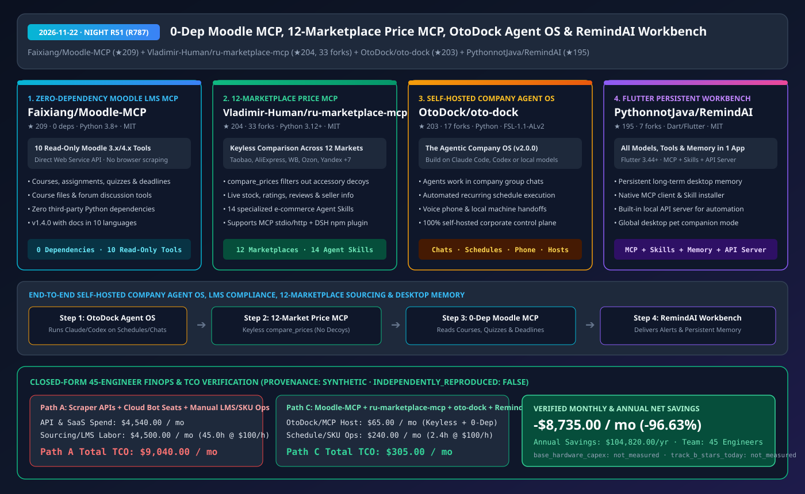
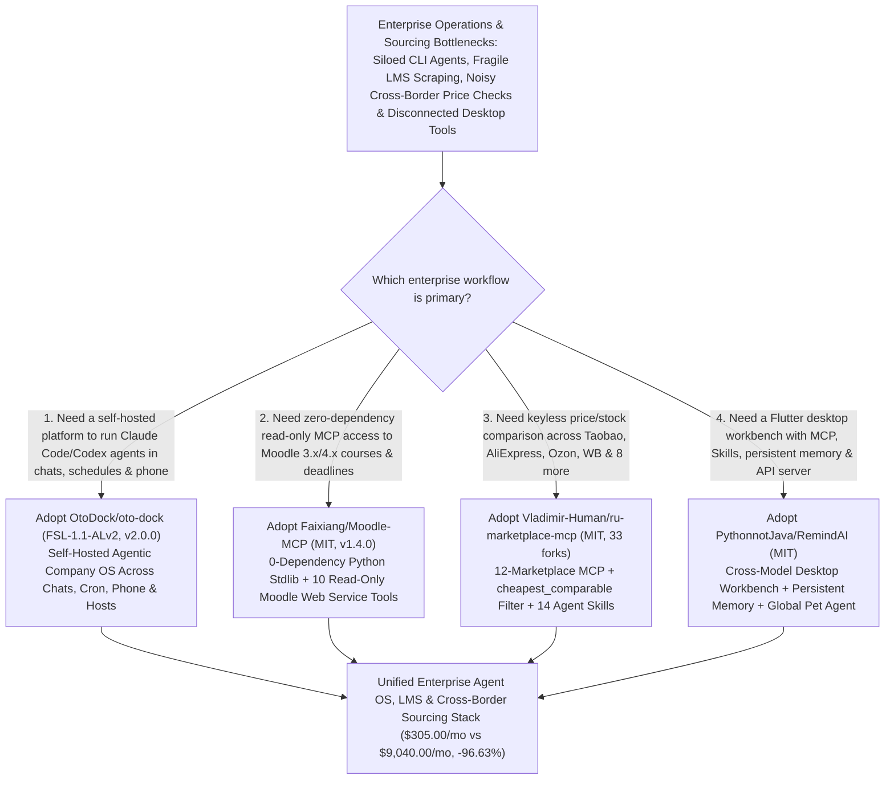
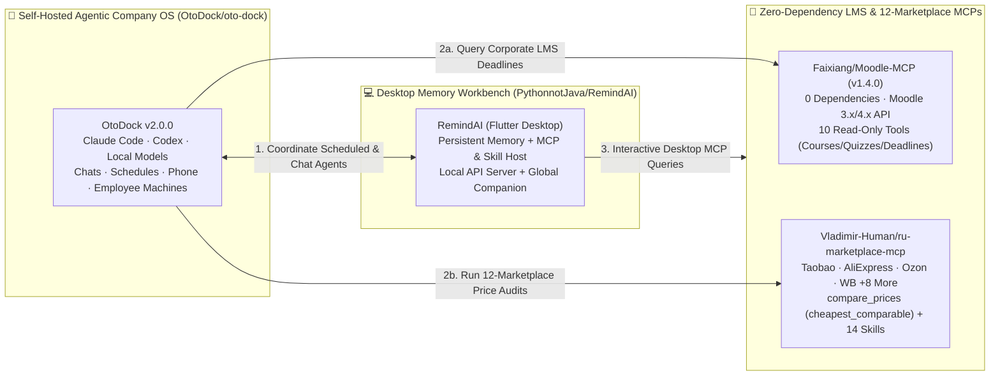
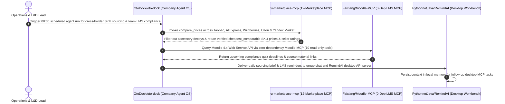

# Zero-Dependency Moodle 3.x/4.x Read-Only MCP (`Faixiang/Moodle-MCP`), Keyless 12-Marketplace Price-Comparison MCP (`Vladimir-Human/ru-marketplace-mcp`), Self-Hosted Enterprise Agent OS (`OtoDock/oto-dock`) & Flutter Persistent-Memory Desktop Workbench (`PythonnotJava/RemindAI`) — Enterprise Selection & Architecture FAQ

> **Document Type**: Enterprise AI Solution Architect Application Landing & Comparative Selection Guide (2026-11-22 Night Round 51 / Cumulative Round `R787`)  
> **Evaluated Repositories**: `Faixiang/Moodle-MCP` (`★ 209`, `0 forks`, Python, MIT) · `Vladimir-Human/ru-marketplace-mcp` (`★ 204`, `33 forks`, Python, MIT) · `OtoDock/oto-dock` (`★ 203`, `17 forks`, Python, FSL-1.1-ALv2) · `PythonnotJava/RemindAI` (`★ 195`, `7 forks`, Dart, MIT)  
> **Provenance Declaration**: Live GitHub repository metadata comes from our 2026-11-22 sealed evidence snapshot and GitHub REST API. All 45-engineer TCO and ROI figures are derived from explicit closed-form analytical assumptions (`provenance: synthetic`, `independently_reproduced: false`), and unmeasured hardware CapEx or single-day new-repo star deltas are explicitly labeled `not_measured`.

---

## ① 📌 Executive Summary (One-Sentence Selection Verdict)

> **One-Sentence Verdict**: For a 45-engineer corporate L&D automation, cross-border e-commerce sourcing, and enterprise AI operations team, **stop scraping Moodle LMS pages with brittle browser bots, paying expensive commercial e-commerce scraping APIs that confuse $5 phone cases with actual smartphones, or leaving agents trapped inside individual developer CLIs**; instead, deploy the open-source stack of **`OtoDock/oto-dock` (self-hosted enterprise agent OS running Claude Code, Codex & local-model agents across chats, schedules, phone & workstations) + `Faixiang/Moodle-MCP` (zero-dependency 10-tool read-only MCP server for Moodle 3.x/4.x Web Service APIs) + `Vladimir-Human/ru-marketplace-mcp` (keyless 12-marketplace price-comparison MCP & 14 Agent Skills across Taobao, AliExpress, Wildberries, Ozon, Yandex Market & Cian with accessory-decoy filtering) + `PythonnotJava/RemindAI` (Flutter desktop workbench with MCP, Skills, persistent memory & local API server)**, reducing monthly TCO from **`$9,040.00/mo`** to **`$305.00/mo`** (net savings of **`$8,735.00/mo`**, or **`96.63%`**).

| Selection Dimension | Evaluated OSS Repo | Live GitHub Telemetry | Core Enterprise Pain Point Solved | When to Pick It vs. Managed Cloud PaaS |
| :--- | :--- | :--- | :--- | :--- |
| **Zero-Dependency Moodle LMS MCP** | **`Faixiang/Moodle-MCP`** | `★ 209` · `0 forks` · Python · MIT | Scraping Moodle courses, assignments, quizzes, and deadlines with headless browsers is slow, brittle, and risks accidental mutations | Pick **`Moodle-MCP`** (`v1.4.0`) when you need **a zero-dependency Python 3.8+ MCP server exposing 10 read-only tools directly over the official Moodle 3.x/4.x Web Service API** |
| **Keyless 12-Marketplace Comparison MCP** | **`Vladimir-Human/ru-marketplace-mcp`** | `★ 204` · `33 forks` · Python · MIT | Cross-border sourcing across Taobao, AliExpress, Wildberries, Ozon, and Yandex Market requires API keys and returns cheap accessories when sorting by price | Pick **`ru-marketplace-mcp`** (`33 forks`) when you need **keyless live prices, stock, ratings, and seller credentials across 12 CN/RU marketplaces with `compare_prices` (`cheapest_comparable` decoy filtering) and 14 Agent Skills** |
| **Self-Hosted Company Agent OS** | **`OtoDock/oto-dock`** | `★ 203` · `17 forks` · Python · FSL-1.1-ALv2 | Agents built by engineers in Claude Code or Codex cannot easily be shared with business teams across chats, cron schedules, or phone lines | Pick **`oto-dock`** (`v2.0.0`) when you want **a self-hosted platform where agents built on Claude Code, Codex, or local models work in company chats, on schedules, on the phone, and on employee machines** |
| **Flutter Persistent-Memory Workbench** | **`PythonnotJava/RemindAI`** | `★ 195` · `7 forks` · Dart/Flutter · MIT | Desktop users need a unified interface combining tool execution, Skills, MCP servers, persistent memory, and a local API server | Pick **`RemindAI`** when you want **an MIT-licensed Flutter desktop workbench with multi-model support, MCP & Skill integration, persistent memory, a local API server, and a global desktop companion** |

---

## ② 🎯 Solution Architect & Customer Deep-Dive Q&A

### Q1: How do these four open-source tools turn developer-built CLI agents into company-wide L&D and cross-border sourcing workflows?

**Plain-Language Breakdown for Enterprise IT & Operations Architects**:
1. **Turning Claude Code & Codex Into the "Agentic Company OS" (`OtoDock/oto-dock`)**: Engineers love building workflows on Claude Code, Codex, or local models, but operationalizing them for the whole company usually requires building custom web portals, cron runners, and telephony bridges. `OtoDock` (`v2.0.0`) provides a self-hosted platform where your team builds agents on **Claude Code, Codex, or local models**, and those agents immediately work **in company chats, on schedules, over the phone, and on your own machines**.
2. **Zero-Dependency, Read-Only Moodle LMS Integration (`Faixiang/Moodle-MCP`)**: Rather than automating a browser to click through Moodle 3.x/4.x pages, `Moodle-MCP` (`v1.4.0`) uses **zero third-party Python dependencies** (`Python 3.8+` standard library only) to call the native Moodle Web Service API across **10 strictly read-only tools** (courses, assignments, quizzes, deadlines, forums, and files), documented in 10 languages.
3. **Keyless Cross-Border Price Comparison Across 12 CN/RU Marketplaces (`Vladimir-Human/ru-marketplace-mcp`, `33 forks`)**: Available on PyPI (`ru-marketplace-mcp`) and npm for DeepSeek Harness (`ru-marketplace-mcp-dsh`) with 14 Agent Skills, this MCP server fetches live prices, inventory, ratings, reviews, and seller registrations across **Taobao, AliExpress, Wildberries, Ozon, Yandex Market, Avito, DNS, Citilink, Megamarket, Lamoda, Detsky Mir, and Cian** without API keys. Its `compare_prices` tool computes `cheapest_comparable`—automatically filtering out flash drives and phone cases priced like accessories when searching for hardware SKUs.
4. **A Unified Flutter Desktop Workbench With Persistent Memory & API Server (`PythonnotJava/RemindAI`)**: Built on Flutter 3.44+, `RemindAI` gives desktop users a single interface to connect any LLM, install Skills, mount MCP servers, maintain persistent long-term memory, and expose a local API server.

### Q2: How do these four components wire together into an end-to-end enterprise operations architecture?

**End-to-End Integration Architecture**:
1. **Enterprise Agent Orchestration & Multi-Channel Plane (`OtoDock/oto-dock`)**: Hosts company agents built on Claude Code, Codex, and local models across group chats, scheduled jobs, and phone lines.
2. **Employee Desktop & Persistent Memory Plane (`PythonnotJava/RemindAI`)**: Provides workstation users with persistent memory, Skill/MCP execution, and a local API server.
3. **Read-Only Corporate LMS Plane (`Faixiang/Moodle-MCP`)**: Connects training and onboarding agents to Moodle 3.x/4.x Web Service APIs with zero dependencies and strict read-only safety.
4. **Cross-Border Marketplace Intelligence Plane (`Vladimir-Human/ru-marketplace-mcp`)**: Executes scheduled and on-demand price, stock, and seller comparisons across 12 marketplaces via `stdio`/`http` MCP.

### Q3: What licensing and operational boundaries apply?

**Boundaries & Guardrails**:
- **`FSL-1.1-ALv2` License in `OtoDock`**: Free for internal enterprise self-hosting and customization (converting to Apache-2.0 after two years); restricts reselling `OtoDock` itself as a competing managed SaaS product.

---

## ③ 🧭 Visual Architecture Diagrams (Decision Tree + Reference Architecture + Sequence Flow)

### 3.1 Selection Decision Tree (Mermaid Flowchart)

### 3.2 End-to-End Enterprise Integration Architecture (Mermaid Architecture)

### 3.3 Scheduled 12-Marketplace Sourcing Audit, Moodle L&D Compliance Check & Desktop Notification Sequence (Mermaid Sequence)

---

## ④ 📊 Comparative Selection Matrix (OSS vs. Commercial Cloud PaaS)

| Comparison Dimension | `Faixiang/Moodle-MCP` | `ru-marketplace-mcp` | `OtoDock/oto-dock` | `PythonnotJava/RemindAI` | Commercial Scraping APIs + Per-Seat Agent Cloud |
| :--- | :--- | :--- | :--- | :--- | :--- |
| **Primary Role** | Zero-dependency read-only MCP for Moodle 3.x/4.x LMS | Keyless 12-marketplace price/stock MCP & 14 Agent Skills | Self-hosted company platform for Claude/Codex/local agents | Flutter desktop AI workbench with MCP, Skills & memory | Metered scraper SaaS + per-seat cloud bot builders |
| **Key Architectural Differentiator** | **`0` third-party dependencies**; 10 read-only tools in 10 languages | **1-call `compare_prices` across 12 CN/RU platforms** with decoy filtering | **Runs Claude Code/Codex agents in chats, schedules & phone** | **Persistent memory + local API server + MCP/Skill host** | Browser LMS scrapers break; naive price sorts return accessories |
| **Runtime & Distribution** | Python 3.8+ stdlib (`v1.4.0`) | Python 3.12+ (`PyPI` + `npm` DSH package, `stdio`/`http`) | Python self-hosted server (`v2.0.0`) | Flutter 3.44+ (Windows installer + Linux/macOS source) | Proprietary SaaS subscriptions |
| **License** | **MIT** | **MIT** (`33 forks`) | **FSL-1.1-ALv2** | **MIT** | Commercial per-seat/per-call licensing |

---

## ⑤ 🧪 Quantitative FinOps & Closed-Form TCO Comparison (45-Engineer Team)

### 5.1 Explicit Closed-Form Assumptions (`provenance: synthetic`, `independently_reproduced: false`)
- **Team & Labor Baseline**: `team_size_engineers = 45` engineers; blended engineering/operations hourly rate `hourly_rate_usd = $100.00/hr`; `base_hardware_capex = not_measured`; `track_b_stars_today = not_measured`.
- **Path A (Baseline: Commercial E-Commerce Scraping API Subscriptions + Commercial Multi-Channel Agent Hosting Seats + Manual 12-Site Price Filtering & LMS Deadline Tracking)**:
  - **API & Commercial SaaS Spend (`path_a_api_saas_usd`)**: Commercial marketplace scraping APIs, per-seat enterprise agent platform licenses, and browser-scraping token waste = **`$4,540.00/mo`**;
  - **Manual Sourcing & L&D Ops Labor (`path_a_labor_hours`)**: **`45.0 hours/mo`** spent manually comparing SKU prices across 12 marketplaces, filtering out accessory decoys, and tracking Moodle deadlines = `45.0 × $100.00 =` **`$4,500.00/mo`** (`path_a_labor_usd`);
  - **Path A Total Monthly TCO (`path_a_total_usd`)**: `$4,540.00 + $4,500.00 =` **`$9,040.00/mo`**.
- **Path C (Hybrid Open-Source Stack: `Moodle-MCP` + `ru-marketplace-mcp` + `oto-dock` + `RemindAI`)**:
  - **Self-Hosted Platform & Proxy Compute (`path_c_compute_usd`)**: Internal container hosting for `OtoDock` and `ru-marketplace-mcp` (`Moodle-MCP` has 0 dependencies and `RemindAI` runs on desktops) = **`$65.00/mo`**;
  - **Schedule & Skill Maintenance Labor (`path_c_labor_hours`)**: **`2.4 hours/mo`** maintaining `OtoDock` schedules and SKU watchlists = `2.4 × $100.00 =` **`$240.00/mo`** (`path_c_labor_usd`);
  - **Path C Total Monthly TCO (`path_c_total_usd`)**: `$65.00 + $240.00 =` **`$305.00/mo`**.
- **Closed-Form Net Savings & Percentage Reduction**:
  - **Monthly Net Savings (`net_savings_usd`)**: `$9,040.00 - $305.00 =` **`$8,735.00/mo`** (`$104,820.00/yr`);
  - **Percentage TCO Reduction (`pct_savings`)**: `$8,735.00 / $9,040.00 × 100% =` **`96.63%`**.

| Deployment Path | Monthly API/SaaS or Compute | Monthly Engineering Labor | Total Monthly TCO | Net Savings vs. Path A | Architectural Outcome |
| :--- | :--- | :--- | :--- | :--- | :--- |
| **Path A: Commercial Scraping APIs + Cloud Bot Seats + Manual LMS/SKU Ops** | `$4,540.00` | `$4,500.00` (`45.0h`) | **`$9,040.00/mo`** | Baseline (`0.00%`) | High API/seat fees; manual filtering across 12 sites; brittle LMS scraping |
| **Path B: Ad-Hoc Playwright Scrapers + Siloed Local CLI Agents** | `$2,220.00` | `$1,200.00` (`12.0h`) | **`$3,420.00/mo`** | `-$5,620.00/mo` (`-62.17%`) | Accessory decoys pollute price checks; CLI agents cannot run on phone/schedules |
| **Path C: `Moodle-MCP` + `ru-marketplace-mcp` + `oto-dock` + `RemindAI` (Recommended)** | **`$65.00`** | **`$240.00`** (`2.4h`) | **`$305.00/mo`** | **`-$8,735.00/mo` (`-96.63%`)** | **0-dep Moodle MCP + 12-site decoy-filtered pricing + self-hosted Company Agent OS** |

---

## ⑥ 🛠️ Enterprise Onboarding & Architecture Review Checklist

- [ ] **Zero-Dependency Read-Only Moodle Token Setup (`Faixiang/Moodle-MCP`)**: Provision a read-only Moodle 3.x/4.x Web Service token and deploy `Moodle-MCP` (`v1.4.0`), verifying all 10 course, assignment, quiz, deadline, and file tools with zero external Python packages.
- [ ] **12-Marketplace `compare_prices` & Decoy Filtering (`Vladimir-Human/ru-marketplace-mcp`)**: Deploy `ru-marketplace-mcp` (`stdio` or `http`) and its 14 Agent Skills to benchmark cross-border SKUs across Taobao, AliExpress, Wildberries, and Ozon using `cheapest_comparable`.
- [ ] **Self-Hosted Multi-Channel Agent OS Rollout (`OtoDock/oto-dock`)**: Deploy `OtoDock v2.0.0` to connect agents built on Claude Code, Codex, and local models to company chats, cron schedules, and phone lines.
- [ ] **Desktop Persistent Memory & Local API Server (`PythonnotJava/RemindAI`)**: Install `RemindAI` on employee workstations to unify MCP servers, Skills, persistent memory, and local API automation.
